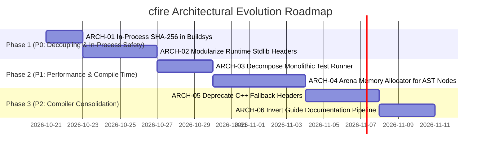

# Architectural Evolution & Technical Debt Backlog

This backlog catalogs the architectural improvements, decoupling initiatives, and performance optimizations identified during the Senior Engineer Codebase Review.

Tasks follow the standard operational protocol defined in [`docs/planning/README.md`](./README.md). When starting a task, promote it to [`docs/planning/active.md`](./active.md) and fulfill the pre-implementation scoping gate.

---

## Milestone Summary



---

## Phase 1: High Priority (P0 — Immediate Decoupling & In-Process Safety)

### `ARCH-01`: In-Process Cryptographic Hashing for Buildsys
- **Priority**: P0 (Immediate)
- **Category**: Build System / Portability / Subprocess Elimination
- **Target Files**:
  - `src/buildsys.hpp`
  - `src/buildsys.cf`
  - `runtime/cfire_core_stdlib.hpp`
- **Problem Statement**:
  In `src/buildsys.hpp` (lines 518–520), archive hash verification invokes external shell commands:
  ```cpp
  int sha_rc = 0;
  std::string sha_out = bridge::run_command_capture(
      std::format("shasum -a 256 \"{}\"", tmp_archive.string()), sha_rc);
  if (sha_rc != 0) {
      sha_out = bridge::run_command_capture(
          std::format("sha256sum \"{}\"", tmp_archive.string()), sha_rc);
  }
  ```
  Spawning `/bin/sh` to run external binaries:
  1. Fails on minimal container images (Alpine, distroless) or Windows environments where neither `shasum` nor `sha256sum` exists in `$PATH`.
  2. Incurs 15–30 ms of process creation latency per downloaded package archive.
  3. Ignores the fact that `cfire` already includes an optimized, self-hosted SHA-256 implementation in `cfire::sha256::hash_hex()` (`runtime/cfire_core_stdlib.hpp`).
- **Detailed Requirements**:
  1. Refactor `fetch_archive()` in `src/buildsys.hpp` to stream bytes from `tmp_archive` directly into `cfire::sha256::hash_hex()`.
  2. Remove subprocess spawning of `shasum` and `sha256sum`.
  3. Ensure identical lowercase hexadecimal digest format matching `.lock` files.
- **Acceptance Criteria**:
  - `cfire vendor` and `test_cfire_remote_vendor` pass cleanly without invoking external `shasum`/`sha256sum`.
  - Conformance test added verifying hash computation against known test vectors.
  - Zero subprocess spawns recorded for checksum verification.

---

### `ARCH-02`: Modularize Standard Library Runtime Headers (`runtime/core/*.hpp`)
- **Priority**: P0 (Immediate)
- **Category**: Runtime Architecture / Build Speed / Compilation Scalability
- **Target Files**:
  - `runtime/cfire_core_stdlib.hpp` (decomposition)
  - `runtime/core/*.hpp` (new modular headers)
  - `src/codegen.cf` & `src/codegen.hpp`
  - `src/buildsys.cf` & `src/buildsys.hpp`
- **Problem Statement**:
  `runtime/cfire_core_stdlib.hpp` is currently a monolithic **4,606-line header** containing 28 distinct modules (SQLite3, WebSockets, AES-256 GCM, HTTP router, SIMD JSON, RegEx, etc.).
  Whenever a user program imports *any* module (e.g., `import "core:math"`), `codegen` emits `#include "cfire_core_stdlib.hpp"`. The C++ compiler must parse all 4,606 lines, introducing 400–800 ms of parsing overhead per compilation unit.
- **Detailed Requirements**:
  1. Decompose `runtime/cfire_core_stdlib.hpp` into focused, single-responsibility headers:
     - `runtime/core/fs.hpp`
     - `runtime/core/cli.hpp`
     - `runtime/core/json.hpp`
     - `runtime/core/sqlite.hpp`
     - `runtime/core/crypto.hpp` (sha256, hmac, aes, blake3)
     - `runtime/core/net.hpp` (sockets, url, http, websocket)
     - `runtime/core/time.hpp`
     - `runtime/core/os.hpp`
     - `runtime/core/sync.hpp` (channel, context)
     - `runtime/core/str.hpp`
     - `runtime/core/math.hpp`
     - `runtime/core/encoding.hpp` (base64, hex, csv)
     - `runtime/core/regex.hpp`
     - `runtime/core/collections.hpp`
     - `runtime/core/unicode.hpp`
  2. Maintain `runtime/cfire_core_stdlib.hpp` as a thin umbrella header including all modules for backward compatibility and CMake ejection.
  3. Update `src/codegen.cf` to emit granular `#include "core/<module>.hpp"` statements corresponding strictly to the imports detected in `CheckedFile`.
- **Acceptance Criteria**:
  - Compiling `examples/01-hello-core/main.cf` only includes `core/fs.hpp` and `core/str.hpp`, reducing preprocessed line count by $>60\%$.
  - Compile time for small scripts (`cfire run examples/01-hello-core/main.cf`) drops by at least $3\times$.
  - All 30 conformance test suites pass with 100% parity.

---

## Phase 2: Medium Priority (P1 — Performance & Compile Time)

### `ARCH-03`: Decompose Monolithic Conformance Test Runner
- **Priority**: P1
- **Category**: Testing / Developer Iteration Speed
- **Target Files**:
  - `tests/conformance_test.cpp` (4,574 LOC)
  - `tests/unit/` (new directory)
  - `tests/e2e/` (new directory)
  - `Makefile`
- **Problem Statement**:
  `tests/conformance_test.cpp` compiles all 30 test suites (unit tests, language semantics, self-hosting benchmarks, end-to-end examples) in a single translation unit. A clean compile takes 12–15 seconds on modern multi-core machines, bottlenecking the developer feedback loop during TDD.
- **Detailed Requirements**:
  1. Partition `conformance_test.cpp` into independent suites:
     - `tests/unit/test_frontend.cpp` (Lexer, Parser, AST, Formatter, Refactor)
     - `tests/unit/test_sema.cpp` (Intent safety, mutability, move tracking)
     - `tests/unit/test_stdlib.cpp` (HTTP, WebSockets, SQLite, Crypto, Sync)
     - `tests/e2e/test_canonical.cpp` (Examples 01–11 end-to-end)
     - `tests/benchmarks/test_selfhost_parity.cpp` (12 self-hosting dogfood benchmarks)
     - `tests/test_main.cpp` (Shared test harness and runner entrypoint)
  2. Update `Makefile` to compile test objects in parallel (`-j$(nproc)`).
- **Acceptance Criteria**:
  - Full test execution finishes in $<3$ seconds on warm cache.
  - Test suites can be executed selectively (e.g., `make test-unit`, `make test-stdlib`, `make test-selfhost`).
  - Zero test regressions across all 30 test suites.

---

### `ARCH-04`: Arena Memory Allocator for AST Nodes
- **Priority**: P1
- **Category**: Compiler Performance / Memory Locality
- **Target Files**:
  - `src/ast.hpp` & `src/ast.cf`
  - `src/parser.hpp` & `src/parser.cf`
  - `runtime/cfire_prelude.hpp`
- **Problem Statement**:
  AST nodes currently use `using ExprPtr = std::shared_ptr<Expr>` and `using StmtPtr = std::shared_ptr<Stmt>`.
  Because AST trees have strict hierarchical ownership and are never modified after semantic analysis, `std::shared_ptr` incurs:
  1. Atomic reference count increments/decrements on every copy and traversal.
  2. Cache fragmentation across hundreds of individual heap allocations.
- **Detailed Requirements**:
  1. Implement a monotonic bump allocator (`ArenaAllocator` or `std::pmr::monotonic_buffer_resource`) tied to the lifetime of parsing a file.
  2. Transition `ExprPtr` and `StmtPtr` to non-atomic owning pointers or arena-backed references (`Expr*` allocated from the arena).
  3. Deallocate the entire arena en masse upon compilation completion.
- **Acceptance Criteria**:
  - Parser throughput benchmark in `test_selfhost_parser_parity_and_benchmark` increases by $\ge 25\%$.
  - Peak memory footprint during AST construction decreases by $\ge 30\%$.
  - Valgrind / ASan reports zero memory leaks.

---

## Phase 3: Lower Priority (P2 — Toolchain Consolidation & Documentation)

### `ARCH-05`: Deprecate Dual-Engine C++ Fallback Headers
- **Priority**: P2
- **Category**: Maintainability / Codebase Consolidation
- **Target Files**:
  - `src/lexer.hpp`, `src/parser.hpp`, `src/sema.hpp`, `src/codegen.hpp`, etc.
  - `src/bootstrap/`
  - `bootstrap/stage0/` (new archive directory)
- **Problem Statement**:
  Maintaining dual implementations of the compiler in both C++ (`src/*.hpp`) and `cfire` (`src/*.cf`) doubles maintenance overhead and risks semantic divergence.
- **Detailed Requirements**:
  1. Snapshot the stable C++ implementations into `bootstrap/stage0/` as a permanent bootstrapping artifact.
  2. Replace `src/*.hpp` with clean, thin dispatch wrappers around `src/bootstrap/*.generated.hpp`.
  3. Remove runtime `std::getenv("CFIRE_CXX_*")` fallback branches from the main compiler pipeline once CI stability is locked.
- **Acceptance Criteria**:
  - `src/*.hpp` total line count reduced by $>50\%$.
  - Compiler development happens exclusively in pure `.cf` source files.
  - Stage-0 bootstrap build verified via `make bootstrap-from-stage0`.

---

### `ARCH-06`: Invert Guide Documentation Pipeline
- **Priority**: P2
- **Category**: Documentation Engineering / Content Management
- **Target Files**:
  - `src/docgen.hpp` & `src/docgen.cf`
  - `docs/GUIDE.md`
  - `docs/guide.html`
- **Problem Statement**:
  `docs/GUIDE.md` is currently generated from ~1,000 lines of markdown embedded inside C++ raw string literals in `src/docgen.hpp` (`generate_guide_markdown()`).
  Authors must edit C++ code and recompile `cfire` to update documentation, which is awkward and error-prone.
- **Detailed Requirements**:
  1. Invert the pipeline: Make `docs/GUIDE.md` the authoritative source file on disk.
  2. Refactor `docgen` to parse `docs/GUIDE.md`, validate code blocks and links, and generate `docs/guide.html`.
  3. Ensure `./cfire doc --check` validates that `docs/guide.html` is up to date with `docs/GUIDE.md`.
- **Acceptance Criteria**:
  - Documentation authors can edit `docs/GUIDE.md` directly with immediate live markdown preview.
  - `src/docgen.hpp` line count reduced by ~1,000 lines.
  - `./cfire doc` compiles markdown to HTML cleanly.

---

## Technical Debt Item Matrix

| Task ID | Component | Complexity | Estimated Effort | Impact | Target Milestone |
| :--- | :--- | :---: | :---: | :---: | :---: |
| `ARCH-01` | Buildsys / SHA-256 | Low | 1–2 days | High | Phase 1 (P0) |
| `ARCH-02` | Runtime / Modular Headers | Medium | 3–4 days | High | Phase 1 (P0) |
| `ARCH-03` | Tests / Decomposed Suite | Medium | 2–3 days | Medium | Phase 2 (P1) |
| `ARCH-04` | Parser / AST Arena Allocator | High | 4–5 days | High | Phase 2 (P1) |
| `ARCH-05` | Frontend / Deprecate C++ | Medium | 3–4 days | High | Phase 3 (P2) |
| `ARCH-06` | Docgen / Invert Guide Pipeline | Low | 2–3 days | Medium | Phase 3 (P2) |
