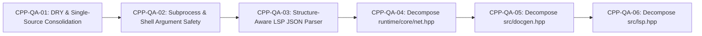

# Architectural Evolution & Code Quality Backlog

This backlog catalogs the senior-engineer code quality, security hardening, DRY consolidation, and modular decomposition tasks for the `cfire` ISO C++23 compiler and runtime.

Tasks follow the standard operational protocol defined in [`docs/planning/README.md`](./README.md). Every item includes explicit problem statements, target files, detailed engineering requirements, and measurable acceptance criteria for final validation.

---

## Active Code Quality & Architecture Hardening Backlog (`CPP-QA-01` – `CPP-QA-06`)

---

### `CPP-QA-01`: DRY & Single-Source-of-Truth Consolidation
- **Priority**: P0 (Immediate)
- **Category**: Code Quality / Maintainability / DRY
- **Target Files**:
  - `src/lexer.hpp`
  - `src/lexer_types.hpp`
  - `src/docgen.hpp`
  - `src/main.cpp`
- **Problem Statement**:
  1. **Duplicate Keyword Tables**: `src/lexer_types.hpp:178-210` defines `keyword_map()` and `find_keyword()`, while `src/lexer.hpp:18-47` defines an identical second 28-entry `keywords` hash table inside `tokenize()`.
  2. **Misplaced LLM Doc Sheet**: `src/main.cpp:443-479` embeds the 40-line `cfire doc --llm` reference string directly inside `main()` rather than inside the `cfire::doc` module (`src/docgen.hpp`).
  3. **Duplicate HTML Landing Template**: `src/docgen.hpp:1780-2090` embeds a 310-line fallback HTML landing page template that duplicates `docs/index.template.html` and can silently drift out of sync.
- **Detailed Requirements**:
  1. In `src/lexer.hpp`, remove the local `static const std::unordered_map<std::string_view, TokenKind> keywords` map and use `find_keyword(lex)` from `src/lexer_types.hpp`.
  2. Move the `--llm` reference string into `cfire::doc::generate_llm_reference()` in `src/docgen.hpp` and call it from `src/main.cpp`.
  3. In `src/docgen.hpp`, make `docs/index.template.html` the single authoritative landing page template (matching how `docs/GUIDE.md` is authoritative for `guide.html`), replacing the 310-line inline duplicate with a concise diagnostic fallback and verifying `index.template.html` existence in `sync_docs_directory(..., check_only)`.
- **Validation & Acceptance Criteria**:
  - Zero duplicate keyword maps across `src/lexer*.hpp`.
  - `src/docgen.hpp` shrinks by ~300 LOC without any change to generated `docs/index.html`, `docs/guide.html`, `docs/reference.html`, or `docs/STDLIB_REFERENCE.md`.
  - `./cfire doc --llm` and `./cfire doc --check` pass 100%.

---

### `CPP-QA-02`: Subprocess & Shell Argument Hardening
- **Priority**: P0 (Immediate)
- **Category**: Security / Subprocess Hygiene / Reliability
- **Target Files**:
  - `src/clang_bridge.hpp`
  - `src/main.cpp`
  - `src/buildsys.hpp`
  - `tests/unit/test_stdlib.cpp`
- **Problem Statement**:
  1. `src/main.cpp:279` invokes `std::system(eval_bin.string().c_str())` without quoting `eval_bin`, which fails if `TMPDIR` contains spaces, and `src/main.cpp:760-762` wraps `run_args` in `"..."` without escaping embedded double quotes, backslashes, backticks, or `$` expansion characters.
  2. `src/buildsys.hpp:103` (`query_pkg_config`) concatenates `"pkg-config --cflags " + pkg` without shell-quoting `pkg`.
- **Detailed Requirements**:
  1. Add a canonical POSIX shell quoting helper `cfire::bridge::shell_quote(std::string_view arg)` in `src/clang_bridge.hpp` (using single-quote wrapping `'...'` with `'\''` escaping, which neutralizes all shell metacharacters including `$`, `` ` ``, `"`, `\`, and spaces).
  2. Use `cfire::bridge::shell_quote` for binary paths and forwarded arguments in `src/main.cpp` (`eval`, `run`, `test`) and `src/buildsys.hpp` (`query_pkg_config`).
  3. Add an automated regression test verifying that `cfire run` and `cfire eval` safely handle arguments containing spaces, double quotes, and `$HOME`-style dollar signs without shell expansion or splitting.
- **Validation & Acceptance Criteria**:
  - `cfire run` forwards arguments containing spaces, `"quotes"`, and `$LITERAL_DOLLAR` verbatim to `os.args()` without shell evaluation.
  - Zero raw unquoted path interpolations in `src/main.cpp`.

---

### `CPP-QA-03`: Structure-Aware JSON-RPC Field Extraction in `src/lsp.hpp`
- **Priority**: P1
- **Category**: Language Server Protocol / Parser Robustness
- **Target Files**:
  - `src/lsp.hpp`
  - `tests/unit/test_frontend.cpp`
- **Problem Statement**:
  - `detail::extract_json_string(json, key)`, `extract_json_int(json, key)`, and `extract_json_id(json)` in `src/lsp.hpp:86-155` use raw `json.find("\"key\"")`.
  - If an LSP client sends a JSON-RPC payload where `"text"` (the `.cf` source code buffer) appears *before* `"uri"`, `"newName"`, `"line"`, or `"id"`, and the `.cf` file itself contains a string literal like `"\"newName\": \"foo\""` or `"\"line\": 999"`, raw substring search matches inside the `.cf` source string instead of the JSON-RPC protocol field.
- **Detailed Requirements**:
  1. Implement a structure-aware JSON key scanner `detail::find_json_key(std::string_view json, std::string_view key, std::size_t start_pos = 0)` in `src/lsp.hpp` that properly skips over JSON string literal values (respecting `\"` and `\\` escapes) so keys are only matched at actual JSON object key positions (followed by `:`) outside of string values.
  2. Route `extract_json_string`, `extract_json_int`, and `extract_json_id` through `find_json_key`.
  3. Add a unit test in `tests/unit/test_frontend.cpp` sending a `textDocument/didChange` and `textDocument/rename` message whose `"text"` field precedes `"newName"` / `"uri"` and contains adversarial `"\"newName\": \"wrong\""` and `"\"line\": 9999"` substrings, verifying the LSP extracts the true protocol fields.
- **Validation & Acceptance Criteria**:
  - Adversarial JSON-RPC payloads with embedded JSON keys inside `"text"` parse 100% accurately.
  - All existing LSP conformance tests in `test_formatter_lsp_and_docgen` pass.

---

### `CPP-QA-04`: Decompose `runtime/core/net.hpp` (`1,436 LOC`) into Modular `runtime/core/net/*.hpp`
- **Priority**: P1
- **Category**: Runtime Architecture / Header Modularization
- **Target Files**:
  - `runtime/core/net.hpp`
  - `runtime/core/net/tcp.hpp`
  - `runtime/core/net/url.hpp`
  - `runtime/core/net/http.hpp`
  - `runtime/core/net/websocket.hpp`
- **Problem Statement**:
  - `runtime/core/net.hpp` (`1,436 LOC`) is by far the largest header in `runtime/core/`, combining 4 distinct networking subsystems (`core:net` TCP sockets, `core:net/url` RFC 3986 URL parser, `core:net/http` HTTP/1.1 client/server/router, and `core:net/websocket` RFC 6455 WebSockets) into one file.
- **Detailed Requirements**:
  1. Extract `cfire::net` (TCP sockets & listener) into `runtime/core/net/tcp.hpp`.
  2. Extract `cfire::net::url` (RFC 3986 parsing & percent-encoding) into `runtime/core/net/url.hpp`.
  3. Extract `cfire::net::http` (HTTP/1.1 wire parser, client, server, and standalone `Router`) into `runtime/core/net/http.hpp`.
  4. Extract `cfire::net::websocket` (RFC 6455 framing, SHA-1 handshake, client/server/pair) into `runtime/core/net/websocket.hpp`.
  5. Turn `runtime/core/net.hpp` into a clean umbrella header that includes the 4 sub-headers, ensuring `cfire eject` (which copies `runtime/core` recursively) continues to work out of the box.
- **Validation & Acceptance Criteria**:
  - Each header in `runtime/core/net/` is self-contained and under ~650 LOC.
  - `test_http_client_server_and_urls`, `test_net_websocket`, `test_net_http_and_router`, and `test_relocatable_cmake_ejection` pass 100%.

---

### `CPP-QA-05`: Decompose `src/docgen.hpp` (`2,767 LOC`) into Modular `src/docgen/*.hpp`
- **Priority**: P1
- **Category**: Compiler Modularization / Documentation Engine
- **Target Files**:
  - `src/docgen.hpp`
  - `src/docgen/catalog.hpp`
  - `src/docgen/styles.hpp`
  - `src/docgen/markdown.hpp`
  - `src/docgen/html.hpp`
- **Problem Statement**:
  - `src/docgen.hpp` mixes the 28-module `stdlib_catalog()`, `diagnostics_catalog()`, CSS stylesheet, Markdown-to-HTML parser, AST package doc extractor, and HTML page generators in one 2,767-line file.
- **Detailed Requirements**:
  1. Extract `StdFnDoc`, `StdModuleDoc`, `DiagnosticDoc`, `stdlib_catalog()`, `diagnostics_catalog()`, and `detail::module_practical_example()` into `src/docgen/catalog.hpp`.
  2. Extract `detail::html_escape()`, `detail::shared_css()`, and `detail::navbar_html()` into `src/docgen/styles.hpp`.
  3. Extract Markdown rendering and extraction (`render_guide_markdown`, `generate_guide_markdown`, `generate_reference_markdown`, `extract_file_markdown_doc`, `generate_llm_reference`) into `src/docgen/markdown.hpp`.
  4. Extract HTML generation and synchronization (`generate_landing_html`, `generate_guide_html`, `generate_reference_html`, `sync_docs_directory`) into `src/docgen/html.hpp`.
  5. Keep `src/docgen.hpp` as a clean umbrella header.
- **Validation & Acceptance Criteria**:
  - `./cfire doc --check` passes with **zero diff** on `docs/index.html`, `docs/guide.html`, `docs/reference.html`, and `docs/STDLIB_REFERENCE.md`.

---

### `CPP-QA-06`: Decompose `src/lsp.hpp` (`4,337 LOC`) into Modular `src/lsp/*.hpp`
- **Priority**: P1
- **Category**: Compiler Modularization / IDE & LSP Engine
- **Target Files**:
  - `src/lsp.hpp`
  - `src/lsp/json_rpc.hpp`
  - `src/lsp/ide_setup.hpp`
  - `src/lsp/server.hpp`
- **Problem Statement**:
  - `src/lsp.hpp` is a 4,337-line single header containing JSON-RPC wire helpers, URI conversion utilities, multi-editor IDE setup generators (`configure_ide`), and the `Server` class.
- **Detailed Requirements**:
  1. Extract JSON-RPC escaping, structure-aware JSON extraction, URI conversion, and text range helpers into `src/lsp/json_rpc.hpp`.
  2. Extract `configure_ide()` and editor configuration templates (VS Code, Cursor, Zed, Neovim, JetBrains) into `src/lsp/ide_setup.hpp`.
  3. Extract the `Server` class and LSP request handlers into `src/lsp/server.hpp`.
  4. Keep `src/lsp.hpp` as a clean umbrella header.
- **Validation & Acceptance Criteria**:
  - `src/lsp.hpp` is reduced to a clean umbrella header; all sub-headers compile with 0 warnings under `-Wall -Wextra -Wpedantic -Wshadow`.
  - `test_formatter_lsp_and_docgen` and `test_ide_configuration_setup` pass 100%.

---

## Completed Architectural Milestones (Archive)

| Task ID | Component | Summary | Completed |
| :--- | :--- | :--- | :---: |
| `CPP-01` | Repo Hygiene | Removed all `.cf` self-hosting experiments (`src/*.cf`, `lib/*.cf`, `src/bootstrap/`, `bootstrap/stage0/`) and restored 100% pure C++23 `runtime/core/*.hpp` | 2026-10-20 |
| `CPP-02` | Frontend & Tooling | Restored 100% native C++23 Lexer, `AstArena` AST, Parser, Formatter, Refactor, Clang Bridge, LSP, and Buildsys | 2026-10-20 |
| `CPP-03` | Semantic Analyzer | Restored 100% native C++23 `SemaFnChecker` in `src/sema.hpp` (`1,382` $\to$ `630 LOC`), deleting 722 lines of FFI bridge wrappers | 2026-10-20 |
| `CPP-04` | Code Generator | Restored 100% native C++23 `Emitter` in `src/codegen.hpp` (`1,728` $\to$ `1,424 LOC`), deleting 311 lines of FFI bridge wrappers | 2026-10-20 |
| `CPP-05` | Docgen & CLI Driver | Restored 100% native C++23 `src/docgen.hpp` and standalone `src/main.cpp` | 2026-10-20 |
| `CPP-06` | Docs & Verification | Verified 0 diff on `docs/reference.html` and `docs/STDLIB_REFERENCE.md`, cleaned self-hosting docs, and verified full conformance suite | 2026-10-20 |
| `CLEAN-01` | Tests & CI | Intent-driven test diagnostic decomposition (`tests/unit/`, `tests/e2e/`), eliminating opaque ticket names from test output | 2026-10-20 |
| `ARCH-01` | Buildsys / SHA-256 | In-process SHA-256 streaming hash eliminating external shell spawning | 2026-10-20 |
| `ARCH-02` | Runtime / Headers | Modularized monolithic runtime into granular headers in `runtime/core/` | 2026-10-20 |
| `ARCH-03` | Tests / Decompose | Split 2,600 LOC monolithic runner into modular parallel suites (`tests/unit`, `tests/e2e`) | 2026-10-20 |
| `ARCH-04` | Memory / Bump Arena | Implemented monotonic bump `AstArena` eliminating atomic `std::shared_ptr` (+16-48% speedup) | 2026-10-20 |
| `ARCH-06` | Docgen / Pipeline | Inverted guide pipeline to make `docs/GUIDE.md` authoritative, deleting 1,400 LOC of string literals | 2026-10-20 |
| `CPP-QA-01` | DRY Consolidation | Deduplicated keyword table in `src/lexer.hpp`, moved `--llm` reference into `src/docgen/markdown.hpp`, and made `docs/index.template.html` single-source | 2026-10-20 |
| `CPP-QA-02` | Subprocess Safety | Added POSIX `cfire::bridge::shell_quote` and hardened binary/argument shell quoting in `src/main.cpp` and `src/buildsys.hpp` | 2026-10-20 |
| `CPP-QA-03` | LSP JSON-RPC | Implemented structure-aware `detail::find_json_key` in `src/lsp/json_rpc.hpp` to ignore embedded JSON keys inside `.cf` string literals | 2026-10-20 |
| `CPP-QA-04` | Runtime Net Split | Decomposed `runtime/core/net.hpp` (`1,436 LOC`) into `runtime/core/net/{tcp,url,http,websocket}.hpp` | 2026-10-20 |
| `CPP-QA-05` | Docgen Split | Decomposed `src/docgen.hpp` (`2,767 LOC`) into `src/docgen/{catalog,styles,markdown,html}.hpp` | 2026-10-20 |
| `CPP-QA-06` | LSP Split | Decomposed `src/lsp.hpp` (`4,337 LOC`) into `src/lsp/{json_rpc,ide_setup,server}.hpp` | 2026-10-20 |
