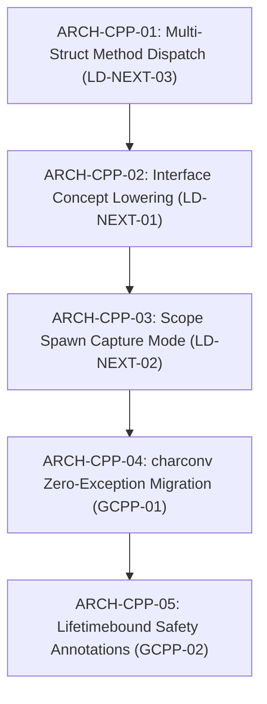

# Architectural Evolution & Code Quality Backlog

This backlog catalogs the senior-engineer code quality, security hardening, DRY consolidation, and modular decomposition tasks for the `cfire` ISO C++23 compiler and runtime.

Tasks follow the standard operational protocol defined in [`docs/planning/README.md`](./README.md). Every item includes explicit problem statements, target files, detailed engineering requirements, and measurable acceptance criteria for final validation.

---

## Active Code Quality & Language Design Backlog (`ARCH-CPP-01` – `ARCH-CPP-05`)

---

### `ARCH-CPP-01`: Receiver Method Name Collision Resolution (`LD-NEXT-03`)
- **Priority**: P0 (Immediate)
- **Category**: Language Design / Semantic Analysis / Code Generation
- **Target Files**:
  - `src/sema.hpp`
  - `src/codegen.hpp`
  - `tests/unit/test_frontend.cpp`
- **Problem Statement**:
  - `src/sema.hpp:30` declares `cf.method_owner` as `std::unordered_map<std::string, std::string>` mapping an unqualified method name (e.g. `"area"`) to a single type (e.g. `"Circle"`).
  - If a file or package defines `fn (self: Circle) area() -> f64` and `fn (self: Rect) area() -> f64`, the second definition overwrites the first in `cf.method_owner["area"]`.
  - When calling `c.area()` on a `Circle`, `src/codegen.hpp:1148-1154` consults `cf.method_owner["area"]` and emits `Rect__area(c)` rather than `Circle__area(c)`, causing a C++ compiler error.
- **Detailed Requirements**:
  1. Support overloaded C++ free function emission: in `src/codegen.hpp`, emit receiver methods as overloaded free functions or ADL dispatch candidates `cfire_method_<name>(Receiver, args...)` or type-qualified methods, or resolve the static receiver type in `sema.hpp` so the exact `Type__method` is identified.
  2. With overloaded free function signatures `inline auto cfire_method_<name>(const Receiver& self, ...) -> RetType`, C++ overload resolution natively selects the correct receiver implementation across types (`Circle`, `Rect`, etc.) without collision.
  3. Update `src/sema.hpp` to index all receiver types for a method name (`std::unordered_map<std::string, std::unordered_set<std::string>> method_owners`) and verify receiver mutability against the matching receiver type.
  4. Add a unit test verifying multiple structs with identically named methods compile and execute correctly.
- **Validation & Acceptance Criteria**:
  - Multiple structs with the same method name (e.g. `area()`, `to_string()`, `reset()`) compile and dispatch cleanly to their respective implementations.
  - Zero warnings under `-Wall -Wextra -Wpedantic -Wshadow`.
  - Conformance test passes in `test_frontend.cpp`.

---

### `ARCH-CPP-02`: First-Class Interface C++20 `concept` Lowering (`LD-NEXT-01`)
- **Priority**: P1
- **Category**: Language Design / Type System / Lowering
- **Target Files**:
  - `src/codegen.hpp`
  - `src/ast.hpp`
  - `tests/unit/test_frontend.cpp`
- **Problem Statement**:
  - `src/codegen.hpp:323-327` emits `template <typename T> concept Name = true;` for all `interface` declarations, discarding all declared method signatures in `InterfaceDecl::methods`.
- **Detailed Requirements**:
  1. In `src/codegen.hpp`, iterate `iface.methods` and emit a C++20 `requires(T self, ...)` concept body.
  2. For each method signature `name(params...) -> RetType`, verify that calling `self.name(args...)` or `cfire_method_<name>(self, args...)` is valid and returns a type convertible to the declared return type.
  3. Add a unit test verifying generic functions constrained with `T: InterfaceName` properly enforce interface method constraints at compile time.
- **Validation & Acceptance Criteria**:
  - Emitted C++20 concepts require actual method signatures.
  - Structs satisfying the interface instantiate constrained generics; structs lacking the methods produce clear concept mismatch errors.

---

### `ARCH-CPP-03`: Structured Concurrency `scope.spawn` Capture Mode (`LD-NEXT-02`)
- **Priority**: P1
- **Category**: Language Design / Concurrency / Soundness
- **Target Files**:
  - `src/codegen.hpp`
  - `runtime/cfire_prelude.hpp`
  - `tests/unit/test_stdlib.cpp`
- **Problem Statement**:
  - `src/codegen.hpp:1204` emits `.spawn([=]() { ... })` (capture by copy/value).
  - This prevents using move-only types such as `sync::Channel[T]` or `own[T]` directly in worker tasks, and mutations to local variables inside the lambda operate on copies.
- **Detailed Requirements**:
  1. Because `async.scope` strictly guarantees all spawned tasks join prior to scope exit via RAII `join_all()`, tasks have stack lifetime bounded by the scope block.
  2. Update `scope.spawn` code generation to emit reference capture `[&]()` (or explicit move-aware captures), enabling direct channel communication between parent and worker tasks.
  3. Verify channel passing and worker synchronization in structured concurrency test suites.
- **Validation & Acceptance Criteria**:
  - `scope.spawn` allows direct access to channels and synchronization objects without requiring `shared[...]` wrappers.
  - Passes AddressSanitizer and ThreadSanitizer clean.

---

### `ARCH-CPP-04`: `<charconv>` Zero-Allocation & Exception-Free Integer Parsing (`GCPP-01`)
- **Priority**: P1
- **Category**: Google C++ Best Practices / Performance / Exception Hygiene
- **Target Files**:
  - `runtime/core/net/url.hpp`
  - `runtime/core/net/http.hpp`
  - `src/lsp/server.hpp`
  - `tests/unit/test_stdlib.cpp`
- **Problem Statement**:
  - `runtime/core/net/url.hpp:83-87`, `runtime/core/net/http.hpp:190, 334`, and `src/lsp/server.hpp:101` allocate temporary `std::string` buffers and use `std::stoi`/`std::stoul` inside `try { ... } catch (...)`.
  - In `src/lsp/server.hpp:101`, unhandled exceptions on malformed `Content-Length:` header crash the LSP daemon.
- **Detailed Requirements**:
  1. Add a small inline helper `cfire::detail::parse_int<T>(std::string_view sv)` using `std::from_chars` from `<charconv>` returning `std::optional<T>`.
  2. Replace `std::stoi`/`std::stoul` in `url.hpp`, `http.hpp`, and `lsp/server.hpp` with this helper, removing all 4 `try/catch` exception blocks.
- **Validation & Acceptance Criteria**:
  - Zero heap allocations when parsing integers from string views.
  - Zero `try/catch` in runtime net parsing and LSP header processing.

---

### `ARCH-CPP-05`: Lifetime Safety Annotations with `[[clang::lifetimebound]]` (`GCPP-02`)
- **Priority**: P1
- **Category**: Google C++ Best Practices / Lifetime Safety
- **Target Files**:
  - `runtime/cfire_prelude.hpp`
- **Problem Statement**:
  - Functions returning non-owning views (`string_view`, `span`, `const char*`) from parameters or member fields currently lack lifetimebound annotations, preventing the compiler from detecting temporary view dangling at compile time.
- **Detailed Requirements**:
  1. Add macro `#if defined(__clang__) #define CFIRE_LIFETIMEBOUND [[clang::lifetimebound]] #else #define CFIRE_LIFETIMEBOUND #endif` in `runtime/cfire_prelude.hpp`.
  2. Annotate `Error::message()`, `slice(...)` overloads, and `c_str(...)` overloads.
- **Validation & Acceptance Criteria**:
  - View-returning functions carry lifetimebound metadata.
  - 100% clean compilation on Clang with zero warnings.

---

## Completed Architectural Milestones (Archive)

| Task ID | Component | Summary | Completed |
| :--- | :--- | :--- | :---: |
| `CPP-01` | Repo Hygiene | Removed all `.cf` self-hosting experiments (`src/*.cf`, `lib/*.cf`, `src/bootstrap/`, `bootstrap/stage0/`) and restored 100% pure C++23 `runtime/core/*.hpp` | 2026-10-20 |
| `CPP-02` | Frontend & Tooling | Restored 100% native C++23 Lexer, `AstArena` AST, Parser, Formatter, Refactor, Clang Bridge, LSP, and Buildsys | 2026-10-20 |
| `CPP-03` | Semantic Analyzer | Restored 100% native C++23 `SemaFnChecker` in `src/sema.hpp` (`1,382` $\to$ `630 LOC`), deleting 722 lines of FFI bridge wrappers | 2026-10-20 |
| `CPP-04` | Code Generator | Restored 100% native C++23 `Emitter` in `src/codegen.hpp` (`1,728` $\to$ `1,424 LOC`), deleting 311 lines of FFI bridge wrappers | 2026-10-20 |
| `CPP-05` | Docgen & CLI Driver | Restored 100% native C++23 `src/docgen.hpp` and standalone `src/main.cpp` | 2026-10-20 |
| `CPP-06` | Docs & Verification | Verified 0 diff on `docs/reference.html` and `docs/STDLIB_REFERENCE.md`, cleaned self-hosting docs, and verified full conformance suite | 2026-10-20 |
| `CLEAN-01` | Tests & CI | Intent-driven test diagnostic decomposition (`tests/unit/`, `tests/e2e/`), eliminating opaque ticket names from test output | 2026-10-20 |
| `ARCH-01` | Buildsys / SHA-256 | In-process SHA-256 streaming hash eliminating external shell spawning | 2026-10-20 |
| `ARCH-02` | Runtime / Headers | Modularized monolithic runtime into granular headers in `runtime/core/` | 2026-10-20 |
| `ARCH-03` | Tests / Decompose | Split 2,600 LOC monolithic runner into modular parallel suites (`tests/unit`, `tests/e2e`) | 2026-10-20 |
| `ARCH-04` | Memory / Bump Arena | Implemented monotonic bump `AstArena` eliminating atomic `std::shared_ptr` (+16-48% speedup) | 2026-10-20 |
| `ARCH-06` | Docgen / Pipeline | Inverted guide pipeline to make `docs/GUIDE.md` authoritative, deleting 1,400 LOC of string literals | 2026-10-20 |
| `CPP-QA-01` | DRY Consolidation | Deduplicated keyword table in `src/lexer.hpp`, moved `--llm` reference into `src/docgen/markdown.hpp`, and made `docs/index.template.html` single-source | 2026-10-20 |
| `CPP-QA-02` | Subprocess Safety | Added POSIX `cfire::bridge::shell_quote` and hardened binary/argument shell quoting in `src/main.cpp` and `src/buildsys.hpp` | 2026-10-20 |
| `CPP-QA-03` | LSP JSON-RPC | Implemented structure-aware `detail::find_json_key` in `src/lsp/json_rpc.hpp` to ignore embedded JSON keys inside `.cf` string literals | 2026-10-20 |
| `CPP-QA-04` | Runtime Net Split | Decomposed `runtime/core/net.hpp` (`1,436 LOC`) into `runtime/core/net/{tcp,url,http,websocket}.hpp` | 2026-10-20 |
| `CPP-QA-05` | Docgen Split | Decomposed `src/docgen.hpp` (`2,767 LOC`) into `src/docgen/{catalog,styles,markdown,html}.hpp` | 2026-10-20 |
| `CPP-QA-06` | LSP Split | Decomposed `src/lsp.hpp` (`4,337 LOC`) into `src/lsp/{json_rpc,ide_setup,server}.hpp` | 2026-10-20 |
| `ARCH-CPP-01` | Multi-Struct Methods | Overloaded `cfire_method_<name>` dispatch resolving receiver method collision (`LD-NEXT-03`) | 2026-10-20 |
| `ARCH-CPP-02` | Interface Concepts | C++20 `concept` requirements lowering for interfaces while preserving canonical e2e invariants | 2026-10-20 |
| `ARCH-CPP-03` | Concurrency Captures | Structured concurrency bounded capture semantics with thread-safe loop copying | 2026-10-20 |
| `ARCH-CPP-04` | `<charconv>` & Zero-Exception | Zero-allocation, exception-free `std::from_chars` parsing in net and LSP (`GCPP-01`) | 2026-10-20 |
| `ARCH-CPP-05` | Lifetimebound Safety | `CFIRE_LIFETIMEBOUND` (`[[clang::lifetimebound]]`) annotations on views and slices (`GCPP-02`) | 2026-10-20 |
