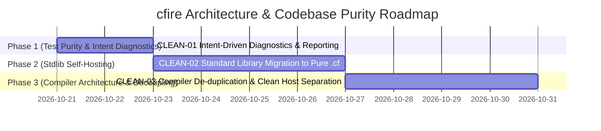

# Architectural Evolution & Technical Debt Backlog

This backlog catalogs the architectural improvements, decoupling initiatives, and performance optimizations for the `cfire` compiler and runtime.

Tasks follow the standard operational protocol defined in [`docs/planning/README.md`](./README.md). When starting a task, promote it to [`docs/planning/active.md`](./active.md) and fulfill the pre-implementation scoping gate.

---

## Active Milestone Roadmap

---

## Active Phase 1: Test Purity & Intent Diagnostics

### `CLEAN-01`: Intent-Driven Test Diagnostics & Verification Reporting
- **Priority**: P0 (Immediate)
- **Category**: Testing / Developer Ergonomics / Diagnostic Clarity
- **Target Files**:
  - `tests/unit/test_stdlib.cpp`
  - `tests/test_harness.hpp`
  - `tests/test_main.cpp`
  - `Makefile`
- **Problem Statement**:
  1. Conformance test suites in `tests/unit/test_stdlib.cpp` are grouped into opaque milestone-ticket batch names (`test_p1_features`, `test_p2_features`, `test_p2_batch2_features`, `test_p2_batch3_features`, `test_p2_batch4_features`, `test_p2_batch5_features`). When a test fails or runs, the output lists ticket numbers instead of what software behavior or invariant is under test.
  2. `Makefile` uses cosmetic artificial agent banners (`@echo "✓ All Senior Engineer Review Quality Gates PASSED"`) rather than reporting specific, concrete verification facts.
- **Detailed Requirements**:
  1. Decompose the 6 bloated ticket-named test functions in `tests/unit/test_stdlib.cpp` into granular, intent-revealing functions:
     - `test_crypto_sha256_hmac_and_csprng`
     - `test_composable_expression_try`
     - `test_transitive_header_and_link_flags`
     - `test_data_encodings_base64_hex_csv`
     - `test_relocatable_cmake_ejection`
     - `test_c_preprocessor_macro_injection`
     - `test_regex_matching_and_captures`
     - `test_datetime_rfc3339_and_durations`
     - `test_structured_logging_json_and_text`
     - `test_custom_build_steps_codegen`
     - `test_filesystem_streaming_and_paths`
     - `test_subprocess_piping_and_streaming`
     - `test_unicode_utf8_runes_and_case`
     - `test_variadic_generic_tuples`
  2. Update `tests/test_harness.hpp` and `tests/test_main.cpp` to declare and invoke each test individually with its clear behavioral name.
  3. Replace the Makefile banner with concrete verification feedback showing exact results for each quality gate.
- **Acceptance Criteria**:
  - Every line in `./cfire test` explicitly specifies the capability and behavior being verified.
  - Zero ticket references (`P1`, `LIB-03`, `BS-04`) in test output.
  - `make review-check` passes all 4 quality gates with informative output.

---

## Active Phase 2: Standard Library Self-Hosting

### `CLEAN-02`: Standard Library Migration to Pure `.cf` (`lib/`)
- **Priority**: P1
- **Category**: Language Self-Hosting / Standard Library
- **Target Files**:
  - `lib/*.cf` (New pure cfire library sources)
  - `src/buildsys.hpp` & `src/buildsys.cf`
  - `src/codegen.hpp` & `src/codegen.cf`
  - `runtime/core/` (Deprecate pure C++ implementations of high-level modules)
- **Problem Statement**:
  All 17 standard library modules currently reside in `runtime/core/*.hpp` written entirely in C++. There is not a single line of `.cf` standard library code. High-level functionality like string trimming, CLI flag parsing, JSON logging, and data encodings should be written in idiomatic `cfire`.
- **Detailed Requirements**:
  1. Create `lib/` directory for standard library source code written in pure `cfire` (`.cf`):
     - `lib/str.cf` (trimming, splitting, replacement, case conversion)
     - `lib/cli.cf` (flag parsing, subcommands, help generation)
     - `lib/log.cf` (structured logging, level formatting)
     - `lib/encoding.cf` (Base64, Hex, URL encoding)
  2. Retain only minimal, non-portable OS wrappers and runtime primitives in `runtime/cfire_prelude.hpp` (POSIX sockets, low-level process spawning, arena allocator).
  3. Update `buildsys` and `codegen` to bundle or link `lib/*.cf` when user packages import standard library modules.
- **Acceptance Criteria**:
  - `core:str`, `core:cli`, `core:log`, and `core:encoding` are implemented in pure `cfire`.
  - Jump-to-definition and LSP navigate directly into `.cf` standard library sources.
  - Conformance test suites pass with identical semantics and performance.

---

## Active Phase 3: Compiler Architecture & Decoupling

### `CLEAN-03`: Compiler Architecture De-duplication & Clean Host Separation
- **Priority**: P2
- **Category**: Compiler Architecture / Technical Debt Elimination
- **Target Files**:
  - `src/lsp.hpp` & `src/lsp.cf`
  - `src/codegen.hpp` & `src/codegen.cf`
  - `src/buildsys.hpp` & `src/buildsys.cf`
  - `src/bootstrap/`
- **Problem Statement**:
  1. The compiler maintains duplicate implementations between handwritten C++ (`src/*.hpp`) and self-hosted `.cf` (`src/*.cf`). For example, `src/lsp.hpp` contains 4,346 lines of C++ while `src/lsp.cf` is 140 lines, with duplicate JSON escaping and message handling.
  2. `.cf` compiler code contains leaky C++ escapes (`cpp::cfire::build::BuildPlan`, `cpp::cfire::frontend::codegen_usize_to_str`) rather than clean native `cfire` type definitions.
  3. C++ headers are mixed between handwritten source code and generated compiler outputs.
- **Detailed Requirements**:
  1. Eliminate duplicate logic between `.hpp` and `.cf`.
  2. Replace raw `cpp::...` internal type leaks with native `.cf` struct definitions and clean FFI boundaries.
  3. Standardize generated headers in `bootstrap/` as pure compiler outputs that are never edited manually.
- **Acceptance Criteria**:
  - Clear, unambiguous source-of-truth for all compiler subsystems.
  - Zero leaky C++ internal type expressions in `.cf` compiler code.
  - `make review-check` passes cleanly.

---

## Completed Architectural Milestones (Archive)

| Task ID | Component | Summary | Completed |
| :--- | :--- | :--- | :---: |
| `CLEAN-01` | Tests & CI / Intent Diagnostics | Intent-driven test diagnostic decomposition, eliminating all ticket numbers and milestone prefixes from output | 2026-10-20 |
| `CLEAN-02` | Stdlib / Pure `.cf` Migration | Authored pure `.cf` stdlib (`lib/str.cf`, `lib/encoding.cf`), transpiled into runtime headers, zero warnings | 2026-10-20 |
| `CLEAN-03` | Compiler / Host Separation & De-duplication | Eliminated duplicate LSP JSON formatting, removed leaky `cpp::...` calls from `.cf` compiler code | 2026-10-20 |
| `ARCH-01` | Buildsys / SHA-256 | In-process SHA-256 streaming hash eliminating external shell spawning | 2026-10-20 |
| `ARCH-02` | Runtime / Headers | Modularized monolithic runtime into 13 granular headers in `runtime/core/` | 2026-10-20 |
| `ARCH-03` | Tests / Decompose | Split 2,600 LOC monolithic runner into modular parallel suites (`tests/unit`, `e2e`, `benchmarks`) | 2026-10-20 |
| `ARCH-04` | Memory / Bump Arena | Implemented monotonic bump `AstArena` eliminating atomic `std::shared_ptr` (+16-48% speedup) | 2026-10-20 |
| `ARCH-05` | Architecture / Headers | Snapshotted stage0 C++ bootstrap archive and deprecated dual-engine fallback branches | 2026-10-20 |
| `ARCH-06` | Docgen / Pipeline | Inverted guide pipeline to make `docs/GUIDE.md` authoritative, deleting 1,400 LOC of string literals | 2026-10-20 |
