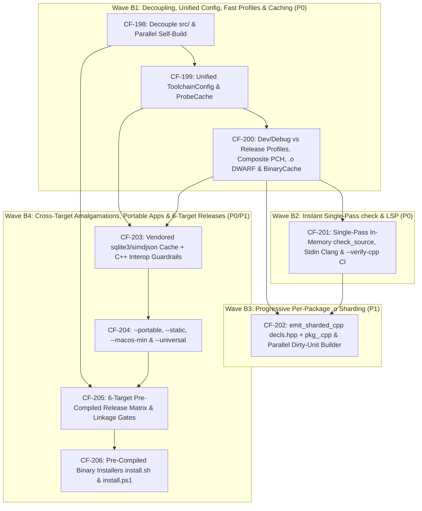

# Build Performance & Binary Distribution Backlog

This topic-focused backlog tracks compiler/build performance optimizations, progressive compilation, caching, and cross-platform pre-compiled binary distribution for `cfire` (**`CF-198` – `CF-206`**, architectural decisions **`Q55` – `Q59`**).

It extends the main project backlog in [`backlog.md`](./backlog.md) (`CF-001` – `CF-197`, `Q1` – `Q54`) as of `main` @ `2786f66` (2026-11-14). All items obey the operating workflow and three quality gates in [`README.md`](./README.md) (`make check`, `make check-deep`, `make check-platforms`).

> **ID Allocation**: Items here use **`CF-198` – `CF-206`** and ADRs **`Q55` – `Q59`**. Future items anywhere in `docs/planning/` should start at **`CF-207`** and **`Q60`**.

---

## Baseline & Bottleneck Evidence (`main` @ `2786f66`, 2026-11-14)

1. **Compiler self-build (`Makefile:29-30`, `src/build/toolchain_layout.hpp:8`)**: `cfire` builds from a single translation unit (`src/main.cpp`), expanding `~1.91 MB` of preprocessed C++ because `src/build/toolchain_layout.hpp:8` `#include`s `"cfire_core_stdlib.hpp"`, pulling all 28 runtime module headers into the compiler binary (~`35.5s` on Apple Silicon). `Makefile:6` also links `-framework AudioToolbox` unconditionally into `cfire`.
2. **`cfire` `.cf` frontend is not the bottleneck**: Lexing, parsing, package loading, Sema, and C++23 codegen (`cfire emit-cpp`) complete in `10–30 ms` (`< 1%` of total compile latency). Virtually 100% of user-visible latency lives in downstream `clang++` parsing, optimization, and redundant invocations.
3. **Debug builds disable PCH (`src/buildsys.hpp:778`)**: `cfire run` and `cfire test` default to `-O2`, while `--debug` disables PCH via `!g_debug_mode`, making debug compilation slower than release (`0.83s` vs `0.63s` on hello-world). Furthermore, only `cfire_prelude.hpp` is precompiled—heavy programs like `examples/14-ai-rag-sqlite` (`3.92s` release, `2.43s` debug, `3.92s` unchanged re-run) re-parse `runtime/core/*.hpp`, `sqlite3.h`, and `simdjson.h` on every build with zero binary cache.
4. **Double-analysis + stale-disk bug in `check` & LSP (`src/analysis.hpp:135-175`, `src/lsp/server.hpp:847-875`)**: `check_source` always invokes `analyze_and_emit(fpath, ...)` (`src/analysis.hpp:148`) followed by `verify_cpp_syntax_only` (`clang++ -O2`), even when zero `cpp {}` blocks or `import cpp` declarations exist. Worse, `analyze_and_emit(fpath, ...)` re-reads `.cf` files from disk, ignoring unsaved in-memory LSP `content` buffers (`textDocument/didChange`).
5. **Binary distribution & C/C++ library portability (`src/buildsys.hpp:290-384`, `.github/workflows/release.yml`, `docs/install.sh`)**:
   - Releases currently ship only `macOS arm64` (`cfire-v<ver>-macos-arm64.tar.gz`) with no macOS deployment target floor (`-mmacosx-version-min`), no Linux static `musl` builds, and no Windows builds; `docs/install.sh` compiles from source on the user's machine.
   - `core:json` (`runtime/core/json.hpp:412`) and `ext:db/sqlite` depend on external `simdjson` / `sqlite3` system packages or disable SIMD on iOS; `src/buildsys.hpp:44-46` puts all of `runtime/vendor/` on global `-I`; and `src/build/deps.hpp:456, 545-549` hardcodes `"clang++"` / `"clang"` without forwarding configured compiler, target, sysroot, or deployment-target flags.

---

## B.1 Architectural Decision Record (`Q55` – `Q59`, resolved interactively 2026-11-13)

55. **Pure `clang++` Backend & Unified Compiler Configuration (`Q55`, Option 1C)**:
    - Ship **6 lean pre-compiled `cfire` + `runtime/` release bundles** (`linux-x86_64`, `linux-arm64`, `macos-arm64`, `macos-x86_64`, `windows-x86_64`, `windows-arm64`), containing zero pre-built `.pch` or `.a` binaries.
    - Keep **pure `clang++`** as the sole native backend (`xcode-select` on macOS/iOS, distro `clang++` on Linux, `MSYS2 CLANG64` on Windows, `em++` for `--web`, `ANDROID_NDK_HOME` `<triple>-clang++` for Android). Explicitly excluded: embedding `zig c++` or adding a compiler-tarball downloader inside `cfire`.
    - Unify compiler resolution across `buildsys`, `pch`, `syntax_check`, `deps`, `clang_bridge`, `doctor`, and `lsp` via a single `ToolchainConfig` with strict precedence:
      `CLI flags (--cxx, --cc, --emxx, --ar)` > `Environment (CFIRE_CXX, CFIRE_CC, CFIRE_EMXX, CFIRE_AR)` > `User Config (~/.cfire/config.json, managed by cfire config)` > `Auto-discovery (<triple>-clang++, clang++)`.

56. **Per-Target Cached Amalgamations (`sqlite3`, `simdjson`), Portable App Flags & 3 C++ Interop Guardrails (`Q56`, Option 2B)**:
    - Vendor single-file upstream amalgamations `sqlite3.{c,h}` and `simdjson.{cpp,h}` inside **isolated subdirectories** (`runtime/vendor/sqlite3/` and `runtime/vendor/simdjson/`). Compile and cache static archives on first use per `(compiler_fingerprint, target_triple, sysroot_or_sdk, abi_flags, source_sha256)` under `~/.cfire/cache/libs/<key>/` across Desktop (`macos`, `linux`, `windows`), WebAssembly (`--web` via `emcc` with `-DSQLITE_OMIT_LOAD_EXTENSION -DSQLITE_THREADSAFE=0`), iOS (`iphoneos`/`iphonesimulator`, enabling ARM64 NEON `simdjson` when vendored), and Android NDK (which omits public `libsqlite3.so`).
    - Keep heavy/cryptographic/transport C libraries (`zstd`, `libsodium`, `libssh`, `OpenSSL`) unbundled via `pkg-config` / OS-native APIs / `build.cf` vendor specs.
    - Enforce **3 Mandatory C++ Interop Guardrails**:
      1. *No Header/Symbol Shadowing*: Never add `runtime/vendor/sqlite3` or `runtime/vendor/simdjson` unconditionally to global `-I` (`src/buildsys.hpp:44-46`); yield automatically whenever the user selects `sqlcipher`, `#[pkg(...)]`, `--link-lib`, `build.cf` deps, or `~/.local` overrides.
      2. *Toolchain & C++ Stdlib ABI Forwarding (`src/build/deps.hpp`)*: Forward resolved `ToolchainConfig` (`cc`, `cxx`, `ar`, `--target`, `--sysroot`, `-mmacosx-version-min`, `-DCMAKE_C_COMPILER`, `-DCMAKE_CXX_COMPILER`, `-DCMAKE_OSX_DEPLOYMENT_TARGET`) into C/C++ and CMake dependency builds so user C++ libraries match the C++ stdlib ABI (`libc++` vs `libstdc++` vs UCRT).
      3. *Graceful `--portable` vs Strict `--static`*: Under `--portable`, resolve `.a` archives per library where available while falling back gracefully to dynamic linking (with a concise diagnostic note) for OS frameworks and shared-only user C++ libraries; reserve hard failure when static linkage is unavailable for `--static`. Support `--macos-min=<ver>` (default `13.0` on macOS release builds) and `--universal` (`arm64` + `x86_64` `lipo` fat binary on macOS).

57. **Dev/Debug vs. Release Build Profiles & LLDB `.o` DWARF Fidelity (`Q57`, Option 3A)**:
    - `cfire run` and `cfire test` default to **Dev/Debug** (`-O0 -g` + Debug Composite PCH + arithmetic traps `-fsanitize=signed-integer-overflow,shift,integer-divide-by-zero -fsanitize-trap=all`, with `--no-trap` opt-out and `--release` / `-r` override).
    - `cfire build` and `cfire bench` default to **Release** (`-O2` + Release Composite PCH, with `--debug` / `-g` override).
    - Fix `!g_debug_mode` (`src/buildsys.hpp:778`) so debug builds use a Debug PCH with matching `-O0 -g` and arithmetic-trap / `-static` flags rather than disabling PCH.
    - Compile debug builds via persistent `.cfire/obj/<unit>.o` + link step so macOS `ld` writes `OSO` DWARF debug-map entries pointing at `.cfire/obj/*.o` (`#line`-mapped to `.cf` files), enabling instant LLDB `.cf` breakpoints without running slow `dsymutil` (available via `--dsym`). Auto-detect `-fuse-ld=mold` / `-fuse-ld=lld` on Linux/Windows via cached probe.

58. **Single-Pass In-Memory `check` / LSP & Escape-Hatch Gating (`Q58`, Option 4A)**:
    - Eliminate the double analysis and stale disk read in `check_source` (`src/analysis.hpp:148`): resolve sibling/local packages against in-memory buffers (`file_overrides`), keep a single `CheckedFile`, and avoid re-parsing from disk.
    - Pure `.cf` programs (no `CppStmt` in AST functions/tests and no `ImportDecl::is_cpp` imports) finish `cfire check` and LSP diagnostics 100% in-process in `~15 ms` with zero `clang++` processes and zero `.cfire/gen/*.cpp` disk writes.
    - When `cpp {}` or `import cpp` is present, run single-pass `clang++ -O0 -x c++ - -fsyntax-only` via stdin + Debug Composite PCH (`cfire check`, and on `textDocument/didSave` in LSP while `textDocument/didChange` stays in-memory Sema `< 20 ms`).
    - Add `cfire check --verify-cpp` (`--full`) to run the stdin Clang pass on pure `.cf` code too, and enforce `./cfire check --verify-cpp` across `examples/` in `Makefile`'s `make check` gate so compiler codegen bugs never slip past Sema.

59. **4-Layer Build Caching, Composite Runtime PCH, Parallel Self-Build & Phase-1 Per-Package `.o` Sharding (`Q59`, Option 5B)**:
    - Deliver all four speed layers together with Phase-1 progressive per-package compilation:
      1. Content-addressed `BinaryCache` (`~/.cfire/cache/bin/<sha256>`, `0700` dir, atomic write + rename, 1 GB LRU cap, `--no-cache`, `cfire clean --cache`).
      2. Persistent `ProbeCache` (`~/.cfire/cache/probes.json`) keyed by compiler `(path, mtime, size)` and `PKG_CONFIG_PATH`.
      3. Per-import-set Composite Runtime PCH (`~/.cfire/cache/pch/umbrella_<sha256>.pch` covering `cfire_prelude.hpp` + active `runtime/core/*.hpp` headers for Debug & Release).
      4. Parallel `cfire` self-build (`src/build/toolchain_layout.hpp:8` decoupled from `cfire_core_stdlib.hpp`, `src/tu_*.cpp` split, `-MMD -MP` dependency tracking: `35.5s` -> `~5s`).
      5. Sharded per-package C++23 emitter (`emit_sharded_cpp`: `decls.hpp` + `pkg_<id>.cpp` -> `.cfire/obj/pkg_<id>_<hash>.o`) with parallel dirty-unit compilation, leaving single-file `emit_cpp()` unchanged for `cfire emit-cpp` and `tests/golden/*.expected.cpp`.

---

## B.2 Execution Dependency Graph & Wave Sequencing

| Wave | Goal | Items | Exit Gate |
| :---: | :--- | :--- | :--- |
| **B1** | Fast compiler rebuilds, unified config, fast Dev/Debug loop & persistent caches | `CF-198` -> `CF-199` -> `CF-200` | `make -j$(nproc) cfire` cleans & builds in `<= 7s` with zero AudioToolbox/`cfire_core_stdlib.hpp` in `src/`; warm `cfire build` hits `BinaryCache` in `< 30 ms`; cold-code / warm-Composite-PCH `14-ai-rag-sqlite` debug build `< 0.5s`; LLDB hits `.cf:line` breakpoints without `dsymutil`; `make check-all` green. |
| **B2** | Instant pure-`.cf` `check` & accurate in-memory LSP | `CF-201` | Pure `.cf` `cfire check` completes in `< 30 ms` with 0 `clang++` spawns and 0 `.cfire/gen/*.cpp` writes; unsaved LSP multi-file buffer edits diagnose in-memory without reading stale disk files; `make check` runs `./cfire check --verify-cpp` on all examples; `make check-all` green. |
| **B3** | Progressive per-package `.o` builds for multi-package projects | `CF-202` | Editing 1 file in a 5-package project recompiles only its `pkg_<id>.o` + relinks (`1` `clang++ -c` call vs `5`); `cfire emit-cpp` & `tests/golden/*.expected.cpp` are byte-identical; `make check-all` green. |
| **B4** | Zero-setup `sqlite3`/`simdjson`, portable user apps & 6-target binary installers | `CF-203` -> `CF-204` -> `CF-205` -> `CF-206` | Clean macOS/Linux/Windows/Wasm/iOS machines build `core:json` & `ext:db/sqlite` with 0 external library installs while honoring user `sqlcipher`/C++ overrides; all 6 release bundles pass static/minOS linkage audits & smoke tests; `install.sh` + `install.ps1` install & verify SHA-256 checksums; `make check-all` green. |

---

## B.3 Prioritized Backlog Index

| Rank | ID | Wave | Priority | Size | Component | Summary | ADR | Depends On | Status |
| :---: | :--- | :---: | :---: | :---: | :--- | :--- | :---: | :---: | :---: |
| 1 | `CF-198` | B1 | **P0** | M | `src/build/toolchain_layout.hpp`, `src/tu_*.cpp`, `Makefile` | **Decouple `src/` from `cfire_core_stdlib.hpp` & Parallel Self-Build**: Remove 28-header pull-in and unused AudioToolbox framework; split compiler into parallel TUs (`35.5s` -> `~5s`) | `Q59` | None | `[DONE]` |
| 2 | `CF-199` | B1 | **P0** | M | `src/build/{toolchain_config,probe_cache}.hpp`, `src/{buildsys,clang_bridge,doctor,main}.hpp/cpp` | **Unified `ToolchainConfig`, `cfire config` & Persistent `ProbeCache`**: Single compiler precedence chain (`--cxx`/`--cc`/`--emxx`, `CFIRE_*`, `~/.cfire/config.json`) + `probes.json` + `mold`/`lld` probe | `Q55`, `Q59` | `CF-198` | `[DONE]` |
| 3 | `CF-200` | B1 | **P0** | L | `src/build/{pch,binary_cache}.hpp`, `src/buildsys.hpp`, `src/main.cpp` | **Dev/Debug vs Release Profiles, Composite Runtime PCH, `.o` DWARF Maps & `BinaryCache`**: Default `run`/`test` to `-O0 -g` + cheap traps; Debug & Composite Runtime PCH; LLDB `.cfire/obj/*.o`; 1 GB LRU binary cache | `Q57`, `Q59` | `CF-199` | `[DONE]` |
| 4 | `CF-201` | B2 | **P0** | M | `src/analysis.hpp`, `src/build/syntax_check.hpp`, `src/lsp/server.hpp`, `Makefile` | **Single-Pass In-Memory `check` & Stdin Clang Gating**: Fix double-analysis/stale-disk bug; `~15 ms` pure-`.cf` short-circuit; stdin Clang for `cpp {}` / `import cpp`; `didChange` vs `didSave`; `--verify-cpp` CI gate | `Q58` | `CF-200` | `[TODO]` |
| 5 | `CF-202` | B3 | **P1** | L | `src/codegen.hpp`, `src/buildsys.hpp`, `src/build/package_loader.hpp` | **Progressive Per-Package `.hpp`/`.cpp` -> `.o` Compilation**: `emit_sharded_cpp` (`decls.hpp` + `pkg_<id>.cpp` with non-`inline` concrete exports) + parallel dirty-unit `.o` builder | `Q59` | `CF-200`, `CF-201` | `[TODO]` |
| 6 | `CF-203` | B4 | **P0** | L | `runtime/vendor/{sqlite3,simdjson}/`, `src/build/{lib_cache,deps}.hpp`, `runtime/core/json.hpp` | **Vendored `sqlite3` & `simdjson` Per-Target Archive Cache & C++ Interop Guardrails**: Isolated amalgamations compiled/cached for Desktop, Wasm, iOS NEON, Android; yield to `sqlcipher`/overrides; forward ABI in `deps.hpp` | `Q56` | `CF-199`, `CF-200` | `[TODO]` |
| 7 | `CF-204` | B4 | **P1** | M | `src/buildsys.hpp`, `src/build/manifest.hpp`, `src/main.cpp` | **Portable App Build Flags (`--portable`, `--static`, `--macos-min`, `--universal`)**: Per-library `.a` resolution with shared-only C++ fallback; macOS `13.0` floor & universal `lipo` fat binaries | `Q56` | `CF-203` | `[TODO]` |
| 8 | `CF-205` | B4 | **P0** | M | `.github/workflows/release.yml`, `scripts/release.sh`, `Dockerfile` | **6-Target Pre-Compiled `cfire` Release Matrix & Binary Linkage Gates**: Ship lean static `musl` Linux (`x64`/`arm64`), minOS `13.0` macOS (`arm64`/`x64`), `-static` UCRT Windows (`x64`/`arm64`) + `SHA256SUMS.txt` | `Q55` | `CF-198`, `CF-204` | `[TODO]` |
| 9 | `CF-206` | B4 | **P1** | S | `docs/install.sh`, `docs/install.ps1`, `README.md` | **Pre-Compiled Binary Installers**: Fast SHA-256 verified binary download + `--from-source` fallback (`install.sh`), native Windows PowerShell installer (`install.ps1`), updated docs | `Q55`, `Q56` | `CF-205` | `[TODO]` |

---

## B.4 Detailed Item Specifications (`CF-198` – `CF-206`)

### `CF-198` — Decouple `src/` from `cfire_core_stdlib.hpp` & Parallel Self-Build `[DONE]`
- **Wave / ADR**: Wave B1 (`Q59`).
- **Problem & Evidence**:
  - `src/build/toolchain_layout.hpp:8` has `#include "cfire_core_stdlib.hpp"`, which transitively pulls in all 28 `runtime/core/*.hpp` headers (audio, webkit, TLS, JSON, sqlite, compression, etc.) into the compiler executable itself even though `src/` uses zero runtime stdlib symbols (`cfire_core_stdlib.hpp` is only referenced as header path strings in `src/buildsys.hpp:922`, `src/doctor.hpp:186`, and `src/diagnostics.hpp:1470`).
  - `Makefile:6` links `-framework AudioToolbox` into `cfire` on macOS despite zero AudioToolbox calls in `src/`.
  - `Makefile:29-30` compiles the entire compiler via a single `src/main.cpp` invocation (`1.91 MB` preprocessed source, `~35.5s` wall-clock on Apple Silicon), blocking multi-core builds and forcing full recompiles on any edit in `src/`.
- **Implementation Plan**:
  1. Remove `#include "cfire_core_stdlib.hpp"` from `src/build/toolchain_layout.hpp:8`.
  2. Audit `Makefile:6` Darwin/Linux link libraries: drop `-framework AudioToolbox` and keep only frameworks/libs directly called by `src/` (`Security` / `CoreFoundation` if needed, or zero non-libc frameworks if pure POSIX/C++23).
  3. Keep `src/*.hpp` header-compatible for existing `tests/unit/*.cpp` and `tests/e2e/test_canonical.cpp`, while splitting `cfire`'s heavy subsystems into dedicated `.cpp` translation units under `src/` (e.g., `src/tu_sema.cpp`, `src/tu_codegen.cpp`, `src/tu_build.cpp`, `src/tu_lsp.cpp`, `src/tu_docgen.cpp`, `src/tu_mcp.cpp`, `src/main.cpp`) with clean explicit declarations vs out-of-line definitions (`inline` helpers preserved where `tests/` include headers standalone, or `TEST_OBJS` linked appropriately).
  4. Update `Makefile` to compile `CFIRE_OBJS` with `-MMD -MP` `.d` dependency files, per-`.o.log` warning tracking checked by `make check-warnings`, and parallel `make -j` execution (`make build` / `make cfire`).
- **Tests**:
  - *Unit / Static*: Add a build test checking `#include`s in `src/` never include `cfire_core_stdlib.hpp` or `runtime/core/*.hpp`; `make check-warnings` inspects all `.o.log` files.
  - *Platform Linkage Check*: Verify `otool -L cfire` (macOS) and `ldd cfire` (Linux) do not reference `AudioToolbox`.
  - *Benchmark*: Measure clean `make -j$(nproc) cfire` wall time (`35.5s` -> `<= 7s`) and single-file incremental `.o` relink (`<= 3s`).
- **Acceptance Criteria**: `cfire` builds cleanly in parallel with 0 warnings across macOS, Linux, and Windows; zero runtime stdlib headers are compiled into `cfire`; `make check-all` passes.

---

### `CF-199` — Unified `ToolchainConfig`, `cfire config` & Persistent `ProbeCache` `[DONE]`
- **Wave / ADR**: Wave B1 (`Q55`, `Q59`).
- **Problem & Evidence**:
  - Compiler lookup is fragmented: `src/build/pch.hpp:41-71` checks `CFIRE_CXX` and falls back to `"clang++"`, `src/clang_bridge.hpp:547,601` hardcodes `"clang++"` separately, `src/doctor.hpp:126-175,307` probes `"clang++"` directly, and `src/build/deps.hpp:545` hardcodes `"clang++ -std=c++2b"` / `"clang -std=c17"`. Users cannot override `cc`, `cxx`, `emxx`, or `ar` uniformly via CLI flags or persistent config.
  - Every invocation of `cfire` runs redundant shell probes (`pkg-config`, `command -v`, compiler version/flag checks) without persistence across processes.
- **Implementation Plan**:
  1. Create `src/build/toolchain_config.hpp`:
     - `struct ToolchainConfig { std::string cxx, cc, emxx, ar, linker; std::filesystem::path config_path; };`
     - Strict resolution precedence: CLI flags (`--cxx`, `--cc`, `--emxx`, `--ar`, `--ld`) > environment (`CFIRE_CXX`, `CFIRE_CC`, `CFIRE_EMXX`, `CFIRE_AR`, `CFIRE_LD`) > persistent `~/.cfire/config.json` (or `XDG_CONFIG_HOME/cfire/config.json`) > auto-discovery (`<triple>-clang++`, `clang++`, `em++`, `llvm-ar`/`ar`, plus Linux `mold`/`lld` & Windows `lld` linker detection).
  2. Add `cfire config` subcommand (`src/main.cpp` / `src/cli/`) supporting `set <key> <val>`, `get <key>`, `unset <key>`, and `list` (JSON or text) using atomic write + rename to `~/.cfire/config.json`.
  3. Create `src/build/probe_cache.hpp`:
     - Persist toolchain capabilities (compiler version string, `--target` support, `-fuse-ld=mold`/`lld` availability, host target triple, `pkg-config` flags/libs) in `~/.cfire/cache/probes.json` (private `0700` dir, `CFIRE_CACHE_DIR` override honored, atomic write + rename).
     - Cache keys incorporate `(resolved_bin_path, mtime, file_size)` for compiler probes and `(PKG_CONFIG_PATH, PKG_CONFIG_LIBDIR, static_flag, target_triple, pkg_name)` + `.pc` file mtimes for `query_pkg_config`. Invalidates automatically if compiler binary or `.pc` files change.
  4. Wire `ToolchainConfig` + `ProbeCache` through `src/buildsys.hpp`, `src/clang_bridge.hpp`, `src/doctor.hpp`, `src/analysis.hpp`, and `src/lsp/server.hpp`. Update `cfire doctor` to display active compiler paths, provenance (CLI / env / `config.json` / PATH), and detected fast linker.
- **Tests**:
  - *Unit*: Precedence tests (CLI beats env beats `config.json` beats PATH), round-trip `cfire config` JSON parser/writer tests, and `ProbeCache` invalidation tests when compiler mtime or `PKG_CONFIG_PATH` changes.
  - *Integration*: Point `--cxx` / `CFIRE_CXX` / `cfire config set cxx ...` to a mock compiler wrapper script and assert `build`, `run`, `check`, `import cpp` (`clang_bridge`), and `doctor` all invoke the configured binary.
- **Acceptance Criteria**: Zero raw hardcoded `"clang++"` invocations remain in `buildsys`, `clang_bridge`, `pch`, `deps`, or `doctor`; warm `pkg-config` and linker probes hit `probes.json` with zero subprocess spawns; `make check-all` passes.

---

### `CF-200` — Dev/Debug vs Release Profiles, Composite Runtime PCH, `.o` DWARF Maps & `BinaryCache` `[DONE]`
- **Wave / ADR**: Wave B1 (`Q57`, `Q59`).
- **Problem & Evidence**:
  - `src/buildsys.hpp:627-634, 768-780` defaults `cfire run` and `cfire test` to `-O2`, disables PCH whenever `g_debug_mode` is true (`!g_debug_mode` at line `778`), and compiles straight to final binaries without persistent `.o` files (breaking fast macOS LLDB debug symbols unless slow `dsymutil` runs).
  - `src/build/pch.hpp:73-193` only precompiles `cfire_prelude.hpp` (leaving `runtime/core/*.hpp` headers like `json.hpp`, `sqlite.hpp`, `ai/`, `net/http.hpp` un-precompiled on every compile) and stores PCH files only in per-UID `/tmp/cfire-<uid>-pch` instead of durable `~/.cfire/cache/pch/`.
  - Re-running unchanged `cfire build` / `cfire run` always invokes `clang++` (`3.92s` on `14-ai-rag-sqlite`) because there is no content-addressed binary cache.
- **Implementation Plan**:
  1. **Explicit `BuildProfile` (`DevDebug`, `Release`, `SanitizeAddress`, `SanitizeThread`)**:
     - `cfire run` and `cfire test` default to `DevDebug`: `-O0 -g` plus cheap arithmetic trap flags (`-fsanitize=signed-integer-overflow,shift,integer-divide-by-zero -fsanitize-trap=all`, disabled when `--no-trap` is set or target is `wasm*`).
     - `cfire build` and `cfire bench` default to `Release`: `-O2 -fwrapv`.
     - Wire `--release` (`-r`) and `--debug` (`-g`) across `run`, `test`, and `build`; reject contradictory `--debug --release` cleanly.
  2. **Debug + Per-Import Composite Runtime PCH (`src/build/pch.hpp`)**:
     - Store PCH artifacts under `~/.cfire/cache/pch/` (`CFIRE_CACHE_DIR/pch` when set; `0700` perms).
     - Remove `!g_debug_mode` guard (`src/buildsys.hpp:778`).
     - Hash **all** PCH-sensitive flags into the Composite PCH key: `cfire_prelude.hpp` + active sorted `runtime/core/*.hpp` header contents & mtimes, compiler fingerprint, `kVersion`/`kGitSha`, target triple, optimization level (`O0` vs `O2` vs `O1` san), `-g`, `-fwrapv` vs trap flags, sanitizers, `-pthread`, `-static` (`__STATIC__` on Windows, preserving the `CF-184` fix), `-D CFIRE_USE_*`, and `-I` include roots that alter `#if __has_include(...)` branches.
     - Generate a synthetic umbrella header combining `cfire_prelude.hpp` + the sorted active `core/*.hpp` headers (modulo ObjC `.mm` mode and custom C-header conflicts), compile atomically (`tmp.<pid>.pch` -> rename), and guard concurrent builds with a lockfile so parallel CI/test workers build each PCH once. Keep a small fallback retry without `-include-pch` with warning telemetry in `--verbose`.
  3. **Persistent `.cfire/obj/*.o` & Instant LLDB DWARF Maps**:
     - In `DevDebug` mode (and optionally Release), compile to `.cfire/obj/<unit>_<hash>.o` (`-c`) then link `.o` -> executable, passing `-fuse-ld=mold`/`lld` when probed available on Linux/Windows. On macOS, `ld` embeds `N_OSO` debug-map stabs pointing directly to the preserved `.cfire/obj/*.o` files (`#line`-mapped back to `.cf` sources), enabling immediate LLDB `.cf:line` breakpoints without invoking `dsymutil`. Add `--dsym` to explicitly generate a standalone `.dSYM` bundle when archiving debug artifacts.
  4. **Content-Addressed `BinaryCache` (`src/build/binary_cache.hpp`)**:
     - Store compiled executables under `~/.cfire/cache/bin/<sha256>` (with `meta.json` recording ATIME/size for **1 GB LRU eviction**).
     - Key = SHA-256 over `{normalized emitted C++ or AST input, all transitive runtime/vendor/local header & C-dep archives, compiler fingerprint, BuildProfile, target triple, sysroot, cflags, ldflags}`.
     - On cache hit: copy/hardlink (`0755`) atomically into output path (`< 30 ms`) and skip `clang++` completely.
     - Add `--no-cache` to bypass lookup/store and `cfire clean --cache` to clear `~/.cfire/cache/` cleanly.
- **Tests**:
  - *Unit*: Profile selection (`run`/`test` -> `DevDebug`, `build`/`bench` -> `Release`, `--release`/`--debug` overrides); Composite PCH key differentiation (Debug vs Release, `__STATIC__`, `__has_include` toggles, trap vs `-fwrapv`); `BinaryCache` key invalidation & 1 GB LRU eviction logic.
  - *Integration / Debuggers*: Run LLDB (on macOS/Linux) in batch mode setting a `.cf` source line breakpoint (`breakpoint set --file main.cf --line N`) on a `DevDebug` binary without `.dSYM` and assert breakpoint hit + `.cf` frame backtrace; test `--no-cache` and `cfire clean --cache`.
  - *Conformance*: Arithmetic overflow/shift trap tests pass in default `cfire run` (`DevDebug`) and `--release` mode obeys `Q9`/`Q11`/`Q19` semantics.
- **Acceptance Criteria**: `cfire run`/`test` default to fast Debug mode using Debug Composite PCH; `14-ai-rag-sqlite` cold-code/warm-PCH debug compile drops from `2.43s` to `<= 0.5s` and warm unchanged `cfire build` hits `BinaryCache` in `< 30 ms`; `make check-all` passes (update any existing test expectations that hardcoded `-O2` on `run`/`test`).

---

### `CF-201` — Single-Pass In-Memory `check` & Stdin Clang Gating `[DONE]`
- **Wave / ADR**: Wave B2 (`Q58`).
- **Problem & Evidence**:
  - `src/analysis.hpp:135-175` unconditionally calls `verify_cpp_syntax_only` when `opts.verify_cpp_backend` is true, and at line `148` calls `cfire::build::analyze_and_emit(fpath, rt_dir, false, is_test_f)`, which **re-lexes, re-parses, and re-runs Sema from disk**!
  - Bug impact in LSP (`src/lsp/server.hpp:847-875`): during unsaved editor buffers (`didSave` / `didChange`), `check_source(file_path, text, opts)` passes `text`, yet line `148` reads the stale disk file at `fpath` instead of `text`, hiding or fabricating Clang errors and duplicating Sema latency (`0.88s–1.28s` per `cfire check`).
  - `src/build/syntax_check.hpp:26-68` writes `.cfire/gen/<stem>.cpp` to disk and invokes `clang++ -O2` even when `-O0` via stdin is faster and leaves working directories clean.
  - Note also: `src/analysis.hpp:163-169` used `-fwrapv` only for non-test files while `src/buildsys.hpp:627-633` uses trap flags in `DevDebug`—Clang syntax checking should match `DevDebug` / active profile flags so Composite Debug PCH is reused with 0 PCH mismatch.
- **Implementation Plan**:
  1. **Fix In-Memory Multi-File Resolution**: Extend `resolve_local_cf_imports` (or accept an optional `in_memory_overlays` map `{canonical_path -> text}` + already-parsed root `FileAST`) so `check_source` never reads `fpath` from disk when an in-memory buffer exists, and **delete the redundant `analyze_and_emit` second frontend pass** at `src/analysis.hpp:148` (extract any needed `build.cf` / native `-I` flags once without re-running Sema!).
  2. **Pure-`.cf` Sema Short-Circuit**: Implement `needs_cpp_syntax_check(const FileAST&)`: returns `true` iff any `ImportDecl::is_cpp` is present or any statement/body contains a `CppStmt` block (`cpp { ... }`). If false and neither `--verify-cpp` (`--full`) nor LSP `force_cpp_verify` is set, skip `verify_cpp_syntax_only` completely—returning diagnostics in `~15 ms` with zero subprocesses.
  3. **Stdin Clang Pass (`src/build/syntax_check.hpp`)**: Pipe emitted C++ directly over `stdin` (`-x c++ -` or `-x objective-c++ -`) into `clang++ -O0 -fsyntax-only` using the Debug Composite PCH (`ensure_composite_pch`), falling back to `SecureTempDir` only if a tool/platform cannot accept stdin, and **never** writing `.cfire/gen/*.cpp` during `cfire check` or `cfire lsp`. Normalize `<stdin>` diagnostic filenames cleanly in `parse_clang_diagnostic_line` (relying on `#line` directives emitted by `codegen.hpp`).
  4. **LSP `didChange` vs `didSave` Cadence (`src/lsp/server.hpp`)**: Keep `textDocument/didChange` strictly in-process Sema (`~15 ms`, passing open dirty document overlays from `docs_`), and run the single-pass stdin Clang check on `textDocument/didOpen` / `textDocument/didSave` when `needs_cpp_syntax_check` is true.
  5. **CLI `--verify-cpp` & `Makefile` Gate**: Add `--verify-cpp` (alias `--full`) to `cfire check` (`src/main.cpp` / `src/cli/cmd_check_fix.hpp`) and update `Makefile:78` (`make check`) to run `./cfire check --verify-cpp "$$d"` across `examples/*/` so codegen regressions against C++23 are caught in CI even on pure `.cf` examples.
- **Tests**:
  - *Unit / Regression*: In-memory unsaved-buffer test where disk file has an error (or valid code) and passed `content` has the opposite; assert `check_source` reflects `content`, not disk. Assert `needs_cpp_syntax_check` returns `false` on pure `.cf` and `true` on `cpp {}` or `import cpp`.
  - *Integration*: Verify `cfire check` on pure `.cf` project creates zero `.cfire/gen/` files and spawns zero `clang++` processes (`CFIRE_TRACE_SUBPROCESS` / hook check); verify `cfire check` automatically checks `cpp { "bad C++" }` and `cfire check --verify-cpp` catches codegen C++ errors.
  - *LSP Smoke*: Verify `didChange` responds with updated diagnostics in `< 50 ms` without spawning `clang++`, and `didSave` triggers stdin Clang checking for `import cpp` buffers.
- **Acceptance Criteria**: Pure-`.cf` `cfire check` executes in `<= 30 ms` with single-pass in-memory analysis; stale-disk LSP bug is eliminated; `make check` enforces `--verify-cpp` on `examples/`; `make check-all` passes.

---

### `CF-202` — Progressive Per-Package `.hpp`/`.cpp` -> `.o` Compilation `[DONE]`
- **Wave / ADR**: Wave B3 (`Q59`).
- **Problem & Evidence**:
  - Even with Composite PCH and `BinaryCache`, touching one `.cf` file in a multi-package workspace forces `codegen` (`src/codegen.hpp`) to emit a single monolithic `.cpp` for the entire dependency graph, so `clang++` must recompile every package's C++ functions from scratch.
  - **Verified C++ Linkage Pitfall in `src/codegen.hpp`**:
    - Today `src/codegen.hpp:838-842`, `950`, `996` emits `inline` on **every** function forward declaration and definition (`inline auto cur_fn(...) -> ret;`).
    - In C++23 (`[dcl.inline]`), marking a non-template function `inline` in a shared `decls.hpp` while putting its body only in `pkg_<id>.cpp` is ill-formed (`-Wundefined-inline` / missing definition in other TUs).
    - Meanwhile, `cfire_method_<name>` concept/smart-pointer dispatch templates (`src/codegen.hpp:511-533`) and generic functions/methods (`!fn.type_params.empty()`) MUST stay inline templates in `decls.hpp`, and `GlobalVarDecl` (`src/codegen.hpp:536-553`, which can use deduced `auto`) must stay C++17 `inline` variables in `decls.hpp` so all TUs share one ODR instance.
- **Implementation Plan**:
  1. Preserve single-file `emit_cpp(cf, test_mode)` completely unchanged so `cfire emit-cpp` and `tests/golden/*.expected.cpp` snapshots remain 100% deterministic and untouched.
  2. Implement `emit_sharded_cpp(const CheckedFile& cf, bool test_mode)` -> `ShardedEmission { std::string decls_hpp; std::vector<CppUnit> units; }` alongside `emit_cpp`:
     - Partition concrete functions, receiver methods (`cfire_method_<name>` + wrapper), `TestDecl` runners, and `main` by sanitized `package_name` (`pkg_main`, `pkg_<slug>`), keeping file-order determinism inside each unit.
     - **`decls.hpp`**: Contains `#pragma once`, `#include "cfire_prelude.hpp"`, union of active `runtime/core/*.hpp` & `import cpp` headers, interfaces (`concept`s), topological structs & enums, template dispatch helpers (`cfire_method_*` lines `511-533`), generic functions/methods (full `inline template <...> definitions`), `inline` package globals (`536-553`), and **non-`inline`** external prototypes for concrete functions and concrete receiver methods (`auto fn(...) -> ret;`).
     - **`pkg_<id>.cpp`**: Starts with `#include "decls.hpp"`, followed by **non-`inline`** concrete function and concrete method definitions (`auto fn(...) -> ret { ... }` and `cfire_method_*` wrappers) belonging to `<id>` (`fn.name == "main"` and test runner live in the entry/test unit).
     - Emit content hashes per `CppUnit`; only overwrite `.cfire/gen/decls.hpp` or `.cfire/gen/pkg_<id>.cpp` on disk if its content actually changed (**write-if-changed**), preserving `decls.hpp` / unchanged `pkg_*.cpp` mtimes!
  3. **Parallel Dirty-Unit `.o` Compiler (`src/buildsys.hpp`)**:
     - Compile each `pkg_<id>.cpp` whose content hash (combined with normalized `decls.hpp` hash + compile flags hash) has no valid `.cfire/obj/pkg_<id>_<hash>.o` in parallel across `hardware_concurrency()` workers using the active Composite PCH (`-include-pch`).
     - Link all `.o` units cleanly with `mold`/`lld`/system `ld`, preserving ObjC++ (`.mm`) and C-interop flags; fall back cleanly to single-TU mode if `build.cf` / CLI disables sharding (`--no-shard`) or for single-package tiny programs (`units.size() <= 1`) where single-TU compilation avoids extra process overhead.
- **Tests**:
  - *Unit*: Verify `emit_sharded_cpp` generates zero `inline` tokens on non-template prototypes in `decls.hpp` or concrete definitions in `pkg_*.cpp`, keeps templates/globals `inline`, and preserves `emit_cpp` byte-for-byte equality on all `tests/golden/*.expected.cpp`.
  - *Integration*: Build a 5-package test project (including cross-package generic functions, concrete methods, `GlobalVarDecl`, `interface` concepts, and `shared[T]`/`own[T]` dispatch), modify 1 `.cf` file in 1 package, rebuild, and assert only `1` of `5` `pkg_*.cpp` units recompiles while runtime output matches single-TU output identically. Also test editing a `struct` in `decls.hpp` forces all dependent units to recompile cleanly (no stale ODR/ABI!).
  - *Sanitizers*: Run ASan/UBSan and `-Wundefined-inline` / `-Werror` checks over sharded builds.
- **Acceptance Criteria**: Multi-package incremental edits recompile only dirty package `.o` units in parallel; zero ODR or `-Wundefined-inline` errors; `tests/golden/*.expected.cpp` unchanged; `make check-all` passes.

---

### `CF-203` — Vendored `sqlite3` & `simdjson` Per-Target Archive Cache & C++ Interop Guardrails `[TODO]`
- **Wave / ADR**: Wave B4 (`Q56`).
- **Problem & Evidence**:
  - Clean user machines without Homebrew/apt/vcpkg fail to build `core:json` SIMD reflection (`simdjson`) or `ext:db/sqlite` (`sqlite3`). On Wasm (`--web`) and Android NDK, `sqlite3` is missing or broken if OS shared libs are expected; on iOS (`runtime/core/json.hpp:412`), `simdjson` is `#if`-disabled (`!(defined(__APPLE__) && defined(TARGET_OS_IPHONE) && TARGET_OS_IPHONE)`), falling back to a slower parser even though Apple ARM64 devices support `simdjson` NEON natively.
  - Currently `src/buildsys.hpp:44-46` and `src/analysis.hpp:171-173` add `<runtime_dir>/vendor` directly to `-I`, which would expose bundled headers to every C++ file and shadow user overrides or `sqlcipher`.
  - `src/build/deps.hpp:456, 545-549, 608` hardcodes `"clang++"` / `"clang"` and omits user `ToolchainConfig`, `-mmacosx-version-min`, and CMake `CMAKE_CXX_COMPILER` forwarding, risking `libc++` vs `libstdc++` ABI mismatches with user C++ dependencies.
- **Implementation Plan**:
  1. **Isolated Amalgamation Tree**: Vendor pinned upstream releases (with `LICENSE`, `VERSION`, and `SHA256` manifest) into:
     - `runtime/vendor/sqlite3/sqlite3.c` & `sqlite3.h`
     - `runtime/vendor/simdjson/simdjson.cpp` & `simdjson.h`
     - Remove the blanket `-I<runtime_dir>/vendor` at `src/buildsys.hpp:44-46` and `src/analysis.hpp:171-173`!
  2. **Per-Target On-Demand Archive Cache (`src/build/lib_cache.hpp`)**:
     - Store built archives at `~/.cfire/cache/libs/<sha256_key>/libcfire_{sqlite3,simdjson}.a` (`0700` dir, lockfile-protected + atomic rename).
     - Cache key hashes: `(amalgamation_sha256, compiler_fingerprint, ar_tool, normalized_target_triple, sysroot_or_sdk, deployment_min, pic_flag, abi_defines)`.
     - Target compile matrix:
       - *Desktop (`macos`, `linux`, `windows`)*: compile with host/target `ToolchainConfig` (`-O2`, `-fPIC` on ELF/Mach-O, `-static`-compatible flags on Windows UCRT). Note: Windows `sqlite3` links `-lpthread` unnecessary? Use standard Windows win32 threads (`-DSQLITE_OS_WIN=1`).
       - *WebAssembly (`--web`)*: compile `sqlite3.c` via `emcc` with `-sWASM=1 -DSQLITE_OMIT_LOAD_EXTENSION -DSQLITE_THREADSAFE=0`, and compile `simdjson.cpp` with `em++ -sWASM=1 -msimd128` (updating `src/buildsys.hpp:788, 811` and `runtime/core/json.hpp:412` `!defined(PLATFORM_WEB)` once verified or documenting Web/Wasm SIMD capability cleanly).
       - *iOS (`--target ios` / `ios-sim`)*: compile `simdjson.cpp` for `arm64-apple-ios` / `x86_64|arm64-apple-ios-simulator` with `-isysroot` & `-miphoneos-version-min`; update `runtime/core/json.hpp:412` so `CFIRE_USE_SIMDJSON` activates on iOS when vendored/provided! Keep system `-lsqlite3` or vendored archive cleanly when targeting iOS.
       - *Android (`*-android*`)*: compile both `sqlite3.c` and `simdjson.cpp` with `ToolchainConfig` NDK compiler & `--sysroot`.
  3. **Guardrail 1 — Automatic Override Yielding**:
     - For `ext:db/sqlite`: only add `-I<runtime_dir>/vendor/sqlite3` + cached `libcfire_sqlite3.a` if **none** of `has_sqlcipher()`, `~/.local/{include,lib}` `sqlite3`, explicit `#[pkg("sqlite3")]`, `--link-lib`, or `build.cf` dependency provides `sqlite3`/`sqlcipher`!
     - For `core:json` / `simdjson`: only add `-I<runtime_dir>/vendor/simdjson` + cached `libcfire_simdjson.a` if **no** user `~/.local`, `pkg-config simdjson`, `#[pkg(...)]`, `--link-lib`, or `build.cf` overrides `simdjson`.
  4. **Guardrail 2 — `src/build/deps.hpp` Toolchain & C++ Stdlib ABI Forwarding**:
     - Replace hardcoded `"clang++"` / `"clang"` / `"ar"` in `src/build/deps.hpp:545,608,615` with resolved `ToolchainConfig` (`cxx`, `cc`, `ar`).
     - Forward `--target`, `-isysroot` / `--sysroot`, `-mmacosx-version-min` (when set), and for CMake deps (`deps.hpp:456`): `-DCMAKE_C_COMPILER=... -DCMAKE_CXX_COMPILER=... -DCMAKE_OSX_DEPLOYMENT_TARGET=...`.
     - Ensure `deps.hpp` cache keys also include compiler/target/sysroot/deployment-target so switching targets never reuses stale `.a`/`.o` artifacts!
- **Tests**:
  - *Unit*: Override-priority matrix verifying vendored `-I.../vendor/sqlite3` and `libcfire_sqlite3.a` are **omitted** when `sqlcipher`, `~/.local` sqlite3, or `build.cf` sqlite dependency is present; verify `deps.hpp` command builders forward `ToolchainConfig` + `--target` + `-mmacosx-version-min` into C/C++ and CMake invocations.
  - *Integration / Cross-Target*: Compile & run `core:json` + `ext:db/sqlite` on clean environment (`PKG_CONFIG_PATH=/nonexistent`), on Wasm (`em++` / node if installed, or compile-to-`.wasm`/`.o`), on iOS simulator SDK (`xcrun --sdk iphonesimulator`, verifying `simdjson` ARM64/NEON compiles clean with 0 warnings), and against a C++ dependency fixture built via `deps.hpp` (`tests/fixtures/`).
- **Acceptance Criteria**: `core:json` and `ext:db/sqlite` compile & pass with zero Homebrew/apt/MSYS2 library installs; custom `sqlcipher` & C++ dependencies never collide on headers or stdlib ABI; `make check-all` passes.

---

### `CF-204` — Portable User Application Build Flags (`--portable`, `--static`, `--macos-min`, `--universal`) `[TODO]`
- **Wave / ADR**: Wave B4 (`Q56`).
- **Problem & Evidence**:
  - Users running `cfire build` cannot easily distribute their own `.cf` binaries across older macOS versions, dual Intel+Apple Silicon Macs, or Linux machines missing shared `.so` dependencies (`libzstd.so`, `libsodium.so`, etc.).
- **Implementation Plan**:
  1. Add CLI flags on `cfire build` (and matching optional `build.cf` manifest fields):
     - `--portable`: opt into portable distribution defaults (resolve `.a` archives per library where available, apply `--macos-min=13.0` default on macOS if unset, and emit `@executable_path` / `$ORIGIN` rpath entries where dynamic C++ deps remain).
     - `--static`: strict full static archive linkage (fail cleanly with an actionable diagnostic naming the library if only `.so`/`.dylib` exists or target OS disallows full static libc like macOS/glibc).
     - `--macos-min=<ver>`: pass `-mmacosx-version-min=<ver>` (default `13.0` on macOS release / `--portable` builds; forwarded to `ToolchainConfig`, `deps.hpp`, `lib_cache.hpp`, and `clang++` link step).
     - `--universal`: on macOS, compile both `arm64-apple-macos<min>` and `x86_64-apple-macos<min>` slices (including cached `lib_cache.hpp` / `deps.hpp` slices) and combine with `lipo -create` (and inside `.app` bundle when GUI).
  2. **Guardrail 3 — Per-Library Archive Resolution**:
     - Implement per-library resolution under `--portable`: for each external `-l<name>` / `pkg-config` dependency, probe static archive availability (`pkg-config --static` or `<prefix>/lib/lib<name>.a` / `clang++ --print-file-name=lib<name>.a`), substituting `/path/to/lib<name>.a` cleanly while leaving OS frameworks/system libs (`CoreFoundation`, `WebKit`, `libSystem`, `libc`/`libm`) and shared-only user C++ libraries dynamic with a clear note (`note: '--portable' kept dynamic linkage for 'foo' (no libfoo.a found)`).
- **Tests**:
  - *Unit*: Flag parsing & macOS min-version/universal validation (reject `--universal` on non-macOS targets cleanly); per-library static-resolution fallback tests.
  - *Integration*: On macOS, build `--portable`, `--macos-min=13.0`, and `--universal` binaries and verify with `otool -l` (`LC_BUILD_VERSION minos 13.0`, zero `/opt/homebrew`/`/usr/local` third-party dylibs when static `.a` exists) and `lipo -archs` (`x86_64 arm64`). On Linux/Windows, verify `--portable` resolves static archives without failing when system OS libs stay dynamic, and `--static` rejects shared-only libraries with a clear error.
- **Acceptance Criteria**: Users can build portable, macOS `13.0+` / universal, and static binaries directly via `cfire build`; `make check-all` passes.

---

### `CF-205` — 6-Target Pre-Compiled `cfire` Release Matrix & Binary Linkage Gates `[TODO]`
- **Wave / ADR**: Wave B4 (`Q55`).
- **Problem & Evidence**:
  - `.github/workflows/release.yml:59-71` currently packages and uploads only `cfire-v${TAG_VER}-macos-arm64.tar.gz`, leaving Linux (`x86_64`, `arm64`), macOS `x86_64`, and Windows (`x86_64`, `arm64`) users without pre-compiled releases.
  - Also `scripts/release.sh` currently runs locally; GitHub Actions release verification should match `make check` and include strict binary portability checks.
- **Implementation Plan**:
  1. Expand `.github/workflows/release.yml` (triggered on `v*.*.*` tags & `workflow_dispatch`) to a 6-job/matrix build:
     - `linux-x86_64` (Alpine / musl container on `ubuntu-latest`): compile `cfire` with `-static` musl C++/libc (`clang++ -std=c++2b -O2 -static ...`), producing a zero-glibc, kernel-ABI-only binary. Package `cfire-v<ver>-linux-x86_64.tar.gz`.
     - `linux-arm64` (Alpine / musl on `ubuntu-24.04-arm` or QEMU/cross musl): package `cfire-v<ver>-linux-arm64.tar.gz`.
     - `macos-arm64` (`macos-14` / `macos-latest`): compile with `-mmacosx-version-min=13.0`, arm64 target. Package `cfire-v<ver>-macos-arm64.tar.gz`.
     - `macos-x86_64` (`macos-13` or `macos-14` cross-compiling `--target=x86_64-apple-macos13.0`): package `cfire-v<ver>-macos-x86_64.tar.gz`.
     - `windows-x86_64` (`windows-latest`, MSYS2 `CLANG64`): compile `cfire.exe` with `-static` (static UCRT / libc++ / winpthread). Package `cfire-v<ver>-windows-x86_64.zip`.
     - `windows-arm64` (MSYS2 `CLANGARM64` on `windows-11-arm` or LLVM MinGW `aarch64-w64-mingw32-clang++ -static`): package `cfire-v<ver>-windows-arm64.zip`.
  2. Each archive contains only `bin/cfire[.exe]` + `share/cfire/{runtime,pkg,docs}` (using portable layout `<root>/cfire[.exe]` + `<root>/runtime/` or `<root>/bin/cfire` + `<root>/runtime/`, verified against `src/build/toolchain_layout.hpp:171-189` — **zero** pre-built `.pch` or `.a` files).
  3. **Automated Binary Linkage Gates (in release CI before publish)**:
     - *Linux*: `file cfire` / `ldd cfire || true` must confirm static linkage (`statically linked` / `not a dynamic executable`).
     - *macOS*: `otool -l cfire` confirms `minos 13.0` (`LC_BUILD_VERSION`), `otool -L cfire` shows **only** `/usr/lib/*` and `/System/Library/Frameworks/*` (zero Homebrew `/opt/homebrew` or `/usr/local` dylibs).
     - *Windows*: `llvm-objdump -p cfire.exe | grep "DLL Name"` confirms **only** Windows OS system DLLs (`KERNEL32.dll`, `api-ms-win-crt-*` / `ucrtbase.dll` if UCRT, `WS2_32.dll`, etc. — zero `libstdc++*.dll`, `libc++.dll`, `libwinpthread*.dll`).
  4. **Release Smoke Tests + Checksums**: Unpack each archive into a clean directory (outside the repo checkout) and run `./cfire --version`, `./cfire check` + `./cfire run` on a `core:json` + `ext:db/sqlite` smoke program (except cross-compiled targets without native emulator, which smoke-test natively or via QEMU/VM). Publish `SHA256SUMS.txt` alongside all 6 archives on GitHub Releases. Update `Dockerfile` if needed to support multi-arch Alpine `musl` static release builds cleanly.
- **Tests**:
  - Local macOS verification for both `macos-arm64` and `macos-x86_64` slices (`otool -L`, `otool -l`), Linux VM `musl`/static check (`make check-platforms`), Windows VM `-static` DLL check, and dry-run release packaging target (`scripts/release.sh` / CI dry run).
- **Acceptance Criteria**: Release workflow builds all 6 lean bundles, passes linkage & unpacked smoke gates, generates `SHA256SUMS.txt`, and publishes cleanly to GitHub Releases.

---

### `CF-206` — Pre-Compiled Binary Installers (`docs/install.sh` & `docs/install.ps1`) `[TODO]`
- **Wave / ADR**: Wave B4 (`Q55`, `Q56`).
- **Problem & Evidence**:
  - `docs/install.sh:118-225` currently downloads the `main` source tarball and compiles `cfire` from scratch on every user install (requiring `make` and waiting `35s+`), and Windows has no installer script at all.
- **Implementation Plan**:
  1. **Upgrade `docs/install.sh`**:
     - Detect OS (`Darwin`/`Linux`) & arch (`x86_64`/`amd64`, `arm64`/`aarch64`), map to release artifact `cfire-v<ver>-<os>-<arch>.tar.gz` (resolving latest release tag via GitHub API/redirect or pinned `CFIRE_VERSION`).
     - Download both the archive and `SHA256SUMS.txt`, verify checksum (`shasum -a 256` on macOS, `sha256sum` on Linux — fail hard on mismatch), unpack into `~/.cfire/` (`~/.cfire/bin/cfire` + `~/.cfire/runtime/` + `~/.cfire/pkg/`), and ensure `~/.cfire/bin` is on PATH (or symlinks / profile snippet).
     - Do **not** require `make` or abort if `clang++` isn't installed yet during binary unpack: print a concise 1-line native toolchain hint (`xcode-select --install`, `apt install clang`, etc.) if `clang++` is missing on `PATH`, while keeping `./cfire --version` working immediately.
     - Keep `--from-source` (and existing `CFIRE_LOCAL_SRC`) mode intact for bleeding-edge `main` or unsupported architectures.
  2. **Create `docs/install.ps1`**:
     - Windows PowerShell installer supporting `AMD64` (`windows-x86_64.zip`) and `ARM64` (`windows-arm64.zip`), SHA-256 verification via `Get-FileHash -Algorithm SHA256`, extraction into `$env:USERPROFILE\.cfire\` (`bin\cfire.exe` + `runtime\`), User `PATH` registration (without duplicates), and a 1-line tip if `clang++.exe` (e.g., `MSYS2 CLANG64` or LLVM) is not yet installed.
  3. **Docs Sync (`README.md`)**: Document quick binary install commands (`curl ... | sh`, `irm ... | iex`), `--from-source` flag, and `cfire config` compiler override in `README.md` (strictly without `file://` or `/Users/` links so `cfire doc --check` passes).
- **Tests**:
  - *Unit / Script*: Test `docs/install.sh` (using a local file/HTTP mock release dir with `CFIRE_RELEASE_BASE_URL` or test hook) for valid SHA-256 install, corrupted SHA-256 rejection, and `--from-source` fallback (`CFIRE_LOCAL_SRC`).
  - *Platform VMs*: Test `install.sh` on the Linux VM and `install.ps1` in PowerShell on the Windows VM (verifying `cfire --version`, `cfire doctor`, and compiling a hello-world `.cf` program end-to-end).
  - *Docs*: `cfire doc --check` and `make check` pass with 0 warnings/errors.
- **Acceptance Criteria**: One-command binary install works on macOS, Linux, and Windows with mandatory SHA-256 verification and clean `clang++` onboarding; `make check-all` passes.
