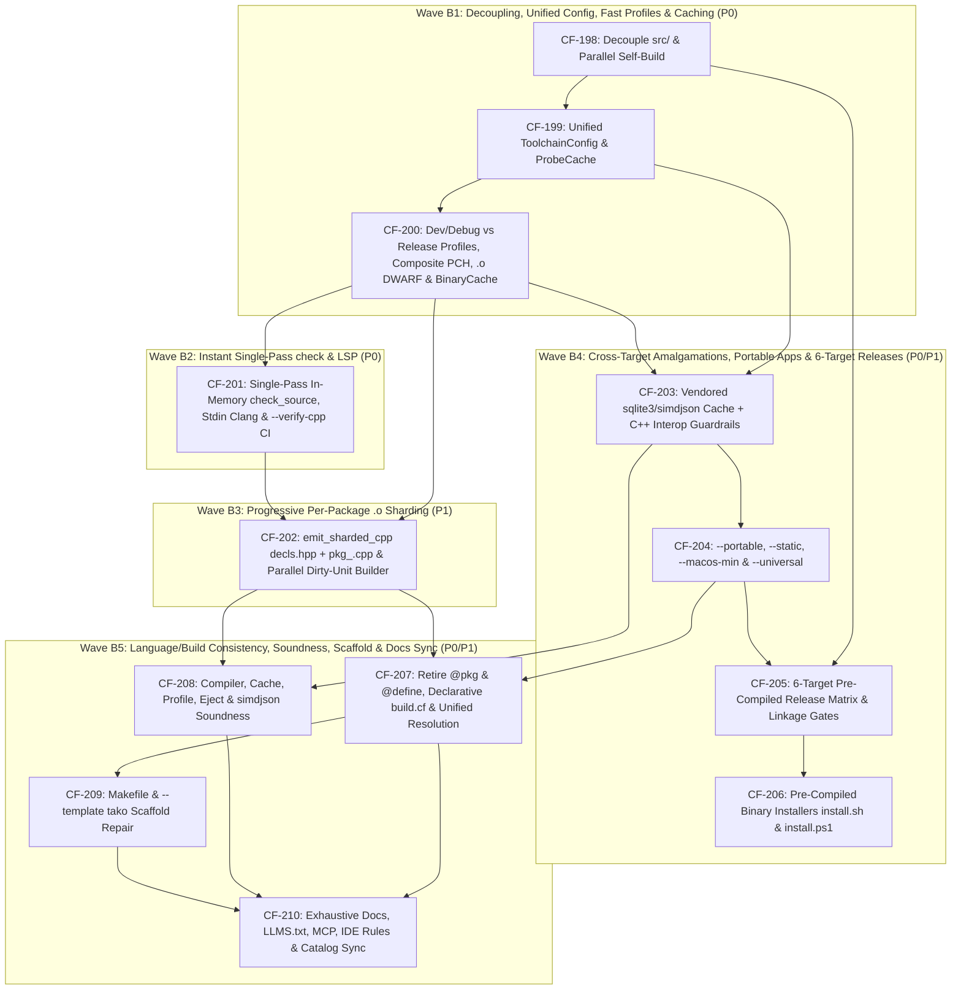
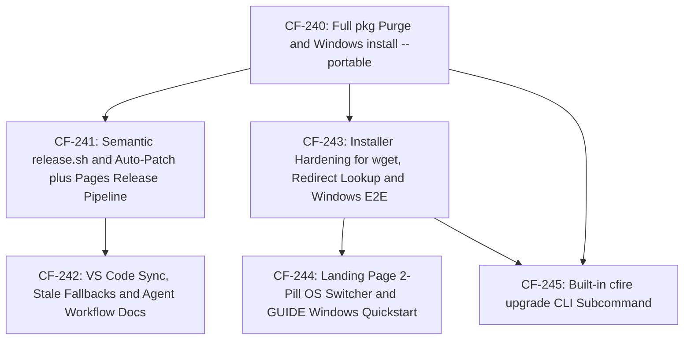

# Build Performance & Binary Distribution Backlog

This topic-focused backlog tracks compiler/build performance optimizations, progressive compilation, caching, cross-platform pre-compiled binary distribution, Wave B5 consistency/soundness/docs remediation, Wave B6 release automation, installer parity, and self-upgrade tooling, and Wave B7 test/cache/VM gate acceleration for `cfire` (**`CF-198` – `CF-210`** and **`CF-240` – `CF-246`**, architectural decisions **`Q55` – `Q61`** and **`Q70` – `Q74`**).

It extends the main project backlog in [`backlog.md`](./backlog.md) (`CF-001` – `CF-197`, `Q1` – `Q54`) as of `main` @ `2786f66` (2026-11-14) and `71adeb7` (2026-11-18). All items obey the operating workflow and three quality gates in [`README.md`](./README.md) (`make check`, `make check-deep`, `make check-platforms`).

> **ID Allocation**: Waves B1–B5 use **`CF-198` – `CF-210`** (`Q55` – `Q61`), [`flint.md`](./flint.md) uses **`CF-211` – `CF-239`** (`Q62` – `Q69`) and **`CF-262` – `CF-272`** (`Q95` – `Q99`), Wave B6 uses **`CF-240` – `CF-245`** (`Q70` – `Q73`), Wave B7 uses **`CF-246`** (`Q74`), and Wave B8 below uses **`CF-273`**. Future items anywhere in `docs/planning/` start at **`CF-274`** and **`Q100`**.

---

## Baseline & Bottleneck Evidence (`main` @ `2786f66`, 2026-11-14)

1. **Compiler self-build (`Makefile:29-30`, `src/build/toolchain_layout.hpp:8`)**: `cfire` builds from a single translation unit (`src/main.cpp`), expanding `~1.91 MB` of preprocessed C++ because `src/build/toolchain_layout.hpp:8` `#include`s `"cfire_core_stdlib.hpp"`, pulling all runtime module headers into the compiler binary (~`35.5s` on Apple Silicon). `Makefile:6` also links `-framework AudioToolbox` unconditionally into `cfire`.
2. **`cfire` `.cf` frontend is not the bottleneck**: Lexing, parsing, package loading, Sema, and C++23 codegen (`cfire emit-cpp`) complete in `10–30 ms` (`< 1%` of total compile latency). Virtually 100% of user-visible latency lives in downstream `clang++` parsing, optimization, and redundant invocations.
3. **Debug builds disable PCH (`src/buildsys.hpp:778`)**: `cfire run` and `cfire test` default to `-O2`, while `--debug` disables PCH via `!g_debug_mode`, making debug compilation slower than release (`0.83s` vs `0.63s` on hello-world). Furthermore, only `cfire_prelude.hpp` is precompiled—heavy programs like `examples/14-ai-rag-sqlite` (`3.92s` release, `2.43s` debug, `3.92s` unchanged re-run) re-parse `runtime/core/*.hpp`, `sqlite3.h`, and `simdjson.h` on every build with zero binary cache.
4. **Double-analysis + stale-disk bug in `check` & LSP (`src/analysis.hpp:135-175`, `src/lsp/server.hpp:847-875`)**: `check_source` always invokes `analyze_and_emit(fpath, ...)` (`src/analysis.hpp:148`) followed by `verify_cpp_syntax_only` (`clang++ -O2`), even when zero `cpp {}` blocks or `import cpp` declarations exist. Worse, `analyze_and_emit(fpath, ...)` re-reads `.cf` files from disk, ignoring unsaved in-memory LSP `content` buffers (`textDocument/didChange`).
5. **Binary distribution & C/C++ library portability (`src/buildsys.hpp:290-384`, `.github/workflows/release.yml`, `docs/install.sh`)**:
   - Releases currently ship only `macOS arm64` (`cfire-v<ver>-macos-arm64.tar.gz`) with no macOS deployment target floor (`-mmacosx-version-min`), no Linux static `musl` builds, and no Windows builds; `docs/install.sh` compiles from source on the user's machine.
   - `core:json` (`runtime/core/json.hpp:412`) and `ext:db/sqlite` depend on external `simdjson` / `sqlite3` system packages or disable SIMD on iOS; `src/buildsys.hpp:44-46` puts all of `runtime/vendor/` on global `-I`; and `src/build/deps.hpp:456, 545-549` hardcodes `"clang++"` / `"clang"` without forwarding configured compiler, target, sysroot, or deployment-target flags.

---

## B.1 Architectural Decision Record (`Q55` – `Q59`, resolved interactively 2026-11-13)

55. **Pure `clang++` Backend & Unified Compiler Configuration (`Q55`, Option 1C)**:
    - Ship **6 lean pre-compiled `cfire` + `runtime/` release bundles** (`linux-x86_64`, `linux-arm64`, `macos-arm64`, `macos-x86_64`, `windows-x86_64`, `windows-arm64`), containing zero pre-built `.pch` or `.a` binaries.
    - Keep **pure `clang++`** as the sole native backend (`xcode-select` on macOS/iOS, distro `clang++` on Linux, `MSYS2 CLANG64` on Windows, `em++` for `--web`, `ANDROID_NDK_HOME` `<triple>-clang++` for Android). Explicitly excluded: embedding `zig c++` or adding a compiler-tarball downloader inside `cfire`.
    - Unify compiler resolution across `buildsys`, `pch`, `syntax_check`, `deps`, `clang_bridge`, `doctor`, and `lsp` via a single `ToolchainConfig` with strict precedence:
      `CLI flags (--cxx, --cc, --emxx, --ar)` > `Environment (CFIRE_CXX, CFIRE_CC, CFIRE_EMXX, CFIRE_AR)` > `User Config (~/.cfire/config.json, managed by cfire config)` > `Auto-discovery (<triple>-clang++, clang++)`.

56. **Per-Target Cached Amalgamations (`sqlite3`, `simdjson`), Portable App Flags & 3 C++ Interop Guardrails (`Q56`, Option 2B)**:
    - Vendor single-file upstream amalgamations `sqlite3.{c,h}` and `simdjson.{cpp,h}` inside **isolated subdirectories** (`runtime/vendor/sqlite3/` and `runtime/vendor/simdjson/`). Compile and cache static archives on first use per `(compiler_fingerprint, target_triple, sysroot_or_sdk, abi_flags, source_sha256)` under `~/.cfire/cache/libs/<key>/` across Desktop (`macos`, `linux`, `windows`), WebAssembly (`--web` via `emcc` with `-DSQLITE_OMIT_LOAD_EXTENSION -DSQLITE_THREADSAFE=0`), iOS (`iphoneos`/`iphonesimulator`, enabling ARM64 NEON `simdjson` when vendored), and Android NDK (which omits public `libsqlite3.so`).
    - Keep heavy/cryptographic/transport C libraries (`zstd`, `libsodium`, `libssh`, `OpenSSL`) unbundled via `pkg-config` / OS-native APIs / `build.cf` vendor specs.
    - Enforce **3 Mandatory C++ Interop Guardrails**:
      1. *No Header/Symbol Shadowing*: Never add `runtime/vendor/sqlite3` or `runtime/vendor/simdjson` unconditionally to global `-I` (`src/buildsys.hpp:44-46`); yield automatically whenever the user selects `sqlcipher`, `--pkg-config` / `--link-lib`, `build.cf` deps (`PkgConfig` / `Libraries` / `CMake` / `CC`), or `~/.local` overrides. *(Historic `@pkg(...)` / `#[pkg(...)]` syntax retired in `Q60`.)*
      2. *Toolchain & C++ Stdlib ABI Forwarding (`src/build/deps.hpp`)*: Forward resolved `ToolchainConfig` (`cc`, `cxx`, `ar`, `--target`, `--sysroot`, `-mmacosx-version-min`, `-DCMAKE_C_COMPILER`, `-DCMAKE_CXX_COMPILER`, `-DCMAKE_OSX_DEPLOYMENT_TARGET`) into C/C++ and CMake dependency builds so user C++ libraries match the C++ stdlib ABI (`libc++` vs `libstdc++` vs UCRT).
      3. *Graceful `--portable` vs Strict `--static`*: Under `--portable`, resolve `.a` archives per library where available while falling back gracefully to dynamic linking (with a concise diagnostic note) for OS frameworks and shared-only user C++ libraries; reserve hard failure when static linkage is unavailable for `--static`. Support `--macos-min=<ver>` (default `13.3` on macOS release builds — the Ventura floor where `libc++.1.dylib` exports floating-point `std::to_chars` needed by C++23 `<format>`/`<print>`) and `--universal` (`arm64` + `x86_64` `lipo` fat binary on macOS).

57. **Dev/Debug vs. Release Build Profiles & LLDB `.o` DWARF Fidelity (`Q57`, Option 3A)**:
    - `cfire run` and `cfire test` default to **Dev/Debug** (`-O0 -g` + Debug Composite PCH + arithmetic traps `-fsanitize=signed-integer-overflow,shift,integer-divide-by-zero -fsanitize-trap=all`, with `--no-trap` opt-out and `--release` / `-r` override).
    - `cfire build` and `cfire bench` default to **Release** (`-O2` + Release Composite PCH, with `--debug` / `-g` override).
    - Fix `!g_debug_mode` (`src/buildsys.hpp:778`) so debug builds use a Debug PCH with matching `-O0 -g` and arithmetic-trap / `-static` flags rather than disabling PCH.
    - Compile debug builds via persistent `.cfire/obj/<unit>.o` + link step so macOS `ld` writes `OSO` DWARF debug-map entries pointing at `.cfire/obj/*.o` (`#line`-mapped to `.cf` files), enabling instant LLDB `.cf` breakpoints without running slow `dsymutil` (available via `--dsym`). Auto-detect `-fuse-ld=mold` / `-fuse-ld=lld` on Linux/Windows via cached probe.

58. **Single-Pass In-Memory `check` / LSP & Escape-Hatch Gating (`Q58`, Option 4A)**:
    - Eliminate the double analysis and stale disk read in `check_source` (`src/analysis.hpp:148`): resolve sibling/local packages against in-memory buffers (`file_overrides`), keep a single `CheckedFile`, and avoid re-parsing from disk.
    - Pure `.cf` programs (no `CppStmt` in AST functions/tests and no `ImportDecl::is_cpp` imports) finish `cfire check` and LSP diagnostics 100% in-process in `~15 ms` with zero `clang++` processes and zero `.cfire/gen/*.cpp` disk writes.
    - When `cpp {}` or `import cpp` is present, run single-pass `clang++ -O0 -x c++ - -fsyntax-only` via stdin + Debug Composite PCH (`cfire check`, and on `textDocument/didSave` in LSP while `textDocument/didChange` stays in-memory Sema `< 20 ms`).
    - Add `cfire check --verify-cpp` (`--full`) to run the stdin Clang pass on pure `.cf` code too, and enforce `./cfire check --verify-cpp` across `examples/` in `Makefile`'s `make check` gate so compiler codegen bugs never slip past Sema.

59. **4-Layer Build Caching, Composite Runtime PCH, Parallel Self-Build & Phase-1 Per-Package `.o` Sharding (`Q59`, Option 5B)**:
    - Deliver all four speed layers together with Phase-1 progressive per-package compilation:
      1. Content-addressed `BinaryCache` (`~/.cfire/cache/bin/<sha256>` or `$XDG_CACHE_HOME/cfire/bin/`, `0700` dir, atomic write + rename, 1 GB LRU cap, `--no-cache`, `cfire clean --cache`).
      2. Persistent `ProbeCache` (`~/.cfire/cache/probes.json`) keyed by compiler `(path, mtime, size)` and `PKG_CONFIG_PATH`.
      3. Per-import-set Composite Runtime PCH (`~/.cfire/cache/pch/umbrella_<sha256>.pch` covering `cfire_prelude.hpp` + active `runtime/core/*.hpp` headers for Debug & Release).
      4. Parallel `cfire` self-build (`src/build/toolchain_layout.hpp:8` decoupled from `cfire_core_stdlib.hpp`, `src/tu_*.cpp` split, `-MMD -MP` dependency tracking: `35.5s` -> `~5s`).
      5. Sharded per-package C++23 emitter (`emit_sharded_cpp`: `decls.hpp` + `pkg_<id>.cpp` -> `.cfire/obj/pkg_<id>_<hash>.o`) with parallel dirty-unit compilation, leaving single-file `emit_cpp()` unchanged for `cfire emit-cpp` and `tests/golden/*.expected.cpp`.

60. **Strict `CF-031` Boundary — Retire Both `@pkg(...)` and `@define(...)`, Move All Native Linkage & Preprocessor Defines to `build.cf` + CLI (`Q60`, Option B)**:
    - Source files (`.cf`) express **source-level module/header imports only** (`import cpp "foo.h" as foo`); all native link/pkg-config concerns (`PkgConfig`, `Libraries`, `Frameworks`, `Includes`) and compile-time macro definitions (`Defines`, `build.Define`, `build.Defines`) belong declaratively in `build.cf` (or `--pkg-config <name>` / `--link-lib <name>` / `--define <K[=V]>` / `-D<K[=V]>` CLI flags for ad-hoc single-file builds).
    - **Retire `@pkg(...)` and `@define(...)` on `import`** with `cfire/RETIRED-API` and clear fix-its pointing to `build.cf` `PkgConfig` / `Defines` (and reject any remaining unknown import attribute with `cfire/INVALID-ATTRIBUTE`). Never silently accept retired or unknown attributes in Sema or LSP completions.
    - **Propagate validated macro definitions cleanly**: validate C macro identifiers (`[A-Za-z_][A-Za-z0-9_]*`), support both project-wide `Defines` in `build.cf` / CLI `-D` and per-header `build.Define` entries, and emit `#ifndef`-guarded `#define` directives (when `has_impl_define` or across sharded `decls.hpp`) alongside `target_compile_definitions(...)` in `cfire eject` and multi-package shard builds.
    - Unify `query_pkg_config` / `cpp_headers` / `build.cf` resolution **before** Sema across `buildsys`, `analysis`, `lsp`, and `cfire inspect`, and typecheck `build.cf` manifests cleanly via registered `core:build` struct types (`Package`, `Executable`, `Library`, `PkgConfig`, `Define`, etc.).

61. **Vendored-First `simdjson` Precedence & `core:tako` Scaffold Hygiene (`Q61`, Options A + A)**:
    - **`simdjson` matches `sqlite3`**: Always compile and link the cached vendored `simdjson` `5.0.5` archive across `run`, `build`, `test`, and `eject`, yielding only to explicit user overrides (`~/.local/{include,lib}`, `build.cf`, `--link-lib`, `--pkg-config`), and pin `-DSIMDJSON_DEVELOPMENT_CHECKS=0` consistently across `DevDebug` and `Release` so `sizeof(ondemand::parser)` never flips between profiles or PCH builds.
    - **Purge dead `pkg:tako` / `pkg/*` references & modernize `--template tako`**: Remove the empty `cp -R pkg/*` failure in `Makefile:install`, remove legacy `pkg:tako` strings from rules/docs/LLM prompts, and update `cfire new --template tako` to scaffold a compiling, tested `import "core:tako"` local cloud-mock starter.

---

## B.2 Execution Dependency Graph & Wave Sequencing

| Wave | Goal | Items | Exit Gate |
| :---: | :--- | :--- | :--- |
| **B1** | Fast compiler rebuilds, unified config, fast Dev/Debug loop & persistent caches | `CF-198` -> `CF-199` -> `CF-200` | `make -j$(nproc) cfire` cleans & builds in `<= 7s` with zero AudioToolbox/`cfire_core_stdlib.hpp` in `src/`; warm `cfire build` hits `BinaryCache` in `< 30 ms`; cold-code / warm-Composite-PCH `14-ai-rag-sqlite` debug build `< 0.5s`; LLDB hits `.cf:line` breakpoints without `dsymutil`; `make check-all` green. |
| **B2** | Instant pure-`.cf` `check` & accurate in-memory LSP | `CF-201` | Pure `.cf` `cfire check` completes in `< 30 ms` with 0 `clang++` spawns and 0 `.cfire/gen/*.cpp` writes; unsaved LSP multi-file buffer edits diagnose in-memory without reading stale disk files; `make check` runs `./cfire check --verify-cpp` on all examples; `make check-all` green. |
| **B3** | Progressive per-package `.o` builds for multi-package projects | `CF-202` | Editing 1 file in a 5-package project recompiles only its `pkg_<id>.o` + relinks (`1` `clang++ -c` call vs `5`); `cfire emit-cpp` & `tests/golden/*.expected.cpp` are byte-identical; `make check-all` green. |
| **B4** | Zero-setup `sqlite3`/`simdjson`, portable user apps & 6-target binary installers | `CF-203` -> `CF-204` -> `CF-205` -> `CF-206` | Clean macOS/Linux/Windows/Wasm/iOS machines build `core:json` & `ext:db/sqlite` with 0 external library installs while honoring user `sqlcipher`/C++ overrides; all 6 release bundles pass static/minOS linkage audits & smoke tests; `install.sh` + `install.ps1` install & verify SHA-256 checksums; `make check-all` green. |
| **B5** | `CF-031` linkage/define boundary, pure-`.cf` Sema/cache/eject soundness, `--template tako`, and docs/LLM parity | `CF-207` -> `CF-208` -> `CF-209` -> `CF-210` | `@pkg(...)` and `@define(...)` retired with `cfire/RETIRED-API` and unknown import attrs rejected with `cfire/INVALID-ATTRIBUTE`; `Defines`/`build.Define`/`--define`/`-D`, `PkgConfig`/`Includes`/`AppName`/`--pkg-config` + `build.cf` Sema checks green; `simdjson` vendored-first & `DevDebug` consistent; `cfire run`/`eval`/`eject` sound; `make install` & `cfire new --template tako` pass; `./cfire doc --check`, `make check`, `make check-deep` green. |

---

## B.3 Prioritized Backlog Index

| Rank | ID | Wave | Priority | Size | Component | Summary | ADR | Depends On | Status |
| :---: | :--- | :---: | :---: | :---: | :--- | :--- | :---: | :---: | :---: |
| 1 | `CF-198` | B1 | **P0** | M | `src/build/toolchain_layout.hpp`, `src/tu_*.cpp`, `Makefile` | **Decouple `src/` from `cfire_core_stdlib.hpp` & Parallel Self-Build**: Remove runtime-header pull-in and unused AudioToolbox framework; split compiler into parallel TUs (`35.5s` -> `~5s`) | `Q59` | None | `[DONE]` |
| 2 | `CF-199` | B1 | **P0** | M | `src/build/{toolchain_config,probe_cache}.hpp`, `src/{buildsys,clang_bridge,doctor,main}.hpp/cpp` | **Unified `ToolchainConfig`, `cfire config` & Persistent `ProbeCache`**: Single compiler precedence chain (`--cxx`/`--cc`/`--emxx`, `CFIRE_*`, `~/.cfire/config.json`) + `probes.json` + `mold`/`lld` probe | `Q55`, `Q59` | `CF-198` | `[DONE]` |
| 3 | `CF-200` | B1 | **P0** | L | `src/build/{pch,binary_cache}.hpp`, `src/buildsys.hpp`, `src/main.cpp` | **Dev/Debug vs Release Profiles, Composite Runtime PCH, `.o` DWARF Maps & `BinaryCache`**: Default `run`/`test` to `-O0 -g` + cheap traps; Debug & Composite Runtime PCH; LLDB `.cfire/obj/*.o`; 1 GB LRU binary cache | `Q57`, `Q59` | `CF-199` | `[DONE]` |
| 4 | `CF-201` | B2 | **P0** | M | `src/analysis.hpp`, `src/build/syntax_check.hpp`, `src/lsp/server.hpp`, `Makefile` | **Single-Pass In-Memory `check` & Stdin Clang Gating**: Fix double-analysis/stale-disk bug; `~15 ms` pure-`.cf` short-circuit; stdin Clang for `cpp {}` / `import cpp`; `didChange` vs `didSave`; `--verify-cpp` CI gate | `Q58` | `CF-200` | `[DONE]` |
| 5 | `CF-202` | B3 | **P1** | L | `src/codegen.hpp`, `src/buildsys.hpp`, `src/build/package_loader.hpp` | **Progressive Per-Package `.hpp`/`.cpp` -> `.o` Compilation**: `emit_sharded_cpp` (`decls.hpp` + `pkg_<id>.cpp` with non-`inline` concrete exports) + parallel dirty-unit `.o` builder | `Q59` | `CF-200`, `CF-201` | `[DONE]` |
| 6 | `CF-203` | B4 | **P0** | L | `runtime/vendor/{sqlite3,simdjson}/`, `src/build/{lib_cache,deps}.hpp`, `runtime/core/json.hpp` | **Vendored `sqlite3` & `simdjson` Per-Target Archive Cache & C++ Interop Guardrails**: Isolated amalgamations compiled/cached for Desktop, Wasm, iOS NEON, Android; yield to `sqlcipher`/overrides; forward ABI in `deps.hpp` | `Q56` | `CF-199`, `CF-200` | `[DONE]` |
| 7 | `CF-204` | B4 | **P1** | M | `src/buildsys.hpp`, `src/build/manifest.hpp`, `src/main.cpp` | **Portable App Build Flags (`--portable`, `--static`, `--macos-min`, `--universal`)**: Per-library `.a` resolution with shared-only C++ fallback; macOS `13.3` floor & universal `lipo` fat binaries | `Q56` | `CF-203` | `[DONE]` |
| 8 | `CF-205` | B4 | **P0** | M | `.github/workflows/release.yml`, `scripts/release.sh`, `Dockerfile` | **6-Target Pre-Compiled `cfire` Release Matrix & Binary Linkage Gates**: Ship lean static `musl` Linux (`x64`/`arm64`), minOS `13.3` macOS (`arm64`/`x64`), `-static` UCRT Windows (`x64`/`arm64`) + `SHA256SUMS.txt` | `Q55` | `CF-198`, `CF-204` | `[DONE]` |
| 9 | `CF-206` | B4 | **P1** | S | `docs/install.sh`, `docs/install.ps1`, `README.md` | **Pre-Compiled Binary Installers**: Fast SHA-256 verified binary download + `--from-source` fallback (`install.sh`), native Windows PowerShell installer (`install.ps1`), updated docs | `Q55`, `Q56` | `CF-205` | `[DONE]` |
| 10 | `CF-207` | B5 | **P0** | L | `src/parser_impl.hpp`, `src/sema/*`, `src/build/{manifest,package_loader,toolchain_layout}.hpp`, `src/buildsys.hpp`, `src/analysis.hpp`, `src/lsp/*`, `src/codegen/declarations.hpp` | **Retire `@pkg` & `@define`, Declarative `build.cf` (`PkgConfig`, `Includes`, `Defines`, `AppName`) & Unified Pre-Sema Resolution**: Enforce `CF-031` separation (`cfire/RETIRED-API`, `cfire/INVALID-ATTRIBUTE`), validate/propagate `build.cf` `Defines`/`build.Define` & CLI `--define`/`-D` across shards and `eject`, add `--pkg-config`, typecheck `build.cf` | `Q60` | `CF-202`, `CF-204` | `[DONE]` |
| 11 | `CF-208` | B5 | **P0** | L | `src/codegen/decl.inc`, `src/sema/*`, `src/buildsys.hpp`, `src/tu_build.cpp`, `src/cli/scaffold.hpp`, `src/mcp.hpp`, `src/build/{toolchain_config,cache_paths,lib_cache,deps}.hpp` | **Compiler, Cache, Profile, `cfire eject` & Vendored `simdjson` Soundness**: Fix receiver-generic methods, C++ keyword mangling, recursive struct cycles, transitive move-only & interface checks; fix C header caching, stale `cfire run`, `cfire eval` `DevDebug`, vendored-first `simdjson` + `SIMDJSON_DEVELOPMENT_CHECKS=0`, `eject_cmake`, XDG/toolchain precedence, `--universal` Make/dSYM | `Q61` | `CF-203` | `[DONE]` |
| 12 | `CF-209` | B5 | **P0** | S | `Makefile`, `src/cli/scaffold.hpp`, `scripts/release.sh` | **`Makefile install` & `--template tako` Scaffold Repair**: Remove dead `pkg/*` copy in `Makefile`, verify portable flags, and rewrite `cfire new --template tako` onto `core:tako` | `Q61` | `CF-207` | `[DONE]` |
| 13 | `CF-210` | B5 | **P1** | M | `src/docgen/*`, `src/mcp.hpp`, `src/lsp/ide_setup.hpp`, `README.md`, `AGENTS.md`, `.agents/rules/planning-workflow.md`, `docs/*` | **Exhaustive Documentation, LLM Reference, MCP, IDE Rules & Catalog Sync**: Fix `generate_llm_reference`, add `docs/LLMS.txt`, sync `GUIDE.md`, `AGENTS.md`, `index.template.html`, Tab 7 snake_case, and regenerate `cfire doc` | `Q60`, `Q61` | `CF-207`, `CF-208`, `CF-209` | `[DONE]` |

---

## B.4 Detailed Item Specifications (`CF-198` – `CF-210`)

### `CF-198` — Decouple `src/` from `cfire_core_stdlib.hpp` & Parallel Self-Build `[DONE]`
- **Wave / ADR**: Wave B1 (`Q59`).
- **Problem & Evidence**:
  - `src/build/toolchain_layout.hpp:8` has `#include "cfire_core_stdlib.hpp"`, which transitively pulls in all 28 `runtime/core/*.hpp` headers (audio, webkit, TLS, JSON, sqlite, compression, etc.) into the compiler executable itself even though `src/` uses zero runtime stdlib symbols (`cfire_core_stdlib.hpp` is only referenced as header path strings in `src/buildsys.hpp:922`, `src/doctor.hpp:186`, and `src/diagnostics.hpp:1470`).
  - `Makefile:6` links `-framework AudioToolbox` into `cfire` on macOS despite zero AudioToolbox calls in `src/`.
  - `Makefile:29-30` compiles the entire compiler via a single `src/main.cpp` invocation (`1.91 MB` preprocessed source, `~35.5s` wall-clock on Apple Silicon), blocking multi-core builds and forcing full recompiles on any edit in `src/`.
- **Implementation Plan**:
  1. Remove `#include "cfire_core_stdlib.hpp"` from `src/build/toolchain_layout.hpp:8`.
  2. Audit `Makefile:6` Darwin/Linux link libraries: drop `-framework AudioToolbox` and keep only frameworks/libs directly called by `src/` (`Security` / `CoreFoundation` if needed, or zero non-libc frameworks if pure POSIX/C++23).
  3. Keep `src/*.hpp` header-compatible for existing `tests/unit/*.cpp` and `tests/e2e/test_canonical.cpp`, while splitting `cfire`'s heavy subsystems into dedicated `.cpp` translation units under `src/` (e.g., `src/tu_sema.cpp`, `src/tu_codegen.cpp`, `src/tu_build.cpp`, `src/tu_lsp.cpp`, `src/tu_docgen.cpp`, `src/tu_mcp.cpp`, `src/main.cpp`) with clean explicit declarations vs out-of-line definitions (`inline` helpers preserved where `tests/` include headers standalone, or `TEST_OBJS` linked appropriately).
  4. Update `Makefile` to compile `CFIRE_OBJS` with `-MMD -MP` `.d` dependency files, per-`.o.log` warning tracking checked by `make check-warnings`, and parallel `make -j` execution (`make build` / `make cfire`).
- **Tests**:
  - *Unit / Static*: Add a build test checking `#include`s in `src/` never include `cfire_core_stdlib.hpp` or `runtime/core/*.hpp`; `make check-warnings` inspects all `.o.log` files.
  - *Platform Linkage Check*: Verify `otool -L cfire` (macOS) and `ldd cfire` (Linux) do not reference `AudioToolbox`.
  - *Benchmark*: Measure clean `make -j$(nproc) cfire` wall time (`35.5s` -> `<= 7s`) and single-file incremental `.o` relink (`<= 3s`).
- **Acceptance Criteria**: `cfire` builds cleanly in parallel with 0 warnings across macOS, Linux, and Windows; zero runtime stdlib headers are compiled into `cfire`; `make check-all` passes.

---

### `CF-199` — Unified `ToolchainConfig`, `cfire config` & Persistent `ProbeCache` `[DONE]`
- **Wave / ADR**: Wave B1 (`Q55`, `Q59`).
- **Problem & Evidence**:
  - Compiler lookup is fragmented: `src/build/pch.hpp:41-71` checks `CFIRE_CXX` and falls back to `"clang++"`, `src/clang_bridge.hpp:547,601` hardcodes `"clang++"` separately, `src/doctor.hpp:126-175,307` probes `"clang++"` directly, and `src/build/deps.hpp:545` hardcodes `"clang++ -std=c++2b"` / `"clang -std=c17"`. Users cannot override `cc`, `cxx`, `emxx`, or `ar` uniformly via CLI flags or persistent config.
  - Every invocation of `cfire` runs redundant shell probes (`pkg-config`, `command -v`, compiler version/flag checks) without persistence across processes.
- **Implementation Plan**:
  1. Create `src/build/toolchain_config.hpp`:
     - `struct ToolchainConfig { std::string cxx, cc, emxx, ar, linker; std::filesystem::path config_path; };`
     - Strict resolution precedence: CLI flags (`--cxx`, `--cc`, `--emxx`, `--ar`, `--ld`) > environment (`CFIRE_CXX`, `CFIRE_CC`, `CFIRE_EMXX`, `CFIRE_AR`, `CFIRE_LD`) > persistent `~/.cfire/config.json` (or `XDG_CONFIG_HOME/cfire/config.json`) > auto-discovery (`<triple>-clang++`, `clang++`, `em++`, `llvm-ar`/`ar`, plus Linux `mold`/`lld` & Windows `lld` linker detection).
  2. Add `cfire config` subcommand (`src/main.cpp` / `src/cli/`) supporting `set <key> <val>`, `get <key>`, `unset <key>`, and `list` (JSON or text) using atomic write + rename to `~/.cfire/config.json`.
  3. Create `src/build/probe_cache.hpp`:
     - Persist toolchain capabilities (compiler version string, `--target` support, `-fuse-ld=mold`/`lld` availability, host target triple, `pkg-config` flags/libs) in `~/.cfire/cache/probes.json` (private `0700` dir, `CFIRE_CACHE_DIR` override honored, atomic write + rename).
     - Cache keys incorporate `(resolved_bin_path, mtime, file_size)` for compiler probes and `(PKG_CONFIG_PATH, PKG_CONFIG_LIBDIR, static_flag, target_triple, pkg_name)` + `.pc` file mtimes for `query_pkg_config`. Invalidates automatically if compiler binary or `.pc` files change.
  4. Wire `ToolchainConfig` + `ProbeCache` through `src/buildsys.hpp`, `src/clang_bridge.hpp`, `src/doctor.hpp`, `src/analysis.hpp`, and `src/lsp/server.hpp`. Update `cfire doctor` to display active compiler paths, provenance (CLI / env / `config.json` / PATH), and detected fast linker.
- **Tests**:
  - *Unit*: Precedence tests (CLI beats env beats `config.json` beats PATH), round-trip `cfire config` JSON parser/writer tests, and `ProbeCache` invalidation tests when compiler mtime or `PKG_CONFIG_PATH` changes.
  - *Integration*: Point `--cxx` / `CFIRE_CXX` / `cfire config set cxx ...` to a mock compiler wrapper script and assert `build`, `run`, `check`, `import cpp` (`clang_bridge`), and `doctor` all invoke the configured binary.
- **Acceptance Criteria**: Zero raw hardcoded `"clang++"` invocations remain in `buildsys`, `clang_bridge`, `pch`, `deps`, or `doctor`; warm `pkg-config` and linker probes hit `probes.json` with zero subprocess spawns; `make check-all` passes.

---

### `CF-200` — Dev/Debug vs Release Profiles, Composite Runtime PCH, `.o` DWARF Maps & `BinaryCache` `[DONE]`
- **Wave / ADR**: Wave B1 (`Q57`, `Q59`).
- **Problem & Evidence**:
  - `src/buildsys.hpp:627-634, 768-780` defaults `cfire run` and `cfire test` to `-O2`, disables PCH whenever `g_debug_mode` is true (`!g_debug_mode` at line `778`), and compiles straight to final binaries without persistent `.o` files (breaking fast macOS LLDB debug symbols unless slow `dsymutil` runs).
  - `src/build/pch.hpp:73-193` only precompiles `cfire_prelude.hpp` (leaving `runtime/core/*.hpp` headers like `json.hpp`, `sqlite.hpp`, `ai/`, `net/http.hpp` un-precompiled on every compile) and stores PCH files only in per-UID `/tmp/cfire-<uid>-pch` instead of durable `~/.cfire/cache/pch/`.
  - Re-running unchanged `cfire build` / `cfire run` always invokes `clang++` (`3.92s` on `14-ai-rag-sqlite`) because there is no content-addressed binary cache.
- **Implementation Plan**:
  1. **Explicit `BuildProfile` (`DevDebug`, `Release`, `SanitizeAddress`, `SanitizeThread`)**:
     - `cfire run` and `cfire test` default to `DevDebug`: `-O0 -g` plus cheap arithmetic trap flags (`-fsanitize=signed-integer-overflow,shift,integer-divide-by-zero -fsanitize-trap=all`, disabled when `--no-trap` is set or target is `wasm*`).
     - `cfire build` and `cfire bench` default to `Release`: `-O2 -fwrapv`.
     - Wire `--release` (`-r`) and `--debug` (`-g`) across `run`, `test`, and `build`; reject contradictory `--debug --release` cleanly.
  2. **Debug + Per-Import Composite Runtime PCH (`src/build/pch.hpp`)**:
     - Store PCH artifacts under `~/.cfire/cache/pch/` (`CFIRE_CACHE_DIR/pch` when set; `0700` perms).
     - Remove `!g_debug_mode` guard (`src/buildsys.hpp:778`).
     - Hash **all** PCH-sensitive flags into the Composite PCH key: `cfire_prelude.hpp` + active sorted `runtime/core/*.hpp` header contents & mtimes, compiler fingerprint, `kVersion`/`kGitSha`, target triple, optimization level (`O0` vs `O2` vs `O1` san), `-g`, `-fwrapv` vs trap flags, sanitizers, `-pthread`, `-static` (`__STATIC__` on Windows, preserving the `CF-184` fix), `-D CFIRE_USE_*`, and `-I` include roots that alter `#if __has_include(...)` branches.
     - Generate a synthetic umbrella header combining `cfire_prelude.hpp` + the sorted active `core/*.hpp` headers (modulo ObjC `.mm` mode and custom C-header conflicts), compile atomically (`tmp.<pid>.pch` -> rename), and guard concurrent builds with a lockfile so parallel CI/test workers build each PCH once. Keep a small fallback retry without `-include-pch` with warning telemetry in `--verbose`.
  3. **Persistent `.cfire/obj/*.o` & Instant LLDB DWARF Maps**:
     - In `DevDebug` mode (and optionally Release), compile to `.cfire/obj/<unit>_<hash>.o` (`-c`) then link `.o` -> executable, passing `-fuse-ld=mold`/`lld` when probed available on Linux/Windows. On macOS, `ld` embeds `N_OSO` debug-map stabs pointing directly to the preserved `.cfire/obj/*.o` files (`#line`-mapped back to `.cf` sources), enabling immediate LLDB `.cf:line` breakpoints without invoking `dsymutil`. Add `--dsym` to explicitly generate a standalone `.dSYM` bundle when archiving debug artifacts.
  4. **Content-Addressed `BinaryCache` (`src/build/binary_cache.hpp`)**:
     - Store compiled executables under `~/.cfire/cache/bin/<sha256>` (with `meta.json` recording ATIME/size for **1 GB LRU eviction**).
     - Key = SHA-256 over `{normalized emitted C++ or AST input, all transitive runtime/vendor/local header & C-dep archives, compiler fingerprint, BuildProfile, target triple, sysroot, cflags, ldflags}`.
     - On cache hit: copy/hardlink (`0755`) atomically into output path (`< 30 ms`) and skip `clang++` completely.
     - Add `--no-cache` to bypass lookup/store and `cfire clean --cache` to clear `~/.cfire/cache/` cleanly.
- **Tests**:
  - *Unit*: Profile selection (`run`/`test` -> `DevDebug`, `build`/`bench` -> `Release`, `--release`/`--debug` overrides); Composite PCH key differentiation (Debug vs Release, `__STATIC__`, `__has_include` toggles, trap vs `-fwrapv`); `BinaryCache` key invalidation & 1 GB LRU eviction logic.
  - *Integration / Debuggers*: Run LLDB (on macOS/Linux) in batch mode setting a `.cf` source line breakpoint (`breakpoint set --file main.cf --line N`) on a `DevDebug` binary without `.dSYM` and assert breakpoint hit + `.cf` frame backtrace; test `--no-cache` and `cfire clean --cache`.
  - *Conformance*: Arithmetic overflow/shift trap tests pass in default `cfire run` (`DevDebug`) and `--release` mode obeys `Q9`/`Q11`/`Q19` semantics.
- **Acceptance Criteria**: `cfire run`/`test` default to fast Debug mode using Debug Composite PCH; `14-ai-rag-sqlite` cold-code/warm-PCH debug compile drops from `2.43s` to `<= 0.5s` and warm unchanged `cfire build` hits `BinaryCache` in `< 30 ms`; `make check-all` passes (update any existing test expectations that hardcoded `-O2` on `run`/`test`).

---

### `CF-201` — Single-Pass In-Memory `check` & Stdin Clang Gating `[DONE]`
- **Wave / ADR**: Wave B2 (`Q58`).
- **Problem & Evidence**:
  - `src/analysis.hpp:135-175` unconditionally calls `verify_cpp_syntax_only` when `opts.verify_cpp_backend` is true, and at line `148` calls `cfire::build::analyze_and_emit(fpath, rt_dir, false, is_test_f)`, which **re-lexes, re-parses, and re-runs Sema from disk**!
  - Bug impact in LSP (`src/lsp/server.hpp:847-875`): during unsaved editor buffers (`didSave` / `didChange`), `check_source(file_path, text, opts)` passes `text`, yet line `148` reads the stale disk file at `fpath` instead of `text`, hiding or fabricating Clang errors and duplicating Sema latency (`0.88s–1.28s` per `cfire check`).
  - `src/build/syntax_check.hpp:26-68` writes `.cfire/gen/<stem>.cpp` to disk and invokes `clang++ -O2` even when `-O0` via stdin is faster and leaves working directories clean.
  - Note also: `src/analysis.hpp:163-169` used `-fwrapv` only for non-test files while `src/buildsys.hpp:627-633` uses trap flags in `DevDebug`—Clang syntax checking should match `DevDebug` / active profile flags so Composite Debug PCH is reused with 0 PCH mismatch.
- **Implementation Plan**:
  1. **Fix In-Memory Multi-File Resolution**: Extend `resolve_local_cf_imports` (or accept an optional `in_memory_overlays` map `{canonical_path -> text}` + already-parsed root `FileAST`) so `check_source` never reads `fpath` from disk when an in-memory buffer exists, and **delete the redundant `analyze_and_emit` second frontend pass** at `src/analysis.hpp:148` (extract any needed `build.cf` / native `-I` flags once without re-running Sema!).
  2. **Pure-`.cf` Sema Short-Circuit**: Implement `needs_cpp_syntax_check(const FileAST&)`: returns `true` iff any `ImportDecl::is_cpp` is present or any statement/body contains a `CppStmt` block (`cpp { ... }`). If false and neither `--verify-cpp` (`--full`) nor LSP `force_cpp_verify` is set, skip `verify_cpp_syntax_only` completely—returning diagnostics in `~15 ms` with zero subprocesses.
  3. **Stdin Clang Pass (`src/build/syntax_check.hpp`)**: Pipe emitted C++ directly over `stdin` (`-x c++ -` or `-x objective-c++ -`) into `clang++ -O0 -fsyntax-only` using the Debug Composite PCH (`ensure_composite_pch`), falling back to `SecureTempDir` only if a tool/platform cannot accept stdin, and **never** writing `.cfire/gen/*.cpp` during `cfire check` or `cfire lsp`. Normalize `<stdin>` diagnostic filenames cleanly in `parse_clang_diagnostic_line` (relying on `#line` directives emitted by `codegen.hpp`).
  4. **LSP `didChange` vs `didSave` Cadence (`src/lsp/server.hpp`)**: Keep `textDocument/didChange` strictly in-process Sema (`~15 ms`, passing open dirty document overlays from `docs_`), and run the single-pass stdin Clang check on `textDocument/didOpen` / `textDocument/didSave` when `needs_cpp_syntax_check` is true.
  5. **CLI `--verify-cpp` & `Makefile` Gate**: Add `--verify-cpp` (alias `--full`) to `cfire check` (`src/main.cpp` / `src/cli/cmd_check_fix.hpp`) and update `Makefile:78` (`make check`) to run `./cfire check --verify-cpp "$$d"` across `examples/*/` so codegen regressions against C++23 are caught in CI even on pure `.cf` examples.
- **Tests**:
  - *Unit / Regression*: In-memory unsaved-buffer test where disk file has an error (or valid code) and passed `content` has the opposite; assert `check_source` reflects `content`, not disk. Assert `needs_cpp_syntax_check` returns `false` on pure `.cf` and `true` on `cpp {}` or `import cpp`.
  - *Integration*: Verify `cfire check` on pure `.cf` project creates zero `.cfire/gen/` files and spawns zero `clang++` processes (`CFIRE_TRACE_SUBPROCESS` / hook check); verify `cfire check` automatically checks `cpp { "bad C++" }` and `cfire check --verify-cpp` catches codegen C++ errors.
  - *LSP Smoke*: Verify `didChange` responds with updated diagnostics in `< 50 ms` without spawning `clang++`, and `didSave` triggers stdin Clang checking for `import cpp` buffers.
- **Acceptance Criteria**: Pure-`.cf` `cfire check` executes in `<= 30 ms` with single-pass in-memory analysis; stale-disk LSP bug is eliminated; `make check` enforces `--verify-cpp` on `examples/`; `make check-all` passes.

---

### `CF-202` — Progressive Per-Package `.hpp`/`.cpp` -> `.o` Compilation `[DONE]`
- **Wave / ADR**: Wave B3 (`Q59`).
- **Problem & Evidence**:
  - Even with Composite PCH and `BinaryCache`, touching one `.cf` file in a multi-package workspace forces `codegen` (`src/codegen.hpp`) to emit a single monolithic `.cpp` for the entire dependency graph, so `clang++` must recompile every package's C++ functions from scratch.
  - **Verified C++ Linkage Pitfall in `src/codegen.hpp`**:
    - Today `src/codegen.hpp:838-842`, `950`, `996` emits `inline` on **every** function forward declaration and definition (`inline auto cur_fn(...) -> ret;`).
    - In C++23 (`[dcl.inline]`), marking a non-template function `inline` in a shared `decls.hpp` while putting its body only in `pkg_<id>.cpp` is ill-formed (`-Wundefined-inline` / missing definition in other TUs).
    - Meanwhile, `cfire_method_<name>` concept/smart-pointer dispatch templates (`src/codegen.hpp:511-533`) and generic functions/methods (`!fn.type_params.empty()`) MUST stay inline templates in `decls.hpp`, and `GlobalVarDecl` (`src/codegen.hpp:536-553`, which can use deduced `auto`) must stay C++17 `inline` variables in `decls.hpp` so all TUs share one ODR instance.
- **Implementation Plan**:
  1. Preserve single-file `emit_cpp(cf, test_mode)` completely unchanged so `cfire emit-cpp` and `tests/golden/*.expected.cpp` snapshots remain 100% deterministic and untouched.
  2. Implement `emit_sharded_cpp(const CheckedFile& cf, bool test_mode)` -> `ShardedEmission { std::string decls_hpp; std::vector<CppUnit> units; }` alongside `emit_cpp`:
     - Partition concrete functions, receiver methods (`cfire_method_<name>` + wrapper), `TestDecl` runners, and `main` by sanitized `package_name` (`pkg_main`, `pkg_<slug>`), keeping file-order determinism inside each unit.
     - **`decls.hpp`**: Contains `#pragma once`, `#include "cfire_prelude.hpp"`, union of active `runtime/core/*.hpp` & `import cpp` headers, interfaces (`concept`s), topological structs & enums, template dispatch helpers (`cfire_method_*` lines `511-533`), generic functions/methods (full `inline template <...> definitions`), `inline` package globals (`536-553`), and **non-`inline`** external prototypes for concrete functions and concrete receiver methods (`auto fn(...) -> ret;`).
     - **`pkg_<id>.cpp`**: Starts with `#include "decls.hpp"`, followed by **non-`inline`** concrete function and concrete method definitions (`auto fn(...) -> ret { ... }` and `cfire_method_*` wrappers) belonging to `<id>` (`fn.name == "main"` and test runner live in the entry/test unit).
     - Emit content hashes per `CppUnit`; only overwrite `.cfire/gen/decls.hpp` or `.cfire/gen/pkg_<id>.cpp` on disk if its content actually changed (**write-if-changed**), preserving `decls.hpp` / unchanged `pkg_*.cpp` mtimes!
  3. **Parallel Dirty-Unit `.o` Compiler (`src/buildsys.hpp`)**:
     - Compile each `pkg_<id>.cpp` whose content hash (combined with normalized `decls.hpp` hash + compile flags hash) has no valid `.cfire/obj/pkg_<id>_<hash>.o` in parallel across `hardware_concurrency()` workers using the active Composite PCH (`-include-pch`).
     - Link all `.o` units cleanly with `mold`/`lld`/system `ld`, preserving ObjC++ (`.mm`) and C-interop flags; fall back cleanly to single-TU mode if `build.cf` / CLI disables sharding (`--no-shard`) or for single-package tiny programs (`units.size() <= 1`) where single-TU compilation avoids extra process overhead.
- **Tests**:
  - *Unit*: Verify `emit_sharded_cpp` generates zero `inline` tokens on non-template prototypes in `decls.hpp` or concrete definitions in `pkg_*.cpp`, keeps templates/globals `inline`, and preserves `emit_cpp` byte-for-byte equality on all `tests/golden/*.expected.cpp`.
  - *Integration*: Build a 5-package test project (including cross-package generic functions, concrete methods, `GlobalVarDecl`, `interface` concepts, and `shared[T]`/`own[T]` dispatch), modify 1 `.cf` file in 1 package, rebuild, and assert only `1` of `5` `pkg_*.cpp` units recompiles while runtime output matches single-TU output identically. Also test editing a `struct` in `decls.hpp` forces all dependent units to recompile cleanly (no stale ODR/ABI!).
  - *Sanitizers*: Run ASan/UBSan and `-Wundefined-inline` / `-Werror` checks over sharded builds.
- **Acceptance Criteria**: Multi-package incremental edits recompile only dirty package `.o` units in parallel; zero ODR or `-Wundefined-inline` errors; `tests/golden/*.expected.cpp` unchanged; `make check-all` passes.

---

### `CF-203` — Vendored `sqlite3` & `simdjson` Per-Target Archive Cache & C++ Interop Guardrails `[DONE]`
- **Wave / ADR**: Wave B4 (`Q56`).
- **Problem & Evidence**:
  - Clean user machines without Homebrew/apt/vcpkg fail to build `core:json` SIMD reflection (`simdjson`) or `ext:db/sqlite` (`sqlite3`). On Wasm (`--web`) and Android NDK, `sqlite3` is missing or broken if OS shared libs are expected; on iOS (`runtime/core/json.hpp:412`), `simdjson` is `#if`-disabled (`!(defined(__APPLE__) && defined(TARGET_OS_IPHONE) && TARGET_OS_IPHONE)`), falling back to a slower parser even though Apple ARM64 devices support `simdjson` NEON natively.
  - Currently `src/buildsys.hpp:44-46` and `src/analysis.hpp:171-173` add `<runtime_dir>/vendor` directly to `-I`, which would expose bundled headers to every C++ file and shadow user overrides or `sqlcipher`.
  - `src/build/deps.hpp:456, 545-549, 608` hardcodes `"clang++"` / `"clang"` and omits user `ToolchainConfig`, `-mmacosx-version-min`, and CMake `CMAKE_CXX_COMPILER` forwarding, risking `libc++` vs `libstdc++` ABI mismatches with user C++ dependencies.
- **Implementation Plan**:
  1. **Isolated Amalgamation Tree**: Vendor pinned upstream releases (with `LICENSE`, `VERSION`, and `SHA256` manifest) into:
     - `runtime/vendor/sqlite3/sqlite3.c` & `sqlite3.h`
     - `runtime/vendor/simdjson/simdjson.cpp` & `simdjson.h`
     - Remove the blanket `-I<runtime_dir>/vendor` at `src/buildsys.hpp:44-46` and `src/analysis.hpp:171-173`!
  2. **Per-Target On-Demand Archive Cache (`src/build/lib_cache.hpp`)**:
     - Store built archives at `~/.cfire/cache/libs/<sha256_key>/libcfire_{sqlite3,simdjson}.a` (`0700` dir, lockfile-protected + atomic rename).
     - Cache key hashes: `(amalgamation_sha256, compiler_fingerprint, ar_tool, normalized_target_triple, sysroot_or_sdk, deployment_min, pic_flag, abi_defines)`.
     - Target compile matrix:
       - *Desktop (`macos`, `linux`, `windows`)*: compile with host/target `ToolchainConfig` (`-O2`, `-fPIC` on ELF/Mach-O, `-static`-compatible flags on Windows UCRT). Note: Windows `sqlite3` links `-lpthread` unnecessary? Use standard Windows win32 threads (`-DSQLITE_OS_WIN=1`).
       - *WebAssembly (`--web`)*: compile `sqlite3.c` via `emcc` with `-sWASM=1 -DSQLITE_OMIT_LOAD_EXTENSION -DSQLITE_THREADSAFE=0`, and compile `simdjson.cpp` with `em++ -sWASM=1 -msimd128` (updating `src/buildsys.hpp:788, 811` and `runtime/core/json.hpp:412` `!defined(PLATFORM_WEB)` once verified or documenting Web/Wasm SIMD capability cleanly).
       - *iOS (`--target ios` / `ios-sim`)*: compile `simdjson.cpp` for `arm64-apple-ios` / `x86_64|arm64-apple-ios-simulator` with `-isysroot` & `-miphoneos-version-min`; update `runtime/core/json.hpp:412` so `CFIRE_USE_SIMDJSON` activates on iOS when vendored/provided! Keep system `-lsqlite3` or vendored archive cleanly when targeting iOS.
       - *Android (`*-android*`)*: compile both `sqlite3.c` and `simdjson.cpp` with `ToolchainConfig` NDK compiler & `--sysroot`.
  3. **Guardrail 1 — Automatic Override Yielding**:
     - For `ext:db/sqlite`: only add `-I<runtime_dir>/vendor/sqlite3` + cached `libcfire_sqlite3.a` if **none** of `has_sqlcipher()`, `~/.local/{include,lib}` `sqlite3`, explicit `--pkg-config`, `--link-lib`, or `build.cf` dependency provides `sqlite3`/`sqlcipher`!
     - For `core:json` / `simdjson`: always default to vendored `simdjson` + cached `libcfire_simdjson.a` unless user `~/.local`, `--pkg-config`, `--link-lib`, or `build.cf` overrides `simdjson` *(enforced consistently across `run`/`build`/`test`/`eject` in `CF-208` / `Q61`)*. *(Historic `#[pkg]` / `@pkg` syntax retired in `CF-207` / `Q60`.)*
  4. **Guardrail 2 — `src/build/deps.hpp` Toolchain & C++ Stdlib ABI Forwarding**:
     - Replace hardcoded `"clang++"` / `"clang"` / `"ar"` in `src/build/deps.hpp:545,608,615` with resolved `ToolchainConfig` (`cxx`, `cc`, `ar`).
     - Forward `--target`, `-isysroot` / `--sysroot`, `-mmacosx-version-min` (when set), and for CMake deps (`deps.hpp:456`): `-DCMAKE_C_COMPILER=... -DCMAKE_CXX_COMPILER=... -DCMAKE_OSX_DEPLOYMENT_TARGET=...`.
     - Ensure `deps.hpp` cache keys also include compiler/target/sysroot/deployment-target so switching targets never reuses stale `.a`/`.o` artifacts!
- **Tests**:
  - *Unit*: Override-priority matrix verifying vendored `-I.../vendor/sqlite3` and `libcfire_sqlite3.a` are **omitted** when `sqlcipher`, `~/.local` sqlite3, or `build.cf` sqlite dependency is present; verify `deps.hpp` command builders forward `ToolchainConfig` + `--target` + `-mmacosx-version-min` into C/C++ and CMake invocations.
  - *Integration / Cross-Target*: Compile & run `core:json` + `ext:db/sqlite` on clean environment (`PKG_CONFIG_PATH=/nonexistent`), on Wasm (`em++` / node if installed, or compile-to-`.wasm`/`.o`), on iOS simulator SDK (`xcrun --sdk iphonesimulator`, verifying `simdjson` ARM64/NEON compiles clean with 0 warnings), and against a C++ dependency fixture built via `deps.hpp` (`tests/fixtures/`).
- **Acceptance Criteria**: `core:json` and `ext:db/sqlite` compile & pass with zero Homebrew/apt/MSYS2 library installs; custom `sqlcipher` & C++ dependencies never collide on headers or stdlib ABI; `make check-all` passes.

---

### `CF-204` — Portable User Application Build Flags (`--portable`, `--static`, `--macos-min`, `--universal`) `[DONE]`
- **Wave / ADR**: Wave B4 (`Q56`).
- **Problem & Evidence**:
  - Users running `cfire build` cannot easily distribute their own `.cf` binaries across older macOS versions, dual Intel+Apple Silicon Macs, or Linux machines missing shared `.so` dependencies (`libzstd.so`, `libsodium.so`, etc.).
- **Implementation Plan**:
  1. Add CLI flags on `cfire build` (and matching optional `build.cf` manifest fields):
     - `--portable`: opt into portable distribution defaults (resolve `.a` archives per library where available, apply `--macos-min=13.3` default on macOS if unset — Ventura `13.3` is the floor where `libc++.1.dylib` exports floating-point `std::to_chars` needed by C++23 `<format>`/`<print>`, and emit `@executable_path` / `$ORIGIN` rpath entries where dynamic C++ deps remain).
     - `--static`: strict full static archive linkage (fail cleanly with an actionable diagnostic naming the library if only `.so`/`.dylib` exists or target OS disallows full static libc like macOS/glibc).
     - `--macos-min=<ver>`: pass `-mmacosx-version-min=<ver>` (default `13.3` on macOS release / `--portable` builds; forwarded to `ToolchainConfig`, `deps.hpp`, `lib_cache.hpp`, and `clang++` link step).
     - `--universal`: on macOS, compile both `arm64-apple-macos<min>` and `x86_64-apple-macos<min>` slices (including cached `lib_cache.hpp` / `deps.hpp` slices) and combine with `lipo -create` (and inside `.app` bundle when GUI).
  2. **Guardrail 3 — Per-Library Archive Resolution**:
     - Implement per-library resolution under `--portable`: for each external `-l<name>` / `pkg-config` dependency, probe static archive availability (`pkg-config --static` or `<prefix>/lib/lib<name>.a` / `clang++ --print-file-name=lib<name>.a`), substituting `/path/to/lib<name>.a` cleanly while leaving OS frameworks/system libs (`CoreFoundation`, `WebKit`, `libSystem`, `libc`/`libm`) and shared-only user C++ libraries dynamic with a clear note (`note: '--portable' kept dynamic linkage for 'foo' (no libfoo.a found)`).
- **Tests**:
  - *Unit*: Flag parsing & macOS min-version/universal validation (reject `--universal` on non-macOS targets cleanly); per-library static-resolution fallback tests.
  - *Integration*: On macOS, build `--portable`, `--macos-min=13.3`, and `--universal` binaries and verify with `otool -l` (`LC_BUILD_VERSION minos 13.3`, zero `/opt/homebrew`/`/usr/local` third-party dylibs when static `.a` exists) and `lipo -archs` (`x86_64 arm64`). On Linux/Windows, verify `--portable` resolves static archives without failing when system OS libs stay dynamic, and `--static` rejects shared-only libraries with a clear error.
- **Acceptance Criteria**: Users can build portable, macOS `13.3+` / universal, and static binaries directly via `cfire build`; `make check-all` passes.

---

### `CF-205` — 6-Target Pre-Compiled `cfire` Release Matrix & Binary Linkage Gates `[DONE]`
- **Wave / ADR**: Wave B4 (`Q55`).
- **Problem & Evidence**:
  - `.github/workflows/release.yml:59-71` currently packages and uploads only `cfire-v${TAG_VER}-macos-arm64.tar.gz`, leaving Linux (`x86_64`, `arm64`), macOS `x86_64`, and Windows (`x86_64`, `arm64`) users without pre-compiled releases.
  - Also `scripts/release.sh` currently runs locally; GitHub Actions release verification should match `make check` and include strict binary portability checks.
- **Implementation Plan**:
  1. Expand `.github/workflows/release.yml` (triggered on `v*.*.*` tags & `workflow_dispatch`) to a 6-job/matrix build:
     - `linux-x86_64` (Alpine / musl container on `ubuntu-latest`): compile `cfire` with `-static` musl C++/libc (`clang++ -std=c++2b -O2 -static ...`), producing a zero-glibc, kernel-ABI-only binary. Package `cfire-v<ver>-linux-x86_64.tar.gz`.
     - `linux-arm64` (Alpine / musl on `ubuntu-24.04-arm` or QEMU/cross musl): package `cfire-v<ver>-linux-arm64.tar.gz`.
     - `macos-arm64` (`macos-14` / `macos-latest`): compile with `-mmacosx-version-min=13.3`, arm64 target. Package `cfire-v<ver>-macos-arm64.tar.gz`.
     - `macos-x86_64` (`macos-13` or `macos-14` cross-compiling `--target=x86_64-apple-macos13.3`): package `cfire-v<ver>-macos-x86_64.tar.gz`.
     - `windows-x86_64` (`windows-latest`, MSYS2 `CLANG64`): compile `cfire.exe` with `-static` (static UCRT / libc++ / winpthread). Package `cfire-v<ver>-windows-x86_64.zip`.
     - `windows-arm64` (MSYS2 `CLANGARM64` on `windows-11-arm` or LLVM MinGW `aarch64-w64-mingw32-clang++ -static`): package `cfire-v<ver>-windows-arm64.zip`.
  2. Each archive contains only `bin/cfire[.exe]` + `share/cfire/{runtime,pkg,docs}` (using portable layout `<root>/cfire[.exe]` + `<root>/runtime/` or `<root>/bin/cfire` + `<root>/runtime/`, verified against `src/build/toolchain_layout.hpp:171-189` — **zero** pre-built `.pch` or `.a` files).
  3. **Automated Binary Linkage Gates (in release CI before publish)**:
     - *Linux*: `file cfire` / `ldd cfire || true` must confirm static linkage (`statically linked` / `not a dynamic executable`).
     - *macOS*: `otool -l cfire` confirms `minos 13.3` (`LC_BUILD_VERSION`), `otool -L cfire` shows **only** `/usr/lib/*` and `/System/Library/Frameworks/*` (zero Homebrew `/opt/homebrew` or `/usr/local` dylibs).
     - *Windows*: `llvm-objdump -p cfire.exe | grep "DLL Name"` confirms **only** Windows OS system DLLs (`KERNEL32.dll`, `api-ms-win-crt-*` / `ucrtbase.dll` if UCRT, `WS2_32.dll`, etc. — zero `libstdc++*.dll`, `libc++.dll`, `libwinpthread*.dll`).
  4. **Release Smoke Tests + Checksums**: Unpack each archive into a clean directory (outside the repo checkout) and run `./cfire --version`, `./cfire check` + `./cfire run` on a `core:json` + `ext:db/sqlite` smoke program (except cross-compiled targets without native emulator, which smoke-test natively or via QEMU/VM). Publish `SHA256SUMS.txt` alongside all 6 archives on GitHub Releases. Update `Dockerfile` if needed to support multi-arch Alpine `musl` static release builds cleanly.
- **Tests**:
  - Local macOS verification for both `macos-arm64` and `macos-x86_64` slices (`otool -L`, `otool -l`), Linux VM `musl`/static check (`make check-platforms`), Windows VM `-static` DLL check, and dry-run release packaging target (`scripts/release.sh` / CI dry run).
- **Acceptance Criteria**: Release workflow builds all 6 lean bundles, passes linkage & unpacked smoke gates, generates `SHA256SUMS.txt`, and publishes cleanly to GitHub Releases.

---

### `CF-206` — Pre-Compiled Binary Installers (`docs/install.sh` & `docs/install.ps1`) `[DONE]`
- **Wave / ADR**: Wave B4 (`Q55`, `Q56`).
- **Problem & Evidence**:
  - `docs/install.sh:118-225` currently downloads the `main` source tarball and compiles `cfire` from scratch on every user install (requiring `make` and waiting `35s+`), and Windows has no installer script at all.
- **Implementation Plan**:
  1. **Upgrade `docs/install.sh`**:
     - Detect OS (`Darwin`/`Linux`) & arch (`x86_64`/`amd64`, `arm64`/`aarch64`), map to release artifact `cfire-v<ver>-<os>-<arch>.tar.gz` (resolving latest release tag via GitHub API/redirect or pinned `CFIRE_VERSION`).
     - Download both the archive and `SHA256SUMS.txt`, verify checksum (`shasum -a 256` on macOS, `sha256sum` on Linux — fail hard on mismatch), unpack into `~/.cfire/` (`~/.cfire/bin/cfire` + `~/.cfire/runtime/` + `~/.cfire/pkg/`), and ensure `~/.cfire/bin` is on PATH (or symlinks / profile snippet).
     - Do **not** require `make` or abort if `clang++` isn't installed yet during binary unpack: print a concise 1-line native toolchain hint (`xcode-select --install`, `apt install clang`, etc.) if `clang++` is missing on `PATH`, while keeping `./cfire --version` working immediately.
     - Keep `--from-source` (and existing `CFIRE_LOCAL_SRC`) mode intact for bleeding-edge `main` or unsupported architectures.
  2. **Create `docs/install.ps1`**:
     - Windows PowerShell installer supporting `AMD64` (`windows-x86_64.zip`) and `ARM64` (`windows-arm64.zip`), SHA-256 verification via `Get-FileHash -Algorithm SHA256`, extraction into `$env:USERPROFILE\.cfire\` (`bin\cfire.exe` + `runtime\`), User `PATH` registration (without duplicates), and a 1-line tip if `clang++.exe` (e.g., `MSYS2 CLANG64` or LLVM) is not yet installed.
  3. **Docs Sync (`README.md`)**: Document quick binary install commands (`curl ... | sh`, `irm ... | iex`), `--from-source` flag, and `cfire config` compiler override in `README.md` (strictly without `file://` or `/Users/` links so `cfire doc --check` passes).
- **Tests**:
  - *Unit / Script*: Test `docs/install.sh` (using a local file/HTTP mock release dir with `CFIRE_RELEASE_BASE_URL` or test hook) for valid SHA-256 install, corrupted SHA-256 rejection, and `--from-source` fallback (`CFIRE_LOCAL_SRC`).
  - *Platform VMs*: Test `install.sh` on the Linux VM and `install.ps1` in PowerShell on the Windows VM (verifying `cfire --version`, `cfire doctor`, and compiling a hello-world `.cf` program end-to-end).
  - *Docs*: `cfire doc --check` and `make check` pass with 0 warnings/errors.
- **Acceptance Criteria**: One-command binary install works on macOS, Linux, and Windows with mandatory SHA-256 verification and clean `clang++` onboarding; `make check-all` passes.

---

### `CF-207` — Retire `@pkg` & `@define`, Declarative `build.cf` (`PkgConfig`, `Includes`, `Defines`, `AppName`) & Unified Resolution `[DONE]`
- **Wave / ADR**: Wave B5 (`Q60`).
- **Problem & Evidence**:
  - `import cpp "..." @pkg("...")` and `@define(...)` violate `CF-031` separation of concerns between source files and `build.cf`, interact poorly with alias placement/deduplication (`package_loader.hpp`), leak raw `pkg-config` spawns inside LSP `collect_imports`, and scatter build configuration into `.cf` files instead of `build.cf`.
  - Meanwhile, `cfire new` emits `build.Executable{...}` which fails `cfire check build.cf` (`UNKNOWN-STDLIB-TYPE`), `core:build` points to non-existent `core/buildsys.hpp`, and `build.cf` lacks first-class `PkgConfig`, `Includes`, `Defines`, and `AppName` fields while `analyze_and_emit_impl` runs C header inspection before Sema (`pkg-config` runs after).
- **Implementation Plan**:
  1. Retire `@pkg(...)` and `@define(...)` in Sema (`cfire/RETIRED-API` with fix-its to `build.cf` `PkgConfig` / `Defines` / CLI `--pkg-config` / `--define`), reject unknown import attributes (`cfire/INVALID-ATTRIBUTE`), and validate `build.cf` `Defines` / `build.Define` / `--define` / `-D` C macro identifiers cleanly across `manifest.hpp`, `analysis.hpp`, and CLI parsing.
  2. Add `PkgConfig`, `Includes`, `Defines`, `AppName`, top-level `build.PkgConfig`/`Link`/`Include`/`Define` in `src/build/manifest.hpp`, `--pkg-config <name>` and `--define <K[=V]>`/`-D<K[=V]>` CLI flags, and generalized `ProbeCache`-backed `query_pkg_config` in `toolchain_layout.hpp` forwarding `--static`/`--portable` flags.
  3. Unify `cpp_headers` / `pkg-config` / `build.cf` resolution **before** Sema across `buildsys.hpp`, `analysis.hpp`, `lsp/server.hpp`, `inspect_and_outline.hpp`, `package_loader.hpp` (dedup key + subpackage linkage inheritance), and propagate `Defines` across all `decls.hpp` (`codegen/declarations.hpp`), shards, and `cfire eject` (`target_compile_definitions`).
  4. Register `core:build` struct types (`Package`, `Executable`, `Library`, `Step`, `PkgConfig`, `Link`, `Include`, `Define`, `Tako`, `Target`, `StepTarget`, `Command`, `CC`, `CMake`, `Make`, `Git`, `Archive`) in `builtin_methods.hpp`, treat `package build` or filename `build.cf` cleanly in Sema, and include `build.cf` in `cfire check <dir>` without Clang verification.
- **Acceptance Criteria**: `@pkg(...)` and `@define(...)` are cleanly rejected with `cfire/RETIRED-API`; `build.cf` `Defines`/`build.Define` and `--define`/`-D` validate identifiers and work across single-TU, sharded, and `eject` builds; `examples/05-cmake-interop` uses `build.cf` `PkgConfig`; `cfire check` succeeds on every `build.cf` project.

---

### `CF-208` — Compiler, Cache, Profile, `cfire eject` & Vendored `simdjson` Soundness `[DONE]`
- **Wave / ADR**: Wave B5 (`Q61`).
- **Problem & Evidence**:
  - Pure-`.cf` short-circuit (`CF-201`) revealed Clang-only codegen/Sema gaps: receiver-generic methods (`fn (b: Box[T]) get()`) lose enclosing `template <typename T>`, C++ keyword identifiers (`operator`, `concept`, `requires`, etc.) fail codegen, recursive value/`T?` struct cycles infinite-recurse, non-struct interface impls slip through, and move-only structs fail transitively.
  - Cache/profile/eject inconsistencies: `cfire run` skips `build_native` when `.cfire/bin/<exe>` exists (running stale `Release` binaries or stale `ui/index.html` in `.app` bundles), `cfire eval` uses `Release` instead of `DevDebug`, `SIMDJSON_DEVELOPMENT_CHECKS` flips `sizeof(ondemand::parser)` across `-O0`/`-O2`, `simdjson` yields to arbitrary Homebrew `pkg-config`, C header cache keys omit `-I`/header trees and non-`main` package `.h`, `eject_cmake` emits broken CMake (`pkg_check_modules simdjson`, missing `pthread dl m`, split `-framework`, missing `.mm`/`cflags`), `XDG_CONFIG_HOME` is ignored by `config_file_path()`, `compiler_binary_fingerprint` hashes only `ccache`, `resolve_cxx` vs `resolve_c` disagree, and `--universal` Make/Ninja/dSYM handling is incomplete.
- **Implementation Plan**:
  1. Fix generic receiver methods across forward decls, definitions, and sharded headers (`src/codegen/decl.inc`), expand `sanitize_cpp_ident`, reject recursive value struct cycles (`cfire/RECURSIVE-TYPE`), reject non-struct interface impls, and fix transitive move-only field checks.
  2. Switch `request_simdjson_dep` to vendored-first (`Q61`) + explicit `-DSIMDJSON_DEVELOPMENT_CHECKS=0` across `DevDebug` & `Release`; clean `doctor.hpp`; fix `eject_cmake`; unify `emit_cpp`/`emit_sharded_cpp` headers.
  3. Fix C header fingerprinting across `-I` dirs and `build.CC` headers, atomic `.tmp.<pid>.o`, `cflags` in single-TU `.o` cache, Windows `windres` hash, `tu_build.cpp`/`tu_scaffold.cpp` always running `build_native` in `cfire run`, `cfire eval` `DevDebug`, `package_loader.hpp` `GlobalVarDecl` topological order & test type mangling, `XDG_CONFIG_HOME`, `ToolchainConfig` cross-target precedence, `compiler_binary_fingerprint`, `LibCache` `ar`, and `--universal` Make/Ninja arch flags + skipping 3rd host pass + `--dsym`.
- **Acceptance Criteria**: All pure-`.cf` and multi-file projects hit zero C++23 codegen/ODR surprises under `--verify-cpp`; `cfire run`/`eval`/`eject`/`--universal` behave consistently across `DevDebug` and `Release`.

---

### `CF-209` — `Makefile install` & `--template tako` Scaffold Repair `[DONE]`
- **Wave / ADR**: Wave B5 (`Q61`).
- **Problem & Evidence**: `Makefile:79,83` fails `make install` with `cp: pkg/*: No such file or directory`; `cfire new --template tako` generates dead `import "pkg:tako"` and broken `tako.new_app` syntax.
- **Implementation Plan**: Remove dead `pkg` lines in `Makefile:79-84`, audit `scripts/release.sh` portable flags, and rewrite `cfire new --template tako` in `src/cli/scaffold.hpp` to scaffold a clean, compiling, tested `import "core:tako"` local cloud-mock app.
- **Acceptance Criteria**: `make install DESTDIR=/tmp/stage` succeeds cleanly and `cfire new app --template tako && cfire test` passes out-of-the-box.

---

### `CF-210` — Exhaustive Documentation, LLM Context, MCP, IDE Rules & Catalog Sync `[DONE]`
- **Wave / ADR**: Wave B5 (`Q60`, `Q61`).
- **Problem & Evidence**: `generate_llm_reference()` hardcodes a 13-module subset (`pkg:tako`, `@pkg`, `&str`, `str.find`, `log.Level.Debug`) while missing 15 runtime modules; `README.md`, `GUIDE.md`, `AGENTS.md`, `.agents/rules/planning-workflow.md`, `docs/index.template.html`, `src/mcp.hpp`, `src/lsp/ide_setup.hpp`, `src/docgen/*`, and Showcase Tab 7 still advertise retired syntax, stale counts, or wrong diagnostics.
- **Implementation Plan**: Overhaul `src/docgen/{markdown,styles,html,catalog_*}.hpp`, add generated `docs/LLMS.txt`, sync `src/mcp.hpp`, `src/lsp/ide_setup.hpp`, `src/cli/*`, `README.md`, `docs/GUIDE.md`, `docs/index.template.html`, `AGENTS.md`, `docs/planning/*`, `tests/conformance/README.md`, `tests/unit/test_lsp_docgen.hpp`, and regenerate all docs via `./cfire doc`.
- **Acceptance Criteria**: `./cfire doc --check`, `./.cfire_test_runner guide`, and `make check` pass with zero drift across docs, prompts, MCP resources, and catalogs.

---

## Wave B6: Release Pipeline Automation, Cross-Platform Installer Parity & Self-Upgrade (`CF-240` – `CF-245`)

This wave hardens and automates `cfire`'s build, packaging, container, installer, and self-update infrastructure on top of Wave B5 (**`CF-240` – `CF-245`**, architectural decisions **`Q70` – `Q73`**).

### Baseline & Audit Evidence (`main` @ `14a1a51`, 2026-11-17)

1. **Hard `Dockerfile` failure (`Dockerfile:24, 63`)**: Both `release-linux-musl` (`line 24`) and the default Ubuntu runtime stage (`line 63`) execute `COPY pkg ./pkg`. Because `pkg/` was removed in `CF-209`, `docker build -t cfire .` and `docker build --target release-linux-musl .` fail immediately.
2. **Hard Windows release failure & bespoke build (`release.yml:301-318`)**: `build-windows` manually compiles `src/main.cpp` instead of calling `make -j4 build` + `./cfire.exe install --portable`, and runs `mkdir -p "./dist/${BUNDLE}/runtime" "./dist/${BUNDLE}/pkg"` + `cp -R pkg/* "./dist/${BUNDLE}/pkg/"` under `set -e`, aborting `windows-x86_64` and `windows-arm64` jobs and blocking `publish`.
3. **Broken `workflow_dispatch` & missing auto-patch on `main` (`.github/workflows/release.yml`, `scripts/release.sh`, `.github/workflows/deploy-docs.yml`)**:
   - Commits pushed to `main` only trigger `ci.yml` and `deploy-docs.yml`; patch versions (`0.11.X`) do not auto-increment or publish new binaries.
   - Under `workflow_dispatch`, `prepare` runs `./scripts/release.sh` and pushes `chore(release): vX.Y.Z` + tag `vX.Y.Z` to `main`, but `build-linux` (`line 75`), `build-macos` (`line 169`), and `build-windows` (`line 273`) invoke `actions/checkout@v4` **without** `ref: ${{ needs.prepare.outputs.tag }}` — checking out the pre-bump commit SHA and failing `./cfire --version | grep -F "cfire ${TAG_VER}"` at `line 95`.
   - `release.yml:35` installs only `clang-18 libclang-rt-18-dev libzstd-dev libsimdjson-dev libsqlite3-dev libsodium-dev` before `./scripts/release.sh` -> `make review-check`, omitting `libssh-dev`, `libasound2-dev`, `libgtk-3-dev`, and `libwebkit2gtk-4.1-dev` present in `.github/workflows/ci.yml:37`.
   - Pushing `HEAD:main` with `GITHUB_TOKEN` (`release.yml:41`) suppresses downstream `on: push` workflows (`deploy-docs.yml`), leaving `cfire.memo.engineer` stuck on the old version label.
4. **Residual `pkg` / `pkg:` code across installers & C++ toolchain/loader**:
   - `docs/install.sh` (`lines 195, 237-240, 338-341`) and `docs/install.ps1` (`lines 115-119`) retain dead `pkg/` copy blocks.
   - `src/build/toolchain_layout.hpp` (`lines 62, 79, 118-124, 221`: `ToolchainLayout::pkg_dir`, `derive_pkg_dir`), `src/doctor.hpp` (`lines 886-899`: `dest_pkg` copy in `run_install`), `src/build/package_loader.hpp` (`lines 159-161, 205-213`), and `src/lsp/server.hpp` (`lines 709-715`) carry dead `pkg_dir` / `imp.path.starts_with("pkg:")` branches. In `package_loader.hpp`, intercepting `pkg:tako` pre-Sema during `cfire build` / `cfire run` fails with a missing-directory error before `src/sema/analyze.hpp:107` can emit the `cfire/INVALID-IMPORT` (`core:tako`) fix-it. *(Verified clean across the repository: zero `.cf` files, examples, tests, or active plugins rely on `ToolchainLayout::pkg_dir` or `pkg:` resolution.)*
5. **Landing page missing Windows installer & installer reliability gaps (`docs/index.template.html:980-989`, `docs/install.sh`, `docs/install.ps1`)**:
   - `docs/index.template.html` renders only `$ curl -fsSL https://cfire.memo.engineer/install.sh | sh`, hiding `install.ps1` on the homepage (`docs/GUIDE.md` Chapter 1 also lacks native Windows PowerShell install instructions alongside `install.sh`).
   - `docs/install.sh` supports `wget` for downloads (`line 138`) yet fails in `wget`-only containers because `/releases/latest` tag resolution (`lines 253-256`) uses only `curl`. Moreover, `install.sh` (`lines 233, 335`) and `Makefile:83` copy `runtime/*` over existing install directories without purging deleted headers on upgrades.
   - `docs/install.ps1:28-30` queries `https://api.github.com/repos/gsandoval/cfire/releases/latest` (60 req/hr unauthenticated IP rate limit on shared NATs/CI) instead of resolving `https://github.com/gsandoval/cfire/releases/latest` redirect first, lacks `-Setup` / `$env:CFIRE_SETUP`, and `tests/unit/test_vendored_libs_and_release.hpp:789-796` only inspects substrings in `install.ps1` without executing PowerShell on `_WIN32`.
6. **Manifest version drift & missing self-update CLI**:
   - `.vscode/extensions/cfire.cfire-lang/package.json:4` is pinned at `"version": "0.2.0"` because `sync_docs_directory()` (`src/docgen/html.hpp:1256-1307`) only syncs `.claude-plugin/plugin.json` and `.claude-plugin/marketplace.json`. Meanwhile, `Makefile:2`, `scripts/release.sh:63`, `docs/install.sh:39,54`, `docs/install.ps1:5,33`, and `.github/workflows/release.yml:10` mix stale `0.10.0` and `v0.16.0` fallback/example strings.
   - Users installing pre-built binaries have no built-in `cfire upgrade` (`self-update`) CLI command to pull continuous `0.11.X` / `0.12.0` releases in-place.

---

### B6.1 Architectural Decision Record (`Q70` – `Q73`, resolved interactively 2026-11-17)

70. **Unified GitHub Actions Auto-Patch (`0.11.X`) & Intentional Minor/Major (`0.X.0` / `X.0.0`) Release Pipeline (`Q70`)**:
    - **Auto-patch on every `main` commit (`0.11.0` -> `0.11.1` -> `0.11.2`)**: After `.github/workflows/ci.yml` completes with `success` on `push` to `main`, `.github/workflows/release.yml` runs automatically via `workflow_run` (skipping `chore(release):` bot commits and `github-actions[bot]` runs to avoid loops).
    - **Identical mechanism for `patch`, `minor`, and `major`**: Extend `scripts/release.sh` to accept semantic bump keywords (`patch | minor | major`) alongside explicit `<x.y.z>` versions, and add `BUMP=patch|minor|major` support to `Makefile` `release`.
    - **Triggering minor (`0.X.0`) & major (`X.0.0`) upgrades via the same pipeline**:
      1. `workflow_dispatch` provides a `choice` dropdown `bump` (`minor` default, `major`, `patch`, `custom`) + optional `custom_version` (`gh workflow run release.yml -f bump=minor` or GitHub UI).
      2. On `workflow_run` after green CI on `main`, `prepare` compares `HEAD:VERSION` against the highest `v*.*.*` git tag: if unchanged (normal commit), it runs `./scripts/release.sh patch` and pushes `chore(release): vX.Y.(Z+1)` + tag; if the author already bumped `VERSION` ahead of the latest tag (e.g. via `make release BUMP=minor`), it honors `HEAD:VERSION` without adding a duplicate patch commit, tags `v${FILE_VER}` if missing, and ships that release.
    - **Concurrency, checkout & Pages parity**: Serialize `release.yml` via `concurrency: { group: cfire-release, cancel-in-progress: false }`, pull/rebase `origin/main` cleanly in `prepare` before committing, check out `ref: ${{ needs.prepare.outputs.tag }}` in `build-linux`, `build-macos`, and `build-windows`, install full Ubuntu CI dependencies in `prepare`, and include a `deploy-pages` job (`actions/configure-pages@v5`, `actions/upload-pages-artifact@v3`, `actions/deploy-pages@v4` at the new tag `ref`) so `cfire.memo.engineer` updates atomically alongside `publish` despite `GITHUB_TOKEN` push suppression.
    - **Developer/Agent workflow docs**: Document auto-patch + `git pull --rebase` on `main`, `gh workflow run release.yml -f bump=minor`, and `make release BUMP=minor` in `AGENTS.md`, `docs/planning/README.md`, and `.agents/rules/planning-workflow.md`.

71. **Complete `pkg` Purge Across Containers, CI, Installers & C++ Toolchain/Loader (`Q71`)**:
    - Delete every dead `pkg` reference from `Dockerfile`, `.github/workflows/release.yml`, `docs/install.sh`, and `docs/install.ps1`.
    - Remove dead `ToolchainLayout::pkg_dir` and `derive_pkg_dir()` (`src/build/toolchain_layout.hpp`), the `dest_pkg` copy in `run_install()` (`src/doctor.hpp`), and pre-Sema `imp.path.starts_with("pkg:")` interception in `src/build/package_loader.hpp` and `src/lsp/server.hpp` (plus `src/buildsys.hpp:883` comment). Add `cfire/RETIRED-API` fallback in `src/sema/analyze.hpp` for non-`tako` `pkg:*` imports (after `canonical_import_for_wrong_prefix`, so `pkg:tako` keeps its `cfire/INVALID-IMPORT` -> `core:tako` fix-it!).
    - Keep relative `./pkg/...` local imports and the `~/.cfire/cache/pkg` remote-dependency download cache (`src/build/deps.hpp:11`) intact.

72. **2-Pill Landing Page OS Switcher (`macOS / Linux` | `Windows (PowerShell)`) & Hardened Installers (`Q72`)**:
    - Replace the static hero install bar in `docs/index.template.html` with a segmented 2-pill switcher (`macOS / Linux` | `Windows (PowerShell)`) that pre-selects Windows vs POSIX via `navigator.userAgentData?.platform || navigator.platform || navigator.userAgent`, switches prompt (`$` vs `PS>`), command (`curl -fsSL https://cfire.memo.engineer/install.sh | sh` vs `irm https://cfire.memo.engineer/install.ps1 | iex`), and compiler prerequisite note, with a `<noscript>` fallback. Also add native PowerShell quickstart instructions to `docs/GUIDE.md` Chapter 1.
    - Harden `docs/install.sh` (`wget -S --spider` redirect tag lookup fallback + atomic staged `$INSTALL_SHARE/runtime` swap on upgrades, mirrored in `Makefile:install`) and `docs/install.ps1` (HTTP `/releases/latest` `Location` header lookup ahead of `api.github.com` + `-Setup` / `$env:CFIRE_SETUP`), and run real PowerShell `file://` E2E verification on `_WIN32` in `tests/unit/test_vendored_libs_and_release.hpp`.

73. **Unified Windows `install --portable`, Repo Hygiene Gates, VS Code Sync & Built-In `cfire upgrade` (`Q73`)**:
    - Replace manual `src/main.cpp` compilation and file copying in `release.yml` `build-windows` with `make -j4 build` + `./cfire.exe install --portable` (using native helper packaging + cross binary swap for `windows-arm64`), and add static `Dockerfile`/`release.yml` path checks in `test_vendored_libs_and_release.hpp` plus a `docker build --target release-linux-musl .` check in `ci.yml`.
    - Sync `.vscode/extensions/cfire.cfire-lang/package.json` `"version"` inside `sync_docs_directory()` (`src/docgen/html.hpp`), `.githooks/pre-commit`, and `scripts/release.sh`, and normalize stale `0.10.0`/`v0.16.0` fallback strings across build/installer files.
    - Implement native `cfire upgrade` (`self-update`) in `src/cli/upgrade_command.hpp` (using `cfire::build::sha256_file_hex` from `src/build/cache_paths.hpp` so `src/` stays decoupled from `runtime/core/*.hpp`), supporting `--check`, `--version <tag>`, `--yes`, `--force`, `CFIRE_RELEASE_BASE_URL`, layout-preserving replacement (`PortableDir` vs `SystemPrefix`/`UserHome`), `WorkspaceFallback` checkout protection, and `_WIN32` `cfire.exe.old` self-rename.

---

### B6.2 Execution Dependency Graph & Wave B6 Exit Gate

| Wave | Goal | Items | Exit Gate |
| :---: | :--- | :--- | :--- |
| **B6** | Zero broken `pkg`/Docker/Windows paths, automated `0.11.X` + dropdown `0.X.0` GitHub releases + Pages deploy, OS-aware homepage & hardened installers, VS Code sync, `cfire upgrade` | `CF-240` -> `CF-241` -> `CF-242`, `CF-243` -> `CF-244`, `CF-245` | `docker build --target release-linux-musl .` & `docker build -t cfire .` pass (or CI `linux` gate passes if local Docker absent); `./scripts/release.sh patch --dry-run` & `minor --dry-run` pass; `./cfire doc --check` audits `package.json` & dual OS install URLs; hermetic `install.sh`, `install.ps1` (`_WIN32`), and `cfire upgrade` E2E tests pass; `make check-all` green & recorded in `docs/planning/active.md`. |

---

### B6.3 Prioritized Backlog Index (`CF-240` – `CF-245`)

| Rank | ID | Wave | Priority | Size | Component | Summary | ADR | Depends On | Status |
| :---: | :--- | :---: | :---: | :---: | :--- | :--- | :---: | :---: | :---: |
| 14 | `CF-240` | B6 | **P0** | S | `Dockerfile`, `.dockerignore`, `.github/workflows/release.yml`, `docs/install.*`, `src/{build,sema,lsp}/`, `src/doctor.hpp` | **Full `pkg` Purge & Unified Windows Packaging**: Remove dead `pkg/` copies from `Dockerfile`, installers, and `release.yml`; unify Windows release job onto `make build` + `install --portable`; delete dead `pkg_dir`/`pkg:` C++ paths; add `Dockerfile`/`.dockerignore`/`release.yml` path checks | `Q71`, `Q73` | `CF-209` | `[DONE]` |
| 15 | `CF-241` | B6 | **P0** | M | `scripts/release.sh`, `Makefile`, `.github/workflows/{release,ci}.yml` | **Semantic `release.sh` & Unified Auto-Patch + Minor/Major GitHub Actions Pipeline**: Support `patch`/`minor`/`major` in `release.sh` + `BUMP=` in `Makefile`; auto-bump patch & publish 6-target release + Pages on green `main` CI; fix `workflow_dispatch` checkout `ref`, Ubuntu deps, and `deploy-pages`; add Docker build check to `ci.yml` | `Q70`, `Q73` | `CF-240` | `[DONE]` |
| 16 | `CF-242` | B6 | **P1** | S | `src/docgen/html.hpp`, `src/lsp/ide_setup.hpp`, `.githooks/pre-commit`, `AGENTS.md`, `docs/planning/` | **VS Code Version Sync, Stale Fallbacks & Release Workflow Docs**: Sync `.vscode/extensions/cfire.cfire-lang/package.json` in `cfire doc`, `ide_setup.hpp`, hooks, and `release.sh`; replace `0.10.0`/`v0.16.0` fallback/example strings; document auto-patch + `git pull --rebase` + `minor` release flow in agent rules | `Q70`, `Q73` | `CF-241` | `[DONE]` |
| 17 | `CF-243` | B6 | **P1** | M | `docs/install.sh`, `docs/install.ps1`, `Makefile`, `tests/unit/test_vendored_libs_and_release.hpp` | **Installer Reliability (`wget` Tag Lookup, Windows Redirect Lookup, Atomic `runtime/` Swap & `_WIN32` E2E)**: Add `wget` `/releases/latest` spider fallback, staged atomic `runtime/` replacement, non-rate-limited Windows redirect lookup + `-Setup`, and real `_WIN32` PowerShell E2E tests | `Q72` | `CF-240` | `[DONE]` |
| 18 | `CF-244` | B6 | **P1** | S | `docs/index.template.html`, `docs/GUIDE.md`, `src/docgen/html.hpp`, `tests/unit/test_lsp_docgen.hpp` | **Landing Page 2-Pill OS Switcher & Windows Quickstart Docs**: Add `macOS / Linux` vs `Windows (PowerShell)` pill switcher with OS detection in `#install`; add Windows `install.ps1` instructions in `GUIDE.md`; enforce both installer URLs in doc/unit audits and regenerate via `./cfire doc` | `Q72` | `CF-243` | `[DONE]` |
| 19 | `CF-245` | B6 | **P2** | M | `src/cli/upgrade_command.hpp`, `src/cli/{toolchain_commands.cpp,usage.hpp,dispatch.hpp}`, `src/main.cpp`, `tests/unit/test_toolchain_upgrade.hpp` | **Built-In `cfire upgrade` (`self-update`) CLI Subcommand**: Add `cfire upgrade` / `self-update` with `--check`, `--version`, `--yes`, `--force`, `CFIRE_RELEASE_BASE_URL`, SHA-256 verification via `sha256_file_hex`, layout-preserving swap, and Windows `.old.exe` self-rename | `Q73` | `CF-240`, `CF-243` | `[DONE]` |

---

### B6.4 Detailed Item Specifications (`CF-240` – `CF-245`)

#### `CF-240` — Complete `pkg` Purge & Unified Windows `install --portable` `[DONE]`
- **Wave / ADR**: Wave B6 (`Q71`, `Q73`).
- **Problem & Evidence**:
  - `Dockerfile:24, 63` fails both Docker stages with `COPY pkg ./pkg`.
  - `.github/workflows/release.yml:301-318` compiles Windows releases manually (`clang++ ... src/main.cpp` missing `-lgdi32` vs `Makefile:13` and missing `--portable` helper staging) and aborts on `cp -R pkg/* "./dist/${BUNDLE}/pkg/"` (`set -e`).
  - `docs/install.sh:195, 237-240, 338-341` and `docs/install.ps1:115-119` still check/copy `pkg/`.
  - `src/build/toolchain_layout.hpp:62, 79, 118-124, 221` (`ToolchainLayout::pkg_dir`, `derive_pkg_dir`), `src/doctor.hpp:886-899` (`dest_pkg`), `src/build/package_loader.hpp:159-161, 205-213`, and `src/lsp/server.hpp:709-715` retain dead `pkg_dir` / `imp.path.starts_with("pkg:")` branches; intercepting `pkg:tako` in `package_loader.hpp` errors out on a missing `pkg/tako` directory before `src/sema/analyze.hpp:107` can report the `core:tako` fix-it.
- **Implementation Plan**:
  1. Remove `COPY pkg ./pkg` from `Dockerfile:24` and `Dockerfile:63`.
  2. Delete `pkg` copy blocks from `docs/install.sh` (`lines 195, 237-240, 338-341`) and `docs/install.ps1` (`lines 115-119`).
  3. In `.github/workflows/release.yml` (`build-windows`, `lines 299-324`):
     - Use the split-TU `Makefile` build on `windows-x86_64` (`make -j4 build GIT_SHA="${GIT_SHA}"` followed by `./cfire.exe install --portable "./dist/${BUNDLE}"`).
     - On `windows-arm64`, build native `cfire.exe` via `make -j4 build` to run `./cfire.exe install --portable "./dist/${BUNDLE}"`, then compile all `CFIRE_SRCS` (or `make clean && make -j4 build CXX="clang++ --target=aarch64-w64-mingw32 --sysroot=/clangarm64 -fuse-ld=lld" EXTRA_LDFLAGS="-static -lws2_32 -ladvapi32 -lshell32 -lgdi32" GIT_SHA="${GIT_SHA}"`) and overwrite `./dist/${BUNDLE}/cfire.exe` (mirroring `build-macos` `x86_64` at `lines 194-201`), verifying zero MinGW/GCC/libc++ DLL imports via `llvm-objdump -p`.
  4. Remove `ToolchainLayout::pkg_dir` and `derive_pkg_dir()` from `src/build/toolchain_layout.hpp`, remove the `dest_pkg` copy in `src/doctor.hpp:886-899`, remove `toolchain_pkg_dir` and `imp.path.starts_with("pkg:")` branches in `src/build/package_loader.hpp:159-215` and `src/lsp/server.hpp:709-715`, and update the comment in `src/buildsys.hpp:883`. In `src/sema/analyze.hpp` (right after `canonical_import_for_wrong_prefix` at `line 107` so `pkg:tako` still produces `cfire/INVALID-IMPORT` -> `core:tako`), emit `cfire/RETIRED-API` for any remaining `imp.path.starts_with("pkg:")` instructing users to use `core:*`, `ext:*`, or relative `./...` imports.
  5. Keep relative `import "./pkg/..."` local subpackage resolution and `~/.cfire/cache/pkg` (`src/build/deps.hpp:11`) untouched.
- **Tests**:
  - *Unit*: Expand `tests/unit/test_vendored_libs_and_release.hpp` to verify every `COPY <src> <dst>` path in `Dockerfile` exists in `repo_root`, neither `Dockerfile` nor `.github/workflows/release.yml` nor `docs/install.*` references deleted `pkg/` bundles, and `release.yml` contains no `cp -R pkg` or manual single-TU `src/main.cpp` Windows release bypass.
  - *Sema / Build Integration*: Assert `import "pkg:tako"` via `cfire build` / `cfire check` surfaces `cfire/INVALID-IMPORT` (`core:tako`), unknown `import "pkg:custom"` emits `cfire/RETIRED-API`, while `import "./pkg/checksum"` (e.g. `examples/08-multi-pkg-cc-build`) still builds and passes LSP checks cleanly.
  - *Container*: Run `docker build --target release-linux-musl .` and `docker build -t cfire .` if Docker/OrbStack is running (record status explicitly if Docker daemon is unavailable locally; covered in CI via `CF-241`).
- **Acceptance Criteria**: Zero dead `pkg/` bundle references exist in `Dockerfile`, `release.yml`, installers, or C++ `ToolchainLayout`/`package_loader`/`lsp`; `make check-all` passes.

---

#### `CF-241` — Semantic `scripts/release.sh` & Unified GitHub Actions Auto-Patch + Minor/Major + Pages Pipeline `[DONE]`
- **Wave / ADR**: Wave B6 (`Q70`, `Q73`).
- **Problem & Evidence**:
  - `scripts/release.sh` requires an explicit `X.Y.Z` literal (`line 114`) and `Makefile:144` only accepts `VERSION=x.y.z`.
  - Commits to `main` never auto-bump patch (`0.11.X`) or publish 6-target binaries.
  - `.github/workflows/release.yml` has three critical defects on `workflow_dispatch`: (1) `build-linux`/`build-macos`/`build-windows` check out the pre-bump commit SHA instead of `needs.prepare.outputs.tag`; (2) `prepare` (`line 35`) omits `libssh-dev`, `libasound2-dev`, `libgtk-3-dev`, `libwebkit2gtk-4.1-dev` needed by `make review-check`; (3) `git push` via `GITHUB_TOKEN` suppresses `.github/workflows/deploy-docs.yml`, so GitHub Pages stays stale.
- **Implementation Plan**:
  1. **Extend `scripts/release.sh` & `Makefile`**:
     - Update `scripts/release.sh` first positional argument to accept `patch | minor | major` (in addition to `X.Y.Z` / `vX.Y.Z`). Parse current `X.Y.Z` from `VERSION` (`tr -d '[:space:]'`), compute `(X).(Y).(Z+1)` for `patch`, `(X).(Y+1).0` for `minor`, `(X+1).0.0` for `major` using pure POSIX `IFS=.` arithmetic, and guard cleanly against missing/malformed `VERSION`.
     - Add an idempotent `git tag` / push-safe check and support `BUMP=patch|minor|major` in `Makefile:144-146` (`make release BUMP=minor`, preserving backward-compatible `make release VERSION=0.12.0`).
     - Include `.vscode/extensions/cfire.cfire-lang/package.json` once `CF-242` wires it into `cfire doc` (or keep git staging synced across `CF-241` + `CF-242`).
  2. **Overhaul `.github/workflows/release.yml`**:
     - Permissions: `contents: write`, `pages: write`, `id-token: write`.
     - Concurrency: `group: cfire-release`, `cancel-in-progress: false` (queue sequential `main` pushes cleanly without dropping a release or fighting tag pushes).
     - Triggers:
       - `push: { tags: ['v*.*.*'] }` (manual local tag pushes still work)
       - `workflow_dispatch`: input `bump` (`type: choice`, `default: minor`, options `['minor', 'major', 'patch', 'custom']`) + optional `custom_version` (`type: string`, used when `bump == 'custom'`)
       - `workflow_run: { workflows: ["CI"], types: [completed], branches: [main] }`
     - `prepare` job gating (`if:`): run always for `tag` / `workflow_dispatch`, and for `workflow_run` ONLY when `github.event.workflow_run.conclusion == 'success'`, `github.event.workflow_run.event == 'push'`, `github.event.workflow_run.head_branch == 'main'`, `!startsWith(github.event.workflow_run.head_commit.message, 'chore(release):')`, and `github.event.workflow_run.actor != 'github-actions[bot]'`.
     - Inside `prepare`:
       - When `workflow_run`, check out `ref: main` (`fetch-depth: 0`) and rebase onto `origin/main` before acting.
       - Install full Ubuntu deps matching `.github/workflows/ci.yml:37` (`clang-18 libclang-rt-18-dev libzstd-dev libsimdjson-dev libsqlite3-dev libsodium-dev libssh-dev libasound2-dev libgtk-3-dev libwebkit2gtk-4.1-dev`).
       - Determine SemVer target:
         - On `workflow_dispatch`: compute `TARGET = custom ? custom_version : bump`, run `./scripts/release.sh "${TARGET}"`, pull/rebase if needed, and push `HEAD:main "v${NEW_VER}"`.
         - On `workflow_run`: read `FILE_VER` from `VERSION` and `LATEST_TAG` from `git tag -l 'v[0-9]*.[0-9]*.[0-9]*' | sort -V | tail -n 1`. Using a clean SemVer comparator (`semver_gt FILE_VER LATEST_VER`):
           - If `FILE_VER` is already strictly greater than `LATEST_VER` (author pre-bumped `VERSION` locally with e.g. `minor`), verify `make review-check`, create annotated tag `v${FILE_VER}` on `HEAD` if absent, push tag `v${FILE_VER}` (do **not** double-bump to `.1`).
           - Otherwise (normal code push to `main`), run `./scripts/release.sh patch` (`0.11.Z` -> `0.11.(Z+1)`), verify `make review-check`, and push `HEAD:main "v${NEW_VER}"`.
       - Output exact `version` and `tag=v${VERSION}` from the verified `VERSION` file (not raw dispatch input!).
     - All 3 build matrix jobs (`build-linux`, `build-macos`, `build-windows`) **must** pass `ref: ${{ needs.prepare.outputs.tag }}` to `actions/checkout@v4`!
     - Append `deploy-pages` job (`needs: [prepare, publish]`, `environment: { name: github-pages, url: ${{ steps.deployment.outputs.page_url }} }`) checking out `ref: ${{ needs.prepare.outputs.tag }}` and running `actions/configure-pages@v5`, `actions/upload-pages-artifact@v3` (`path: 'docs'`), and `actions/deploy-pages@v4` (keeping `.github/workflows/deploy-docs.yml` intact for standalone direct doc pushes).
  3. **Add Container CI Verification (`.github/workflows/ci.yml`)**:
     - Add a step in the `linux` job running `docker build --target release-linux-musl .` (fast single-stage check reusing `Dockerfile`) so `Dockerfile` drift never reaches `main` unnoticed.
- **Tests**:
  - *Dry-run & Script Tests*: Run `./scripts/release.sh patch --dry-run` and `./scripts/release.sh minor --dry-run` against a temporary worktree/restore or sandboxed temp git clone (never polluting `main` with uncommitted bumps unless `--dry-run` is verified to leave clean state or test copies are used). Add unit assertions in `tests/unit/test_vendored_libs_and_release.hpp` verifying:
    - `release.sh` SemVer `patch`/`minor`/`major` math inside a temp git sandbox (`--no-tag` / mocked workspace copy),
    - `.github/workflows/release.yml` specifies `workflow_run` on `["CI"]`, `concurrency:`, `ref: ${{ needs.prepare.outputs.tag }}` on all 3 build jobs, all 4 missing `apt` packages in `prepare`, and `deploy-pages`,
    - `.github/workflows/ci.yml` covers `docker build`.
- **Acceptance Criteria**: Pushing to `main` automatically bumps `patch` -> builds 6 targets -> publishes GitHub Release -> deploys GitHub Pages after green CI; GitHub Actions `Run workflow` -> `minor` (and pre-bumped `VERSION` pushes) share the identical verified pipeline cleanly; `make check-all` passes.

---

#### `CF-242` — VS Code Extension Version Sync, Stale Fallbacks & Release Workflow Docs `[DONE]`
- **Wave / ADR**: Wave B6 (`Q70`, `Q73`).
- **Problem & Evidence**:
  - `.vscode/extensions/cfire.cfire-lang/package.json:4` has `"version": "0.2.0"` instead of `0.11.0`; `src/docgen/html.hpp:1256, 1296` syncs/checks only `.claude-plugin/plugin.json` and `.claude-plugin/marketplace.json`.
  - `.githooks/pre-commit:29` (`SYNC_PATHS`) and `scripts/release.sh:141-142` stage `.claude-plugin/` but would miss `.vscode/extensions/cfire.cfire-lang/package.json`.
  - Stale fallback strings appear in `Makefile:2` (`0.10.0`), `scripts/release.sh:63` (`0.16.0`), `docs/install.sh:39,54` (`v0.16.0`), `docs/install.ps1:5,33` (`v0.16.0`), and `.github/workflows/release.yml:10` (`0.16.0`).
  - `AGENTS.md`, `docs/planning/README.md`, and `.agents/rules/planning-workflow.md` lack instructions explaining GitHub auto-patch releases on `main`, `git pull --rebase` after pushing, and how to trigger minor/major releases (`gh workflow run release.yml -f bump=minor` or `make release BUMP=minor`).
- **Implementation Plan**:
  1. Add `".vscode/extensions/cfire.cfire-lang/package.json"` to both the write loop (`src/docgen/html.hpp:1256`) and `check_only` loop (`src/docgen/html.hpp:1296`) in `sync_docs_directory()`. Run `./cfire doc` to bump `.vscode/extensions/cfire.cfire-lang/package.json` to match `kVersion`.
  2. Add `.vscode/extensions/cfire.cfire-lang/package.json` to `SYNC_PATHS` in `.githooks/pre-commit:29` and to `git diff` / `git add` in `scripts/release.sh:141-142`.
  3. Normalize stale version examples/fallbacks across `Makefile:2` (read/match current `VERSION` line or neutral `0.0.0-dev` fallback when `VERSION` is missing), `scripts/release.sh:63`, `docs/install.sh:39,54`, `docs/install.ps1:5,33`, and `.github/workflows/release.yml:10` to realistic neutral examples or current version dynamically. *(Note: inspect `tests/unit/test_vendored_libs_and_release.hpp:728,753` to ensure mock installer test assertions match cleanly.)*
  4. Add a concise **Release & Auto-Versioning Workflow** section to `AGENTS.md`, `docs/planning/README.md`, and `.agents/rules/planning-workflow.md` covering:
     - Automatic `patch` (`0.Y.Z` -> `0.Y.(Z+1)`) release commit + 6-target binaries + GitHub Pages deploy created by GitHub Actions after green `CI` on `main`.
     - Running `git pull --rebase` locally before pushing subsequent commits after a `main` release completes.
     - How to cut intentional `minor` (`0.X.0`) or `major` (`X.0.0`) releases via GitHub Actions `workflow_dispatch` (`bump: minor` / `gh workflow run release.yml -f bump=minor`) or locally (`make release BUMP=minor` before push).
     - Strict repo hygiene check: ensure `collect_missing_repo_paths` (`tests/unit/test_tooling_docs_polish.hpp`) passes across `AGENTS.md` and `docs/GUIDE.md`.
- **Tests**:
  - *Unit / Docgen*: `./cfire doc --check` fails if `.vscode/extensions/cfire.cfire-lang/package.json` has a stale `"version"` and passes once synced; `test_generated_doc_integrity` passes with zero broken paths in `AGENTS.md`.
- **Acceptance Criteria**: Every plugin/extension manifest in the repository tracks `kVersion` via `cfire doc --check`; agent instructions accurately document the GitHub release workflow; `make check-all` passes.

---

#### `CF-243` — Installer Hardening (`wget` Tag Lookup, Windows Redirect Lookup, Atomic `runtime/` Swap & `_WIN32` E2E) `[DONE]`
- **Wave / ADR**: Wave B6 (`Q72`).
- **Problem & Evidence**:
  - `docs/install.sh:253-260` falls back to `wget` for file downloads (`line 138`) yet fails on minimal Linux containers without `curl` because `/releases/latest` resolution only tries `curl`.
  - `docs/install.sh:233, 335` (`cp -R .../runtime/* "$INSTALL_SHARE/runtime/"`) and `Makefile:83` leave orphaned headers behind when future `cfire` versions rename or delete files under `runtime/`.
  - `docs/install.ps1:28-30` queries `https://api.github.com/repos/gsandoval/cfire/releases/latest` (60 req/hr unauthenticated IP rate limit) instead of resolving `https://github.com/gsandoval/cfire/releases/latest` HTTP redirect (`AllowAutoRedirect = $false` -> `Location`), lacks a `-Setup` CLI switch / `$env:CFIRE_SETUP = "1"` option matching `install.sh --setup`, and `tests/unit/test_vendored_libs_and_release.hpp:789-796` only performs static substring checks on `install.ps1` without running PowerShell on Windows.
- **Implementation Plan**:
  1. **`docs/install.sh` improvements**:
     - Update latest-tag resolution (`lines 253-260`): if `curl` is missing and `wget` is present, parse `wget -S --spider --max-redirect=0 https://github.com/gsandoval/cfire/releases/latest 2>&1 | sed -n 's/^[[:space:]]*[Ll]ocation:[[:space:]]*.*\/tag\/\([^[:space:]\r]*\).*/\1/p' | head -n 1` (and follow 1 redirect via `wget -S --max-redirect=5 -O /dev/null` if needed so tag discovery works reliably on `wget`-only hosts).
     - Stage unpacked `runtime/` into a temp sibling directory (`"${INSTALL_SHARE}/.runtime.tmp.$$"`), write `cfire-runtime.version` and strip `VERSION` inside the temp dir, then atomically swap out `"$INSTALL_SHARE/runtime"` (preserving permissions/backups if move fails) so obsolete runtime headers are cleanly pruned on upgrade (apply the same clean replacement in `Makefile:81-84` for `make install`).
  2. **`docs/install.ps1` improvements**:
     - Accept `[switch]$Setup` parameter (or `$env:CFIRE_SETUP -eq '1'`) to optionally run `& $ExePath setup --yes` at the end.
     - Resolve latest tag via `HttpWebRequest` (`https://github.com/gsandoval/cfire/releases/latest`, `AllowAutoRedirect = $false`, reading `Response.Headers["Location"]` and extracting the trailing tag) **before** falling back to `api.github.com/repos/gsandoval/cfire/releases/latest`.
     - Ensure `New-Item` + atomic overwrite of `cfire.exe` (rename previous `cfire.exe` to `.old` and delete on cleanup if locked, though a fresh PowerShell install normally has no running `cfire.exe`).
  3. **Hermetic Installer E2E Tests (`tests/unit/test_vendored_libs_and_release.hpp`)**:
     - On POSIX (`!_WIN32`): add assertions testing `docs/install.sh` stale-runtime cleanup (pre-create `$INSTALL_SHARE/runtime/stale_obsolete_header.hpp`, run verified mock install, assert `stale_obsolete_header.hpp` was removed while `cfire_prelude.hpp` is present) and `wget` helper fallback behavior.
     - On Windows (`_WIN32`): add an end-to-end PowerShell test in `test_vendored_archives_and_portable_releases()` packaging `bundle_dir` into a mock `.zip`, writing `SHA256SUMS.txt`, running `powershell -NoProfile -ExecutionPolicy Bypass -File docs/install.ps1` with `CFIRE_RELEASE_BASE_URL="file://..."`, `CFIRE_VERSION="v0.11.0"`, and `CFIRE_INSTALL_DIR` pointing to a temp dir (testing both valid install + `cfire.exe --version` and corrupted `SHA256SUMS.txt` rejection!). Guard User `PATH` mutation during test mode or restore original test dir cleanly (`install.ps1` can support `$env:CFIRE_NO_MODIFY_PATH = "1"` so CI/VM User `PATH` stays clean!).
- **Tests**:
  - *Unit / E2E*: POSIX stale-runtime cleanup & `install.sh` `file://` tests pass on macOS & Linux VM; `_WIN32` PowerShell `file://` install + SHA-256 tamper rejection test passes inside `make check` and Windows VM (`make check-platforms`).
- **Acceptance Criteria**: `install.sh` works with `curl` or `wget` and prunes stale runtime headers cleanly; `install.ps1` avoids GitHub API rate limits and passes real PowerShell E2E tests in Windows VM/CI (`make check-all` green).

---

#### `CF-244` — Landing Page 2-Pill OS Switcher (`macOS / Linux` | `Windows (PowerShell)`) & Guide Docs `[DONE]`
- **Wave / ADR**: Wave B6 (`Q72`).
- **Problem & Evidence**:
  - `docs/index.template.html:980-989` only displays `$ curl -fsSL https://cfire.memo.engineer/install.sh | sh`, giving Windows visitors no visible `irm https://cfire.memo.engineer/install.ps1 | iex` command and failing to advertise native Windows pre-built binary support on the homepage.
  - `docs/GUIDE.md:25-104` covers Quick Installation (`install.sh`) for macOS & Linux and WSL2 setup, omitting native Windows PowerShell (`install.ps1`) setup and LLVM/MSYS2 prerequisites.
- **Implementation Plan**:
  1. Update `#install` in `docs/index.template.html` (`lines 487-500` CSS + `lines 980-989` markup + `lines 1387-1396` JS):
     - Add `.install-tabs` / `.install-tab` styling (matching theme variables `--bg-subtle`, `--bg-card`, `--border`, `--accent`, `--font-mono`).
     - Render two semantic `role="tab"` buttons: **`macOS / Linux`** (`data-os="unix"`) and **`Windows (PowerShell)`** (`data-os="win"`).
     - Clicking either tab switches:
       - Prompt token (`$` vs `PS>`)
       - Copyable `#cmd-install` command (`curl -fsSL https://cfire.memo.engineer/install.sh | sh` vs `irm https://cfire.memo.engineer/install.ps1 | iex`)
       - Compact prerequisite subline (Linux/macOS build-from-source + `cfire doctor` vs `winget install LLVM.LLVM` + `cfire doctor`, keeping existing `git clone` / `docker build -t cfire .` accessible).
     - Run a tiny zero-flash inline `<script>` immediately after `#install` (checking `navigator.userAgentData?.platform || navigator.platform || navigator.userAgent`) so Windows browsers land with `Windows (PowerShell)` selected automatically, and add a concise `<noscript>` fallback displaying the PowerShell command underneath.
  2. Update `docs/GUIDE.md` Chapter 1 (`lines 25-43` and `lines 97-105`) to include native Windows PowerShell installation (`irm https://cfire.memo.engineer/install.ps1 | iex` + `winget install LLVM.LLVM`) alongside WSL2 and macOS/Linux.
  3. Extend `sync_docs_directory()` in `src/docgen/html.hpp` (`check_only` & generation audit) and `tests/unit/test_lsp_docgen.hpp` (`lines 709-723`) to assert generated `docs/index.html` includes both `https://cfire.memo.engineer/install.sh` and `https://cfire.memo.engineer/install.ps1` and the OS switcher controls.
  4. Run `./cfire doc` to regenerate `docs/index.html`, `docs/guide.html`, `docs/reference.html`, `docs/STDLIB_REFERENCE.md`, and `docs/LLMS.txt`.
- **Tests**:
  - *Unit / Docgen*: `./cfire doc --check` and `./.cfire_test_runner guide` pass; `test_formatter_lsp_and_docgen` asserts both installer URLs and `selectInstallOs` switcher in `docs/index.html`.
  - *Manual / Visual*: Inspect `docs/index.html` in Light & Dark themes and narrow mobile viewport (~375 px) verifying tab alignment, `PS>` vs `$` contrast, Copy button behavior for both tabs, and zero horizontal overflow.
- **Acceptance Criteria**: Both macOS/Linux and Windows one-line installers are first-class on `cfire.memo.engineer` and in `docs/GUIDE.md`; `./cfire doc --check` and `make check-all` pass.

---

#### `CF-245` — Built-In `cfire upgrade` (`self-update`) CLI Subcommand `[DONE]`
- **Wave / ADR**: Wave B6 (`Q73`).
- **Problem & Evidence**:
  - Because `main` pushes automatically publish `v0.11.X` releases and manual dispatches cut `v0.12.0`, users with pre-built `cfire` installations lack an ergonomic `cfire upgrade` (alias `cfire self-update`) command to check for and install newer binaries without copying web installer URLs again.
- **Implementation Plan**:
  1. Create `src/cli/upgrade_command.hpp` *(strictly domain-descriptive naming per `AGENTS.md` §3)*, exposing `run_upgrade_command(int argc, char** argv, const cfire::build::ToolchainLayout& layout) -> int`.
  2. **Supported flags & behavior**:
     - `--check`: resolves target tag (`https://github.com/gsandoval/cfire/releases/latest` redirect via `curl -fsSL -o /dev/null -w '%{url_effective}'`, or `powershell` `/releases/latest` redirect lookup on Windows, or `CFIRE_RELEASE_BASE_URL`), compares SemVer cleanly (`parse_semver` + `compare_semver(latest, kVersion)`), prints current vs latest version, and exits `0` without mutating disk (can optionally exit `0` printing `"Up to date"` or `"Update available: v... -> v..."`).
     - `--version <ver>` (`CFIRE_VERSION`): upgrade/pin to a specific `vX.Y.Z` tag (accepting `X.Y.Z` or `vX.Y.Z`, rejecting invalid strings safely with shell-injection guard matching `src/build/deps.hpp:validate_fetch_arg`).
     - `--yes`, `-y`: skip confirmation prompt if interactive; default non-interactive / CLI behavior clearly documented (`--force` reinstalls even when already on target version).
  3. **Install-layout safety checks (`ToolchainLayout::kind`)**:
     - If `layout.kind == InstallKind::WorkspaceFallback` (user is running `./cfire` built from a local git clone, NOT an installed binary) or `layout.kind == InstallKind::EnvOverride` without `--force`: refuse cleanly with exit `1` and an actionable message (`"cfire is running from a source workspace checkout; run git pull && make build or pass --force"`).
     - Inspect `ToolchainLayout::kind` (`PortableDir` -> `<install_root>/cfire[.exe]` + `<install_root>/runtime`; `SystemPrefix` / `UserHome` -> `<install_root>/bin/cfire[.exe]` + `<install_root>/share/cfire/runtime`) and check write permissions before downloading.
  4. **Download, SHA-256 Verification & Atomic Replacement**:
     - Support `CFIRE_RELEASE_BASE_URL` (supporting `file://` and `https://`) for deterministic offline/hermetic unit tests!
     - Use `cfire::detail::SecureTempDir` (`src/build/cache_paths.hpp` / `deps.hpp`), download `cfire-${TAG}-${OS}-${ARCH}.{tar.gz,zip}` + `SHA256SUMS.txt`, and verify digest **in-process** using `cfire::build::sha256_file_hex()` from `src/build/cache_paths.hpp` *(do NOT `#include "runtime/core/crypto.hpp"` inside `src/`, preserving `CF-198` decoupling!)*. Abort on mismatch before touching the live binary.
     - Unpack into temp staging dir, validate extracted `cfire[.exe]` + `runtime/cfire_prelude.hpp`, atomically swap `runtime/` cleanly (no stale headers left behind), and replace `cfire[.exe]`:
       - **POSIX**: write temp binary beside destination, `chmod 755`, atomic `mv`/`rename` over `layout.executable_path`.
       - **Windows (`_WIN32`)**: rename currently running `cfire.exe` -> `cfire.exe.old` via `MoveFileExW(..., MOVEFILE_REPLACE_EXISTING)` (Windows permits renaming a locked running `.exe`), move new `cfire.exe` into place, and schedule/clean `cfire.exe.old` on subsequent `cfire` invocations (or `MOVEFILE_DELAY_UNTIL_REBOOT` / startup sweep inside `upgrade`).
     - Write updated `cfire-runtime.version` (`<ver> <tag>` or `<ver> dev` matching the bundle) and remind user to run `cfire clean --cache` only if needed (`BinaryCache`/`PCH` keys already include `kVersion` / prelude hashes!).
  5. Wire `upgrade` and `self-update` into `src/main.cpp` (`run_toolchain_commands`), `src/cli/toolchain_commands.cpp`, `src/cli/usage.hpp` (`kCommandHelp`), `src/docgen/markdown.hpp` (`generate_llm_reference()`), `docs/GUIDE.md`, and run `./cfire doc`.
- **Tests**:
  - *Unit / Integration (`tests/unit/test_toolchain_upgrade.hpp`, registered in `tests/test_main.cpp` via `tests/unit/test_stdlib.cpp`)*:
    - SemVer comparison tests (`0.11.0` < `0.11.1` < `0.12.0` < `1.0.0`, equal, invalid tag rejection).
    - Hermetic mock `file://` upgrade tests across both `PortableDir` and `UserHome`/`SystemPrefix` staged temp directories: `--check` output & zero mutation, valid upgrade replacing `cfire` + pruning stale `runtime/obsolete.hpp`, `--force` reinstall on same version, corrupted `SHA256SUMS.txt` aborting cleanly without altering `bin/cfire` or `runtime/`, and `WorkspaceFallback` refusal when running from a source repo tree without `--force`.
    - On `_WIN32`: live self-replacement test confirming a running copy of `cfire.exe` copied to a temp `PortableDir` successfully executes `cfire.exe upgrade` on itself using a mock `file://` `.zip`, leaving the upgraded `cfire.exe` runnable afterward!
- **Acceptance Criteria**: `cfire upgrade` and `cfire self-update` work offline/hermetically in tests and end-to-end against releases on macOS, Linux, and Windows; `CF-198` zero-`runtime/core/*` include constraint in `src/` remains intact; `./cfire doc --check` and `make check-all` pass.

---

## Wave B7: Test, Cache, Sanitizer & VM Gate Acceleration (`CF-246`)

### B7.1 Architectural Decision Record (`Q74`, resolved interactively 2026-11-18)

74. **Test Parallelism, Cache Stabilization, Sandbox Preflight & Concurrent VM Gates (`Q74`, Options A + A + A)**:
    - **Linux VM gate depth (`scripts/vm/linux_gate.sh`, Option A)**: Keep both `make check` and incremental `make check-deep` inside the Ubuntu ARM64 VM so Linux ASan/UBSan/TSan and optional-lib conformance (`libsodium`, `libssh`) continue running concurrently alongside the Windows VM in `make check-platforms`.
    - **Pre-commit hook tier (`.githooks/pre-commit`, Option A)**: Keep full `make check` on every commit (accelerated via parallel test runner, stabilized PCH keys, and `-j` builds, with a 5 ms loopback preflight rather than multi-minute sandbox timeouts).
    - **Execution scope (`CF-246`, Option A)**: Execute all 6 workstreams together (sandbox preflight + `make check-fast`, PCH key stabilization + 2 GiB LRU cap + one-shot `BinaryCache` bypass, `.cfire_test.pch` + incremental parallel sanitizer/fuzz targets, multi-process parallel `.cfire_test_runner` + conformance `--verify-cpp` deduplication, cold-cache amalgamation deduplication in `unit`, and concurrent incremental Linux + Windows VM gates via `.vmtest both`).

### B7.2 Item Specification (`CF-246`)

#### `CF-246` — Test Runner Parallelism, PCH Key Stabilization & LRU Cap, Incremental Sanitizer/Fuzz Targets, Sandbox Preflight & Concurrent Incremental VM Gates `[DONE]`
- **Wave / ADR**: Wave B7 (`Q74`).
- **Problem & Evidence (`main` @ `71adeb7`, 2026-11-18)**:
  - `~/Library/Caches/cfire/pch` accumulated `72 GB` (`1,904` `.pch` files) because `compute_composite_pch_stem()` hashed `kVersion`/`kGitSha`, `populate_checked_build_plan()` pushed ephemeral temp `-I` dirs into `plan.cflags` before PCH creation, and `pch/` had zero LRU eviction.
  - One-shot `ScopedTempDir` builds (`conformance`, `guide`, `eval`, `run_cfire_source`) suffered a 0% `BinaryCache` hit rate while copying disposable binaries into `bin/` and scanning 3,250 files on every build.
  - `.cfire_test_runner` compiled 5 giant header-only TUs (`25.1 MB` `.o`s) without a PCH, `test-asan`/`test-tsan`/`fuzz-replay` compiled serially and deleted binaries (`rm -f`), and `.cfire_test_runner` ran all 112 suites single-threaded while `conformance_runner.hpp` spawned `clang++` twice per runnable file.
  - `test_vendored_archives_and_portable_releases` compiled `sqlite3.c` + `simdjson.cpp` + cold `EM_CACHE` from scratch 6+ times per `unit` run.
  - `make check-platforms` ran Linux (`18.0m`) and Windows (`15.5m`) serially (`33.5m`) while `rm -rf`ing guest trees on every run and building Windows test TUs on 1 emulated core without PCH (`GIT_SHA=dev` vs `vm`).
  - OS sandbox runs allowed `bind("127.0.0.1")` while failing `connect("127.0.0.1")` with `EPERM`, wasting 5–8 minutes per retry cycle before failing.
- **Acceptance Criteria**:
  - `make check-fast` runs zero-warning build + `fmt --check` + `doc --check` + non-network compiler/Sema suites in `< 20s` inside Standard Sandbox Mode, and network-dependent runner categories exit `2` in `< 1s` when `connect(127.0.0.1)` returns `EPERM`.
  - `~/Library/Caches/cfire/pch` stays bounded at `<= 2 GiB` (`CFIRE_PCH_CACHE_MAX_MB`) with stable `kVersion`/`kGitSha`-independent stems.
  - `.cfire_test_runner` runs suites in parallel across `default_jobs()` worker processes with zero drop in coverage (`209/211` macOS, `211/211` Linux & Windows, `45/45` GUIDE, `14/14` stdlib suite, `0` C++ warnings).
  - `make check-deep` builds incrementally in parallel (`%.asan.o`, `.cfire_test_asan.pch`, `.fuzz_replay_%`) and persists sanitizer/fuzz artifacts between runs.
  - `make check-platforms` drives Linux and Windows concurrently via `.vmtest both` with incremental guest trees and unified `GIT_SHA=vm` PCHs, passing `make check-all`.

---

## Wave B8: 1:1 Per-File Translation Units & Incremental Testing (`CF-273`)

#### `CF-273` — 1:1 Per-`.cf`-File TU Sharding & Incremental / Cached `cfire test` `[DONE]`
- **Motivation**: `emit_sharded_cpp` (`src/codegen.hpp:17`, `src/buildsys.hpp:1811-1874`) currently shards 1:1 **per package** rather than 1:1 per `.cf` source file, and emits one shared monolithic `decls.hpp` whose `decls_hash` invalidates every shard when any package declaration changes. Meanwhile, `cfire test` re-runs unchanged test packages even when neither their `.cf` sources nor their transitive dependencies changed.
- **In Scope**:
  1. **Phase 1 — 1:1 Per-`.cf`-File TU Sharding & Per-Package Public Headers**:
     - Track originating `.cf` source file (`source_path`) on emitted definitions in `emit_sharded_cpp` so each `.cf` file lowers to its own `.cpp` + content-hashed `.o` (`shard-obj-v2`).
     - Split the monolithic `decls.hpp` into per-package public headers (`pkg_<name>.hpp`) plus an internal header per package when needed, so editing a function body or private symbol in `a.cf` recompiles **only** `a.o` without invalidating sibling `.cf` files or unrelated packages.
  2. **Phase 2 — Incremental & Cached `cfire test`**:
     - Cache each test package's `PASS` result keyed on the SHA-256 of its own `.cf` files, transitive imported package headers/units (from `resolve_local_cf_imports`), referenced `import cpp` headers, compiler fingerprint, and build flags; print `(cached) PASS` for unchanged suites (bypassed automatically by `--no-cache` or `--fuzz`).
     - Add `cfire test --changed` to compute modified `.cf` files (via content hash / git status), walk reverse edges of the package import graph, and build+run **only** test packages whose own TU or transitive dependency changed.
- **Verification Plan**:
  - Unit tests verifying per-file `.cpp`/`.o` shard generation, non-invalidation of sibling `.o`s on body-only edits, and ODR-clean cross-file linking within multi-file packages.
  - Integration tests verifying `cfire test` cache hit (`(cached) PASS`), cache invalidation on transitive dependency / header edit, `--no-cache` bypass, and `cfire test --changed` filtering.
  - Full `make check-all` gate (including Linux and Windows VMs).
- **Delivered**:
  - Phase 1: Added directed `pkg_imports` and `source_path` provenance tracking in [`src/ast.hpp`](../../src/ast.hpp) and [`src/build/package_loader.hpp`](../../src/build/package_loader.hpp); updated `emit_sharded_cpp` ([`src/codegen.hpp`](../../src/codegen.hpp), [`src/codegen/declarations.hpp`](../../src/codegen/declarations.hpp)) to emit `preamble.hpp` + per-package public headers (`pkg_<id>.hpp` with `#ifndef`-guarded `cfire_method_*` fallbacks) and 1:1 per-`.cf`-file concrete units (`unit_*.cpp`); updated [`src/buildsys.hpp`](../../src/buildsys.hpp) to `shard-obj-v2` hashing keyed on each unit's transitive header closure (`dep_headers`).
  - Phase 2: Added [`src/build/test_cache.hpp`](../../src/build/test_cache.hpp), CLI flags `--changed` & `--fuzz` ([`src/cli/common_args.hpp`](../../src/cli/common_args.hpp), [`src/cli/usage.hpp`](../../src/cli/usage.hpp)), `cfire clean --cache` `test/` support ([`runtime/cfire_prelude.hpp`](../../runtime/cfire_prelude.hpp)), signal exit preservation in [`src/clang_bridge.hpp`](../../src/clang_bridge.hpp), and directory + single-file `(cached) PASS` caching & git/hash-snapshot `--changed` filtering in [`src/cli/build_commands.cpp`](../../src/cli/build_commands.cpp).
  - Verified in [`tests/unit/test_sharded_cpp_codegen.hpp`](../../tests/unit/test_sharded_cpp_codegen.hpp) (`Subtest A` per-package headers, `Step B4 == 2`, `Subtest C` multi-file 1:1 sharding & 1-unit body rebuild, `Subtest D` `(cached) PASS`, `--no-cache`, `--fuzz`, `--changed`, C++ header invalidation, and git repo `--changed`) plus full `make check-all` (macOS + Linux VM + Windows VM).
