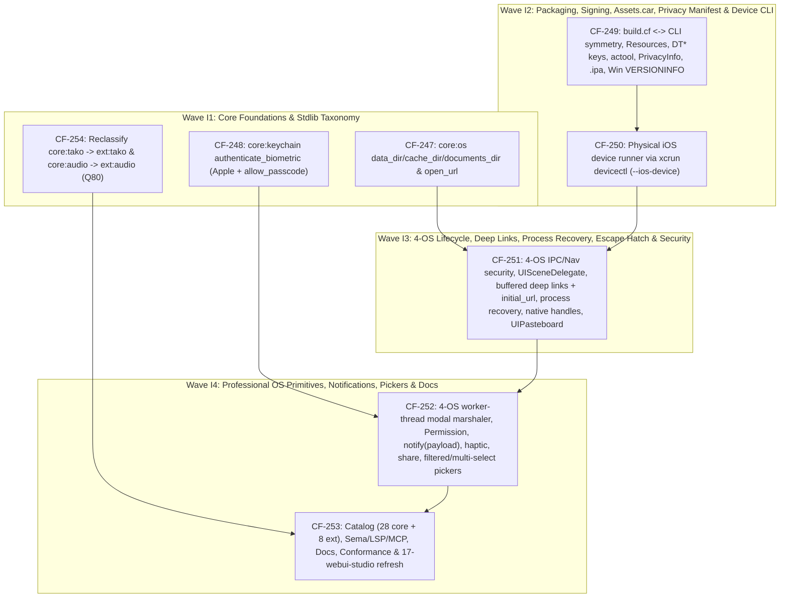

# iOS Ship-Readiness, 4-OS Desktop WebUI Parity & Stdlib Taxonomy Backlog

This topic-focused backlog tracks bringing `cfire`'s `ext:webui` + `core:os` + `core:keychain` + `core:build` stack from an iOS Simulator MVP to a **production, physical-device-deployable, App Store–ready iOS workflow** while closing matching security, lifecycle, deep-link, and packaging parity gaps across **macOS, Windows, and Linux**, and realigning the `core:*` vs `ext:*` stdlib taxonomy (**`CF-247` – `CF-254`**, architectural decisions **`Q75` – `Q80`**).

It extends [`backlog.md`](./backlog.md) (`CF-001` – `CF-197`, `Q1` – `Q54`), [`backlog-build-distribution.md`](./backlog-build-distribution.md) (`CF-198` – `CF-210`, `CF-240` – `CF-246`; `Q55` – `Q61`, `Q70` – `Q74`), and [`flint.md`](./flint.md) (`CF-211` – `CF-239`, `Q62` – `Q69`). All items obey the operating workflow, naming rules (`AGENTS.md` §3), and three quality gates in [`README.md`](./README.md) (`make check`, `make check-deep`, `make check-platforms` / `make check-all`).

> **ID Allocation**: This file owns **`CF-247` – `CF-254`** and ADRs **`Q75` – `Q80`**. Tooling/LSP items `CF-255` – `CF-256` and `Q81` live in [`backlog.md`](./backlog.md). Future items anywhere in `docs/planning/` should start at **`CF-257`** and **`Q82`**.

---

## Handoff Context for Fresh-Context Agents

Before implementing any item below:
1. Read [`AGENTS.md`](../../AGENTS.md) and [`docs/planning/README.md`](./README.md).
2. Promote the active wave/item into [`docs/planning/active.md`](./active.md) before editing `src/` or `runtime/`.
3. **Iteration & Gate Commands**:
   - Fast sandboxed inner loop: `make check-fast`
   - Full local gate (requires loopback TCP): `make check`
   - Sanitizers + fuzz replay: `make check-deep`
   - Linux + Windows VMs: `CFIRE_UTMCTL=/Users/memo/.local/bin/utmctl-proxy make check-platforms` (or `make check-all` for all three + summary table).
4. **Current Testing Infrastructure Rules**:
   - **`*_test.cf` vs `.cf` (`-DCFIRE_TEST_MODE=1`)**: `tests/conformance_runner.hpp` only invokes `cfire test` (which passes `-DCFIRE_TEST_MODE=1` in `src/buildsys.hpp`) for files named `*_test.cf`; plain `.cf` files run via `cfire run` without `CFIRE_TEST_MODE`. Every conformance test relying on `CFIRE_HEADLESS_TEST=1` mocks (`os.open_url`, `keychain.authenticate_biometric`, `webui` modals/permissions/notifications) **must** live under `tests/conformance/stdlib/<subpkg>/*_test.cf` and call `os.setenv("CFIRE_HEADLESS_TEST", "1")`.
   - **ThreadSanitizer (`make test-tsan`)**: `Makefile` `test-tsan` only builds and runs `tests/tsan_main.cpp` and `tests/conformance/concurrency/*` (whose fallback compiles pure C++ with `-pthread` only—no Cocoa, WebKit, or GTK flags). Therefore, `ext:webui` concurrency and modal marshaler TSan tests **must** be pure-C++ suites wired directly into `tests/tsan_main.cpp`.
   - **Existing 4-OS & Xcode Harnesses**: Leverage `tests/unit/test_webui_security_and_desktop.hpp` (`CFIRE_TEST_LINUX_WEBKITGTK_BACKEND`, `CFIRE_TEST_WIN32_BACKEND`, live macOS ObjC++ Cocoa/`WKWebView` + `run_webview_test`, native Windows VM Win32/COM), `tests/unit/test_stdlib_webui_ext.hpp` (keep its Linux/Win32 mock headers in lockstep with `runtime/core/webui/`), real Xcode iOS Simulator/`iPhoneOS` SDK builds (`resolve_ios_sdk_path`), and `tests/unit/test_build_manifest_ios.hpp` wired into `tests/unit/test_stdlib.cpp` and `tests/test_main.cpp` (`requires_loopback = false` so pure checks run in `make check-fast`).
5. **Key Existing Files**:
   - `runtime/core/os.hpp` — POSIX/Win32/Apple OS primitives (`cwd`, `args`, `command`, `RawTerminal`).
   - `runtime/core/keychain.hpp` — `Security.framework` (macOS/iOS), `secret-tool` (Linux), `Advapi32` (Windows), `CFIRE_HEADLESS_TEST=1` memory store.
   - `runtime/core/webui.hpp` — `webui::App` facade (`bind`, `bind_async`, `on`, `emit`, `open_file_dialog`, `clipboard_*`, `set_devtools`, `set_context_menu`, `set_autofill`).
   - `runtime/core/webui/bridge.hpp` — `AppState`, `kPreloadBridgeJs`, `app://localhost/` VFS, `emit_system_event`, `handle_ipc_message`.
   - `runtime/core/webui/macos_ios.hpp` — `CfireWebUISchemeHandler`, `CfireWebUIMessageHandler`, iOS `CfireWebUIAppDelegate` (`#if CFIRE_WEBUI_IOS`), macOS Cocoa + `WKWebView`.
   - `runtime/core/webui/linux_gtk.hpp` — GTK3 + `WebKitGTK` host.
   - `runtime/core/webui/windows_webview2.hpp` — Win32 + self-contained COM `ICoreWebView2` host (serving on `kWv2Origin` = `https://app.localhost`).
   - `src/build/manifest.hpp` — `ExecutableSpec`, `BuildPlan`, `parse_build_cf`, `populate_exe_fields`.
   - `src/build/apple_bundle.hpp` — macOS `.app` + iOS `.app` packaging, `Info.plist`, `codesign`, `launch_ios_simulator`.
   - `src/build/windows_resources.hpp` — Win32 `.rc` / `windres` icon embedding.
   - `src/build/package_loader.hpp` — `normalize_ios_triple`, `resolve_ios_sdk_path`.
   - `src/build/pch.hpp` — `kDefaultMacosMinVersion` (`"13.3"`), `resolve_effective_macos_min`.
   - `src/cli/common_args.hpp`, `src/cli/build_commands.cpp`, `src/cli/usage.hpp`, `src/cli/scaffold.hpp` — CLI flags, `build`/`run` drivers, and `cfire new --template`.
   - `src/buildsys.hpp` — Target triples, iOS/macOS/Windows/Linux library & framework auto-linking (lines ~558–680), vendored-archive map, binary cache key.
   - `src/module_registry.hpp`, `src/sema.hpp`, `src/sema/expression_checker_impl.hpp`, `src/lsp/type_query.hpp` — Canonical `core:*` / `ext:*` import registry, Sema fallibility/diagnostics, `cfire fix`, and LSP method type queries.
   - `src/docgen/catalog.hpp`, `src/docgen/stdlib_catalog_entries.hpp`, `src/docgen/catalog_types.hpp`, `src/docgen/catalog_examples.hpp`, `src/docgen/catalog_type_docs.hpp`, `src/docgen/markdown.hpp`, `src/docgen/html.hpp` — Single-source stdlib discovery, sorted catalog, Sema/LSP/MCP metadata, and `cfire doc` generators.
   - `tests/tsan_main.cpp`, `tests/unit/test_webui_security_and_desktop.hpp`, `tests/unit/test_stdlib_webui_ext.hpp` — Runtime TSan concurrency driver and 4-OS WebUI mock/native verification harnesses.

---

## Architectural Decision Record (`Q75` – `Q80`, resolved interactively 2026-11-18 / 2026-11-19)

75. **Scope — Full iOS Ship-Readiness for `ext:webui` + 4-OS Desktop Parity (`Q75`)**:
    - Deliver end-to-end iOS ship-readiness (signing, provisioning, entitlements validation, `Assets.car`, `DT*` App Store plist metadata, `PrivacyInfo.xcprivacy`, declarative `Resources`, `.ipa` export, `xcrun devicectl` physical device deploy, `UISceneDelegate`/lifecycle/keyboard events, cold-start-buffered Universal Links, `WKWebView` WebContent process crash recovery, secure navigation, native handle escape hatch, sandbox paths, generic permissions, local notifications with deep-link payloads, Apple biometrics, haptics, share sheet, filtered/multi-select document & media pickers, and iOS clipboard) alongside matching desktop parity fixes on macOS, Linux, and Windows.
    - Defer remote APNs push notifications (`registerForRemoteNotifications` / push token handling) to a future dedicated push-services milestone, and keep any future declarative `cfire` VDOM UI layer (`core:ui`) as a separate, independent milestone.

76. **First-Principles Namespace Placement (`Q76`, aligns with `Q7`/`Q62`/`Q68`/`Q80`)**:
    - Capabilities reusable **without** `ext:webui` (CLI, TUI, daemons, Desktop, iOS) belong in their owning `core:*` module:
      - `core:os`: `os.data_dir(app: str = "") -> str!`, `os.cache_dir(app: str = "") -> str!`, `os.documents_dir() -> str!`, `os.open_url(url: str) -> void!`.
      - `core:keychain`: `keychain.authenticate_biometric(reason: str, allow_passcode: bool = true) -> bool!` (macOS/iOS `LocalAuthentication` via lazy ObjC runtime dispatch so CLI binaries don't need `.mm`; clean `Err` on Windows, Linux, and WASM — no hand-rolled raw WinRT COM vtables).
    - Capabilities requiring an app bundle (`CFBundleIdentifier`), active window, or `UIViewController` live on `webui.App` (`ext:webui`): generic permissions, local notifications, haptics, share sheet, filtered/multi-select document & media pickers, navigation policy, scroll bounce, status bar style, cold-start launch URL, native handle escape hatch, and lifecycle events.
    - No new stdlib module is added; after `CF-254` (`Q80`), the catalog is **`28 core:* + 8 ext:*`** (36 modules total).

77. **Declarative `build.cf` ↔ CLI Flag Symmetry & App Store `.app`/`.ipa` Completeness (`Q77`)**:
    - Every durable project/packaging setting lives declaratively as flat PascalCase fields on `build.App` / `build.Executable` (`src/build/manifest.hpp`), with 1:1 CLI overrides for machine/CI-varying settings following strict precedence: **`CLI flag` > `build.cf` > `default`**.
    - Complete symmetry table:

      | Setting | `build.cf` (`build.App` / `build.Executable`) | CLI Override | Default |
      | :--- | :--- | :--- | :--- |
      | macOS min version | `MacosMin: "13.3"` *(existing)* | `--macos-min <ver>` *(existing)* | `"13.3"` |
      | iOS min version | `IosMin: "17.0"` *(new)* | `--ios-min <ver>` *(new)* | `"17.0"` (floor `"16.3"`) |
      | Code signing *(macOS & iOS)* | `SignIdentity: "..."` *(existing)* | `--sign <identity>` *(new)* | `"-"` (ad-hoc on macOS/Sim) |
      | Entitlements *(macOS & iOS)* | `Entitlements: "app.entitlements"` *(new)* | `--entitlements <path>` *(new)* | `""` |
      | Provisioning profile *(iOS/macOS)* | `ProvisioningProfile: "app.mobileprovision"` *(new)* | `--provisioning-profile <path>` *(new)* | `""` |
      | Version / build *(macOS, iOS, Win)* | `Version: "1.2.0"`, `BuildNumber: "42"` *(new)* | — *(manifest-only)* | `"1.0"` / `"1"` |
      | Bundled resources *(macOS & iOS)* | `Resources: ["ui", "assets"]` *(new)* | — *(manifest-only)* | `["ui"]` *(if `ui/` exists)* |
      | URL schemes *(macOS & iOS)* | `UrlSchemes: ["myapp"]` *(existing, wired to iOS)* | — *(manifest-only)* | `[]` |
      | iOS metadata | `IosOrientations`, `IosDeviceFamily`, `InfoPlist`, `PrivacyManifest` *(new)* | — *(manifest-only)* | Portrait+Landscape / iPhone+iPad / runtime-accurate `PrivacyInfo.xcprivacy` |
      | Distribution modes | `Portable`, `Static`, `Universal` *(existing)* | `--portable`, `--static`, `--universal` *(existing)* | `false` |
      | Per-run / output mode | — *(invocation-only)* | `--ios`, `--ios-device`, `--device <id>`, `--ipa` | — |

    - `plan.ios_min` drives **all three** of: Clang target triple (`arm64-apple-ios<ver>[-simulator]`), `Info.plist` `MinimumOSVersion`, and `actool --minimum-deployment-target`.
    - iOS `Info.plist` emits App Store Connect / Transporter `DT*` toolchain metadata (`DTPlatformName`, `DTPlatformVersion`, `DTPlatformBuild`, `DTSDKName`, `DTSDKBuild`, `DTXcode`, `DTXcodeBuild`) queried dynamically from `xcrun`/`xcodebuild`, stages icons inside an `.xcassets` directory (`Assets.xcassets/AppIcon.appiconset`) and runs `actool --platform iphoneos|iphonesimulator` matching `plan.is_ios_sim`, merges `actool --output-partial-info-plist` (`CFBundleIconName` / `CFBundleIcons`), extracts `<key>Entitlements</key>` directly from `embedded.mobileprovision` (`security cms -D -i <profile> | plutil -extract Entitlements xml1 -o - -`) rather than hand-synthesizing XML, and signs without deprecated `codesign --deep` (using `bridge::shell_quote`).
    - **App Store ITMS-90683 & Scene Manifest Guards**:
      - `AVFoundation` and `Photos` **must not** be unconditionally linked into all `ext:webui` iOS binaries (otherwise apps that never touch camera/mic/photo library get rejected by App Store Connect for missing purpose strings); `PhotosUI` (`PHPickerViewController`) is safe.
      - `UIApplicationSceneManifest` (`CfireWebUISceneDelegate`) is emitted in `CF-251` alongside `CfireWebUISceneDelegate` (not prematurely in `CF-249`), avoiding black-screen simulator/device launches between Waves I2 and I3.
    - Whenever packaging a macOS `.app` bundle (even under `--debug`), always pass `-mmacosx-version-min=<effective_min>` to Clang so Mach-O `LC_BUILD_VERSION` and `Info.plist` `LSMinimumSystemVersion` never diverge.
    - Reject incompatible flag combinations upfront (`--universal` on iOS, `--ipa` on non-iOS, `--ios-min` on non-iOS, `--static` on macOS/iOS).

78. **4-OS Navigation, Deep-Link, Process Recovery & VFS IPC Origin Security (`Q78`)**:
    - Keep `app://localhost/` (Apple/Linux) and `https://app.localhost/` (`kWv2Origin` in `windows_webview2.hpp`) as the zero-port offline VFS origins across all 4 OSes, and remove the overly broad `Access-Control-Allow-Origin: *` header on `app://` scheme responses.
    - Enforce a **strict top-frame VFS-origin IPC boundary** on **all 4 backends** (`is_app_origin` matching `app://localhost` on Apple/Linux and `https://app.localhost` on Windows, with exact host boundaries rejecting `app://localhost.evil.com` and `https://app.localhost.evil.com`):
      - **iOS & macOS (`WKWebView`)**: `message.frameInfo.isMainFrame && [message.frameInfo.request.URL.scheme isEqualToString:@"app"]` (plus exact host `localhost`).
      - **Linux (`WebKitGTK`)**: Pair `webkit_user_script_new(..., WEBKIT_USER_CONTENT_INJECT_TOP_FRAME, ..., allow_list={"app://localhost/*", nullptr}, nullptr)` with a per-launch CSPRNG closure-private `__tok` token attached by `postRaw()` and verified in C++, plus `is_app_origin(webkit_web_view_get_uri(webview))` in `linux_script_msg_cb` (keeps `window.invoke`/`window.runtime` in the normal page world while blocking untrusted iframes and allowlisted external pages on both `webkit2gtk-4.0` and `webkit2gtk-4.1`).
      - **Windows (`WebView2`)**: Verify `ICoreWebView2WebMessageReceivedEventArgs::get_Source` matches `is_app_origin` (`https://app.localhost` / `https://app.localhost/...`). Any IPC message originating from a non-VFS frame is silently dropped.
    - Intercept top-level non-VFS `http(s)://` navigations and `target="_blank"` on **all 4 backends**:
      - Allow free navigation inside the platform VFS origin (`app://localhost` or `https://app.localhost`), `about:blank`, `data:`, `blob:`.
      - Allow in-WebView external `http(s)://` navigation **only** if the origin is explicitly registered via `app.allow_navigation_origin("https://...")`. Even when allowed in-WebView, IPC remains strictly locked to the VFS origin.
      - Otherwise cancel in-WebView, emit `"app:external_navigation"` (`{"url": "..."}`), and open externally (`SFSafariViewController` sheet on iOS; `NSWorkspace.openURL` on macOS; `os.open_url` on Linux/Windows; `UIApplication.openURL` for `mailto:`/`tel:`/custom schemes on iOS).
    - Lifecycle, cold-start deep-link buffering, and crash recovery via `emit_system_event(...)`:
      - Buffer pre-ready `"app:open_url"` and `"app:notification_opened"` events in `AppState` and flush them once the preload bridge signals `__sys: "ready"`, plus expose `app.initial_url() -> str?` for `.cf` backend code.
      - Implement `webViewWebContentProcessDidTerminate:` on iOS/macOS to automatically reload `app://localhost/index.html` and emit `"app:webview_reloaded"` (`{}`).
      - iOS (`UISceneDelegate` + `UIApplicationDelegate` fallback): `"app:background"`, `"app:foreground"`, `"app:active"`, `"app:inactive"`, `"app:open_url"` (custom `UrlSchemes` + Universal Links `continueUserActivity:`), `"keyboard:change"` (`{"visible": bool, "height": px}`), `"app:notification_opened"` (`{"id": "...", "payload": "..."}`), `"app:webview_reloaded"`.
      - macOS: `application:openURLs:` -> `"app:open_url"`, `NSApplicationDidBecomeActive` / `ResignActive` -> `"app:active"` / `"app:inactive"`, `"app:webview_reloaded"`.
      - Linux (`GTK3`): `focus-in-event` / `focus-out-event` -> `"app:active"` / `"app:inactive"`.
      - Windows (`Win32`): `WM_ACTIVATE` -> `"app:active"` / `"app:inactive"`.

79. **Professional OS Primitives, `Q8` Absence, Uniform 4-OS Worker-Thread Modal Dispatch & Native Escape Hatch (`Q79`)**:
    - **No backwards-compatibility shims**: Apply one clean, uniform contract across all 4 OSes and retire toy/legacy APIs immediately.
    - **Retire 1-button `message_dialog`**: Remove `message_dialog` from `ext:webui` (professional WebView apps render styled HTML/CSS modals, or use the native handle escape hatch for multi-button native alerts/sheets).
    - **Uniform 4-OS Worker-Thread Modal Dispatch & Lifetime Safety**:
      - All blocking OS modal/picker/permission/biometric calls (`open_file_dialog`, `open_files_dialog`, `save_file_dialog`, `pick_media`, `pick_media_many`, `share`, `request_permission`, `authenticate_biometric`) must run from a background thread (`app.bind_async` / `async.scope`), marshaling UI presentation onto the platform UI thread (`dispatch_async(dispatch_get_main_queue(), ...)` on macOS/iOS, `g_idle_add` on Linux, `PostMessageW` `WM_APP_MODAL` to `state->win32_hwnd` on Windows — never calling `GetOpenFileNameW` directly from a worker thread with a cross-thread `hwndOwner`) and waiting on `std::promise`/`std::future` under an atomic `modal_in_flight_` guard. Calling any blocking modal synchronously on the UI thread (`app.bind`) fails fast with a clear `Err` pointing to `bind_async` — zero nested run loops on any OS.
      - Windows `open_files_dialog` must handle `OFN_ALLOWMULTISELECT | OFN_EXPLORER` double-NUL format (`dir\0f1\0f2\0\0` vs single `dir\file\0\0`) and detect `CommDlgExtendedError() == FNERR_BUFFERTOOSMALL`.
      - macOS `share()` (`NSSharingServicePicker`) must implement `NSSharingServicePickerDelegate` (`sharingServicePicker:didChooseSharingService:`, which fires with `nil` on dismiss) or resolve immediately upon presentation so `modal_in_flight_` can never get stuck permanently.
      - Capture `std::shared_ptr<AppState>` (never raw `this`) across all worker -> UI dispatch hops.
      - Load Apple permission frameworks (`AVFoundation` / `AVCaptureDevice`, `Photos` / `PHPhotoLibrary`) lazily via `dlopen` + `NSClassFromString` / `objc_msgSend` (matching `CF-248` `LAContext`) so unused capabilities never trigger App Store ITMS-90683.
    - **Typed enums & `Q30` labeled parameters**: `webui.Permission::{Notifications, Camera, Microphone, Photos, Biometrics}`, `webui.PermissionStatus::{Granted, Denied, NotDetermined, Restricted, Unsupported}`, `webui.HapticStyle::{Light, Medium, Heavy, Success, Warning, Error, Selection}`, `webui.StatusBarStyle::{Auto, Light, Dark, Hidden}`, `webui.MediaKind::{Image, Video, Any}`; labeled optional parameters for `share`, `notify` (with `payload: str = ""`), and file/media pickers (`filters: []str = []`).
    - **`Q8` absence semantics everywhere**: `open_file_dialog` / `save_file_dialog` / `pick_media` return `str?!` (`Ok(Some(path))`, `Ok(none)` cancelled, `Err(e)` failed/wrong-thread); `open_files_dialog` / `pick_media_many` return `[]str?!` (`Ok(Some(paths))`, `Ok(none)` cancelled, `Err(e)` failed).
    - **Native Handle Escape Hatch**: Expose native handle accessors on `webui.App` (for C++/ObjC++ interop) so professional apps can integrate arbitrary platform SDKs (StoreKit, HealthKit, Passkeys, custom `UIAlertController`, etc.) directly against the live `WKWebView*` / `UIViewController*` / `NSWindow*` / `HWND` / `GtkWidget*`.

80. **Stdlib Inclusion & `core:*` vs `ext:*` Taxonomy Standard (`Q80`, aligns with `Q16`/`Q62`/`CF-086`)**:
    - **`core:*` (28 modules)**: Pure, zero-setup, headless systems, data, networking, and cryptography primitives. No vendor-specific cloud SDKs and no hardware/media UI engines.
    - **`ext:*` (8 modules)**: Native hardware/OS engines, external C/platform library bindings, and first-party batteries (`ext:ai`, `ext:audio`, `ext:compress/zstd`, `ext:crypto/sodium`, `ext:db/sqlite`, `ext:net/ssh`, `ext:tako`, `ext:webui`).
    - Reclassify **`core:tako` → `ext:tako`** and **`core:audio` → `ext:audio`** (keeping their existing APIs as-is) as hard `cfire/INVALID-IMPORT` errors with machine-applicable `cfire fix` rewrites (`Q16`), with zero backwards-compat aliases.
    - Every new capability in `ext:webui` must pass the **Primitives + Escape Hatch** bar: OS/sandbox/hardware-gated (impossible to build in HTML/JS), configurable enough for production apps (filters, multi-select, deep-link payloads, passcode fallback), and backed by the native handle escape hatch rather than toy UI wrappers.

---

## Summary Index & Wave Sequencing (`Waves I1–I4`)



| ID | Wave | Priority | Size | Component | Summary | Depends On | Status |
| :--- | :---: | :---: | :---: | :--- | :--- | :--- | :--- |
| `CF-254` | `I1` | **P1** | S | `src/module_registry.hpp`, `src/sema/`, `src/buildsys.hpp`, `src/cli/scaffold.hpp`, `src/docgen/`, `examples/`, `tests/` | **Stdlib Taxonomy Realignment (`Q80`)**: Reclassify `core:tako` → `ext:tako` and `core:audio` → `ext:audio` (`28 core:* + 8 ext:*`) with `cfire/INVALID-IMPORT` + `cfire fix` rewrites, updating vendored-archive map, `--template tako`, sorted catalog, docs, and tests | None | `[DONE]` |
| `CF-247` | `I1` | **P1** | S | `runtime/core/os.hpp`, `src/buildsys.hpp`, `src/docgen/`, `tests/` | **`core:os` App Directories & Safe Browser Launch**: `data_dir`, `cache_dir`, `documents_dir`, `open_url` across iOS/macOS/Linux/Windows + auto-linker (`-lshell32 -lole32 -luuid`, iOS `-lobjc`/`UIKit`) + `*_test.cf` headless hook | None | `[DONE]` |
| `CF-248` | `I1` | **P1** | S | `runtime/core/keychain.hpp`, `src/buildsys.hpp`, `src/docgen/`, `tests/` | **`core:keychain` Biometric Auth**: `authenticate_biometric(reason, allow_passcode = true) -> bool!` via lazy ObjC `LAContext` (`-lobjc`) + worker-thread dispatch + clean `Err` (Windows/Linux/WASM) + `*_test.cf` mock | None | `[DONE]` |
| `CF-249` | `I2` | **P0** | L | `src/build/{manifest,apple_bundle,windows_resources,package_loader,pch}.hpp`, `src/cli/`, `src/buildsys.hpp`, `tests/unit/test_build_manifest_ios.hpp` | **Apple/Windows Packaging & CLI Symmetry (`Q77`)**: `Version`, `BuildNumber`, `Resources`, `IosMin`/`--ios-min`, `--sign`/`--entitlements`/`--provisioning-profile`, `InfoPlist`, `DT*` keys, `PrivacyInfo.xcprivacy`, `.xcassets` `actool` `Assets.car` + partial plist merge, non-`--deep` `codesign` + `plutil` profile entitlements extraction, `.ipa`, macOS `.app` `minos` fix, Windows `VERSIONINFO`, iOS frameworks (excluding `AVFoundation`/`Photos`) | None | `[DONE]` |
| `CF-250` | `I2` | **P1** | M | `src/build/apple_bundle.hpp`, `src/cli/{common_args.hpp,build_commands.cpp,usage.hpp}`, `tests/unit/test_build_manifest_ios.hpp` | **Physical iOS Device Runner (`xcrun devicectl`)**: `cfire run --ios-device [--device <name\|udid>]`, JSON device discovery, install & console launch | `CF-249` | `[DONE]` |
| `CF-251` | `I3` | **P0** | L | `runtime/core/webui/{bridge,macos_ios,linux_gtk,windows_webview2}.hpp`, `runtime/core/webui.hpp`, `src/build/apple_bundle.hpp`, `src/sema/`, `src/lsp/` | **4-OS Navigation/IPC Security, Lifecycle, Recovery & Escape Hatch (`Q78`)**: Top-frame VFS-only (`app://localhost` & Windows `https://app.localhost`) IPC gate + WebKitGTK `__tok` + tight CORS, `allow_navigation_origin`, `UIApplicationSceneManifest` + iOS `UISceneDelegate` + buffered deep links & `initial_url()` + `keyboard:change` + `webViewWebContentProcessDidTerminate:`, native handle escape hatch, macOS `openURLs`, 4-OS `app:active`/`app:inactive`, iOS `UIPasteboard`, retire `message_dialog` | `CF-247`, `CF-250` | `[DONE]` |
| `CF-252` | `I4` | **P1** | L | `runtime/core/webui.hpp`, `runtime/core/webui/*.hpp`, `tests/tsan_main.cpp`, `tests/conformance/` | **Professional OS Primitives & Uniform 4-OS Modal Dispatch (`Q79`)**: Uniform 4-OS worker-thread modal marshaler (Win32 `PostMessageW`, fail-fast on UI thread, TSan-verified), lazy Apple `AVFoundation`/`Photos`, `Permission`/`PermissionStatus`, local `notify(..., payload)`/`cancel_notification`, `haptic`, `share`, filtered/multi-select pickers (`str?!`/`[]str?!`), `set_scroll_bounce`/`set_status_bar_style` | `CF-248`, `CF-251` | `[TODO]` |
| `CF-253` | `I4` | **P1** | M | `src/docgen/`, `src/sema/`, `src/lsp/`, `docs/`, `tests/conformance/`, `examples/17-webui-studio/` | **Catalog, Sema/LSP/MCP Parity, Conformance & Example Refresh**: Single-source metadata (`28 core:* + 8 ext:*`), `./cfire doc --check`, full conformance tests, `examples/17-webui-studio` iOS+desktop `build.cf` & tests, `make check-all` sign-off | `CF-254`, `CF-252` | `[TODO]` |

---

## Detailed Item Specifications

### `CF-254` — Stdlib Taxonomy Realignment: `core:tako` → `ext:tako` & `core:audio` → `ext:audio` (`Q80`) `[DONE]`
- **Goal**: Keep `core:*` strictly for pure, zero-setup, headless systems/data/networking/crypto primitives (**28 `core:*` + 8 `ext:*`**) by moving the Tako cloud SDK and the audio hardware/synth engine into `ext:*` with zero backwards-compatibility aliases.
- **Files Touched**:
  - `src/module_registry.hpp` (flip `pkg:tako` → `ext:tako`, remove `ext:tako` from wrong-prefix, move `core:tako` & `core:audio` into `canonical_import_for_wrong_prefix`)
  - `src/sema.hpp`
  - `src/buildsys.hpp` (update both the `{"core:tako", "simdjson"}` vendored-archive map and the `core:tako` / `core:audio` linker blocks)
  - `src/cli/scaffold.hpp` (`cfire new --template tako` emits `import "ext:tako"`)
  - `src/docgen/catalog.hpp` (`audio.hpp` → `"ext:audio"`), `src/docgen/stdlib_catalog_entries.hpp` (keep `stdlib_catalog()` strictly sorted alphabetically by `import_path` per `audit_documentation_catalog`), `src/docgen/catalog_examples.hpp`, `src/docgen/catalog_type_docs.hpp`, `src/docgen/markdown.hpp`, `src/docgen/html.hpp`
  - `examples/16-audio-synth/main.cf`, `docs/GUIDE.md` + regenerated `docs/` (`./cfire doc`)
  - Existing unit & conformance tests whose polarity flips: `tests/unit/test_ext_soundness_cache_and_clean.hpp`, `tests/unit/test_vendored_libs_and_release.hpp`, `tests/unit/test_language_consistency_and_docs.hpp`, `tests/unit/test_lsp_docgen.hpp`, `tests/unit/test_ergonomics_upstream.hpp`, `tests/unit/test_frontend.cpp`, `tests/conformance/imports/non_canonical_module_aliases.cf`
  - New `ext:*` catalog smoke fixtures: `tests/conformance/ext_smoke/audio.cf` and `tests/conformance/ext_smoke/tako.cf` (verified across `make check-all`: `check`, `check-deep`, and `check-platforms`)
- **Implementation**:
  1. Reclassify `core:tako` → `ext:tako` and `core:audio` → `ext:audio` in `src/module_registry.hpp` (including `pkg:tako` → `ext:tako`), Sema import checker, `src/docgen/catalog.hpp`, `src/docgen/stdlib_catalog_entries.hpp` (strictly sorted by `import_path`), `src/cli/scaffold.hpp`, and `src/buildsys.hpp` (vendored-archive `simdjson` dependency map + `AudioToolbox`/`AVFAudio`/ALSA and `libtako` auto-linker blocks).
  2. Emit hard `cfire/INVALID-IMPORT` diagnostics with machine-applicable `cfire fix` rewrites for any legacy `core:tako` or `core:audio` import (`Q16`).
  3. Keep both modules' existing `.cf` APIs unchanged; update all docgen generators (`catalog_examples.hpp`, `catalog_type_docs.hpp`, `markdown.hpp`, `html.hpp`), examples (`examples/16-audio-synth/main.cf`), `docs/GUIDE.md`, and affected tests, then regenerate docs via `./cfire doc`.
- **Tests**:
  - Updated `tests/conformance/imports/non_canonical_module_aliases.cf` and Sema/diagnostic unit tests confirming `import "core:tako"` and `import "core:audio"` emit `cfire/INVALID-IMPORT` with fix-its to `ext:tako` / `ext:audio` (and `pkg:tako` → `ext:tako`).
  - Existing audio and tako conformance/unit tests (`test_frontend.cpp`, `test_language_consistency_and_docs.hpp`, `test_ext_soundness_cache_and_clean.hpp`, `test_vendored_libs_and_release.hpp`, `test_lsp_docgen.hpp`, `test_ergonomics_upstream.hpp`) pass under `ext:audio` and `ext:tako`.
- **Validation**: `make check-fast`, `./.cfire_test_runner conformance --filter 'imports/*'`, `./cfire doc --check`, `cfire check` on all examples, and `make check-all`.

---

### `CF-247` — `core:os` App Directories & Safe Browser Launch `[DONE]`
- **Goal**: Give `cfire` programs portable, sandbox-safe persistent storage paths (mandatory on iOS where the `.app` bundle is read-only) and safe external URL opening without shell injection.
- **Files Touched**: `runtime/core/os.hpp`, `src/buildsys.hpp`, `src/docgen/stdlib_catalog_entries.hpp`, `tests/conformance/stdlib/os/dirs_and_open_url_test.cf`, `tests/unit/test_build_manifest_ios.hpp`.
- **Public `.cf` API**:
  ```cfire
  fn os.data_dir(app: str = "") -> str!
  fn os.cache_dir(app: str = "") -> str!
  fn os.documents_dir() -> str!
  fn os.open_url(url: str) -> void!
  ```
- **Implementation**:
  1. **`data_dir(app)` / `cache_dir(app)` / `documents_dir()`**:
     - Validate `app`: reject path traversal (`..`, `/`, `\`, NUL) with `Err`.
     - Uniform suffix rule across all 4 OSes: return the OS base directory when `app` is empty, or append `/<app>` when non-empty; create the directory with `0700` permissions if missing.
     - **iOS (`TARGET_OS_IPHONE`)**: `$HOME/Library/Application Support[/<app>]`, `$HOME/Library/Caches[/<app>]`, `$HOME/Documents`.
     - **macOS**: `~/Library/Application Support[/<app>]`, `~/Library/Caches[/<app>]`, `~/Documents`.
     - **Linux**: `$XDG_DATA_HOME[/<app>]` (fallback `~/.local/share`), `$XDG_CACHE_HOME[/<app>]` (fallback `~/.cache`), `$XDG_DOCUMENTS_DIR` (fallback `~/Documents`).
     - **Windows**: `SHGetKnownFolderPath` (`FOLDERID_RoamingAppData`, `FOLDERID_LocalAppData` + `\Cache`, `FOLDERID_Documents`) converted to UTF-8.
  2. **`open_url(url)`**:
     - Validate URL: non-empty, no ASCII control characters (`< 0x20` or `0x7f`), must start with an allowed scheme (`http://`, `https://`, `mailto:`, `tel:`, or `^[a-zA-Z][a-zA-Z0-9+.-]*://` excluding `file://` and `javascript:`).
     - Under `CFIRE_TEST_MODE` with `CFIRE_HEADLESS_TEST=1`: record URL into an in-memory `last_opened_url` test slot and return `Ok({})` without launching a browser.
     - **macOS**: `posix_spawnp("/usr/bin/open", {"open", url})` (no shell).
     - **Linux**: `posix_spawnp("xdg-open", {"xdg-open", url})` (no shell).
     - **Windows**: `ShellExecuteW(nullptr, L"open", wide_url.c_str(), nullptr, nullptr, SW_SHOWNORMAL)` (check return > 32).
     - **iOS**: Dispatch `[UIApplication.sharedApplication openURL:options:completionHandler:]` via `<objc/runtime.h>` / `<objc/message.h>` on main queue so `core:os` remains pure C++ (no `.mm` required).
  3. **`src/buildsys.hpp` auto-linker**:
     - Add an `if (imp.path == "core:os")` block linking `-lshell32 -lole32` on Windows (`SHGetKnownFolderPath` + `ShellExecuteW`) and `"-lobjc", "-framework", "Foundation", "-framework", "UIKit"` when `plan.is_ios` (`objc_msgSend` for `UIApplication.openURL`).
- **Tests**:
  - Conformance test **named** `tests/conformance/stdlib/os/dirs_and_open_url_test.cf` (`*_test.cf` so `cfire test` enables `-DCFIRE_TEST_MODE=1`): sets `os.setenv("CFIRE_HEADLESS_TEST", "1")` inside the test block, verifies `data_dir("cfire_test")`, `cache_dir("cfire_test")`, `documents_dir()` return non-empty paths, traversal (`"../evil"`, `"a/b"`, `"a\\b"`) returns `Err`, `open_url("javascript:alert(1)")` / `open_url("file:///etc/passwd")` / control chars return `Err`, and `open_url("https://cfire.memo.engineer")` succeeds under `CFIRE_HEADLESS_TEST=1`.
  - iOS Simulator compile test in `tests/unit/test_build_manifest_ios.hpp` (registered in `tests/unit/test_stdlib.cpp` & `tests/test_main.cpp` with `requires_loopback = false`) compiling a `.cf` program importing `core:os` via `build_native(..., "ios-sim")` when `resolve_ios_sdk_path(true)` succeeds.
- **Validation**: Passes `make check-fast`, `make check`, `make check-deep`, and `make check-platforms` (native Linux XDG + Windows `SHGetKnownFolderPath` / `-lshell32 -lole32`).

---

### `CF-248` — `core:keychain` Apple Biometric Authentication `[DONE]`
- **Goal**: Expose native Apple biometric + passcode user-presence verification (`Face ID`, `Touch ID`) in `core:keychain` so CLI/TUI tools, macOS apps, and custom iOS authentication screens can gate sensitive vault operations without importing `ext:webui`.
- **Files Touched**: `runtime/core/keychain.hpp`, `src/buildsys.hpp`, `src/docgen/stdlib_catalog_entries.hpp`, `tests/conformance/stdlib/keychain/biometric_test.cf`, `tests/unit/test_build_manifest_ios.hpp`.
- **Public `.cf` API**:
  ```cfire
  fn keychain.authenticate_biometric(reason: str, allow_passcode: bool = true) -> bool!
  ```
- **Implementation**:
  1. Validate non-empty `reason`.
  2. **Headless `CFIRE_TEST_MODE`**: When `CFIRE_HEADLESS_TEST=1`, return mock result (default `Ok(true)`, configurable via `keychain::detail::set_mock_biometric` / `CFIRE_MOCK_BIOMETRIC=0|1|err`).
  3. **macOS & iOS (`__APPLE__ && !PLATFORM_WEB`)**:
     - Dynamically load `/System/Library/Frameworks/LocalAuthentication.framework/LocalAuthentication` via `dlopen(..., RTLD_LAZY)` and call `LAContext` via `<objc/runtime.h>` + `<objc/message.h>` (keeps `core:keychain` 100% pure C++, zero `.mm` requirement for CLI binaries).
     - Add `"-lobjc"` to `if (imp.path == "core:keychain")` in `src/buildsys.hpp` on `__APPLE__` (both macOS CLI binaries and iOS) so `<objc/runtime.h>` / `<objc/message.h>` symbols resolve cleanly without `ext:webui`.
     - Select policy from `allow_passcode`: `true` → `LAPolicyDeviceOwnerAuthentication` (`2`, Face ID / Touch ID with automatic device passcode fallback); `false` → `LAPolicyDeviceOwnerAuthenticationWithBiometrics` (`1`, strict biometrics only).
     - Check `canEvaluatePolicy:`; if unavailable, return `Err` with localized `NSError` description.
     - Follow `Q79` threading discipline: when called inside a GUI app on the main UI thread (`[NSThread isMainThread]` while `NSApp`/`UIApplication` is running), return `Err("biometric authentication must run on a background thread (e.g. bind_async)")` rather than spinning a nested run loop; on a background thread or headless CLI, await the reply callback via `std::promise`/`std::future`.
     - Map success -> `Ok(true)`, user cancel / auth failed (`LAErrorUserCancel`, `LAErrorAuthenticationFailed`) -> `Ok(false)`, hardware/lockout/policy error -> `Err(...)`.
     - Document that physical iOS devices require `NSFaceIDUsageDescription` in `InfoPlist` (warned by `CF-249` if missing).
  4. **Windows / Linux / WASM**: Return `Err("biometric authentication is not supported on this platform")` (no fragile hand-rolled raw WinRT COM vtables).
- **Tests**:
  - Conformance test **named** `tests/conformance/stdlib/keychain/biometric_test.cf` (`*_test.cf` so `cfire test` enables `-DCFIRE_TEST_MODE=1`): sets `os.setenv("CFIRE_HEADLESS_TEST", "1")` and exercises `CFIRE_MOCK_BIOMETRIC=1|0|err`, `allow_passcode:` labeled argument, and empty-reason validation.
  - Pure-C++ macOS CLI build+link smoke test (without `ext:webui`, verifying zero `-lobjc` link errors) and `ios-sim` `build_native` check in `tests/unit/test_build_manifest_ios.hpp`.
  - Linux/Windows VM gates confirm clean compilation and non-Apple `Err` fallback outside headless mode.
- **Validation**: Compiles with zero warnings across all 4 OSes and passes `make check-all`.

---

### `CF-249` — Apple & Windows Packaging, Signing, `Assets.car`, `DT*` Metadata, `PrivacyInfo.xcprivacy` & CLI Symmetry (`Q77`) `[DONE]`
- **Goal**: Make `build.cf` + CLI flags clean, symmetrical, and genuinely TestFlight / App Store Connect–valid for macOS, iOS, and Windows app packaging.
- **Files Touched**:
  - `src/build/manifest.hpp`
  - `src/build/apple_bundle.hpp`
  - `src/build/windows_resources.hpp`
  - `src/build/package_loader.hpp`
  - `src/build/pch.hpp`
  - `src/buildsys.hpp`
  - `src/cli/common_args.hpp`, `src/cli/build_commands.cpp`, `src/cli/usage.hpp`
  - `tests/unit/test_build_manifest_ios.hpp`, `tests/unit/test_stdlib.cpp`, `tests/test_main.cpp`
- **Implementation**:
  1. **`manifest.hpp`**:
     - Add to `ExecutableSpec` and `BuildPlan`: `version`, `build_number`, `resources` (`std::vector<std::string>`), `ios_min`, `ios_orientations`, `ios_device_family`, `provisioning_profile`, `entitlements`, `privacy_manifest`, `info_plist_extras` (`std::vector<std::pair<std::string, std::string>>`).
     - Parse `Version`, `BuildNumber`, `Resources`, `IosMin`, `IosOrientations`, `IosDeviceFamily`, `ProvisioningProfile`, `Entitlements`, `PrivacyManifest`, and `InfoPlist` (struct literal `{ KEY: "val" }`) in `populate_exe_fields`.
  2. **`pch.hpp` & `package_loader.hpp`**:
     - Add `kDefaultIosMinVersion = "17.0"`, `kMinSupportedIosVersion = "16.3"`, `is_ios_min_supported(ver)`, and update `normalize_ios_triple(target, ios_min)` so `ios` / `ios-sim` emit `arm64-apple-ios<ios_min>[-simulator]` instead of hardcoded `17.0`.
     - Fix macOS `.app` `minos` consistency: when `plan.macos_app_bundle` is non-empty (or `MacosMin`/`--macos-min` is set), always pass `-mmacosx-version-min=<effective_min>` even under `DevDebug` so Mach-O `LC_BUILD_VERSION` matches `Info.plist` `LSMinimumSystemVersion`.
  3. **`common_args.hpp` & `build_commands.cpp` & `usage.hpp`**:
     - Add CLI overrides: `--ios-min <ver>`, `--sign <identity>`, `--provisioning-profile <path>`, `--entitlements <path>`, `--ipa`, `--device <name|udid>`.
     - Enforce precedence `CLI flag > build.cf > default`.
     - Validate invalid flag combinations upfront (`--universal` on iOS, `--ipa` on non-iOS, `--ios-min` on non-iOS, `--static` on macOS/iOS).
  4. **`apple_bundle.hpp`**:
     - XML-escape all string values written into `Info.plist` (`&`, `<`, `>`, `"`, `'`).
     - **Declarative Resources**: Copy every path in `plan.resources` (defaulting to `["ui"]` if `ui/` exists) into `Contents/Resources/` on macOS and `.app/` root on iOS, instead of hardcoding `ui/`.
     - Emit `CFBundleShortVersionString` (`plan.version`, default `"1.0"`), `CFBundleVersion` (`plan.build_number`, default `"1"`), and `CFBundleURLTypes` (`plan.url_schemes`) on **both** macOS and iOS.
     - On iOS: emit `MinimumOSVersion` (`plan.ios_min`), `UISupportedInterfaceOrientations`, `UIDeviceFamily`, App Store toolchain keys (`DTPlatformName`, `DTPlatformVersion`, `DTPlatformBuild`, `DTSDKName`, `DTSDKBuild`, `DTXcode`, `DTXcodeBuild`, queried from `xcrun --sdk ... --show-sdk-version`/`--show-sdk-build-version` and `xcodebuild -version`), and all `plan.info_plist_extras`. (**Defer `UIApplicationSceneManifest` emission to `CF-251`** alongside `CfireWebUISceneDelegate` so iOS Simulator/device launches do not black-screen between Waves I2 and I3.)
     - Emit a build warning when targeting iOS and importing `core:keychain` without `NSFaceIDUsageDescription` in `InfoPlist`.
     - **Icons (`ensure_ios_appicon`)**: Stage `AppIcon.appiconset` (`120`, `180`, `152`, `167`, `1024`) + `Contents.json` inside an `.xcassets` parent directory (`Assets.xcassets/AppIcon.appiconset`) and compile to `Assets.car` via `xcrun actool --compile ... --platform <iphoneos|iphonesimulator> --minimum-deployment-target <ios_min> --app-icon AppIcon --output-partial-info-plist ...`, parsing and merging `CFBundleIconName` / `CFBundleIcons` from the partial plist into `Info.plist` (fallback to PNGs if `actool` is absent).
     - **Privacy Manifest (`PrivacyInfo.xcprivacy`)**: Copy `plan.privacy_manifest` if specified; otherwise auto-generate a valid Apple Required Reason API manifest declaring **only** Required Reason APIs actually invoked by `cfire`'s runtime (e.g. `NSPrivacyAccessedAPICategoryFileTimestamp` `C617.1`, `NSPrivacyAccessedAPICategorySystemBootTime` `35F9.1`).
     - **Codesigning & Provisioning (macOS & iOS)**:
       - Copy `plan.provisioning_profile` to `embedded.mobileprovision` (iOS) or `Contents/embedded.provisionprofile` (macOS).
       - On iOS device/distribution builds, extract `<key>Entitlements</key>` directly from the profile via `security cms -D -i <profile> | plutil -extract Entitlements xml1 -o - -` (validating consistency if custom `Entitlements` was supplied, or writing extracted entitlements cleanly instead of hand-synthesizing XML), and pass `--entitlements <path>` to `codesign`.
       - Replace deprecated `codesign --deep` with explicit inside-out signing of any embedded frameworks/binaries followed by signing the `.app` bundle, using `bridge::shell_quote(...)` (never raw `\"{}\"` quoting) so paths with spaces work reliably.
       - Honor `plan.sign_identity` on iOS (instead of hardcoded `-`), return a clear error if `codesign` fails on a non-adhoc identity or device build, and fail clearly when building `iPhoneOS` (device) without a signing identity.
     - **`.ipa` Packaging (`package_ios_ipa`)**: When `--ipa` or `-o <path>.ipa` is passed for `--target=ios`, stage `Payload/<Name>.app` in `SecureTempDir` and zip via `/usr/bin/ditto -c -k --sequesterRsrc --keepParent Payload <out.ipa>`.
  5. **`windows_resources.hpp`**:
     - Emit lightweight `VS_VERSION_INFO` (`FILEVERSION`, `PRODUCTVERSION`, `FileVersion`, `ProductVersion`, `ProductName`, `FileDescription`) from `plan.version`, `plan.build_number`, and `plan.app_name` in the generated `.rc` file.
  6. **`buildsys.hpp`**:
     - Include all new manifest/signing/version/resources fields in the binary cache key.
     - When `imp.path == "ext:webui"` on `plan.is_ios`, auto-link **only** `UIKit`, `WebKit`, `Foundation`, `CoreGraphics`, `SafariServices`, `PhotosUI`, `UniformTypeIdentifiers`, and `UserNotifications` (**never** `AVFoundation` or `Photos`, avoiding App Store ITMS-90683 rejections).
- **Tests**:
  - Wire `tests/unit/test_build_manifest_ios.hpp` into `tests/unit/test_stdlib.cpp` and `tests/test_main.cpp` (`requires_loopback = false` so pure checks run in `make check-fast`):
    - Cross-OS unit checks: `parse_build_cf` for all new fields (including `Resources`), XML escaping in `Info.plist`, `normalize_ios_triple(target, ios_min)`, CLI precedence & invalid-flag errors, binary cache key sensitivity, and Windows `.rc` `VS_VERSION_INFO` output.
    - macOS Xcode-guarded checks (`resolve_ios_sdk_path(true)`/`false`): build an `ext:webui` app for `ios-sim` (including a bundle path containing spaces), verify `plutil -lint` on `Info.plist` (`DT*` keys, `MinimumOSVersion`, `CFBundleIconName`, `CFBundleURLTypes`, custom `Resources`) & `PrivacyInfo.xcprivacy`, verify `Assets.car` existence, check `vtool -show-build`/`otool -l` `minos` consistency on both macOS `--debug` `.app` and iOS `.app`, assert via `otool -L` and `nm -u` that zero static linkage/symbols exist for `AVFoundation`/`Photos`/`AVCaptureDevice`/`PHPhotoLibrary` (ITMS-90683 guard), and verify `unzip -l` `.ipa` layout.
    - Windows VM gate validates real `windres` compilation of `VS_VERSION_INFO`.
- **Acceptance Criteria**: Passes `make check-fast` and `make check-all`.

---

### `CF-250` — Physical iOS Device Runner (`xcrun devicectl`) `[DONE]`
- **Goal**: Enable `cfire run --ios-device [--device <name|udid>]` to build for `iPhoneOS` (`arm64-apple-ios`), sign with the developer's identity + provisioning profile, install onto a connected iPhone/iPad, and stream console logs.
- **Files Touched**: `src/build/apple_bundle.hpp`, `src/cli/common_args.hpp`, `src/cli/build_commands.cpp`, `src/cli/usage.hpp`, `tests/unit/test_build_manifest_ios.hpp`.
- **Implementation**:
  1. Parse `--ios-device` (sets target triple `"ios"`, device mode = true) and `--device <name|udid>` (shared by both Simulator and physical device).
  2. Implement `parse_devicectl_devices_json(json_str, preferred)` (pure function, unit-testable on all OSes without a physical iPhone!) parsing `xcrun devicectl list devices --json-output <tmp.json>` (`result.devices[]` with `identifier`, `hardwareProperties.udid`, `deviceProperties.name`, `connectionProperties.tunnelState`).
  3. Implement `launch_ios_device(app_bundle, bundle_id, preferred_device, run_args)`:
     - Require non-adhoc signing (`SignIdentity` / `--sign`) and emit an actionable error if missing.
     - Select matching connected device (or error cleanly listing available devices if 0 or ambiguous >1 without `--device`).
     - Install: `xcrun devicectl device install app --device <id> <app_bundle>`.
     - Launch: `xcrun devicectl device process launch --console --device <id> <bundle_id> [run_args...]`.
- **Tests**:
  - Unit tests in `tests/unit/test_build_manifest_ios.hpp` for `parse_devicectl_devices_json` (0 devices, 1 connected device, multiple devices with `--device` name/UDID match, ambiguous >1 without `--device`, disconnected device filtering, malformed JSON error) and CLI error when `--ios-device` lacks a non-adhoc signing identity.
- **Acceptance Criteria**: Passes `make check-fast` and `make check-all`; manual device launch verified when a signed profile + iPhone are attached.

---

### `CF-251` — 4-OS Navigation/IPC Security, Lifecycle, Recovery, Escape Hatch & iOS Parity (`Q78`) `[DONE]`
- **Goal**: Enforce top-frame VFS-origin IPC across all 4 OSes (`app://localhost` on Apple/Linux and `https://app.localhost` on Windows), intercept external links safely on all 4 OSes, emit `UIApplicationSceneManifest` + implement iOS `UISceneDelegate` + cold-start-buffered Universal Links + `initial_url()` + keyboard events + `WKWebView` process-termination recovery + native handle escape hatch + desktop `app:active`/`app:inactive` + macOS `application:openURLs:`, wire iOS `UIPasteboard`, and retire the toy 1-button `message_dialog`.
- **Files Touched**:
  - `runtime/core/webui/bridge.hpp`
  - `runtime/core/webui/macos_ios.hpp`
  - `runtime/core/webui/linux_gtk.hpp`
  - `runtime/core/webui/windows_webview2.hpp`
  - `runtime/core/webui.hpp`
  - `src/build/apple_bundle.hpp` (emit `UIApplicationSceneManifest` -> `CfireWebUISceneDelegate` here in sync with `macos_ios.hpp`)
  - `src/sema/expression_checker_impl.hpp`, `src/lsp/type_query.hpp` (defer `webui.App` method return types to `stdlib_catalog()` instead of stale hardcoded `return "void"`)
  - `tests/conformance/ext_smoke/webui.cf` (remove `message_dialog`)
  - `tests/unit/test_webui_security_and_desktop.hpp`, `tests/unit/test_stdlib_webui_ext.hpp` (remove `win32_message_dialog` and keep Linux/Win32 mock headers in lockstep)
- **Public `.cf` Additions / Removals (`ext:webui`)**:
  ```cfire
  fn (mut app: App) allow_navigation_origin(origin: str)
  fn (app: App) initial_url() -> str?
  // Retired (`Q79`, no backwards-compat shim): message_dialog
  ```
- **Implementation**:
  1. **`bridge.hpp` (shared state, cold-start buffering & policy helpers)**:
     - Add to `AppState`: `std::vector<std::string> allowed_navigation_origins`, `std::optional<std::string> initial_url`, `bool js_ready = false`, `std::vector<std::pair<std::string, std::string>> pending_cold_start_events`, `std::string ipc_session_token` (per-launch CSPRNG token), `bool scroll_bounce_enabled = true`, `StatusBarStyle status_bar_style = StatusBarStyle::Auto`, plus opaque native handle slots (`void* native_window_handle`, `void* native_webview_handle`, `void* native_view_controller_handle`).
     - Add `bool is_app_origin(std::string_view url)` matching `app://localhost` (Apple/Linux) and `https://app.localhost` (`kWv2Origin` on Windows), requiring end-of-string, `/`, `?`, or `#` after `localhost` (rejecting prefix tricks like `https://app://...`, `app://localhost.evil.com`, or `https://app.localhost.evil.com`).
     - Add `bool should_allow_in_webview(std::string_view url)` (true for `is_app_origin(url)`, `about:blank`, `data:`, `blob:`, or exact scheme+host+port match in `allowed_navigation_origins`).
     - In `kPreloadBridgeJs`, emit `{ __sys: "ready" }` on `DOMContentLoaded` (or immediately if already interactive) so `AppState` flushes any buffered cold-start `"app:open_url"` / `"app:notification_opened"` events after JS attaches listeners.
  2. **Strict Top-Frame VFS-Origin IPC Enforcement & Tight CORS (all 4 OSes)**:
     - **iOS & macOS (`CfireWebUIMessageHandler` & `CfireWebUISchemeHandler`)**: Require `message.frameInfo.isMainFrame && [message.frameInfo.request.URL.scheme isEqualToString:@"app"] && [message.frameInfo.request.URL.host isEqualToString:@"localhost"]`; drop otherwise. Remove `Access-Control-Allow-Origin: *` from `app://` responses.
     - **Linux (`WebKitGTK`)**: Inject preload script via `webkit_user_script_new(..., WEBKIT_USER_CONTENT_INJECT_TOP_FRAME, ..., allow_list={"app://localhost/*", nullptr}, nullptr)`, attach the closure-private CSPRNG `__tok` in `postRaw()`, and require valid `__tok` + `is_app_origin(webkit_web_view_get_uri(webview))` in `linux_script_msg_cb` before dispatching `handle_ipc_message` (works uniformly on both `webkit2gtk-4.0` and `webkit2gtk-4.1`).
     - **Windows (`WebView2`)**: Verify `ICoreWebView2WebMessageReceivedEventArgs::get_Source` satisfies `is_app_origin` (`https://app.localhost` / `https://app.localhost/...`) before dispatching.
  3. **External Navigation & New-Window Interception (all 4 OSes)**:
     - **iOS**: `CfireWebUINavigationDelegate` (`WKNavigationDelegate` + `WKUIDelegate`). On non-allowed `http(s)://` navigation or `target="_blank"`, emit `"app:external_navigation"` (`{"url": "..."}`) and present `SFSafariViewController` from root VC; on custom schemes (`mailto:`, `tel:`, etc.), call `[UIApplication.sharedApplication openURL:options:completionHandler:]`.
     - **macOS**: `WKNavigationDelegate` + `WKUIDelegate` -> emit `"app:external_navigation"` and call `[[NSWorkspace sharedWorkspace] openURL:]`.
     - **Linux**: `WebKitGTK` `decide-policy` (`WEBKIT_POLICY_DECISION_TYPE_NAVIGATION_ACTION` & `NEW_WINDOW_ACTION`) + `create` -> emit `"app:external_navigation"` and call `cfire::os::open_url`.
     - **Windows**: Explicitly declare self-contained `ICoreWebView2NavigationStartingEventArgs`, `ICoreWebView2NavigationStartingEventHandler`, `ICoreWebView2NewWindowRequestedEventArgs`, `ICoreWebView2NewWindowRequestedEventHandler`, and their IIDs in `windows_webview2.hpp`; wire `add_NavigationStarting` + `add_NewWindowRequested` -> emit `"app:external_navigation"` and call `cfire::os::open_url`.
  4. **Lifecycle, Cold-Start Deep Links, Keyboard & WebContent Process Recovery**:
     - **iOS (`apple_bundle.hpp` + `macos_ios.hpp`)**: Emit `UIApplicationSceneManifest` (`CfireWebUISceneDelegate`) in `apple_bundle.hpp` in sync with implementing `CfireWebUISceneDelegate` (`UIWindowSceneDelegate`) + `UIApplicationDelegate` fallback + `CfireWebUIViewController` (dynamic `preferredStatusBarStyle`, `prefersStatusBarHidden`):
       - Emit `"app:background"`, `"app:foreground"`, `"app:active"`, `"app:inactive"`.
       - Capture launch URLs from `scene:willConnectToSession:options:` (`connectionOptions.URLContexts` / `userActivities`) into `state->initial_url` and queue `"app:open_url"` until `__sys: "ready"`; also handle warm `scene:openURLContexts:`, `application:openURL:options:`, `scene:continueUserActivity:`, and `application:continueUserActivity:restorationHandler:`.
       - Implement `webViewWebContentProcessDidTerminate:` to reload `app://localhost/index.html` and emit `"app:webview_reloaded"` (`{}`).
       - Observe `UIKeyboardWillShowNotification` / `UIKeyboardWillHideNotification` -> emit `"keyboard:change"` (`{"visible": bool, "height": px}`).
       - Forward `UNUserNotificationCenterDelegate` tap (buffered on cold start) -> `"app:notification_opened"` (`{"id": "...", "payload": "..."}`).
       - Set `config.allowsInlineMediaPlayback = YES`, `config.mediaTypesRequiringUserActionForPlayback = WKAudiovisualMediaTypeNone`, and wire `set_scroll_bounce` to `webView.scrollView.bounces`.
       - Document `viewport-fit=cover` safe-area CSS guidance.
     - **macOS**: Implement `application:openURLs:` -> `"app:open_url"` (with cold-start buffering + `initial_url`), `NSApplicationDidBecomeActiveNotification` / `NSApplicationDidResignActiveNotification` -> `"app:active"` / `"app:inactive"`, and `webViewWebContentProcessDidTerminate:` -> reload + `"app:webview_reloaded"`.
     - **Linux**: Connect GTK `focus-in-event` / `focus-out-event` -> `"app:active"` / `"app:inactive"`.
     - **Windows**: Handle `WM_ACTIVATE` -> `"app:active"` / `"app:inactive"`.
  5. **Native Handle Escape Hatch (`webui.hpp`)**:
     - Expose C++/ObjC++ interop accessors (`native_window_handle()`, `native_webview_handle()`, `native_view_controller_handle()`) returning opaque `void*` (populated once the platform window/view/VC is created; `nullptr` in headless tests) so professional apps can call any native Apple/Win32/GTK SDK via `cfire`'s C++/ObjC++ header bridge.
  6. **iOS Clipboard, Retiring `message_dialog` & Sema/LSP Parity**:
     - Wire `clipboard_set` / `clipboard_set_secret` / `clipboard_get` on iOS to `UIPasteboard.generalPasteboard` (using `UIPasteboardOptionLocalOnly: @(concealed)` and `UIPasteboardOptionExpirationDate` when `clear_after_ms > 0`). Document iOS 16+ OS paste-permission alert on `clipboard_get()`.
     - Remove `message_dialog` (`win32_message_dialog`) from `webui.hpp`, `windows_webview2.hpp`, `stdlib_catalog_entries.hpp`, `tests/conformance/ext_smoke/webui.cf`, `tests/unit/test_stdlib_webui_ext.hpp`, and examples (`Q79`, no backwards-compat shim).
     - Update `src/lsp/type_query.hpp` (defer `webui.App` method return types to `stdlib_catalog()` instead of stale hardcoded `return "void"`) and `src/sema/expression_checker_impl.hpp`.
- **Tests**:
  - `tests/unit/test_webui_security_and_desktop.hpp` & `tests/unit/test_stdlib_webui_ext.hpp`:
    - Shared tests: `is_app_origin` (`app://localhost` and `https://app.localhost` + evil prefix rejections), `should_allow_in_webview`, cold-start buffering + flush on `__sys: "ready"`, `initial_url()`, and native handle null-safety in headless mode.
    - Linux mock (`CFIRE_TEST_LINUX_WEBKITGTK_BACKEND`, kept in lockstep in both files): assert `WEBKIT_USER_CONTENT_INJECT_TOP_FRAME` + `allow_list`, reject IPC missing `__tok` or from non-`app://` URI, intercept `decide-policy` -> `"app:external_navigation"`, and assert `focus-in-event` / `focus-out-event` -> `"app:active"` / `"app:inactive"`.
    - Win32 mock (`CFIRE_TEST_WIN32_BACKEND`) + native Windows VM COM test (`verify_native_win32_and_com`): assert `WebMessageReceived` accepts `https://app.localhost/index.html` and drops `https://evil.example/` & `https://app.localhost.evil.com/`, assert `NavigationStarting` & `NewWindowRequested` cancel non-allowlisted URLs and emit `"app:external_navigation"`, and assert `WM_ACTIVATE` emits `"app:active"` / `"app:inactive"` on a real Win32 `HWND`.
    - Live macOS ObjC++ `WKWebView` harness (`verify_macos_cocoa_and_webkit`): assert `CfireWebUISchemeHandler` omits `Access-Control-Allow-Origin: *`, `CfireWebUIMessageHandler` drops non-main-frame / non-`app://` messages, `CfireWebUINavigationDelegate` intercepts external nav & `webViewWebContentProcessDidTerminate:` reloads + emits `"app:webview_reloaded"`, `application:openURLs:` sets `initial_url()` + buffers `"app:open_url"`, and `app.run_webview_test(4000)` flushes cold-start events when `__sys: "ready"` fires.
  - iOS Simulator compile check against `iPhoneSimulator` SDK verifying `CfireWebUISceneDelegate`, `CfireWebUIViewController`, `SFSafariViewController`, `UIPasteboard`, and `UIKeyboardWillShowNotification` compile with zero warnings under `-Wall -Wextra -fobjc-arc`.
- **Acceptance Criteria**: Passes `make check-all` (including macOS `run_webview_test`, Linux VM, and Windows VM).

---

### `CF-252` — Generic Permissions, Local Notifications, Filtered/Multi-Select Pickers & Uniform 4-OS Modal Dispatch (`Q79`) `[TODO]`
- **Goal**: Expose professional, OS-gated cross-platform primitives on `ext:webui` for permissions, local notifications (with deep-link payloads), haptics, share sheet, and filtered/multi-select document & media pickers, all backed by a uniform 4-OS worker-thread → UI-thread modal marshaler.
- **Files Touched**: `runtime/core/webui.hpp`, `runtime/core/webui/bridge.hpp`, `runtime/core/webui/macos_ios.hpp`, `runtime/core/webui/linux_gtk.hpp`, `runtime/core/webui/windows_webview2.hpp`, `tests/tsan_main.cpp`, `tests/conformance/stdlib/webui/primitives_and_modals_test.cf`, `tests/conformance/ext_smoke/webui.cf`, `tests/unit/test_webui_security_and_desktop.hpp`.
- **Public `.cf` Types & Methods (`ext:webui`)**:
  ```cfire
  type Permission enum { Notifications, Camera, Microphone, Photos, Biometrics }
  type PermissionStatus enum { Granted, Denied, NotDetermined, Restricted, Unsupported }
  type HapticStyle enum { Light, Medium, Heavy, Success, Warning, Error, Selection }
  type StatusBarStyle enum { Auto, Light, Dark, Hidden }
  type MediaKind enum { Image, Video, Any }

  fn (mut app: App) set_scroll_bounce(enabled: bool)
  fn (app: App) scroll_bounce_enabled() -> bool
  fn (mut app: App) set_status_bar_style(style: StatusBarStyle)
  fn (app: App) status_bar_style() -> StatusBarStyle
  fn (app: App) permission_status(perm: Permission) -> PermissionStatus
  fn (mut app: App) request_permission(perm: Permission) -> PermissionStatus!
  fn (app: App) haptic(style: HapticStyle = HapticStyle::Medium)
  fn (mut app: App) share(text: str = "", url: str = "", file_path: str = "") -> void!
  fn (mut app: App) open_file_dialog(title: str = "Open File", filters: []str = []) -> str?!
  fn (mut app: App) open_files_dialog(title: str = "Open Files", filters: []str = []) -> []str?!
  fn (mut app: App) save_file_dialog(title: str = "Save File", default_name: str = "", filters: []str = []) -> str?!
  fn (mut app: App) pick_media(kind: MediaKind = MediaKind::Any) -> str?!
  fn (mut app: App) pick_media_many(kind: MediaKind = MediaKind::Any) -> []str?!
  fn (mut app: App) notify(title: str, body: str = "", id: str = "", delay_ms: i64 = 0, badge: i32 = 0, payload: str = "") -> void!
  fn (mut app: App) cancel_notification(id: str)
  ```
- **Implementation**:
  1. **Uniform 4-OS Worker-Thread Modal Marshaler (`run_ui_modal_from_worker`)**:
     - Atomic `modal_in_flight_` guard in `AppState` (returns `Err("modal presentation already in progress")` on concurrent overlap).
     - Record UI thread ID when the native event loop starts (`state->ui_thread_id`).
     - If called on the UI thread (`std::this_thread::get_id() == state->ui_thread_id` or `[NSThread isMainThread]` while UI loop is active): **fail fast** with `Err("blocking OS modal calls must run from bind_async or a background thread")` — zero nested run loops on any OS.
     - From a worker thread: dispatch presentation onto the platform UI thread (`dispatch_async(dispatch_get_main_queue(), ...)` on macOS/iOS, `g_idle_add` on Linux, `PostMessageW` `WM_APP_MODAL` to `state->win32_hwnd` on Windows — never calling `GetOpenFileNameW` directly from a worker thread with a cross-thread `hwndOwner`) and block the worker thread on `std::promise`/`std::future`.
     - Capture `std::shared_ptr<AppState>` (never raw `this`) across every worker -> UI dispatch hop.
  2. **Permissions (`permission_status` / `request_permission`)**:
     - **iOS & macOS**: `Notifications` -> `UNUserNotificationCenter` (guard with `NSBundle.mainBundle.bundleIdentifier != nil` on macOS so unbundled `cfire run` binaries never throw an ObjC exception); `Camera`/`Microphone` -> `AVCaptureDevice` loaded **lazily** via `dlopen` + `NSClassFromString` / `objc_msgSend` (`AVFoundation`); `Photos` -> `PHPhotoLibrary` loaded **lazily** via `dlopen` + `NSClassFromString` / `objc_msgSend` (`Photos`); `Biometrics` -> `LAContext::canEvaluatePolicy` (prevents App Store ITMS-90683 rejections when unused).
     - **Linux / Windows**: `Notifications` -> `Granted` on Linux when `notify-send` is available, `Unsupported` otherwise; others -> `Unsupported`.
     - **Headless `CFIRE_TEST_MODE`**: In-memory mock permission map (`set_mock_permission`).
  3. **Local Notifications (`notify`, `cancel_notification`)**:
     - **iOS**: `UNMutableNotificationContent` (attaching `payload` in `userInfo[@"cfire_payload"]`) + `UNTimeIntervalNotificationTrigger` (`delay_ms > 0 ? delay_ms / 1000.0 : 0.1`) + `UNNotificationRequest`.
     - **macOS**: `UNUserNotificationCenter` when bundled (`bundleIdentifier != nil`), clean `Err` when unbundled.
     - **Linux**: `posix_spawnp("notify-send", ...)` (no shell; `Err` if `notify-send` not installed).
     - **Windows**: Return clean `Err("local notifications are not supported on this platform")` (no legacy `Shell_NotifyIconW` balloons).
     - **Headless**: Records scheduled notifications (including `payload`) in `state->scheduled_notifications` and removes on `cancel_notification(id)`.
  4. **Haptics (`haptic`)**:
     - **iOS**: `UIImpactFeedbackGenerator` (`Light`/`Medium`/`Heavy`), `UINotificationFeedbackGenerator` (`Success`/`Warning`/`Error`), `UISelectionFeedbackGenerator` (`Selection`).
     - **macOS**: `NSHapticFeedbackManager.defaultPerformer`.
     - **Linux / Windows**: No-op.
  5. **Share (`share`)**:
     - Validate at least one of `text`, `url`, `file_path` is non-empty.
     - **iOS**: `UIActivityViewController` presented from root VC (with iPad `popoverPresentationController.sourceView` anchor so iPad never crashes).
     - **macOS**: `NSSharingServicePicker` with `NSSharingServicePickerDelegate` (`sharingServicePicker:didChooseSharingService:`, which fires with `nil` on dismiss) or resolve immediately on presentation so `modal_in_flight_` can never hang.
     - **Linux / Windows**: `Err("share sheet is not supported on this platform")`.
  6. **Filtered & Multi-Select Document and Media Pickers (all 4 OSes)**:
     - Upgrade `open_file_dialog` / `open_files_dialog` / `save_file_dialog` across all 4 OSes to return `str?!` / `[]str?!` and apply `filters` (file extensions mapped to `UTType` on Apple, `GtkFileFilter` on Linux, Win32 `lpstrFilter` on Windows); update `tests/conformance/ext_smoke/webui.cf` for the `str?!` return types.
     - **Windows `open_files_dialog`**: Handle `OFN_ALLOWMULTISELECT | OFN_EXPLORER` double-NUL parsing (`dir\0f1\0f2\0\0` vs single `dir\file\0\0`) and detect `CommDlgExtendedError() == FNERR_BUFFERTOOSMALL`.
     - **iOS `open_file_dialog` / `open_files_dialog`**: `UIDocumentPickerViewController` (`UTType` list from `filters`, default `UTTypeItem`, `allowsMultipleSelection` for `open_files_dialog`), copying security-scoped selected file(s) into `os.cache_dir()` so `.cf` `fs.read_bytes` can read them safely.
     - **iOS `pick_media` / `pick_media_many`**: `PHPickerViewController` (`PHPickerFilter` for `Image`/`Video`/`Any`, `selectionLimit = 1` or `0`), exporting picked item(s) to temp files in `os.cache_dir()` and returning `Ok(Some(...))` or `Ok(none)` on cancel.
     - **macOS / Linux / Windows `pick_media` / `pick_media_many`**: Delegates to native file picker filtered to image/video extensions, returning `Ok(Some(...))` or `Ok(none)` on cancel.
- **Tests**:
  - **TSan runtime concurrency test** in `tests/tsan_main.cpp` (executed under `-fsanitize=thread` by `make test-tsan` / `make check-deep`): concurrent worker threads racing `run_ui_modal_from_worker` (asserting atomic `modal_in_flight_` contention rejection + zero data races), UI-thread fail-fast check, and concurrent cold-start event buffering + `__sys: "ready"` flush.
  - **Conformance test** `tests/conformance/stdlib/webui/primitives_and_modals_test.cf` (`// requires-lib: webkit2gtk`, `*_test.cf` so `CFIRE_TEST_MODE=1` is active with `os.setenv("CFIRE_HEADLESS_TEST", "1")`): tests all 5 enums, `open_file_dialog`/`open_files_dialog`/`save_file_dialog`/`pick_media`/`pick_media_many` (`Some`, `none`, UI-thread fail-fast `Err`, `filters:`), `permission_status`/`request_permission`, `notify(..., payload:)`/`cancel_notification`, `haptic`, `share`, `set_scroll_bounce`, `set_status_bar_style`.
  - **Win32 mock + native VM unit tests** in `tests/unit/test_webui_security_and_desktop.hpp`: `OFN_ALLOWMULTISELECT` double-NUL single-file & multi-file parsing, filter string construction (`*.png;*.jpg`), and `WM_APP_MODAL` UI-thread marshaling.
  - Re-run iOS `otool -L` / `nm -u` guard verifying `AVFoundation` / `Photos` still have zero static linkage or symbols.
- **Acceptance Criteria**: Compiles cleanly on macOS, iOS Simulator SDK, Linux VM, and Windows VM; passes `make check-all`.

---

### `CF-253` — Catalog, Sema/LSP/MCP Parity, Docs, Conformance & Example Refresh `[TODO]`
- **Goal**: Keep `cfire`'s single-source documentation (`28 core:* + 8 ext:*`), Sema type-checking, LSP completions, MCP `cfire_inspect`, conformance corpus, and canonical example 100% synchronized.
- **Files Touched**:
  - `src/docgen/stdlib_catalog_entries.hpp`, `src/docgen/catalog_types.hpp`
  - `src/lsp/type_query.hpp`, `src/sema/expression_checker_impl.hpp` (parity audit ensuring no stale hardcoded fallback overrides `stdlib_catalog()`)
  - `docs/STDLIB_REFERENCE.md`, `docs/reference.html`, `docs/LLMS.txt`, `docs/GUIDE.md`, `docs/guide.html` (via `./cfire doc`)
  - `tests/conformance/stdlib/` (`*_test.cf` conformance files for `CF-247`–`CF-254`)
  - `examples/17-webui-studio/` (add `build.cf` showcasing macOS + iOS targets, `Version`, `BuildNumber`, `Resources`, `UrlSchemes`, `InfoPlist`, plus headless tests exercising new lifecycle/permission/notify/haptic/picker APIs)
  - `docs/planning/active.md` (sign-off with full `make check-all` table)
- **Acceptance Criteria**:
  - `./cfire doc --check` green.
  - `cfire fmt --check examples/` and `cfire check` on all examples green.
  - `make check`, `make check-deep` (ASan/UBSan/TSan + fuzz replay), and `CFIRE_UTMCTL=/Users/memo/.local/bin/utmctl-proxy make check-platforms` all green, with full `make check-all` summary recorded in `docs/planning/active.md`.
