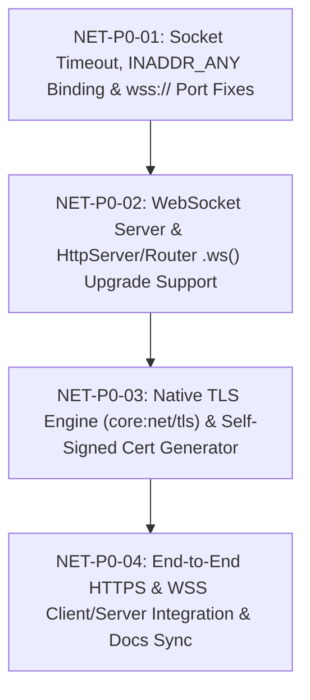
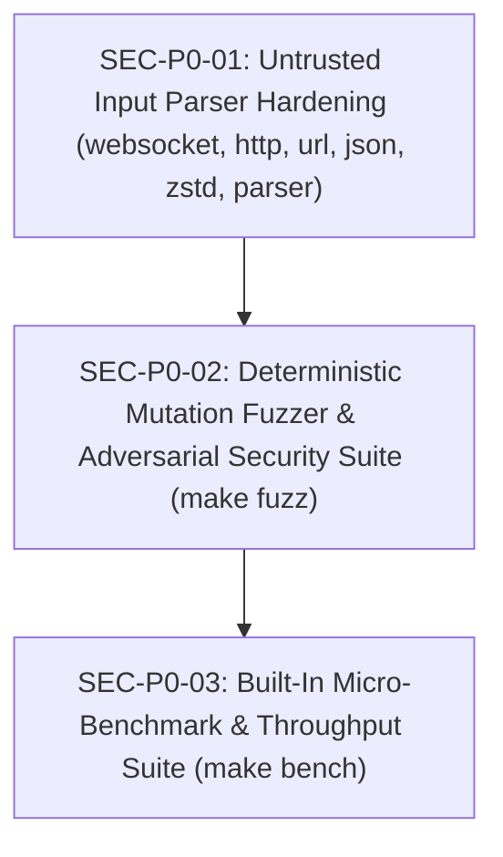

# Project Backlog

This backlog tracks prioritized improvements, features, and tooling upgrades for `cfire`.
When selecting an item for implementation, promote it to [`active.md`](./active.md) and complete the pre-implementation scoping gate before writing code.

---

# Active Backlog: WebSocket Server, Router Upgrade & Native TLS (`https://` / `wss://`) (`NET-*`)

> **MANDATORY INSTRUCTIONS FOR THE IMPLEMENTING AGENT — READ BEFORE WRITING ANY CODE**
>
> 1. **Do Not Skip Edge Cases or Make Silent Assumptions**: Every item below contains a **"Critical Details, Edge Cases & Pitfalls (Do Not Miss)"** checklist. Review every edge case before writing code.
> 2. **Preserve All Existing Invariants**:
>    - **Zero Warnings**: Every change must compile cleanly under `clang++ -std=c++2b -O2 -Wall -Wextra -Wpedantic -Wshadow -Wno-parentheses-equality -Iruntime -Isrc src/main.cpp`.
>    - **Zero Exceptions**: Do not introduce `try`/`catch` or `std::stoi` in `src/` or `runtime/`. Use `cfire::detail::parse_int<T>` (`<charconv>`) and `std::expected<T, E>`.
>    - **Zero External Compiler Flag Requirement for Standard Builds**: `Makefile` and `cfire check` compile against `runtime/cfire_core_stdlib.hpp` using `clang++ -std=c++2b -O2 -Iruntime -Isrc` without requiring external `-I` or `-L` flags on the command line. Native TLS support in `runtime/core/net/tls.hpp` must use dynamic symbol loading (`<dlfcn.h>` `dlopen`/`dlsym` for `libssl` & `libcrypto`) so that both standalone C++ test binaries and `.cf` binaries work out of the box without breaking Precompiled Header (PCH) caching.
>    - **Documentation & Formatting Sync**: Any change to `src/docgen/*`, `docs/GUIDE.md`, `src/formatter.hpp`, or `examples/*` must pass `./cfire doc --check` and `./cfire fmt --check examples/`.

---

### `NET-P0-01`: Socket Timeout, `INADDR_ANY` Binding & `wss://` URL Port Fixes `[Completed]`
- **Status**: Completed
- **Priority**: P0
- **Category**: Networking Runtime (`core:net`, `core:net/url`, `core:net/websocket`)
- **Target Files**:
  - `runtime/core/net/tcp.hpp`
  - `runtime/core/net/url.hpp`
  - `runtime/core/net/websocket.hpp`
- **Problem Statement**:
  1. `TcpConn::TcpConn` (`runtime/core/net/tcp.hpp:51-52`) sets a hardcoded 2-second `SO_RCVTIMEO` on the socket file descriptor. When `websocket::upgrade` or `websocket::connect` takes ownership of the socket via `tcp.release_fd()`, that 2-second timeout stays on the file descriptor. Any WebSocket connection that goes >2 seconds without receiving a frame fails `::recv()` with `EAGAIN`/`EWOULDBLOCK` and disconnects (`"websocket connection closed by peer"`).
  2. `net::listen_tcp` (`runtime/core/net/tcp.hpp:155`) binds exclusively to `INADDR_LOOPBACK` (`127.0.0.1`) rather than `INADDR_ANY` (`0.0.0.0`), preventing connections from LAN peers or container bridge networks.
  3. `url::parse` (`runtime/core/net/url.hpp:87-91`) only checks `u.scheme == "https"` when assigning default port `443`, leaving `wss://host/path` with port `80` instead of `443`.
- **Critical Details, Edge Cases & Pitfalls (Do Not Miss)**:
  - **Keep `HttpServer::stop()` Responsive**: `HttpServer::listen_and_serve` relies on `listener_.accept()` returning periodically so the loop can check `running_.load()`. Keep a bounded default poll timeout (e.g., `2000ms`) or configurable `accept(int timeout_ms = 2000)` on `TcpListener` while ensuring `HttpServer::listen_and_serve` continues looping while `running_` is true.
  - **Clear `SO_RCVTIMEO` on `websocket::Conn` Upgrade/Connect (and Provide `set_read_timeout`)**: When `websocket::Conn` takes ownership of an `fd_`, reset `SO_RCVTIMEO` to `{0, 0}` (blocking until frame arrives or peer closes) by default, and expose `ws.set_timeout_ms(i32)` so callers can opt into a custom read timeout when desired.
- **Detailed Engineering Requirements**:
  1. In `runtime/core/net/url.hpp`, treat both `"https"` and `"wss"` as default port `443` when no explicit `:port` is present in the URL.
  2. In `runtime/core/net/tcp.hpp`, bind `listen_tcp` to `INADDR_ANY` (`0.0.0.0`) by default and add `listen_tcp_addr(host, port)` for explicit interface binding.
  3. Add `TcpConn::set_timeout_ms(int ms)` and clear `SO_RCVTIMEO` (`{0, 0}`) in `websocket::Conn` constructor (with `websocket::Conn::set_timeout_ms(int ms)`).
- **Acceptance Criteria**:
  - `url.parse("wss://echo.example.com/chat")` sets `scheme == "wss"` and `port == 443`.
  - A WebSocket connection can remain idle for >2 seconds (or use custom timeout) without spurious disconnect.

---

### `NET-P0-02`: First-Class WebSocket Server & `http::Router` `.ws()` Route Upgrade `[Completed]`
- **Status**: Completed
- **Priority**: P0
- **Category**: WebSocket Server / HTTP Router (`core:net/http`, `core:net/websocket`)
- **Target Files**:
  - `runtime/core/net/http.hpp`
  - `runtime/core/net/websocket.hpp`
  - `src/codegen.hpp`
- **Problem Statement**:
  1. `http::Router` (`runtime/core/net/http.hpp:411-577`) only supports standard HTTP routes (`Response(const Request&)`) and `http::HttpServer` always writes `Response::to_http_wire()` with `Connection: close`. Users cannot register a WebSocket endpoint on an HTTP router (e.g., `router.ws("/ws/:room", |req, mut ws| { ... })`).
  2. `core:net/websocket` lacks a dedicated `websocket::Server` (`websocket.make_server(port)`) convenience class mirroring `http::HttpServer`.
- **Critical Details, Edge Cases & Pitfalls (Do Not Miss)**:
  - **Use `websocket::upgrade(req, conn)` Directly on the Accepted `TcpConn`**: In `HttpServer::serve_once` and `HttpServer::listen_and_serve`, before dispatching as a normal HTTP response that closes the socket, check if the router matches a registered WebSocket route (`.ws(pattern, handler)`). If it matches, run any router middlewares; if no middleware short-circuits, perform `cfire::websocket::upgrade(req, conn)` (which writes `HTTP/1.1 101 Switching Protocols` and transfers the socket + TLS stream into `websocket::Conn`) and invoke the WebSocket handler `ws_handler(req, ws)`.
  - **Header Order Dependency**: Currently `websocket.hpp` includes `http.hpp`. For `http.hpp` (`Router` and `HttpServer`) to reference `websocket::Conn` and `websocket::upgrade`, either move the core `websocket::Conn` / `websocket::upgrade` definitions before `Router`/`HttpServer` or include `websocket.hpp` cleanly so both `import "core:net/http"` and `import "core:net/websocket"` have full access to `Router::ws` and `websocket::Server`.
  - **Trailing Closure / Lambda Parameter Lowering in `src/codegen.hpp`**: When a `.cf` program writes `router.ws("/ws", |req, mut ws| { ... })` or `srv.serve_in_background(|mut ws| { ... })`, C++ lambda parameter emission in `src/codegen.hpp` emits `auto&& param`. Because `mut ws` is bound to an lvalue reference (`websocket::Conn&`), `auto&& ws` deduces to `websocket::Conn&` which allows calling non-const methods (`ws.recv_text()`, `ws.send_text(...)`) seamlessly! Verify this works in `.cf` codegen.
- **Detailed Engineering Requirements**:
  1. Add `using WsHandler = std::function<void(const Request&, cfire::websocket::Conn&)>;` and `.ws(std::string_view pattern, WsHandler handler)` to `cfire::http::Router`.
  2. Update `HttpServer::serve_once` and `HttpServer::listen_and_serve` so requests matching a `.ws` route upgrade the `TcpConn` to a server-side `websocket::Conn` and invoke the `WsHandler`. Also support passing a `Router` directly to `HttpServer::serve_once(router)`, `listen_and_serve(router)`, and `serve_in_background(router)`.
  3. Add `cfire::websocket::Server` and `cfire::websocket::make_server(port)` in `runtime/core/net/websocket.hpp` supporting `.port()`, `.serve_once(handler)`, `.listen_and_serve(handler)`, `.serve_in_background(handler)`, and `.stop()`.
- **Acceptance Criteria**:
  - A `.cf` program can register both `router.get("/health", ...)` and `router.ws("/chat/:room", |req, mut ws| ...)` on the same `HttpServer`, serve HTTP `GET /health` AND connect via `websocket.connect("ws://127.0.0.1:<port>/chat/general")`, exchange bidirectional text and binary messages, and read `req.param("room") == "general"`.
  - A standalone `websocket.make_server(0)` accepts `websocket.connect("ws://127.0.0.1:<port>/")` clients and exchanges frames cleanly.

---

### `NET-P0-03`: Native TLS / SSL Engine (`core:net/tls`) with Dynamic OpenSSL Bridge & Self-Signed Cert Generator `[Completed]`
- **Status**: Completed
- **Priority**: P0
- **Category**: Cryptography & Transport Security (`core:net/tls`, `core:net`)
- **Target Files**:
  - `runtime/core/net/tls.hpp` (new)
  - `runtime/core/net/tcp.hpp`
  - `runtime/core/net.hpp`
- **Problem Statement**:
  - `TcpConn` and `websocket::Conn` perform raw `::send` and `::recv` syscalls with no TLS encryption, SNI hostname extension, X.509 certificate verification, or server-side TLS certificate loading.
- **Critical Details, Edge Cases & Pitfalls (Do Not Miss)**:
  - **Zero-Flag Compilation via `<dlfcn.h>` (`dlopen` / `dlsym`)**:
    `Makefile` compiles `tests/unit/test_stdlib.cpp` with `clang++ -std=c++2b -O2 -Iruntime -Isrc` (no `-I/opt/homebrew/...` or `-lssl -lcrypto`), and `cfire` uses a precompiled header (`cfire_prelude_opt.pch`). Therefore, `runtime/core/net/tls.hpp` **must not** require `<openssl/ssl.h>` at compile time or `-lssl` at link time! Instead, load `libssl` and `libcrypto` dynamically via `dlopen` (searching `/opt/homebrew/opt/openssl@3/lib/`, `/opt/homebrew/lib/`, `/usr/local/opt/openssl/lib/`, and standard `libssl.3.dylib` / `libssl.dylib` / `libssl.so.3` / `libssl.so`), and resolve the minimal C ABI function pointers (`OPENSSL_init_ssl`, `TLS_client_method`, `TLS_server_method`, `SSL_CTX_new`, `SSL_CTX_free`, `SSL_CTX_set_verify`, `SSL_CTX_set_default_verify_paths`, `SSL_CTX_load_verify_locations`, `SSL_CTX_use_certificate_file`, `SSL_CTX_use_PrivateKey_file`, `BIO_new_mem_buf`, `BIO_free`, `PEM_read_bio_X509`, `PEM_read_bio_PrivateKey`, `SSL_CTX_use_certificate`, `SSL_CTX_use_PrivateKey`, `X509_free`, `EVP_PKEY_free`, `SSL_new`, `SSL_free`, `SSL_set_fd`, `SSL_ctrl`, `SSL_connect`, `SSL_accept`, `SSL_read`, `SSL_write`, `SSL_shutdown`, `SSL_get_verify_result`, `ERR_get_error`, `ERR_error_string_n`).
  - **Transport Hook on `TcpConn` and `websocket::Conn`**:
    Add a `std::shared_ptr<cfire::net::TlsStream>` member to both `TcpConn` and `websocket::Conn`. When non-null, `TcpConn::write`, `TcpConn::read_str`, and `websocket::Conn` (`send_text`, `send_binary`, `ping`, `recv_frame`, `close`) route all reads and writes through `TlsStream::read_fn` (`SSL_read`) and `TlsStream::write_fn` (`SSL_write`). When `websocket::upgrade` or `websocket::connect` transitions a `TcpConn` into a `websocket::Conn`, transfer both `fd_` and `tls_` (`tcp.release_tls()`)!
  - **System CA Bundle Auto-Discovery on macOS & Linux**:
    When `verify_peer` is `true`, in addition to `SSL_CTX_set_default_verify_paths`, check standard CA bundle locations (`/etc/ssl/cert.pem` on macOS, `/opt/homebrew/etc/openssl@3/cert.pem`, `/etc/ssl/certs/ca-certificates.crt` on Debian/Ubuntu, `/etc/pki/tls/certs/ca-bundle.crt` on RHEL/Fedora) and load the first existing bundle via `SSL_CTX_load_verify_locations` so certificate verification against real public servers works reliably even when Homebrew OpenSSL's default `OPENSSLDIR` is unconfigured.
- **Detailed Engineering Requirements**:
  1. Create `runtime/core/net/tls.hpp` with `cfire::tls`:
     - `tls::available() -> bool`
     - `tls::CertKeyPair { std::string cert_pem; std::string key_pem; }`
     - `tls::generate_self_signed_pem(std::string_view common_name = "localhost") -> std::expected<CertKeyPair, cfire::Error>`
     - `tls::wrap_client(cfire::net::TcpConn& conn, std::string_view hostname, bool verify_peer = true, std::string_view ca_file = "") -> std::expected<void, cfire::Error>`
     - `tls::ServerContext` wrapping a server `SSL_CTX*` loaded from PEM files (`from_files(cert_path, key_path)`) or PEM strings in memory (`from_pem(cert_pem, key_pem)`), plus `wrap_server(cfire::net::TcpConn& conn) -> std::expected<void, cfire::Error>`.
     - `tls::connect(host, port, verify_peer = true) -> std::expected<cfire::net::TcpConn, cfire::Error>`
  2. Wire `TlsStream` into `TcpConn` (`runtime/core/net/tcp.hpp`) and `websocket::Conn` (`runtime/core/net/websocket.hpp`).
- **Acceptance Criteria**:
  - `tls::available()` returns `true` on the host machine.
  - `tls::generate_self_signed_pem("localhost")` generates a valid X.509 PEM certificate and private key in memory.
  - A server `TcpListener` using `tls::ServerContext::from_pem` and a client `TcpConn` using `tls::wrap_client` complete a real TLS 1.3 handshake over loopback and exchange encrypted data.

---

### `NET-P0-04`: End-to-End `https://` & `wss://` Client/Server Integration & Catalog Sync `[Completed]`
- **Status**: Completed
- **Priority**: P0
- **Category**: HTTP/WebSocket TLS Integration & Documentation (`core:net/http`, `core:net/websocket`, `src/docgen/catalog.hpp`)
- **Target Files**:
  - `runtime/core/net/http.hpp`
  - `runtime/core/net/websocket.hpp`
  - `src/codegen.hpp`
  - `src/docgen/catalog.hpp`
  - `tests/unit/test_stdlib.cpp`
- **Problem Statement**:
  1. `http::request` (`http.get`, `http.post`) and `websocket::connect` do not invoke TLS when given `https://` or `wss://` URLs.
  2. `http::HttpServer` and `websocket::Server` cannot be configured with TLS certificates to serve `https://` and `wss://` directly.
- **Detailed Engineering Requirements**:
  1. In `http::request` (`runtime/core/net/http.hpp`):
     - When `u->scheme == "https"`, call `cfire::tls::wrap_client(conn, u->host, verify_peer, ca_file)` before sending the HTTP request.
     - Support `verify_peer` control via `http::get(url, headers, verify_peer = true)` / `http::post(url, body, content_type, headers, verify_peer = true)` or header `"x-cfire-tls-verify": "false"`.
  2. In `http::HttpServer`:
     - Add `.enable_tls_files(cert_path, key_path) -> std::expected<void, cfire::Error>` and `.enable_tls_pem(cert_pem, key_pem) -> std::expected<void, cfire::Error>`, plus factory functions `http::make_tls_server(port, cert_path, key_path)` and `http::make_tls_server_pem(port, cert_pem, key_pem)`.
     - When TLS is enabled on `HttpServer`, `serve_once` and `listen_and_serve` automatically perform `tls_ctx_->wrap_server(conn)` on every accepted connection before reading the HTTP request or upgrading to a `wss://` WebSocket!
  3. In `websocket::connect` (`runtime/core/net/websocket.hpp`):
     - Add `bool verify_peer = true` parameter (`websocket::connect(url_str, verify_peer = true)` and `websocket::connect_insecure(url_str)`).
     - When `u->scheme == "wss"`, call `cfire::tls::wrap_client(tcp, u->host, verify_peer)` before sending the HTTP `101` upgrade handshake, and pass `tcp.release_tls()` into the returned `websocket::Conn`.
     - Add `.enable_tls_files` / `.enable_tls_pem` and `websocket::make_tls_server` / `websocket::make_tls_server_pem` to `websocket::Server`.
  4. Register `core:net/tls` (and updated `core:net/http` / `core:net/websocket` signatures) in `src/codegen.hpp` and `src/docgen/catalog.hpp`, regenerate `docs/` with `./cfire doc`, and add comprehensive unit and `.cf` end-to-end tests in `tests/unit/test_stdlib.cpp`.
- **Acceptance Criteria**:
  - End-to-end `https://` test: `http.make_tls_server_pem(0, cert.cert_pem, cert.key_pem)` serves a `Router` with both `GET /secure` and `.ws("/wss-echo", ...)`, and a `.cf` client successfully executes `http.get("https://127.0.0.1:<port>/secure", ...)` AND `websocket.connect("wss://127.0.0.1:<port>/wss-echo", false)` over real TLS 1.3!
  - `make review-check` passes 100% (0 warnings, 0 formatting diffs, 0 doc discrepancies, 100% conformance tests pass).

---

# Active Backlog: Security Hardening, Fuzzing & Performance Benchmarks (`SEC-*`)

---

### `SEC-P0-01`: Untrusted Input Parser Hardening (`websocket`, `http`, `url`, `json`, `zstd`, `parser`) `[Completed]`
- **Status**: Completed
- **Priority**: P0
- **Category**: Runtime & Compiler Security Hardening
- **Target Files**:
  - `runtime/core/net/websocket.hpp`
  - `runtime/core/net/http.hpp`
  - `runtime/core/net/url.hpp`
  - `runtime/core/json.hpp`
  - `runtime/core/compress.hpp`
  - `src/parser.hpp`
- **Problem Statement**:
  1. `websocket::decode_frame` trusts 64-bit wire lengths (`len == 127`) and calls `f.payload.resize(len)` before reading payload bytes or checking a max frame bound, allowing a 10-byte packet to trigger an OOM crash (`std::bad_alloc`).
  2. `http::Response::to_http_wire`, `http::Response::redirect`, and `http::request` do not sanitize `\r`/`\n` in header keys/values, status text, or target paths (HTTP Response Splitting / CRLF Header Injection), and `http::parse_request` / `http::parse_response` / `url::parse` do not cap header or query parameter counts.
  3. `url::decode` does not verify `std::isxdigit` on `%XX` sequences.
  4. `json::DynamicJsonParser` and `frontend::Parser` lack recursion depth limits on nested arrays/objects/expressions/blocks, allowing 64KB of `[[[[...` or `((((...` to overflow the call stack (`SIGSEGV`).
  5. `zstd::decompress` trusts `ZSTD_getFrameContentSize` without a maximum output size limit (decompression bomb).
- **Detailed Engineering Requirements**:
  1. **WebSocket Frame Size Limit & Chunked Read (`websocket.hpp`)**:
     - Add `static constexpr std::size_t kDefaultMaxFrameSize = 16 * 1024 * 1024;` (16 MiB) to `decode_frame` and `max_frame_size_` (with `ws.set_max_frame_size(bytes)`) to `websocket::Conn`.
     - Reject any frame where `len > max_frame_size` before allocating memory. Read large payloads in bounded chunks (e.g., 64 KiB) rather than resizing multi-megabyte buffers upfront.
  2. **HTTP CRLF Sanitization & Header/Query Caps (`http.hpp`, `url.hpp`)**:
     - Strip `\r` and `\n` in `Response::set_header`, `Response::to_http_wire`, `Response::redirect`, and `http::request` wire serialization.
     - Cap HTTP headers at `kMaxHttpHeaders = 128` and URL query parameters at `kMaxQueryParams = 256`.
     - In `url::decode`, require both characters after `%` to satisfy `std::isxdigit`; otherwise preserve the literal `%` character.
  3. **Recursion Depth Guards (`json.hpp`, `src/parser.hpp`)**:
     - In `DynamicJsonParser` (`runtime/core/json.hpp`), enforce `kMaxJsonDepth = 128` across `parse_val` / `parse_obj` / `parse_arr`, returning a clean `cfire::Error("maximum JSON nesting depth exceeded")` when exceeded.
     - In `frontend::Parser` (`src/parser.hpp`), enforce `kMaxParseDepth = 256` across `parse_expr`, `parse_stmt`, `parse_block`, and `parse_type_ref`.
  4. **Zstandard Decompression Bomb Limit (`compress.hpp`)**:
     - Add `std::size_t max_output_bytes = 64 * 1024 * 1024` (64 MiB default) to `zstd::decompress` and reject frames exceeding `max_output_bytes`.
- **Acceptance Criteria**:
  - Crafting a 10-byte WebSocket header with `len = 0x7FFFFFFFFFFFFFFF` returns `std::nullopt` / `Error` in <1ms with zero large allocation.
  - Passing 10,000 nested `[` to `json::parse_dynamic` or 10,000 nested `(` to `frontend::parse_source` returns a clean error without stack overflow.
  - CRLF characters in HTTP headers or redirect URLs cannot inject extra headers or split responses.

---

### `SEC-P0-02`: Deterministic Mutation Fuzzer & Adversarial Security Suite (`make fuzz`) `[Completed]`
- **Status**: Completed
- **Priority**: P0
- **Category**: Security Testing & Fuzzing
- **Target Files**:
  - `tests/unit/test_stdlib.cpp`
  - `tests/test_harness.hpp`
  - `tests/test_main.cpp`
  - `Makefile`
- **Detailed Engineering Requirements**:
  1. Implement `test_security_and_fuzzing` in `tests/unit/test_stdlib.cpp` (invoked in `test_main.cpp` under both `all`, `stdlib`, and a dedicated `fuzz` target in `Makefile`).
  2. Include deterministic PRNG mutation fuzzing (bit flips, byte insertions, truncations, length-field corruption, boundary values) + adversarial security corpora across:
     - `websocket::decode_frame` (64-bit length bombs, truncated extended lengths, partial masks, random byte streams over socketpair)
     - `http::parse_request` & `http::parse_response` (CRLF injection, 1,000+ headers, malformed status lines, negative/huge `Content-Length`)
     - `url::parse` & `url::decode` (`%` at EOF, `%ZZ`, 1,000+ query params, missing host/scheme)
     - `json::parse_dynamic` (10,000-deep nesting, truncated `\uXXXX`, unclosed strings/objects, random mutated JSON)
     - `base64::decode`, `hex::decode`, `csv::parse`, `unicode::is_valid_utf8` / `unicode::runes` (overlong UTF-8, lone surrogates, invalid padding, unclosed CSV quotes)
     - `frontend::tokenize`, `frontend::parse_source_resilient`, and `lsp::detail::find_json_key` (deeply nested expressions/types, random mutated `.cf` source, malformed JSON-RPC)
- **Acceptance Criteria**:
  - `make fuzz` and `./.cfire_test_runner fuzz` execute 10,000+ adversarial & mutated inputs across all parsers in <2 seconds with zero crashes, hangs, or sanitizer faults.

---

### `SEC-P0-03`: Built-In Performance Benchmark Suite (`make bench`) `[Completed]`
- **Status**: Completed
- **Priority**: P0
- **Category**: Performance Benchmarking
- **Target Files**:
  - `tests/unit/test_stdlib.cpp`
  - `tests/test_harness.hpp`
  - `tests/test_main.cpp`
  - `Makefile`
- **Detailed Engineering Requirements**:
  1. Implement `test_performance_benchmarks` in `tests/unit/test_stdlib.cpp` (runnable via `make bench` or `./.cfire_test_runner bench`, and included in the test runner) with structured throughput (`MB/s`, `ops/sec`) and latency (`ns/op`) reporting.
  2. Benchmark key workloads with sanity assertions (ensuring no accidental 100x algorithmic regressions):
     - HTTP request wire parsing & `Router` parameterized dispatch (`ops/sec`, `ns/op`)
     - WebSocket frame encoding/masking & loopback roundtrip (`ops/sec`, `MB/s`)
     - TLS 1.3 loopback handshake & encrypted stream throughput
     - `json::parse_dynamic` + `json::stringify_dynamic` (`MB/s`, `ops/sec`)
     - `sha256::hash_bytes` & `aes::encrypt_gcm` / `decrypt_gcm` (`MB/s`)
     - Compiler frontend (`tokenize` + `parse_source` + `analyze` + `emit_cpp`) throughput (`lines/sec`)
- **Acceptance Criteria**:
  - `make bench` prints a clean benchmark table (`ns/op`, `ops/sec`, `MB/s`) and verifies all throughput sanity checks pass.

---

# Active Backlog: Systems & GUI Application Ergonomics (`LANG-*`, `STDLIB-*`)
*(Detailed RFC and empirical evidence: [`docs/planning/desktop-app-feedback-and-proposals.md`](./desktop-app-feedback-and-proposals.md))*

### `LANG-P0-01`: Built-in Numeric Conversion / Typecast Operators & Prelude Constructors `[Completed]`
- **Status**: Completed
- **Priority**: P0
- **Category**: Compiler & Prelude (`cfire_prelude.hpp`, `src/codegen.hpp`, `src/sema.hpp`)
- **Target Files**:
  - `runtime/cfire_prelude.hpp`
  - `src/codegen.hpp`
- **Scope**: Enable `i32(x)`, `f32(x)`, `u64(x)`, etc. natively without requiring custom conversion functions or `cpp { static_cast<int>(x); }`.

### `STDLIB-P1-04`: Reverse Find & Substring Index Primitives in `core:str` `[Completed]`
- **Status**: Completed
- **Priority**: P1
- **Category**: Standard Library (`runtime/core/str.hpp`)
- **Target Files**:
  - `runtime/core/str.hpp`
  - `tests/unit/test_stdlib.cpp`
- **Scope**: Implement `str.index_of(s, sub)`, `str.last_index_of(s, sub)`, and `str.rfind(s, sub)`.

### `LANG-P1-03`: Bitwise Operator Support on Imported Vendor / C Enums `[Completed]`
- **Status**: Completed
- **Priority**: P1
- **Category**: Compiler & Clang Bridge (`src/clang_bridge.hpp`, `src/codegen.hpp`)
- **Scope**: Emit bitwise `|`, `&`, `^`, `~` operator overloads for imported vendor C enums so flag combinations like `rl.FLAG_WINDOW_HIGHDPI | rl.FLAG_WINDOW_RESIZABLE` work directly in `.cf`.

### `LANG-P1-02`: Pointer Offsets, Decays, and C FFI Interop for `str` & Slices `[Completed]`
- **Status**: Completed
- **Priority**: P1
- **Category**: Standard Library & FFI (`runtime/core/str.hpp`, `src/codegen.hpp`, `src/sema.hpp`)
- **Scope**: Provide `str.byte_ptr()`, `str.byte_ptr_at(offset)`, `s.byte_ptr()`, `s.byte_ptr_at(offset)`, mutable pointer passing for C FFI bindings, and `*c_char` / `*mut c_char` lowering without inline C++.

### `LANG-P2-05`: Rebindable Pointer / Reference Aliases (`*mut T` or `ref mut`) `[Completed]`
- **Status**: Completed
- **Priority**: P2
- **Category**: Language Design & SEMA (`src/parser.hpp`, `src/ast.hpp`, `src/sema.hpp`, `src/codegen.hpp`)
- **Scope**: Support rebindable pointers/references (`mut target: *mut str = &mut state.field`), newline-safe unary dereference parsing (`*target = ...`, `*target += ...`), and null checking (`p == none`, `p = none`) to eliminate code duplication across multi-field editors.

### `LANG-P1-06`: Slice and Vector `.data()` Buffer Pointer Access for C FFI Interop `[Completed]`
- **Status**: Completed
- **Priority**: P1
- **Category**: Language Design & Codegen (`src/codegen.hpp`, `src/sema.hpp`, `docs/reference.html`)
- **Scope**: Complement string `byte_ptr()` / `bytes_str()` by adding built-in `.data()` / `.data_ptr()` method on slice and vector types (`[]T`, `std::vector<T>`, `std::span<T>`) lowering to `({}).data()`. Enables passing raw slice buffer pointers directly to C FFI functions (e.g., `LoadFontEx(..., codepoints.data(), codepoints.len())`) without `cpp {}` blocks.

---

# Completed Milestones Archive (Summary)

| Initiative Series | IDs | Scope | Status |
| :--- | :--- | :--- | :---: |
| **Agent-Friendliness & Language Ergonomics** | `AGENT-P0-01` – `AGENT-P2-05` | Multi-error structured diagnostics & fix-its (`cfire check --json`), `#line` source mapping, `-fsyntax-only` verification, full type/intent `cfire outline`, catalog-backed `cfire doc --llm`, `println` interpolation flattening, `allow_struct_lit_` disambiguation, `MatchExpr`, compound assignment & bitwise ops, `-o` output flag, `cfire fix`, `cfire test --json`/`--filter`, `cfire inspect`, tokenizer-backed `cfire eval` | `[Completed]` |
| **C++23 Architecture & Safety** | `ARCH-CPP-01` – `ARCH-CPP-05`, `CPP-QA-01` – `CPP-QA-06` | Multi-struct receiver method dispatch, C++20 `concept` interface lowering, `scope.spawn` capture safety, `<charconv>` zero-exception migration, `[[clang::lifetimebound]]`, modular header decomposition (`net/*`, `docgen/*`, `lsp/*`) | `[Completed]` |
| **Language Server Protocol (`cfire-lsp`)** | `LSP-01` – `LSP-10` | Snippet completions, Go-to-Type-Definition, semantic tokens, cross-workspace rename, auto-import `core:*`, exhaustive `match` code actions, struct memory layout hover, inlay hints, signature help | `[Completed]` |
| **Language Design & Build System** | `LD-01` – `LD-14`, `BS-01` – `BS-08`, `LIB-01` – `LIB-12` | 28 `core:*` modules, CFG move checker, borrow slices, multi-return tuples, `build.cf` incremental caching, Clang AST header bridge, CMake ejection | `[Completed]` |
