# Project Backlog

This document tracks the interactively triaged and architecturally audited backlog for `cfire` (`CF-001` – `CF-139`).

---

## 0. Quality Audit 2026-11 (`CF-091` – `CF-139`)

### 0.1 Architectural Decision Record

The following architectural decisions were established during the interactive PL audit and code evaluation on 2026-11-09:

1. **Closure & Concurrency Capture Model (`Q2`)**:
   - Closures that escape their declaring stack frame (closures spawned via `scope.spawn`, returned from functions, stored in structs/collections, or passed to standard library parameters marked `escaping`) capture by value (`[=]() mutable`) with an explicit capture list.
   - Assigning to an outer local variable inside an escaping closure is rejected at compile time (`cfire/ESCAPING-CAPTURE-MUT`) with an auto-fix suggesting heap indirection, channels, or atomics.
   - Non-escaping trailing closure blocks (e.g., `for_each`, local algorithms) remain zero-overhead reference borrows (`[&]`).
2. **Path & Member Separator Orthogonality (`Q3`)**:
   - The dot operator (`.`) is strictly reserved for value member access, package qualification, and method invocations (`obj.field`, `pkg.func()`).
   - The double colon (`::`) is strictly reserved for type-level paths and algebraic enum variant constructors (`pkg.Type::Variant`, `Enum::Variant`).
   - Deprecated forms like `log.Level.Debug` or `Type.Variant` trigger `cfire/DEPRECATED-SEPARATOR` with auto-fixes to `::`.
3. **Integer Overflow & Arithmetic Soundness (`Q4`)**:
   - Release binaries compile with `-fwrapv` to enforce well-defined two's-complement wrapping without undefined behavior.
   - Conformance test runs (`cfire test`) and debug builds (`--debug`) compile with `-fsanitize=signed-integer-overflow,shift,integer-divide-by-zero -fsanitize-trap=all` to halt immediately on accidental overflow.
   - Division and modulo by zero are checked in codegen to panic deterministically across all architectures.
   - Explicit arithmetic semantics are provided via `core:math` (`checked_add`, `wrapping_add`, `saturating_add`, etc.).
4. **Language Feature Scope & Downstream Realities (`Q5`)**:
   - Plain C-style enums are elevated to first-class primitives with equality comparison (`==`), string formatting (`{}`), integer conversion (`i32(e)` / `from_i32`), and JSON string serialization.
   - Multi-pattern or-arms (`"a" | "b" =>`, `Ev::A | Ev::B =>`) are supported in `match`.
   - Generic type application syntax is made uniform across all user and standard library types (`Name[A, B]`).
   - Complex nested pattern matching, match guards, and type aliases are deferred until driven by concrete downstream requirements.
5. **Deprecation Transition Policy (`Q6`)**:
   - Deprecated language constructs (`var`, `out` intent, `x: mut T` parameter annotations, explicit `in`, `make(own[T], v)`, `_ :=`, `Type.Variant`, and `(*p).Field` on smart pointers) are treated as hard compile errors accompanied by machine-executable auto-fixes (`cfire fix`).
   - The entire `cfire` repository (examples, guide, tests, and standard library) is migrated concurrently to guarantee zero deprecation warnings.
6. **Network & Development Server Binding**:
   - The development server (`cfire dev` / `cfire server`) retains its intentional default binding to `0.0.0.0` (`INADDR_ANY`), enabling immediate local network testing from mobile devices, containers, and LAN clients. Optional `--host` flags permit restricting to loopback when explicitly requested.

---

### 0.2 Execution Dependency Graph

```mermaid
flowchart TD
    subgraph P0 ["Phase 0: Regression Net & Safety Core"]
        CF091["CF-091: GUIDE Doc-Test Runner"]
        CF092["CF-092: Golden Codegen Snapshot Suite"]
        CF093["CF-093: CI Matrix & Sanitizers"]
        CF094["CF-094: Test Suite Hygiene & Determinism"]
        CF095["CF-095: MCP Server Sandbox & Limits"]
        CF096["CF-096: Formatter Invariance & Safety"]
        CF097["CF-097: Closure Capture Lowering"]
        CF098["CF-098: Arithmetic Overflow & Debug Mode"]
        CF099["CF-099: Missing Return Divergence Check"]
        CF100["CF-100: Expr-Node Move Safety"]
        CF101["CF-101: Codegen Namespace Guard Hotfix"]
    end

    subgraph P1 ["Phase 1: Compiler Diagnostics & Deprecations"]
        CF102["CF-102: Terminal Warning Visibility"]
        CF103["CF-103: Hard Deprecation Error Enforcement"]
        CF104["CF-104: Duplicate Definition Pass"]
        CF105["CF-105: Catalog-Gated Import Validation"]
        CF106["CF-106: Plain Enum Usability Cluster"]
        CF107["CF-107: Uniform Generic Type Application"]
        CF108["CF-108: C++ Backend Error Leak Prevention"]
        CF109["CF-109: FFI Namespace Resolution"]
        CF110["CF-110: Match Exhaustiveness Gaps"]
        CF111["CF-111: Left-Associative Or Chaining"]
        CF112["CF-112: Lexer Exponents & Keywords"]
        CF113["CF-113: Content-Hashed PCH & Invocation"]
        CF114["CF-114: Lambda #line Tracking"]
        CF131["CF-131: Negative Parser Corpus & Fuzzing"]
    end

    subgraph P2 ["Phase 2: Resolved AST & Unified Engine"]
        CF115["CF-115: Semantic AST Resolution Pass"]
        CF116["CF-116: Interned TypeId Lattice"]
        CF117["CF-117: Single Stdlib Metadata Table"]
        CF118["CF-118: Unified Diagnostic Pipeline"]
        CF119["CF-119: Scope-Sound Refactor Engine"]
        CF120["CF-120: Compiler Modularization"]
    end

    subgraph P3 ["Phase 3: Extended Language Features"]
        CF121["CF-121: User-Defined Generic Structs/Enums"]
        CF122["CF-122: Match Or-Patterns"]
        CF123["CF-123: Enum Idiom Guide & Lint"]
        CF124["CF-124: FFI Boundary Loan Invalidation"]
    end

    subgraph P4 ["Phase 4: Tooling Depth & IDE Protocol"]
        CF125["CF-125: Standards-Compliant LSP JSON-RPC"]
        CF126["CF-126: LSP Document Lifecycle & Watchers"]
        CF127["CF-127: Position Encoding & UTF-16 Sync"]
        CF128["CF-128: Incremental Sync & Cancellation"]
        CF129["CF-129: Extended LSP Capabilities"]
        CF130["CF-130: AST-Level Formatter Pretty Printer"]
    end

    subgraph CrossCutting ["Cross-Cutting & Infrastructure"]
        CF132["CF-132: Downstream Ecosystem Fix Run"]
        CF133["CF-133: Pre-Commit & Release CI Gates"]
    end

    P0 --> P1
    P1 --> P2
    P2 --> P3
    P2 --> P4
    P1 -.-> CrossCutting
```



---

### 0.3 Master Backlog Index (`CF-091` – `CF-139`)

| ID | Phase | Priority | Component | Summary | Depends On | Lane | Status |
| :--- | :---: | :---: | :--- | :--- | :---: | :---: | :---: |
| `CF-091` | **P0** | **P0** | `src/docgen/`, `docs/` | **GUIDE Doc-Test Runner & Specification Alignment**: Compile/diff all GUIDE code blocks; sync stale text | None | Docs | `[DONE]` |
| `CF-092` | **P0** | **P0** | `tests/golden/`, `src/codegen/` | **Golden Codegen Snapshot & `#line` Verification Suite**: Characterize ISO C++23 emission regression net | None | Codegen | `[DONE]` |
| `CF-093` | **P0** | **P0** | `.github/`, `Makefile` | **Multi-Platform CI Matrix & Sanitizer Hardening**: Linux job, ASan/UBSan targets, coverage reporting | None | CI | `[DONE]` |
| `CF-094` | **P0** | **P0** | `tests/` | **Conformance Test Suite Hygiene & Determinism**: Isolate temps, remove wall-clock asserts, purge dead code | None | Tests | `[DONE]` |
| `CF-095` | **P0** | **P0** | `src/mcp.hpp` | **MCP Server Security, Process Isolation & Resource Limits**: Replace shell formatting with argv exec | None | Security | `[DONE]` |
| `CF-096` | **P0** | **P0** | `src/formatter.hpp` | **Code Formatter String-Awareness & AST-Level Round-Trip**: Fix `"http://"` corruption in struct defaults | `CF-092` | Tooling | `[DONE]` |
| `CF-097` | **P0** | **P0** | `src/sema.hpp`, `src/codegen/` | **Closure & Spawn Capture Semantics**: Escape analysis, explicit value captures, prohibit outer mut writes | `CF-092` | Language | `[DONE]` |
| `CF-098` | **P0** | **P0** | `src/buildsys.hpp`, `runtime/` | **Defined Integer Overflow, Shift & Division Semantics**: Add `-fwrapv`, UBSan traps, div-by-zero panics | `CF-093` | Runtime | `[DONE]` |
| `CF-099` | **P0** | **P0** | `src/sema.hpp` | **Control-Flow Divergence & Missing-Return Verification**: Enforce all execution branches return | None | Sema | `[DONE]` |
| `CF-100` | **P0** | **P0** | `src/sema.hpp`, `src/codegen/` | **Expr-Node-Keyed Move Tracking & CFG Loop Safety**: Eliminate line-number-based `std::move` tags | `CF-092` | Sema | `[DONE]` |
| `CF-101` | **P0** | **P0** | `src/codegen/expr.hpp` | **Codegen Namespace & Member Access Guard Isolation**: Prevent locals matching stdlib from hijacking C++ | `CF-092` | Codegen | `[DONE]` |
| `CF-102` | **P1** | **P1** | `src/cli/cmd_check_fix.hpp` | **Terminal Warning Visibility**: Surface semantic warnings in human terminal output | None | CLI | `[DONE]` |
| `CF-103` | **P1** | **P1** | `src/sema.hpp`, `src/parser.hpp` | **Hard Deprecation Error Enforcement**: Convert `var`, `out`, `x: mut T`, etc. to hard errors | `CF-091`, `CF-102` | Language | `[DONE]` |
| `CF-104` | **P1** | **P1** | `src/sema.hpp` | **Duplicate Declaration Pass**: Reject redefinitions of functions, structs, and enum variants | None | Sema | `[DONE]` |
| `CF-105` | **P1** | **P1** | `src/sema.hpp`, `src/module_registry.hpp` | **Catalog-Gated Import Validation**: Reject unknown standard library modules with clear diagnostics | None | Sema | `[DONE]` |
| `CF-106` | **P1** | **P1** | `src/codegen/`, `runtime/` | **Plain Enum Usability Cluster**: Add `==`, `{}` display, `i32` cast, JSON variant-name serialization | `CF-092` | Runtime | `[DONE]` |
| `CF-107` | **P1** | **P1** | `src/parser.hpp`, `src/codegen.hpp` | **Uniform First-Class Multi-Argument Generic Type Application**: Unify `Name[A, B]` lowering | `CF-092` | Compiler | `[DONE]` |
| `CF-108` | **P1** | **P1** | `src/sema.hpp`, `runtime/` | **C++ Backend Error Leak Prevention**: Fix `error(m, c)` arity, `[]Interface` diagnostics, channel loops | None | Compiler | `[DONE]` |
| `CF-109` | **P1** | **P1** | `src/sema.hpp` | **Scoped Name Resolution in C++ FFI Files**: Do not disable cfire checks on `import cpp` | None | Sema | `[DONE]` |
| `CF-110` | **P1** | **P1** | `src/sema.hpp` | **Match Statement Exhaustiveness & Arm Reachability**: Validate statement matches and arm types | None | Sema | `[DONE]` |
| `CF-111` | **P1** | **P1** | `src/parser.hpp` | **Left-Associative Or Chaining & Unambiguous Block Parsing**: Support `a or b or c` syntax | None | Parser | `[DONE]` |
| `CF-112` | **P1** | **P1** | `src/lexer.hpp`, `src/parser.hpp` | **Lexer Exponent Literals, Control Keywords & Interpolation**: Tokenize `1e9`, reserve keywords | None | Lexer | `[DONE]` |
| `CF-113` | **P1** | **P1** | `src/buildsys.hpp`, `src/server.hpp` | **Content-Hashed PCH Cache & Multi-Arg Subprocess Execution**: Cache based on dep hashes | None | Buildsys | `[DONE]` |
| `CF-114` | **P1** | **P1** | `src/codegen.hpp` | **Accurate Multi-Line Lambda Source Mapping**: Reset `#line` directives following lambdas | `CF-092` | Codegen | `[DONE]` |
| `CF-115` | **P2** | **P1** | `src/sema.hpp`, `src/codegen.hpp` | **Semantic AST Resolution Pass**: Attach binding `Resolution` to AST; delete codegen name heuristics | `CF-092`, `CF-101` | Architecture | `[DONE]` |
| `CF-116` | **P2** | **P1** | `src/sema.hpp` | **Interned TypeId Lattice & Unknown Diagnostics**: Replace ad-hoc type strings with type system | `CF-115` | Architecture | `[OPEN]` |
| `CF-117` | **P2** | **P1** | `src/docgen/`, `src/module_registry.hpp` | **Unified Generated Standard Library Metadata Table**: Single source of truth for all modules | `CF-115` | Metadata | `[OPEN]` |
| `CF-118` | **P2** | **P1** | `src/diagnostics.hpp`, `src/lsp/` | **Unified Diagnostic Pipeline**: End-to-end structured diagnostics across CLI, LSP, and MCP | `CF-115` | Diagnostics | `[OPEN]` |
| `CF-119` | **P2** | **P1** | `src/refactor.hpp`, `src/lsp/` | **Scope-Sound Semantic Workspace Refactoring**: Disambiguate shadowed symbols during renames | `CF-115`, `CF-118` | Tooling | `[OPEN]` |
| `CF-120` | **P2** | **P2** | `src/sema.hpp`, `src/buildsys.hpp` | **Compiler Modularization & High-Complexity Function Decomposition**: Modularize 3,600-line checker | `CF-116` | Architecture | `[OPEN]` |
| `CF-121` | **P3** | **P2** | `src/parser.hpp`, `src/sema.hpp` | **User-Defined Generic Struct & Algebraic Enum Declarations**: `type Box[T] struct` lowering | `CF-107`, `CF-116` | Language | `[OPEN]` |
| `CF-122` | **P3** | **P2** | `src/parser.hpp`, `src/sema.hpp` | **Multi-Pattern Or-Arms in Match Expressions**: Support `Pattern1 | Pattern2 =>` | `CF-110` | Language | `[OPEN]` |
| `CF-123` | **P3** | **P2** | `docs/GUIDE.md`, `src/sema.hpp` | **Enum Idiom Documentation & `PREFER-ENUM` Diagnostic**: Guide updates and constant linting | `CF-106`, `CF-122` | Docs/Linter | `[OPEN]` |
| `CF-124` | **P3** | **P2** | `src/sema.hpp` | **FFI Boundary Loan & Null Pointer Invariant Invalidation**: Invalidate loan state across C++ | `CF-115` | Safety | `[OPEN]` |
| `CF-125` | **P4** | **P2** | `src/lsp/json_rpc.hpp` | **Standards-Compliant LSP JSON-RPC Protocol Parser**: Handle Unicode escapes, invalid methods | None | Tooling | `[OPEN]` |
| `CF-126` | **P4** | **P2** | `src/lsp/server.hpp` | **LSP Document Lifecycle & Workspace File-Watcher Integration**: Handle `didClose` and cache expiry | None | Tooling | `[OPEN]` |
| `CF-127` | **P4** | **P2** | `src/lsp/` | **Protocol-Compliant Position Encoding & Accurate Ranges**: UTF-16 support and exact token ranges | `CF-118` | Tooling | `[OPEN]` |
| `CF-128` | **P4** | **P2** | `src/lsp/server.hpp` | **Incremental Sync & Worker Thread Request Pipeline**: Avoid whole-project sync on keystrokes | `CF-118` | Performance | `[OPEN]` |
| `CF-129` | **P4** | **P2** | `src/lsp/` | **Extended LSP Capabilities**: Folding ranges, selection ranges, document highlights, pull diags | `CF-118` | Tooling | `[OPEN]` |
| `CF-130` | **P4** | **P2** | `src/formatter.hpp` | **AST-Level Formatter Pretty-Printing Engine**: Normalize spacing, indentation, and expressions | `CF-096` | Tooling | `[OPEN]` |
| `CF-131` | **P1** | **P1** | `tests/unit/`, `tests/fuzz/` | **Negative Parser Corpus, LibFuzzer Targets & Runtime Coverage**: Coverage for parsers and FFI | `CF-093` | Tests | `[DONE]` |
| `CF-132` | **Post** | **P2** | Ecosystem | **Downstream Ecosystem Automated Migration**: Run `cfire fix` across downstream client projects | `CF-103` | Ecosystem | `[OPEN]` |
| `CF-133` | **Post** | **P2** | `.githooks/`, `.github/` | **Pre-Commit & Release CI Verification Gates**: Enforce automated checks on release workflows | None | CI | `[OPEN]` |

---

### 0.4 Detailed Item Specifications

#### `CF-091` — GUIDE Doc-Test Runner & Specification Alignment `[DONE]`
- **Problem & Evidence**:
  - The language guide (`docs/GUIDE.md`) contains 50 ` ```cfire ` code blocks with `# Output:` expectations, but none are validated in CI.
  - Stale syntax documented in the guide is actively rejected by the compiler: `const MAX_RETRIES: i32 = 5` (GUIDE:440), `count as f64` (GUIDE:434), `^T` (GUIDE:574), `new(Session{...})` (GUIDE:1016), `nil` (GUIDE:925), and teaching `out` parameters (GUIDE:651).
  - Chapter 10's channel iteration (`for val in ch`) triggers an unhandled C++ compilation error (`no viable 'begin' function available`).
- **Decision**: Reconciled findings `R-01` through `R-13`. Align `docs/GUIDE.md` to reflect canonical compiler syntax and implement an automated doc-test runner inside `cfire doc --check`.
- **Files Touched**: `src/docgen/catalog.hpp`, `src/docgen/html.hpp`, `src/main.cpp`, `docs/GUIDE.md`, `runtime/core/sync.hpp`.
- **Implementation**:
  1. Add a markdown code-block extractor in `src/docgen/catalog.hpp` to parse all ` ```cfire ` blocks containing `# Output:` in `docs/GUIDE.md`.
  2. Implement execution and output diffing during `cfire doc --check` (or `cfire test --doctests`).
  3. Update `docs/GUIDE.md` to replace `const` with `:=`, `as T` with constructor conversions `T(x)`, `new(...)` with `make[own[T]](...)`, `nil` with `none`, and update `out` examples to return tuples.
  4. Implement `begin()` and `end()` iterators on `cfire::sync::Channel<T>` in `runtime/core/sync.hpp` to support `for val in ch` iteration.
- **Tests**:
  - *Unit*: Validate markdown block extraction and output normalization.
  - *Integration*: Run `./cfire doc --check` ensuring all 50 code blocks compile and match expected outputs.
  - *Conformance*: Verify `for val in ch` runs to completion and terminates upon `ch.close()`.
- **Acceptance Criteria**: `./cfire doc --check` verifies 100% of GUIDE code blocks without manual intervention.

---

#### `CF-092` — Golden Codegen Snapshot & `#line` Verification Suite `[DONE]`
- **Problem & Evidence**:
  - Code generation is currently tested through fragile `contains(...)` substring searches on emitted C++ text (e.g. `test_canonical.cpp:16-20`).
  - Harmless whitespace changes break tests, while catastrophic semantic regressions in unasserted lines go undetected.
- **Decision**: Test audit finding `H3`. Establish golden snapshot testing for compiler output with `#line` directive fidelity tracking.
- **Files Touched**: `tests/golden/*.cf`, `tests/golden/*.expected.cpp`, `tests/test_harness.hpp`, `tests/test_main.cpp`, `Makefile`.
- **Implementation**:
  1. Create a `tests/golden/` test directory containing representative programs covering all language constructs.
  2. Add snapshot assertion logic in `tests/test_harness.hpp` comparing emitted C++ against normalized `.expected.cpp` snapshots.
  3. Add an `UPDATE_GOLDEN=1` environment variable flag to regenerate expected outputs when intentional codegen improvements are made.
  4. Assert presence and numerical accuracy of `#line` directives across all statement boundaries.
- **Tests**:
  - *Unit*: Snapshot comparison test harness validation.
  - *Integration*: Full pass of `tests/golden/` under `make test`.
- **Acceptance Criteria**: Any unintended alteration in ISO C++23 emission fails the test suite with a unified diff.

---

#### `CF-093` — Multi-Platform CI Matrix & Sanitizer Hardening `[DONE]`
- **Problem & Evidence**:
  - CI only executes full tests on macOS. The Windows runner executes a single test file, and Linux CI is entirely absent despite documented Linux support (GUIDE:76).
  - CI does not build or test with AddressSanitizer or UndefinedBehaviorSanitizer, allowing memory safety regressions to go unnoticed.
- **Decision**: Test audit finding `H1` and `H2`. Stand up Linux CI, native sanitizer runs, and test coverage tracking.
- **Files Touched**: `.github/workflows/ci.yml`, `Makefile`.
- **Implementation**:
  1. Add an `ubuntu-latest` workflow job in `.github/workflows/ci.yml` running `make review-check` with GCC/Clang and standard dependencies (`libzstd-dev`, `simdjson-dev`, `libsqlite3-dev`, `libsodium-dev`).
  2. Add a `make test-asan` target in `Makefile` compiling the test runner with `-fsanitize=address,undefined -fno-omit-frame-pointer -O1 -g`.
  3. Configure code coverage measurement via `llvm-cov` / `gcov` in CI.
- **Tests**:
  - *Integration*: Clean green status across macOS, Ubuntu, and Windows on pull requests.
- **Acceptance Criteria**: CI automatically validates AddressSanitizer and Linux platform parity on every push.

---

#### `CF-094` — Conformance Test Suite Hygiene & Determinism `[DONE]`
- **Problem & Evidence**:
  - Statistical benchmarks containing brittle wall-clock assertions (`sec < 5.0`, `elapsed_ms < 500`) execute during the default `make test` pass (`tooling_fuzz_bench.hpp:907`).
  - Concurrent test runs collide on hardcoded `/tmp/cfire_conformance_bins` directories.
  - Test suites print `--- PASS` unconditionally even when assertions fail, relying solely on global failure counters.
- **Decision**: Test audit finding `H4` and `M7`. Quarantine benchmarks, isolate temporary storage, and ensure deterministic reporting.
- **Files Touched**: `tests/test_main.cpp`, `tests/test_harness.hpp`, `tests/unit/test_stdlib_tooling_fuzz_bench.hpp`, `tests/unit/test_stdlib_net_sync.hpp`, `tests/conformance_test.cpp`.
- **Implementation**:
  1. Move `test_performance_benchmarks` from the standard test runner to an opt-in `cfire bench` invocation.
  2. Update `ScopedTempDir` in `tests/test_harness.hpp` to utilize PID-unique temporary directories (`mkdtemp` semantics).
  3. Update `require(...)` macros to track test pass/fail state per function and make `--- PASS` conditional.
  4. Expand `require_sema_error` to assert line, column, and diagnostic count.
  5. Delete obsolete stub `tests/conformance_test.cpp`.
- **Tests**:
  - *Unit*: Verify failing assertions prevent `--- PASS` output and bubble up exit code 1.
  - *Integration*: Run 4 concurrent instances of `make test` without temp directory collision.
- **Acceptance Criteria**: `make test` runs 100% deterministically with zero flaky timing assertions.

---

#### `CF-095` — MCP Server Security, Process Isolation & Resource Limits `[DONE]`
- **Problem & Evidence**:
  - In `src/mcp.hpp:443-444`, `cfire_test` executes shell commands by formatting user-supplied strings directly into a shell string:
    ```cpp
    std::string cmd = "\"" + cfire_bin + "\" " + (in.bench ? "bench" : "test");
    if (!in.filter.empty()) cmd += " --filter \"" + in.filter + "\"";
    ```
    An injection string like `$(rm -rf ~)` executes under shell interpolation.
  - `cfire_eval` compiles and executes arbitrary code without timeout or resource limits, risking server deadlocks on infinite loops.
- **Decision**: Tooling audit finding `H2` and `H3`. Eliminate shell interpolation, enforce execution timeouts, and isolate workspaces.
- **Files Touched**: `src/mcp.hpp`, `src/buildsys.hpp`.
- **Implementation**:
  1. Replace shell invocation in `cfire_test` with direct argument vector execution (`execv` / `CreateProcessW`).
  2. Implement process timeouts with SIGKILL termination (default 10 seconds) on all `cfire_eval` executions.
  3. Allocate PID- and timestamp-isolated workspace directories for eval passes.
  4. Prune automatic import injection to only include libraries referenced in the evaluated snippet.
- **Tests**:
  - *Unit*: Test command runner with inputs containing `";"`, `"$"`, and quotes.
  - *Conformance*: Evaluate an infinite loop (`for {}`) and ensure MCP returns a timeout error within 10 seconds.
- **Acceptance Criteria**: Command execution is completely immune to shell injection and runaway processes terminate cleanly.

---

#### `CF-096` — Code Formatter String-Awareness & AST-Level Round-Trip `[DONE]`
- **Problem & Evidence**:
  - `cfire fmt` corrupts string default values containing `//`:
    ```cfire
    type Cfg struct {
        url: str = "http://x.com"
    }
    ```
    formats into `"http: //x.com"`.
  - The internal round-trip check (`formatter.hpp:419-426`) compares only declaration counts, completely missing this silent corruption.
- **Decision**: Tooling audit finding `H1`. Reconciled finding `R-39`. Make comment scanning string-aware and upgrade verification to token-stream equality.
- **Files Touched**: `src/formatter.hpp`.
- **Implementation**:
  1. Update `try_parse_struct_field_line` in `src/formatter.hpp` to scan for `//` while skipping string and raw string literals using the lexical brace scanner.
  2. Upgrade `format_source` round-trip verification: tokenize the formatted source and assert that non-whitespace token streams match identically.
  3. Ensure `format_path` writes updated files atomically using temporary files and rename operations.
  4. Ensure a syntax error in one file does not abort processing of subsequent directory targets.
- **Tests**:
  - *Unit*: Format struct fields containing URLs, regex patterns, and nested quotes.
  - *Conformance*: Run `./cfire fmt --check` across all canonical examples.
- **Acceptance Criteria**: `cfire fmt` idempotently formats string defaults without corrupting embedded characters.

---

#### `CF-097` — Closure & Spawn Capture Semantics (Escaping Copies, Non-Escaping Borrows) `[DONE]`
- **Problem & Evidence**:
  - General closures unconditionally capture by reference (`[&]`, `src/codegen/expr.hpp:903`). Returning a closure that references stack variables yields dangling pointers and invalid memory reads (reproduced: returned closure printed `1841243945` instead of `42`).
  - Closures passed to `scope.spawn` are hardcoded to capture by value (`[=]() mutable`, `expr.hpp:634`). Direct assignments to outer variables inside `spawn` silently mutate private copies (reproduced: `total += 5` inside `spawn` produced `total = 0`).
- **Decision**: Architectural decision `Q2`. Implement escaping analysis: escaping closures capture by value (`[=]`), non-escaping closures borrow by reference (`[&]`), and direct writes to outer bindings in escaping closures trigger `cfire/ESCAPING-CAPTURE-MUT`.
- **Files Touched**: `src/sema.hpp`, `src/codegen/expr.hpp`, `src/docgen/catalog_types.hpp`.
- **Implementation**:
  1. In `src/sema.hpp`, classify closures into:
     - *Non-escaping*: Trailing blocks passed to synchronous higher-order functions (e.g., `for_each_above`, `sync.with_lock`). Lower to `[&]`.
     - *Escaping*: Closures passed to `spawn`, returned from functions, stored in structs or collections, or passed to standard library APIs annotated with `escaping` (e.g. `http` router handlers). Lower to `[=]` with explicit captures.
     2. Implement diagnostic `cfire/ESCAPING-CAPTURE-MUT`: reject direct reassignment or mutation of outer local variables inside escaping closures, suggesting pointers, atomics, or channels.
  3. In `src/codegen/expr.hpp`, construct explicit lambda capture lists for escaping closures, omitting unread bindings.
- **Tests**:
  - *Conformance*: Verify returned closures retain captured values on the heap/stack without memory corruption.
  - *Sema Negative*: Assert `cfire/ESCAPING-CAPTURE-MUT` triggers when mutating an outer variable directly inside `scope.spawn`.
- **Acceptance Criteria**: Escaping closures execute safely without dangling stack references or silent mutation loss.

---

#### `CF-098` — Defined Integer Overflow, Shift & Division Semantics `[DONE]`
- **Problem & Evidence**:
  - Integer arithmetic compiles down to raw C++23 operators without overflow guards. Signed overflow and out-of-range bit shifts invoke C++ undefined behavior.
  - Division by zero on ARM64 hardware can silently return zero without trapping.
- **Decision**: Architectural decision `Q4`. Enforce defined two's-complement arithmetic in production, trap on overflow during test and debug passes, and panic on division by zero.
- **Files Touched**: `src/buildsys.hpp`, `src/codegen/expr.hpp`, `runtime/cfire_prelude.hpp`, `runtime/core/math.hpp`.
- **Implementation**:
  1. In `src/buildsys.hpp`, append `-fwrapv` to CFLAGS/CXXFLAGS for standard builds.
  2. For `cfire test` and `--debug` builds, append `-fsanitize=signed-integer-overflow,shift,integer-divide-by-zero -fsanitize-trap=all`.
  3. In `src/codegen/expr.hpp`, lower binary `/` and `%` operators through a checked inline helper (`cfire::div` / `cfire::mod`) that calls `cfire::panic("division by zero")` if the divisor is zero.
  4. Expose `checked_add`, `wrapping_add`, and `saturating_add` in `runtime/core/math.hpp`.
  5. Add `--debug` (`-O0 -g`) and `--profile` (`-g -fno-omit-frame-pointer`) options to the CLI.
- **Tests**:
  - *Unit*: Test overflow wrapping and division-by-zero panics.
  - *Conformance*: Ensure `cfire test` cleanly halts on intentional integer overflow with an accurate source location.
- **Acceptance Criteria**: Signed integer overflow is deterministic and division by zero panics predictably.

---

#### `CF-099` — Control-Flow Divergence & Missing-Return Semantic Verification `[DONE]`
- **Problem & Evidence**:
  - Functions declaring a non-void return type that fall off the end of their execution path without a `return` are not flagged by Sema (reproduced: `fn f(x: i64) -> i64` with an open `if` statement compiled and returned garbage).
  - Fall-through relies on the underlying C++ compiler's `-Wreturn-type` warning, leading to undefined behavior.
- **Decision**: Compiler audit finding `H4`. Reconciled finding `R-30`. Add complete return divergence verification in semantic analysis.
- **Files Touched**: `src/sema.hpp`.
- **Implementation**:
  1. Implement a recursive `block_diverges(const BlockStmt&)` analysis in `src/sema.hpp`.
  2. Recognize divergence across `return`, `panic(...)`, `exit(...)`, `for {}` infinite loops without breaks, and exhaustive `match` expressions where all arms diverge.
  3. Emit a compile-time diagnostic `cfire/MISSING-RETURN` if a non-void function's body does not definitively diverge across all control paths.
- **Tests**:
  - *Sema Negative*: Test missing returns across `if/else` ladders, loops, and pattern matches.
  - *Sema Positive*: Verify valid functions with early returns and exhaustive matches pass cleanly.
- **Acceptance Criteria**: Non-void functions missing return statements on any code path are rejected at compile time.

---

#### `CF-100` — Expr-Node-Keyed Move Tracking & CFG Loop Safety `[DONE]`
- **Problem & Evidence**:
  - Last-use move analysis keys variable tracking strictly by line number: `last_read_line[name] = line` (`sema.hpp:614-616`).
  - In codegen, every instance of an identifier on that line is wrapped in `std::move` (`expr.hpp:92`). Passing `f(x, x)` on a single line emits two moves, and variables read inside a loop can be moved on the first iteration.
- **Decision**: Compiler audit finding `H1`. Reconciled finding `R-36`. Track moves by unique AST expression node identifiers and prohibit automatic moves inside loops.
- **Files Touched**: `src/sema.hpp`, `src/codegen/expr.hpp`.
- **Implementation**:
  1. Associate each `IdentExpr` with a unique node ID or pointer identity rather than a line number.
  2. In `src/sema.hpp`, track lexical loop depth. Suppress automatic last-use move inference for any reference residing inside a loop construct (`loop_depth_ > 0`).
  3. Ensure that if an identifier appears multiple times within a single statement, only the final evaluated expression is marked for `move`.
- **Tests**:
  - *Conformance*: Verify `f(x, x)` preserves the first argument and moves the second.
  - *Conformance*: Verify variables used across multiple loop iterations are never moved automatically.
- **Acceptance Criteria**: Variable moves are resolved per-expression and never invalidate loop state.

---

#### `CF-101` — Codegen Namespace Guard Hotfix `[DONE]`
- **Problem & Evidence**:
  - In `src/codegen/expr.hpp:136`, `is_core_ns_ident(id->name)` checks whether an identifier matches any of the 35 standard library namespace names before checking if it exists as a local variable.
  - Declaring a local variable or parameter named `url`, `time`, `log`, `hex`, or `str` results in codegen rewriting `url.host` to `cfire::url::host`, generating invalid C++ (reproduced: parameter `url: U` caused `return cfire::url::host`).
  - User struct fields named `len` are rewritten to `.size()`, and methods named `len()` are rewritten to call standard library length functions.
- **Decision**: Compiler audit finding `H6`. Reconciled findings `R-33` and `R-34`. Ensure local bindings and user methods take precedence over standard library namespaces and builtins.
- **Files Touched**: `src/codegen/expr.hpp`, `src/codegen.hpp`.
- **Implementation**:
  1. In `src/codegen/expr.hpp`, reorder member access lowering: check `local_vars_` and parameter bindings before `is_core_ns_ident`.
  2. Remove the heuristic rewrite converting arbitrary `.len` fields to `.size()`.
  3. Ensure user-defined UFCS methods (such as `fn (s: Stack) len()`) take precedence over builtin scalar and collection length rewrites.
- **Tests**:
  - *Conformance*: Compile and execute programs declaring parameters named `url`, `log`, `str`, and `time`.
  - *Conformance*: Call user method `len()` on a struct and verify the user implementation executes.
- **Acceptance Criteria**: Local variables and user methods are never shadowed or rewritten by standard library name heuristics.

---

#### `CF-102` — Terminal Warning Visibility `[OPEN]`
- **Problem & Evidence**:
  - Running `cfire check <file.cf>` in human terminal mode silently suppresses all compiler warnings. It prints `✓ checked cleanly` even when multiple deprecation warnings are active.
  - Warnings are only visible when passing the machine-readable `--json` flag.
- **Decision**: Reconciled finding `R-14`. Ensure semantic warnings are rendered cleanly to stderr during standard human terminal executions.
- **Files Touched**: `src/cli/cmd_check_fix.hpp`, `src/main.cpp`.
- **Implementation**:
  1. In `src/cli/cmd_check_fix.hpp`, loop over `chk.warnings` and format them to `stderr` with standard location indicators (`path:line:col: warning: ...`).
  2. Display warning counts in the summary line (e.g. `✓ checked (0 errors, 2 warnings)`).
- **Tests**:
  - *Integration*: Run `cfire check` on a file triggering warnings and assert they appear in terminal output.
- **Acceptance Criteria**: Semantic warnings are prominently displayed in human-readable CLI outputs.

---

#### `CF-103` — Hard Deprecation Error Enforcement & Migration `[OPEN]`
- **Problem & Evidence**:
  - Multiple redundant syntactic forms clutter the language: `var`, `out` parameter intent, `x: mut T` parameter placement, explicit `in` annotations, `make(own[T], v)`, `_ :=`, `Type.Variant`, and `(*p).Field` on smart pointers.
  - Allowing multiple ways to declare variables and parameters violates language orthogonality.
- **Decision**: Architectural decisions `Q3`, `Q6`, and LD-07/LD-13. Elevate all deprecated syntactic forms to hard compile-time errors with automated fix-it hints, and migrate the repository to 100% canonical syntax.
- **Files Touched**: `src/parser.hpp`, `src/sema.hpp`, `src/diagnostics.hpp`, `docs/`, `examples/`, `tests/`.
- **Implementation**:
  1. In `src/sema.hpp` and `src/parser.hpp`, convert the following warnings to compile errors:
     - `var` declarations $\rightarrow$ `cfire/DEPRECATED-VAR` (use `:=` or `mut`)
     - `out` intent $\rightarrow$ `cfire/DEPRECATED-OUT-PARAM` (use tuple return values)
     - `x: mut T` in params $\rightarrow$ `cfire/DEPRECATED-INTENT-POS` (use `mut x: T`)
     - explicit `in` $\rightarrow$ `cfire/DEPRECATED-IN-PARAM` (omit intent)
     - `make(own[T], v)` $\rightarrow$ `cfire/INVALID-SMART-PTR-CTOR` (use `make[own[T]](v)`)
     - `_ :=` discard binding $\rightarrow$ `cfire/DEPRECATED-DISCARD` (use `_ =`)
     - `Type.Variant` $\rightarrow$ `cfire/DEPRECATED-SEPARATOR` (use `Type::Variant`)
     - `(*p).Field` on `own`/`shared` $\rightarrow$ `cfire/REDUNDANT-DEREF` (use `p.Field`)
  2. Provide automated fix-its for each diagnostic.
  3. Migrate all files across `examples/`, `pkg/`, `tests/`, and `docs/`.
  4. Add a CI check ensuring zero deprecation diagnostics exist within the repository.
- **Tests**:
  - *Sema Negative*: Test that each deprecated form produces a hard error with an actionable fix-it.
  - *Conformance*: Verify all migrated examples compile cleanly.
- **Acceptance Criteria**: The compiler strictly rejects deprecated forms, and the repository is 100% compliant.

---

#### `CF-104` — Program-Wide Duplicate Declaration Pass `[DONE]`
- **Problem & Evidence**:
  - Redefining functions, structs, or enums within the same package is not diagnosed in Sema. Symbol maps silently overwrite earlier declarations (`sema.hpp:4069-4076`).
  - Two distinct enums sharing a variant name (e.g. `None`) overwrite `variant_to_enum`, corrupting match exhaustiveness checking.
- **Decision**: Compiler audit finding `H5`. Reconciled finding `R-31`. Introduce early duplicate symbol detection across package declarations.
- **Files Touched**: `src/sema.hpp`.
- **Implementation**:
  1. Add a symbol registration pre-pass in `analyze_resilient`.
  2. Record declared source locations for every function, method (`Type.method`), struct, enum, and top-level variable.
  3. Emit `cfire/DUPLICATE-DECLARATION` referencing the original declaration location when a duplicate name is encountered.
  4. Scope enum variant lookups by their parent enum to prevent variant map collisions.
- **Tests**:
  - *Sema Negative*: Assert duplicate functions, structs, and methods trigger `cfire/DUPLICATE-DECLARATION`.
  - *Conformance*: Verify distinct enums sharing variant names perform exhaustive matching correctly.
- **Acceptance Criteria**: Redefinitions within a package are rejected at compile time with source-mapped diagnostics.

---

#### `CF-105` — Catalog-Gated Import Validation `[DONE]`
- **Problem & Evidence**:
  - Typing an invalid standard library import (e.g. `import "core:tyme"`) bypasses Sema validation (`module_registry.hpp:159`).
  - The compiler generates `#include "core/tyme.hpp"`, producing an unformatted clang fatal error (`file not found`).
- **Decision**: Compiler audit finding `M2`. Reconciled finding `R-32`. Validate all standard library imports against the catalog index during semantic analysis.
- **Files Touched**: `src/sema.hpp`, `src/module_registry.hpp`.
- **Implementation**:
  1. Verify imported module paths against the master list of known `core:*` and `ext:*` packages in `src/sema.hpp`.
  2. Emit `cfire/UNKNOWN-MODULE` with "did you mean" levenshtein suggestions when an unknown path is imported.
- **Tests**:
  - *Sema Negative*: Test `import "core:tyme"` triggers `cfire/UNKNOWN-MODULE` with a suggestion for `core:time`.
- **Acceptance Criteria**: Typos in standard library imports are caught in Sema with friendly error suggestions.

---

#### `CF-106` — Plain Enum Usability Cluster `[DONE]`
- **Problem & Evidence**:
  - Plain C-style enums are severely limited: comparing with `==` triggers raw C++ errors, printing via `println("{}", e)` fails to compile, integer casting via `i32(e)` fails, and serializing via `json.stringify` emits empty `{}` objects (silently discarding data).
  - Downstream applications avoid enums completely, resorting to 76 global integer constants (`MODE_PASS_PLAY`, `VIEW_CODE`).
- **Decision**: Reconciled finding `R-60`. Elevate plain enums to full first-class primitives.
- **Files Touched**: `src/codegen/stmt.hpp`, `src/codegen/reflect.hpp`, `runtime/cfire_prelude.hpp`, `runtime/core/json.hpp`.
- **Implementation**:
  1. In `src/codegen/stmt.hpp`, emit `bool operator==(const Enum&, const Enum&) = default;` for generated enum representations.
  2. Implement string formatting: emit `std::formatter<Enum>` returning the textual name of each variant.
  3. Support explicit integer conversions: implement `i32(e)` and generated factory method `Enum::from_i32(val) -> Enum?`.
  4. In `src/codegen/reflect.hpp`, serialize enums to JSON as strings containing their variant name, and parse them back with error handling.
- **Tests**:
  - *Conformance*: Verify equality, string interpolation, integer conversion, and round-trip JSON serialization for plain enums.
- **Acceptance Criteria**: Plain enums support comparison, display, conversion, and JSON reflection natively.

---

#### `CF-107` — Uniform First-Class Multi-Argument Generic Type Application `[DONE]`
- **Problem & Evidence**:
  - Generic type application syntax is hardcoded for a handful of types in `lower_owning_type`: `own`, `shared`, `map`, and `sync::Channel`.
  - Standard library collections like `collections.Set[str]` drop their type arguments and emit unparameterized C++: `cfire::collections::Set s{};`, failing compilation.
  - The parser only supports a single generic argument (`elem_type`), making `Name[K, V]` unrepresentable outside of builtin `map`.
- **Decision**: Architectural decision `Q5` (Option C). Reconciled finding `R-63`. Generalize type application to arbitrary nominal types and multiple parameters.
- **Files Touched**: `src/ast.hpp`, `src/parser.hpp`, `src/codegen.hpp`.
- **Implementation**:
  1. In `src/ast.hpp`, update `TypeRef` to store `std::vector<TypeRef> type_args`.
  2. In `src/parser.hpp`, parse comma-separated generic argument lists within `[...]`.
  3. In `src/codegen.hpp`, replace hardcoded type matching with a generalized lowering: any nominal type `Pkg.Type[A, B]` lowers to `Pkg::Type<A, B>`.
- **Tests**:
  - *Conformance*: Declare and use `collections.Set[str]`, `collections.Deque[i64]`, and multi-argument template structures.
- **Acceptance Criteria**: Any standard library or C++ template type can be parameterized with arbitrary type arguments.

---

#### `CF-108` — C++ Backend Error Leak Prevention `[DONE]`
- **Problem & Evidence**:
  - Calling `error("msg", 3)` produces an unhandled clang error `use of undeclared identifier 'error'` because the 2-argument constructor is not wired.
  - Declaring a slice of an interface (`[]Shape`) leaks a concept compilation failure: `too few template arguments for concept 'Shape'`.
  - Calling `println(s, x)` where `s` is a runtime string variable fails C++23 `consteval` format string checking.
- **Decision**: Reconciled findings `R-12`, `R-61`, and `R-62`. Catch and format all invalid operations within Sema before emitting C++.
- **Files Touched**: `src/sema.hpp`, `src/codegen/expr.hpp`, `runtime/cfire_prelude.hpp`.
- **Implementation**:
  1. Wire 2-argument `cfire::error(msg, code)` in `runtime/cfire_prelude.hpp`.
  2. In `src/sema.hpp`, reject slices of interfaces (`[]Interface`) with a clear diagnostic explaining that structural interfaces lower to concepts and cannot be stored dynamically.
  3. In `src/codegen/expr.hpp`, ensure runtime strings passed as format strings to `println` fall back to runtime formatting rather than `std::format_string` consteval templates.
- **Tests**:
  - *Conformance*: Verify `error("not found", 404)` compiles and exposes its code and message.
  - *Sema Negative*: Assert `[]Interface` produces `cfire/DYNAMIC-INTERFACE-UNSUPPORTED`.
- **Acceptance Criteria**: Common invalid type and function patterns receive clean compiler diagnostics rather than raw C++ errors.

---

#### `CF-109` — Scoped Name Resolution in C++ FFI Files `[DONE]`
- **Problem & Evidence**:
  - In `src/sema.hpp:1855`, `UNDECLARED-IDENT` checking is completely disabled across the entire file if `has_cpp_imports_` or `seen_cpp_block_` is true.
  - Including a single C++ header turns off type and return checking for pure cfire functions, causing typos to leak as clang errors.
- **Decision**: Compiler audit finding `H2`. Reconciled finding `R-37`. Resolve symbols against cfire lexical scopes first before falling back to C++ foreign symbols.
- **Files Touched**: `src/sema.hpp`.
- **Implementation**:
  1. In `src/sema.hpp`, resolve all unqualified identifiers against local variables, functions, and standard library modules first.
  2. Only defer undefined symbols to C++ when they are explicitly prefixed with `cpp::` or match foreign symbols ingested via the Clang bridge.
  3. Keep return-path and intent checks fully active regardless of C++ imports.
- **Tests**:
  - *Sema Negative*: Introduce a typo in a file containing `import cpp` and assert `cfire/UNDECLARED-IDENT` is triggered.
- **Acceptance Criteria**: C++ interop files retain full semantic checking for all cfire code.

---

#### `CF-110` — Match Statement Exhaustiveness & Arm Reachability `[DONE]`
- **Problem & Evidence**:
  - Statement-form `match` on primitive scalars (integers, strings) does not verify reachability or require an exhaustive `_ =>` default arm.
  - Typos in enum variant names in match arms pass unchecked if all arms are misspelled, because `enum_name` is inferred from the last arm.
- **Decision**: Compiler audit finding `M6`. Reconciled finding `R-38`. Make exhaustiveness and arm reachability validation robust.
- **Files Touched**: `src/sema.hpp`.
- **Implementation**:
  1. Determine the target enum type from the matched expression, not the arm patterns.
  2. Require a default wildcard arm `_ =>` for all statement matches on primitive types.
  3. Reject unreachable arms resulting from duplicate variants or redundant wildcard patterns.
- **Tests**:
  - *Sema Negative*: Test missing default arm on string statement match triggers `cfire/NON-EXHAUSTIVE-MATCH`.
  - *Sema Negative*: Test duplicate enum variant triggers `cfire/UNREACHABLE-MATCH-ARM`.
- **Acceptance Criteria**: Match expressions and statements enforce full exhaustiveness and arm validity.

---

#### `CF-111` — Left-Associative Or Chaining & Unambiguous Block Parsing `[DONE]`
- **Problem & Evidence**:
  - The `or` operator is non-associative in the parser (`src/parser.hpp:1486-1511`). Chaining fallbacks (`a or b or c`) fails with a syntax error.
  - Distinguishing `x or err { ... }` from a struct literal `x or Struct{ ... }` relies on `isupper` checks on the identifier, which misparses in loop and conditional headers.
- **Decision**: Reconciled findings `R-19` and `R-20`. Support left-associative `or` chaining and use parser context guards to disambiguate error blocks.
- **Files Touched**: `src/parser.hpp`.
- **Implementation**:
  1. Update `parse_or_expr` to parse left-associative chains of fallback expressions.
  2. Use `allow_struct_lit_` tracking to accurately disambiguate error blocks from struct literals without relying on uppercase heuristics.
- **Tests**:
  - *Conformance*: Evaluate chained optionals: `opt1 or opt2 or default_value`.
  - *Conformance*: Parse struct literals in `or` expressions within `if` conditions.
- **Acceptance Criteria**: `or` chains seamlessly and error handling blocks parse unambiguously.

---

#### `CF-112` — Lexer Exponent Literals, Control Keywords & Interpolation Grammar `[DONE]`
- **Problem & Evidence**:
  - Scientific float literals like `1e9` are mis-tokenized as integer `1` followed by identifier `e9`.
  - `break` and `continue` are plain identifiers, allowing nonsensical code like `break := 1` to parse.
  - String interpolation heuristics (`{` followed by identifier characters) silently fail on `{1+2}` without emitting a diagnostic.
- **Decision**: Reconciled findings `R-21`, `R-22`, and `R-23`. Lex exponents, make control flow tokens reserved keywords, and formalize interpolation grammar.
- **Files Touched**: `src/lexer.hpp`, `src/lexer_types.hpp`, `src/ast.hpp`, `src/parser.hpp`.
- **Implementation**:
  1. In `src/lexer.hpp`, scan `[eE][+-]?[0-9]+` in numeric literals.
  2. Promote `break` and `continue` to `TokenKind::KwBreak` and `TokenKind::KwContinue` with dedicated AST statement nodes.
  3. Formalize interpolation rules: `{}` and `{:spec}` are positional; any other braced sequence is parsed as an expression. Emit a clean diagnostic if an invalid expression is embedded.
- **Tests**:
  - *Unit*: Lex `1e9`, `2.5e-3`, `1E+6`.
  - *Sema Negative*: Assert assigning to `break` or `continue` is rejected as a keyword syntax error.
- **Acceptance Criteria**: Float exponents tokenize accurately and control keywords cannot be shadowed.

---

#### `CF-113` — Content-Hashed PCH Cache & Multi-Arg Subprocess Execution `[DONE]`
- **Problem & Evidence**:
  - The precompiled header (PCH) cache in `/tmp/cfire_pch_cache` invalidates based solely on the mtime of two top-level headers, missing edits to nested headers and racing on concurrent multi-user builds.
  - The development server's binding was audited, but retaining `0.0.0.0` is intentional for mobile/LAN workflows.
- **Decision**: Tooling audit finding `M8`. Reconciled finding `R-46`. Key the PCH cache on a cryptographic hash of all transitive includes and store it in a user-isolated path. Retain `0.0.0.0` default binding on dev server.
- **Files Touched**: `src/buildsys.hpp`, `src/server.hpp`.
- **Implementation**:
  1. Compute a SHA-256 hash of `cfire_prelude.hpp` and all transitively included headers to key the PCH cache.
  2. Relocate cache storage to `~/.cfire/cache/pch/` with atomic temporary writes.
  3. Keep `0.0.0.0` as the default bind address in `src/server.hpp`, adding an optional `--bind <ip>` flag for users who wish to restrict access to `127.0.0.1`.
- **Tests**:
  - *Integration*: Modify an included header and verify the PCH automatically rebuilds.
- **Acceptance Criteria**: Build caching is 100% sound across header modifications and multi-user environments.

---

#### `CF-114` — Accurate Multi-Line Lambda Source Mapping `[DONE]`
- **Problem & Evidence**:
  - When emitting multi-line lambda expressions (such as `try` lowering or `scope.spawn`), emitted newlines advance the C++ compiler's line counter.
  - Errors occurring later in the same cfire function are attributed to incorrect line numbers.
- **Decision**: Compiler audit finding `M3`. Reconciled finding `R-42`. Re-emit `#line` directives immediately after multi-line lambda fragments.
- **Files Touched**: `src/codegen.hpp`, `src/codegen/expr.hpp`.
- **Implementation**:
  1. Track emitted newlines within expression sub-emitters.
  2. Automatically re-emit `#line <current_cfire_line> "<file>"` immediately following the closing brace of generated lambdas.
- **Tests**:
  - *Integration*: Force an error following a `try` expression and verify the reported line matches the source line.
- **Acceptance Criteria**: Compiler errors and sanitizer stack traces report accurate line numbers throughout complex functions.

---

#### `CF-115` — Semantic AST Resolution Pass & Codegen Decoupling `[DONE]`
- **Problem & Evidence**:
  - The compiler backend resolves identifiers and members by string matching in codegen (`expr.hpp:136-583`), leading to widespread name hijacking and requiring fragile guard lists.
  - The parser merges `a.B` into `IdentExpr("a.B")` based on capitalization heuristics, breaking downstream name analysis.
- **Decision**: Architectural decision `R-50`. Implement a dedicated name and member resolution pass in Sema that annotates AST nodes with explicit `Resolution` metadata, and strip all name heuristics from codegen.
- **Files Touched**: `src/ast.hpp`, `src/sema.hpp`, `src/codegen.hpp`, `src/codegen/expr.hpp`, `src/parser.hpp`.
- **Implementation**:
  1. Add `enum class SymbolKind { Local, Param, Global, Function, Struct, EnumVariant, Field, Method, Package, CoreNamespace }` and attach `Resolution` structs to `IdentExpr`, `MemberExpr`, and `CallExpr`.
  2. Perform full scope resolution in `src/sema.hpp`, populating the resolution metadata.
  3. In `src/parser.hpp`, stop merging `a.B` into a single identifier; parse all dot expressions uniformly as `MemberExpr`.
  4. In `src/codegen/expr.hpp`, emit C++ based solely on AST `Resolution` data, deleting all string name-matching heuristics.
- **Tests**:
  - *Golden*: Verify all `tests/golden/` output files match their expected ISO C++23 forms.
  - *Conformance*: Test complex member and method accesses that previously collided with heuristics.
- **Acceptance Criteria**: Codegen is 100% decoupled from identifier names and capitalization patterns.

---

#### `CF-116` — Interned TypeId Lattice & Explicit Unknown-Type Diagnostics `[OPEN]`
- **Problem & Evidence**:
  - Types in Sema are represented as ad-hoc strings (`std::string`). When type inference fails, `infer_expr_type_name_sema` returns `""`, which causes downstream type checks to pass silently and leak errors to clang.
- **Decision**: Compiler audit finding `H3`. Reconciled finding `R-51`. Replace type strings with an interned `TypeId` type system supporting primitive, nominal, pointer, borrow, container, and explicit `Unknown` states.
- **Files Touched**: `src/sema.hpp`.
- **Implementation**:
  1. Implement a `TypeTable` storing canonical type descriptors and interning `TypeId` values.
  2. Update all inference functions to return `TypeId`.
  3. When an expression resolves to `TypeId::Unknown()`, emit a compile-time warning or error rather than silently bypassing type validation.
- **Tests**:
  - *Sema Negative*: Test that type mismatches on unannotated expressions trigger `cfire/TYPE-MISMATCH` within cfire.
- **Acceptance Criteria**: All types are validated within Sema and never pass through unchecked to the C++ compiler.

---

#### `CF-117` — Unified Generated Standard Library Metadata Table `[OPEN]`
- **Problem & Evidence**:
  - Knowledge of standard library functions, types, and headers is duplicated across 6+ locations (`catalog_types.hpp`, `module_registry.hpp`, `sema.hpp`, `codegen.hpp`, and LSP modules).
  - The module registry array of 35 namespaces was missing `build`, and new APIs regularly drift between docgen and sema.
- **Decision**: Compiler audit finding `M1`. Reconciled finding `R-52`. Generate a single unified standard library metadata table consumed by all compiler and tooling subsystems.
- **Files Touched**: `src/docgen/catalog_types.hpp`, `src/module_registry.hpp`, `src/sema.hpp`, `src/codegen.hpp`.
- **Implementation**:
  1. Define the authoritative standard library specification in a single data structure (module name, header path, namespaces, exposed types, functions, and escaping parameters).
  2. Replace independent arrays and maps across Sema, Codegen, ModuleRegistry, and Docgen with lookups against this shared metadata.
  3. Add an automated test asserting that catalog metadata matches the header exports in `runtime/core/*.hpp`.
- **Tests**:
  - *Unit*: Validate that all standard library modules and functions are represented in the registry.
- **Acceptance Criteria**: Adding or modifying a standard library API requires editing only one metadata entry.

---

#### `CF-118` — Unified Diagnostic Pipeline Across CLI, LSP & MCP `[OPEN]`
- **Problem & Evidence**:
  - Three divergent diagnostic engines exist: LSP uses resilient parsing and AST merging, CLI uses batch resilient checking plus emit analysis, and MCP stops at the first error and inspects only the first file in a directory.
  - Diagnostics are formatted as strings and lossily re-parsed by splitting on `:`, breaking on Windows paths like `C:\path`.
- **Decision**: Tooling audit findings `H6` and `M4`. Reconciled findings `R-41` and `R-53`. Build a unified diagnostic engine producing structured diagnostics.
- **Files Touched**: `src/diagnostics.hpp`, `src/cli/cmd_check_fix.hpp`, `src/lsp/server.hpp`, `src/mcp.hpp`.
- **Implementation**:
  1. Implement `analysis::check(target, workspace_dir) -> std::vector<StructuredDiagnostic>` as the single shared analysis engine.
  2. Maintain 1-based line/column numbers, severity, diagnostic code, clean message, and automated fix-its directly in `StructuredDiagnostic`.
  3. Route CLI `cfire check`, LSP background diagnostics, and MCP `cfire_check` through this unified function.
- **Tests**:
  - *Conformance*: Verify identical diagnostics are returned across CLI `--json`, LSP, and MCP for the same erroneous file.
- **Acceptance Criteria**: Diagnostics are identical across all editor, command line, and agent interfaces.

---

#### `CF-119` — Scope-Sound Semantic Workspace Refactoring `[OPEN]`
- **Problem & Evidence**:
  - LSP rename and reference searches are text-based: renaming a local variable renames shadowed variables in nested blocks, and renaming a struct field renames every identically named field across the entire workspace (`navigation.hpp:431-566`).
  - LSP rename lacks keyword and collision validation, and multi-file rename writes files in place without atomic rollback.
- **Decision**: Tooling audit finding `H4` and `M7`. Reconciled findings `R-45` and `R-50`. Implement scope-aware refactoring backed by AST resolution.
- **Files Touched**: `src/refactor.hpp`, `src/lsp/navigation.hpp`, `src/lsp/server.hpp`.
- **Implementation**:
  1. Query `Resolution` data when renaming an identifier to find all references binding to that specific declaration.
  2. Disambiguate field access by verifying the receiver struct's type.
  3. Add workspace collision checking: reject renames that would shadow existing declarations in the target scopes.
  4. Perform atomic multi-file updates: prepare all edits in memory and abort without modifying disk if any file fails.
- **Tests**:
  - *Conformance*: Rename a local variable shadowed in an inner closure; verify the shadowed variable is untouched.
  - *Conformance*: Rename a struct field in a multi-struct project and ensure distinct structs are not modified.
- **Acceptance Criteria**: Renaming symbols across a workspace is 100% semantically sound and collision-checked.

---

#### `CF-120` — Compiler Modularization & High-Complexity Function Decomposition `[OPEN]`
- **Problem & Evidence**:
  - `SemaFnChecker` in `src/sema.hpp` is an unwieldy 3,600-line monolithic class, and core routines in `buildsys.hpp` and `codegen/expr.hpp` span 400 to 700 lines each.
  - Everything is declared inline across headers, causing long recompile times during compiler development.
- **Decision**: Compiler audit findings on maintainability. Modularize Sema into focused validation components.
- **Files Touched**: `src/sema.hpp`, `src/sema/*.hpp`, `src/codegen/expr.hpp`.
- **Implementation**:
  1. Decompose `SemaFnChecker` into distinct passes: type inference, control-flow/divergence checking, loan/borrow checking, and call/intent validation.
  2. Break up oversized functions in codegen and buildsys into single-responsibility subroutines.
- **Tests**:
  - *Conformance*: Pass full `make review-check` suite before and after modularization.
- **Acceptance Criteria**: No single source file exceeds 1,500 lines and compiler maintainability is restored.

---

#### `CF-121` — User-Defined Generic Struct & Algebraic Enum Declarations `[OPEN]`
- **Problem & Evidence**:
  - Generic type declarations are currently unsupported for user code (`type Box[T] struct` triggers a syntax error).
  - Users are unable to author reusable data structures (custom trees, ring buffers, caches) without dropping into raw C++ blocks.
- **Decision**: Architectural decision `Q5` (Option C). Implement first-class generic struct and enum declarations.
- **Files Touched**: `src/ast.hpp`, `src/parser.hpp`, `src/sema.hpp`, `src/codegen.hpp`.
- **Implementation**:
  1. In `src/parser.hpp`, parse optional type parameters `[T]` or `[T: Constraint]` on struct and enum declarations.
  2. In `src/sema.hpp`, validate generic type instantiation against declared constraints.
  3. In `src/codegen.hpp`, lower generic structs and algebraic enums to C++23 `template <typename T> struct`.
- **Tests**:
  - *Conformance*: Declare, instantiate, and use a generic `Box[T]` struct and `Result[T]` enum in pure cfire code.
- **Acceptance Criteria**: Users can author and instantiate generic structs and enums with full type safety.

---

#### `CF-122` — Multi-Pattern Or-Arms in Match Expressions & Statements `[OPEN]`
- **Problem & Evidence**:
  - Downstream applications frequently write repetitive match arms or fallback to `if/else` ladders because matching multiple values in a single arm (`"set_word", "auto_fill" =>`) triggers a syntax error.
- **Decision**: Architectural decision `Q5` (Option A/C). Reconciled downstream finding from `linkup` and `pulse`. Support or-patterns in match arms.
- **Files Touched**: `src/ast.hpp`, `src/parser.hpp`, `src/sema.hpp`, `src/codegen/stmt.hpp`.
- **Implementation**:
  1. Update `MatchArm` in `src/ast.hpp` to hold `std::vector<Pattern> patterns`.
  2. In `src/parser.hpp`, parse `Pattern1 | Pattern2 =>` within match blocks.
  3. In `src/sema.hpp`, ensure all alternatives in an or-pattern bind identical variable names and types.
  4. In `src/codegen/stmt.hpp`, emit multi-case C++ dispatch for alternatives.
- **Tests**:
  - *Conformance*: Match strings and enum variants using `|` syntax and verify control jumps to the common body.
- **Acceptance Criteria**: Multiple patterns can be combined in match arms with full exhaustiveness tracking.

---

#### `CF-123` — Enum Idiom Documentation & `PREFER-ENUM` Diagnostic `[OPEN]`
- **Problem & Evidence**:
  - Downstream code contains 76 uppercase integer constants grouped as pseudo-enums because developers were unaware enums were supported or ran into early bugs.
- **Decision**: Architectural decision `Q5`. Document enum patterns in `docs/GUIDE.md` and introduce an optional lint to help developers modernize legacy integer flags.
- **Files Touched**: `docs/GUIDE.md`, `src/sema.hpp`, `src/cli/cmd_check_fix.hpp`.
- **Implementation**:
  1. Add a dedicated section in Chapter 6 of `docs/GUIDE.md` showcasing plain enums, string matching, and JSON serialization.
  2. Add an optional diagnostic `cfire/PREFER-ENUM` that detects clusters of 3+ identically prefixed integer constants (`VIEW_*`, `MODE_*`) and suggests converting them to an `enum`.
  3. Provide an LSP code action to automatically scaffold the replacement enum.
- **Tests**:
  - *Integration*: Run `cfire check` on a file declaring multiple integer constants and verify the suggestion appears.
- **Acceptance Criteria**: Enums are prominently documented and assisted via editor suggestions.

---

#### `CF-124` — FFI Boundary Loan & Null Pointer Invariant Invalidation `[OPEN]`
- **Problem & Evidence**:
  - The lexical loan and null tracker assumes variables remain untouched across foreign `cpp { ... }` blocks and foreign C function calls, risking false safety guarantees when C code mutates buffers.
- **Decision**: Architectural decision `Q5` (F9). Treat C++ blocks and raw FFI calls as safety boundaries that invalidate active loans.
- **Files Touched**: `src/sema.hpp`.
- **Implementation**:
  1. In `src/sema.hpp`, inspect bindings referenced inside `cpp { ... }` blocks.
  2. Invalidate any active loan facts, nullability proofs, or non-null assumptions on variables passed into or accessed by foreign C++ code.
- **Tests**:
  - *Sema Negative*: Assert dereferencing a pointer following a `cpp {}` block that touched it requires a null check.
- **Acceptance Criteria**: Foreign C++ boundaries safely invalidate compiler memory invariants.

---

#### `CF-125` — Standards-Compliant LSP JSON-RPC Protocol Parser `[OPEN]`
- **Problem & Evidence**:
  - The LSP JSON-RPC reader uses hand-rolled substring searches: Unicode escapes like `\u00e9` are stripped of their backslash, `extract_json_int_after` throws uncaught `std::stoi` exceptions on overflow (crashing the server), and unknown methods return `result: null` instead of standard error `-32601` (`MethodNotFound`).
- **Decision**: Tooling audit finding `M3`. Reconciled finding `R-43`. Adopt a robust JSON parser for protocol communication.
- **Files Touched**: `src/lsp/json_rpc.hpp`, `src/lsp/server.hpp`.
- **Implementation**:
  1. Integrate the existing `simdjson` dependency or a minimal standards-compliant JSON scanner for protocol parsing.
  2. Correctly decode Unicode escape sequences and handle large numeric payloads without throwing.
  3. Return standard JSON-RPC 2.0 error objects (`-32601`) when unknown method requests are received.
  4. Properly percent-decode `file://` URIs handling spaces and Windows drive letters.
- **Tests**:
  - *Unit*: Parse malformed, large, and escaped JSON-RPC frames and verify clean protocol responses.
- **Acceptance Criteria**: The LSP server conforms strictly to the JSON-RPC 2.0 specification without crashing.

---

#### `CF-126` — LSP Document Lifecycle & Workspace File-Watcher Integration `[OPEN]`
- **Problem & Evidence**:
  - The LSP server only handles `didOpen`, `didChange`, and `didSave`. Closed files linger in `docs_` memory indefinitely, and external edits from `git` or external formatters leave stale text in memory.
  - Caches (`cpp_header_cache_`, `last_good_ast_`) are never invalidated, leading to memory bloat.
- **Decision**: Tooling audit finding `H5`. Reconciled finding `R-44`. Implement complete LSP document lifecycle management.
- **Files Touched**: `src/lsp/server.hpp`.
- **Implementation**:
  1. Implement `textDocument/didClose`: release in-memory document buffers and read subsequent queries from disk.
  2. Register `workspace/didChangeWatchedFiles` capability to invalidate caches when `.cf` files are modified externally.
  3. Implement LRU eviction for AST and C++ header caches.
- **Tests**:
  - *Integration*: Open, edit, close, and externally modify a document; verify LSP hover reflects the updated on-disk text.
- **Acceptance Criteria**: LSP memory remains bounded and document state accurately mirrors disk.

---

#### `CF-127` — Protocol-Compliant Position Encoding & Accurate Ranges `[OPEN]`
- **Problem & Evidence**:
  - The LSP assumes all character offsets are raw byte indices into UTF-8 strings. Files containing non-ASCII characters or emojis drift out of alignment on hover, rename, and diagnostic markers.
  - Diagnostic and symbol ranges are hardcoded to dummy values (`col..col+10`, `character 0..20`).
- **Decision**: Tooling audit findings `M1` and `M4`. Negotiate position encodings and emit exact AST token ranges.
- **Files Touched**: `src/lsp/json_rpc.hpp`, `src/lsp/server.hpp`, `src/lsp/navigation.hpp`.
- **Implementation**:
  1. Advertise `positionEncoding: ["utf-8", "utf-16"]` in server initialize response.
  2. Implement UTF-16 to UTF-8 byte offset translation when operating with UTF-16 clients (such as VS Code).
  3. Populate real starting and ending positions on all AST nodes and compute accurate ranges for document symbols and diagnostics.
- **Tests**:
  - *Unit*: Translate character positions on strings containing multi-byte UTF-8 sequences.
- **Acceptance Criteria**: Editor cursor positions and highlighted ranges align perfectly across all Unicode text.

---

#### `CF-128` — Incremental Sync & Worker Thread Request Pipeline `[OPEN]`
- **Problem & Evidence**:
  - Document sync is full-text only (`textDocumentSync: 1`). Every keystroke causes a full re-parse and triggers a synchronous `resolve_workspace` pass on the reader thread.
  - Large workspaces experience typing latency, and long-running requests cannot be cancelled via `$/cancelRequest`.
- **Decision**: Tooling audit finding `M2`. Implement incremental sync and offload request handling to a background thread pool.
- **Files Touched**: `src/lsp/server.hpp`.
- **Implementation**:
  1. Support `textDocumentSync: 2` (Incremental) applying line and character diff patches to memory buffers.
  2. Offload request processing to a dedicated worker thread, keeping the reader thread responsive to cancellation requests (`$/cancelRequest`).
  3. Cache per-file ASTs keyed by content hash to avoid re-parsing unchanged workspace files.
- **Tests**:
  - *Integration*: Send rapid incremental change notifications and verify memory text matches expected content.
- **Acceptance Criteria**: LSP server response times remain sub-10ms even in multi-package workspaces.

---

#### `CF-129` — Extended LSP Capabilities `[OPEN]`
- **Problem & Evidence**:
  - Standard IDE capabilities are unadvertised and unimplemented: folding ranges, selection ranges, document highlights, and pull diagnostics.
  - Code action queries ignore requested diagnostic contexts and re-run full analysis synchronously.
- **Decision**: Tooling audit finding `M5`. Expand LSP feature coverage to provide a rich IDE experience.
- **Files Touched**: `src/lsp/server.hpp`, `src/lsp/navigation.hpp`.
- **Implementation**:
  1. Implement `textDocument/foldingRange` based on block and statement braces.
  2. Implement `textDocument/selectionRange` expanding selections syntactically from expressions to enclosing blocks.
  3. Implement `textDocument/documentHighlight` highlighting all references to the symbol under the cursor.
  4. Optimize `textDocument/codeAction` to inspect the supplied diagnostic context without triggering duplicate compilation passes.
- **Tests**:
  - *Integration*: Query folding and selection ranges on complex functions.
- **Acceptance Criteria**: The LSP server provides comprehensive IDE support across Zed, VS Code, and Claude Code.

---

#### `CF-130` — AST-Level Formatter Pretty-Printing Engine `[OPEN]`
- **Problem & Evidence**:
  - The formatter is currently a line-based indentation adjuster rather than a true pretty-printer. It does not normalize infix operator spacing, continuation line wrapping, or argument list layouts.
- **Decision**: Tooling audit finding `M6`. Upgrade the formatter to an AST- and token-aware pretty printer.
- **Files Touched**: `src/formatter.hpp`.
- **Implementation**:
  1. Parse the token stream with comment preservation and compute consistent expression and statement layout.
  2. Normalize spacing around binary operators, colon annotations, and struct literals.
  3. Enforce idiomatic continuation indentation for wrapped expressions.
- **Tests**:
  - *Conformance*: Format unformatted source files and verify they converge to canonical style in a single pass.
- **Acceptance Criteria**: `cfire fmt` acts as a complete, deterministic, and idempotent code formatter.

---

#### `CF-131` — Negative Parser Corpus, LibFuzzer Targets & Runtime Coverage `[OPEN]`
- **Problem & Evidence**:
  - Parser negative testing is near zero (only 1 expected parse error assertion exists in the entire test suite).
  - Runtime libraries handling untrusted network and document input (`doc_zip_deflate.hpp`, `doc_pdf.hpp`, `net/http.hpp`, `net/websocket.hpp`) have zero fuzz testing or direct unit tests.
- **Decision**: Test audit findings `M5` and `M6`. Build a comprehensive negative parser test suite and stand up continuous fuzzing targets.
- **Files Touched**: `tests/parse_fail/*.cf`, `tests/fuzz/`, `tests/unit/test_stdlib.cpp`.
- **Implementation**:
  1. Create a `tests/parse_fail/` corpus containing erroneous programs asserting specific error codes and line numbers.
  2. Implement standalone libFuzzer targets for parser resilience, HTTP request parsing, WebSocket decoding, and ZIP deflate routines.
  3. Add unit tests for `tako`, `core/net/tcp.hpp`, and document processing utilities.
- **Tests**:
  - *Integration*: Run all parse failure tests verifying expected syntax error diagnostics.
- **Acceptance Criteria**: Parser error recovery is thoroughly tested and untrusted parsers are fuzz-tested.

---

#### `CF-132` — Downstream Ecosystem Automated Migration `[OPEN]`
- **Problem & Evidence**:
  - Enforcing hard errors for deprecated forms (`CF-103`) will break downstream applications (`flautas`, `linkup`, `pulse`, `phosphor`, `tako`, `adventofcode`) until their source code is updated.
- **Decision**: Provide an automated migration step executing `cfire fix` across the downstream workspace repositories.
- **Files Touched**: Downstream repositories (`../flautas`, `../linkup`, etc.).
- **Implementation**:
  1. Execute `./cfire fix` across all downstream projects to replace `var`, `out`, and deprecated syntax automatically.
  2. Rebuild downstream targets to verify clean compilation under the updated toolchain.
- **Tests**:
  - *Integration*: Build and test `flautas` and `linkup` using the updated compiler.
- **Acceptance Criteria**: All downstream applications build cleanly with zero errors.

---

#### `CF-133` — Pre-Commit & Continuous Integration Verification Hardening `[OPEN]`
- **Problem & Evidence**:
  - The local pre-commit hook runs only format and doc checks, omitting automated tests.
  - Release workflows triggered via `workflow_dispatch` skip `review-check` gates.
- **Decision**: Test audit finding `L10`. Ensure all release and commit workflows strictly enforce quality gates.
- **Files Touched**: `.githooks/pre-commit`, `.github/workflows/release.yml`.
- **Implementation**:
  1. Update `.githooks/pre-commit` to execute fast unit tests alongside format checks.
  2. Remove conditional skips in `.github/workflows/release.yml` so manual releases require green test suites.
- **Tests**:
  - *CI*: Run test release workflow verifying test gates are evaluated.
- **Acceptance Criteria**: Quality gates are inviolable across all development and release triggers.

---

## 1. Selected Backlog (Active Scope)

*(Previous active milestone entries `CF-001` through `CF-090` are archived below)*

### Phase 1: P0 Security, Storage Integrity & Uniform Library Diagnostics

| ID | Priority | Component | Summary | Status |
| :--- | :---: | :--- | :--- | :---: |
| `CF-006` / `CF-070` | **P0** | `src/module_registry.hpp`, `src/sema.hpp`, `src/buildsys.hpp`, `runtime/core/sodium.hpp` | **Strict `ext:crypto/sodium` + Hard `libsodium` Requirement**: Make `sodium` strictly `ext:crypto/sodium` (reject `core:crypto/sodium`), expose `sodium.blake2b` & `sodium.derive_subkey`, remove the pure-C++ fallback from `sodium.hpp`, and fail hard with a clear diagnostic at build time if `libsodium` is not installed. | `[DONE]` |
| `CF-007` / `CF-069` | **P0** | `runtime/core/sqlite.hpp`, `src/buildsys.hpp` | **Fail-Closed `sqlite.open_encrypted` & `sqlcipher` Detection**: Auto-detect `sqlcipher` via `pkg-config`/system paths in `buildsys.hpp` and verify `PRAGMA cipher_version;` in `apply_key()` / `open_encrypted()` so it returns an explicit `Err` instead of silently writing plaintext when linked against unencrypted `libsqlite3`. | `[DONE]` |
| `CF-008` / `CF-071` | **P0** | `runtime/core/keychain.hpp` | **Linux `secret-tool lookup`, Error Checking & No Plaintext Cache**: Implement `secret-tool lookup` in `keychain::get` on Linux, check `SecItemAdd` `OSStatus` on macOS and `pclose` status on Linux, and restrict `memory_fallback_store()` strictly to `CFIRE_TEST_MODE`. | `[DONE]` |
| `CF-075` | **P1** | `src/buildsys.hpp`, `src/doctor.hpp` | **Uniform Library Discovery (`~/.local`) & Version Diagnostics (No Network Auto-Download)**: Treat all `core:` / `ext:` C/C++ libraries uniformly — never auto-download during `cfire build`; search `~/.local/{include,lib}` alongside system prefixes and emit clear diagnostics in `cfire build` and `cfire doctor` when a required library is missing or incompatible (e.g., `simdjson < 4.0` with `clang >= 19`). | `[DONE]` |

### Phase 2: P1 Compiler, Sema & Codegen Fixes (Orthogonality-Preserving)

| ID | Priority | Component | Summary | Status |
| :--- | :---: | :--- | :--- | :---: |
| `CF-059` / `CF-063` | **P1** | `src/sema.hpp` | **Fix `os.getenv` False `NULL-DEREF` & Reject `str.find` in Favor of `str.index_of`**: Remove `os.getenv` and `find`/`rfind` from `expr_returns_optional_sema`, and reject `.find()` / `.rfind()` on `str` in Sema with a diagnostic + fix-it pointing to the single canonical `s.index_of(sub)` / `s.last_index_of(sub)`. | `[DONE]` |
| `CF-062` | **P1** | `src/sema.hpp` | **`[]byte` Element Type Diagnostic**: Report a compile-time `cfire/TYPE-MISMATCH` diagnostic (with `byte(...)` fix-it) when integer literals or `u8` values are stored into `[]byte` literals or indexed assignments. | `[DONE]` |
| `CF-017` / `CF-034` / `CF-060` | **P1** | `src/codegen.hpp`, `src/codegen/expr.hpp`, `src/build/package_loader.hpp`, `src/sema.hpp` | **String Interpolation Lowering, Zero-Copy `str` Slice Diagnostics & Cross-Package Mangling**: Keep `a[0..5]` on `str` as zero-copy `std::string_view` (emitting a Sema hint for `&str` or `str(a[0..5])` when passed to an owning `str` param), lower `{...}` interpolation expressions (including `p.helper()`, `a[0..5]`, and nested calls) through `Emitter::emit_expr`, and consistently mangle non-`main` package functions and types (`struct`/`enum`) across packages. | `[DONE]` |
| `CF-057` | **P1** | `src/codegen/reflect.hpp` | **Honor `` `default:"..."` `` Tags in `ext:json`**: Apply field `default_val` tags in generated `cfire::json::parse_struct<T>` when a JSON key is missing or `null`. | `[DONE]` |
| `CF-066` | **P1** | `src/codegen/reflect.hpp` | **Guard JSON Struct Codegen on Field Serializability**: Skip emitting `json::parse_struct` / `stringify_struct` for structs containing non-serializable runtime handles (`webui.App`, `sync.Mutex`, `sqlite.Conn`, etc.). | `[DONE]` |
| `CF-067` | **P1** | `runtime/cfire_prelude.hpp` | **Support Braced Slice Literals in `vec_push` (`rows.push(["a", "b"])`)**: Add `template <typename T> void vec_push(std::vector<T>& v, T val)` overload so braced initializer lists deduce `T`. | `[DONE]` |
| `CF-068` | **P1** | `src/ast.hpp`, `src/parser.hpp`, `src/build/package_loader.hpp`, `src/codegen.hpp` | **Per-Declaration Source File Tracking in `#line` Directives**: Preserve each AST declaration's originating `source_path` across package merges and emit `#line <line> "<source_path>"`. | `[DONE]` |
| `CF-076` | **P1** | `src/clang_bridge.hpp` | **Suppress Partial AST JSON Dump on `import cpp` Error**: Filter out JSON AST lines when `clang++ -Xclang -ast-dump=json` exits non-zero so only Clang diagnostics are displayed. | `[DONE]` |
| `CF-078` | **P1** | `src/parser.hpp` | **Negative Numeric Literals in Struct Field Defaults**: Support unary `-` before integer and float literals in struct field default values (`a: i32 = -1`). | `[DONE]` |
| `CF-085` | **P1** | `src/sema.hpp`, `src/codegen.hpp`, `src/codegen/expr.hpp` | **`shared[T]` / `own[T]` Auto-Deref on `.field` & `.method()` (Keep `make[shared[T]]` Canonical)**: Keep `make[shared[T]](...)` as the sole constructor (emitting a Sema diagnostic with fix-it if `shared(v)` is written), and auto-dereference `shared[T]` / `own[T]` on member accesses and UFCS method calls. | `[DONE]` |

### Phase 3: P1 Build System, Installer, Test Runner & IDE Tooling

| ID | Priority | Component | Summary | Status |
| :--- | :---: | :--- | :--- | :---: |
| `CF-011` / `CF-072` | **P1** | `docs/install.sh`, `Makefile`, `src/doctor.hpp` | **Atomic Binary Install on macOS & Version/Tag/SHA Support**: Install `cfire` via temp file + `mv -f` in `docs/install.sh` (preventing macOS code-signature cache `SIGKILL`), support tags/SHAs in `CFIRE_VERSION`, and pass `GIT_SHA` into `make`. | `[DONE]` |
| `CF-018` / `CF-080` | **P1** | `src/codegen/test_runner.hpp` | **Skip FD-Leak Canary on Foreign `import cpp` FFI & Pre-Warm `libsodium`**: Automatically exempt test suites that use `import cpp` from the FD-leak canary (since foreign C libraries open process-lifetime FDs on first call), and pre-warm `sodium_init()` when `ext:crypto/sodium` is imported. | `[DONE]` |
| `CF-031` | **P1** | `src/buildsys.hpp` | **Inherit `build.cf` `Frameworks` & `Libraries` in `cfire test`**: Discover the nearest ancestor `build.cf` during `cfire test` and apply its `Frameworks`, `Libraries`, and `external_deps`. | `[DONE]` |
| `CF-058` | **P1** | `src/main.cpp`, `src/buildsys.hpp` | **Target Filtering in `cfire build <Name>`**: When `<Name>` matches a declared `build.Executable` in `build.cf`, build only that target (and report an error if `<Name>` matches neither a file nor a declared target). | `[DONE]` |
| `CF-074` | **P1** | `src/lsp/ide_setup.hpp`, `.claude-plugin/marketplace.json` | **Portable `cfire` Command in `.mcp.json` & Claude Code LSP Plugin Setup**: Write `"cfire"` instead of machine-specific absolute paths in `.mcp.json` and `.claude/rules/cfire.md`, ship `.claude-plugin/marketplace.json` + LSP plugin manifest, remove duplicate MCP from `plugin.json`, and update `cfire ide claude` / `cfire ide --status`. | `[DONE]` |

### Phase 4: P1 Desktop `ext:webui` & System Tray Enhancements

| ID | Priority | Component | Summary | Status |
| :--- | :---: | :--- | :--- | :---: |
| `CF-045` | **P1** | `runtime/core/webui/macos_ios.hpp` | **Return CSS Font Family Names from `monospace_fonts()` on macOS**: Resolve `[NSFont fontWithName:size:] familyName` so `app.monospace_fonts()` returns deduplicated CSS family names (`Menlo`) instead of PostScript face names (`Menlo-Regular`). | `[DONE]` |
| `CF-053` | **P1** | `runtime/core/webui.hpp`, `runtime/core/webui/linux_gtk.hpp` | **Hardened `clipboard_set_secret`**: Do not store concealed secrets in `state_->state["__clipboard"]`, set `x-kde-passwordManagerHint` (`"secret"`) on Linux, and dispatch delayed clipboard clearing on the GTK main loop (`g_timeout_add`) only if the clipboard generation matches. | `[DONE]` |
| `CF-077` | **P1** | `runtime/core/webui.hpp`, `runtime/core/webui/linux_gtk.hpp`, `runtime/core/webui/windows_webview2.hpp` | **Native Linux GTK 3 & Win32 File/Message Dialogs**: Implement `open_file_dialog`, `save_file_dialog`, and `message_dialog` on Linux using `GtkFileChooserDialog` / `GtkMessageDialog` (and Win32 dialogs on Windows). | `[DONE]` |
| `CF-082` | **P1** | `runtime/core/webui.hpp`, `runtime/core/webui/bridge.hpp`, `runtime/core/webui/macos_ios.hpp`, `runtime/core/webui/linux_gtk.hpp`, `runtime/core/webui/windows_webview2.hpp`, `src/docgen/catalog_types.hpp` | **System Tray / Menu Bar Status Item & Window Hide/Show**: Add `app.set_tray(icon_path, tooltip)`, `app.add_tray_item(title, event)`, `app.hide_window()`, `app.show_window()`, and `app.set_hide_on_close(enabled: bool)` across macOS (`NSStatusBar` / `NSStatusItem`), Linux, and Windows (`Shell_NotifyIconW`). | `[DONE]` |

### Phase 5: P2 Concurrency, Stdlib & Windows Core Runtime Fixes

| ID | Priority | Component | Summary | Status |
| :--- | :---: | :--- | :--- | :---: |
| `CF-083` | **P2** | `runtime/cfire_prelude.hpp` | **Copyable `cfire::async::Scope` Handle for Nested `scope.spawn`**: Back `cfire::async::Scope` with a shared `State` block so tasks spawned via `scope.spawn` can capture `scope` by value and call `scope.spawn` recursively, while `with_scope` joins all transitively spawned tasks. | `[DONE]` |
| `CF-026` | **P2** | `runtime/core/sync.hpp` | **Fix `ch.len()` Compilation on `sync.Channel[T]`**: Add `size()` alongside `len()` on `cfire::sync::Channel<T>` so `cfire::len(ch)` compiles cleanly. | `[DONE]` |
| `CF-042` | **P2** | `runtime/core/os.hpp` | **Restore `os.RawTerminal` on Process Exit (`std::atexit`)**: Track active raw terminal `termios` state and register an `atexit` hook so `os.exit()` restores the terminal cleanly. | `[DONE]` |
| `CF-054` | **P2** | `src/docgen/catalog_types.hpp`, `src/sema.hpp` | **Fix `fs.write_all` Docs & Document `fs.rename`**: Remove the inaccurate "atomically" claim from `fs.write_all` documentation and add `fs.rename(from: str, to: str) -> void!` to the `core:fs` reference catalog. | `[DONE]` |
| `CF-064` | **P2** | `runtime/core/os.hpp`, `src/sema.hpp`, `src/docgen/catalog_types.hpp` | **Add `os.getpid() -> i64` to `core:os`**: Expose `cfire::os::getpid()` (`::getpid()` on POSIX, `_getpid()` on Windows). | `[DONE]` |
| `CF-001.f,j` / `CF-010.a,b,cli,d,e,f,h,j,l,m` | **P2** | `runtime/cfire_prelude.hpp`, `runtime/core/os.hpp`, `runtime/core/fs.hpp`, `runtime/core/cli.hpp`, `runtime/core/keychain.hpp`, `runtime/core/webui/windows_webview2.hpp` | **Windows Header & Runtime Correctness Fixes**: Fix `c_str(path)` (`CStrViewHolder` via `u8string`) and `using cfire::byte;` collision in `cfire_prelude.hpp`; guard `<termios.h>` in `cli.hpp`; add `CommandLineToArgvW` quoting + `CreateProcessW` + concurrent stderr pipe draining in `os.command`; use `PeekNamedPipe` in `os.poll_fd`; enable `ENABLE_VIRTUAL_TERMINAL_INPUT` in `os.make_raw`; check `CredWriteW`/`CredDeleteW` status in `keychain.hpp`; set `CP_UTF8` console codepage; return `_fileno(fp_)` in `fs::File::fd()`; fix `win32_clipboard_set` HWND ownership; and fail clearly when WebView2 runtime/header is absent. | `[DONE]` |
| `CF-010.c-net,g` | **P2** | `runtime/core/net/tcp.hpp`, `runtime/core/net/tls.hpp`, `runtime/core/os.hpp`, `src/buildsys.hpp`, `tests/unit/test_stdlib_webui_ext.hpp`, `tests/e2e/test_canonical.cpp`, `.github/workflows/ci.yml` | **Windows Winsock2 (`ws2_32`) Networking Port & Multi-Layer Verification**: Port `core/net/tcp.hpp`, `core/net/tls.hpp`, and `os.socketpair()` to Winsock2 (`WSAStartup`, `SOCKET`, `closesocket`, `select`, `LoadLibraryA`), add in-process Win32 mock-header test harness (`CFIRE_TEST_WIN32_BACKEND`), add `mingw-w64` cross-compilation E2E verification, and add native `windows-latest` CI job. | `[DONE]` |
| `CF-086` | **P1** | `src/module_registry.hpp`, `src/sema.hpp`, `src/diagnostics.hpp`, `src/docgen/*`, `docs/*`, `examples/*`, `tests/*` | **`core:*` vs `ext:*` Taxonomy Realignment & Strict Import Enforcement**: Flip the 8 zero-setup modules (`audio`, `json`, `keychain`, `net`, `net/http`, `net/tls`, `net/url`, `net/websocket`) from `ext:*` to `core:*`, reserve `ext:*` for the 6 external C/platform engine modules (`ai`, `compress/zstd`, `crypto/sodium`, `db/sqlite`, `net/ssh`, `webui`), enforce canonical `core:*` / `ext:*` prefixes in Sema (`cfire/INVALID-IMPORT`) with `cfire fix` auto-replacement, and synchronize the 6-group Reference Dashboard and docs. | `[DONE]` |
| `CF-087` | **P1** | `runtime/core/ai*`, `runtime/core/json.hpp`, `src/sema.hpp`, `src/codegen*`, `src/docgen/*`, `docs/*`, `tests/*` | **Pydantic AI Capabilities (`ai.Agent`, `validate:"..."` Tags, Self-Correcting Retries & `ai.mock`) + `ext:ai` 6-Header Refactor**: Split `runtime/core/ai/` into 6 focused headers (`types.hpp`, `vectors.hpp`, `documents.hpp`, `vision.hpp`, `client.hpp`, `agent.hpp`), add `ai.Agent` with multi-turn tool dispatch, `agent.use_mcp`, `run_struct[T]` / `run_struct_validated[T]` self-correction loops, `ai.mock` / `ai.mock_sequence` offline providers, and compile-time `validate:"..."` struct tags in `core:json` + Sema/Codegen. | `[DONE]` |
| `CF-088` | **P1** | `runtime/core/ai*`, `src/sema.hpp`, `src/docgen/*`, `docs/*`, `examples/*`, `tests/*` | **Uniform Stateful `ai.Client` Interface & `ai.local()` Provider Alignment**: Add `ai.local()` (`Provider::Local`) as the canonical cross-platform on-device provider (with `ai.apple()` alias), equip `ai.Client` with a stateful `default_model` (`set_model`, `model`) and 1-arg overloads (`embed(text)`, `embed_image(path)`, `ask(prompt)`, `generate_struct[T](prompt)`), move `ocr` and `detect_language` onto `ai.Client`, and reject legacy top-level `ai.embed`/`ai.embed_image`/`ai.ocr`/`ai.detect_language` in Sema (`cfire/DEPRECATED-API`). | `[DONE]` |
| `CF-089` | **P1** | `runtime/cfire_prelude.hpp`, `runtime/core/{fs,os,cli,log,ssh,audio,net/*}.hpp`, `src/{sema,codegen,lsp/*,docgen/*,cli/*}.hpp`, `docs/*`, `examples/*`, `tests/*` | **Unified I/O Architecture (`stdin`/`stdout`, Files, Pipes & Sockets)**: Enforce strict `_bytes` / `_text` symmetry across `core:fs`, `fs.File`, `net.TcpConn`, and `ssh.Channel`; add bounded delimiter readers (`read_bytes_until`, `read_text_until`, `read_exact`, `read_into`); expose RAII handles for `os.stdin()`, `os.stdout()`, `os.stderr()`, `os.pipe() -> (File, File)!`, and `net.socketpair() -> (TcpConn, TcpConn)!`; remove global `readln`/`input` and raw `os.fd_*`; make `core:net` fail-closed; and emit Sema `cfire/DEPRECATED-API` fix-its. | `[DONE]` |
| `CF-090` / `CF-001.a–e,g` | **P1** | `src/{buildsys,clang_bridge,doctor,main}.hpp/cpp`, `src/build/{package_loader,toolchain_layout}.hpp`, `runtime/cfire_prelude.hpp`, `runtime/core/{os,fs,json,webui*}.hpp`, `Makefile`, `.github/workflows/ci.yml` | **Windows Parity, Self-Contained WebView2 & Toolchain Polish (`W-01`–`W-15`, `NW-01`–`NW-06`)**: Auto-discover `<triple>-clang++`, pass `CFIRE_CXX` to `import cpp`, target-based `.exe` suffix, UTF-8 `os.cwd()` & `os.args()`, `_O_BINARY` + `CP_UTF8` stdio, automatic Windows `-static` + `pkg-config --static`, `*_unix.cf`/`*_wasm.cf` platform filtering, `fs.exists()` on `AF_UNIX` reparse points, self-contained `ICoreWebView2` COM host with built-in Registry/loader fallback, PNG icons & `windres` `.exe` icon embedding, 32K dialog buffer, live `set_dark_mode` across macOS/Win32/GTK, and `Makefile`/CI fixes. | `[DONE]` |

---

## 2. Long-Term / Deferred Backlog

| ID | Priority | Component | Summary | Revisit Criteria | Status |
| :--- | :---: | :--- | :--- | :--- | :---: |
| `CF-081` | P3 | `runtime/core/net/tcp.hpp`, `src/docgen/catalog_types.hpp` | **Unix Domain Sockets & Peer Credentials (`ext:net`)**: `net.listen_unix`, `net.connect_unix`, and `conn.peer() -> PeerCred`. | When specialized IPC or daemon monitoring requires peer credentials. | `[DEFERRED]` |
| `CF-134` | P3 | `src/sema.hpp`, `src/parser.hpp` | **Nested Patterns, Match Guards & Optional Arms**: Complex nested `Out::W(In::A(v))` and `n if n > 0 =>` guards. | When downstream AST processing or compiler self-hosting presents deep match structures. | `[DEFERRED]` |
| `CF-135` | P3 | `src/parser.hpp`, `src/codegen/stmt.hpp` | **Labeled Loop Breaks & Continues**: `outer: for ...` and `break outer`. | When concrete downstream algorithms present nested loops requiring flags. | `[DEFERRED]` |
| `CF-136` | P3 | `src/parser.hpp`, `src/sema.hpp` | **Transparent Type Aliases**: `type Identifier = i64`. | When API modernization requires semantic nominal type synonyms without wrapper structs. | `[DEFERRED]` |
| `CF-137` | P3 | `src/codegen.hpp`, `runtime/` | **Dynamic-Dispatch Interface Views (`[]Interface`)**: Type-erased vtable views for runtime polymorphism. | When plugin architectures or heterogeneous collections require runtime polymorphism. | `[DEFERRED]` |
| `CF-138` | P3 | `src/build/package_loader.hpp`, `src/sema.hpp` | **Package-Level Explicit Symbol Visibility (`pub`)**: Explicit export boundaries between modules. | When multi-maintainer package ecosystems require private implementation hiding. | `[DEFERRED]` |
| `CF-139` | P3 | `src/parser.hpp` | **Postfix Operator Newline Termination Invariance**: Strict same-line postfix rules. | When real multi-line code formatting presents ambiguities. | `[DEFERRED]` |

---

## 3. Explicitly Excluded / Rejected Items

To prevent re-introducing previously rejected designs or violating language orthogonality, the following upstream requests were evaluated and intentionally excluded:

- **`CF-R01` (`if let` / `while let` conditional unwrapping)**: Rejected. Redundant with existing flow-sensitive narrowing (`if val != none`) and expression `or` fallbacks; violates language orthogonality by introducing a third way to unwrap optionals.
- **`CF-R02` (Generic Typed Error Enums `T!E`)**: Rejected. Splits ecosystem libraries into incompatible error hierarchies; `cfire::Error` (carrying human-readable message and integer code) provides uniform, zero-overhead error propagation across all packages.
- **`CF-003` (`ext:webui` binary streaming channel)**: Excluded. `app.emit` and `app.emit_bytes` are sufficient; running an embedded WebSocket/scheme streaming server inside `ext:webui` is out of scope.
- **`CF-005` (`ext:net/ssh` low-level `libssh` jump-host FD / algorithm preference / kbdint APIs)**: Excluded. `ext:net/ssh` remains a high-level stdlib module; specialized SSH clients should bind `libssh` directly.
- **`CF-018` (`@allow_fd_growth` / `@no_fd_check` test attribute)**: Rejected in both rounds. Keep the test grammar clean and exempt foreign `import cpp` FFI tests automatically.
- **`CF-026` (`sync.Mutex[T]` owning wrapper & multi-channel `select`)**: Excluded. Only the `ch.len()` bug fix is included.
- **`CF-031` (`@framework("...")` on `import cpp` & top-level `cpp {}`)**: Rejected in both rounds. Framework and library linkage belongs declaratively in `build.cf` (`Frameworks` / `Libraries`), which `cfire test` will now inherit.
- **`CF-043` (Raw joinable `Thread` struct handles)**: Excluded. `cfire` enforces structured concurrency via `async.scope`.
- **`CF-051` / `CF-073` (macOS default menu bar / `Cmd+W` opt-out toggles)**: Excluded. Keep the standard macOS menu bar in `ext:webui` unchanged.
- **`CF-054` (`fs.write_atomic`)**: Excluded. Only the `fs.write_all` documentation fix and `fs.rename` documentation addition are included.
- **`CF-059` (`s.find` as a synonym for `s.index_of`)**: Rejected for orthogonality. `s.index_of` / `s.last_index_of` is the single canonical method; `s.find` / `s.rfind` is rejected in Sema with a fix-it.
- **`CF-060` (Part 1 — Making `a[0..5]` allocate `std::string`)**: Rejected to preserve the Zero-Overhead Guarantee (`a[0..5]` stays `std::string_view`; use `&str` or `str(a[0..5])`).
- **`CF-065` (Rewriting `.stdout` inside `cpp {}` blocks)**: Rejected. `cpp {}` blocks remain 100% verbatim C++23.
- **`CF-079` (`if c { a } else { b }` expression)**: Rejected. Keep `if` as a statement and `match` as the expression-level branching construct for language orthogonality.
- **`CF-084` (OS screen lock, sleep, and wake events)**: Excluded. OS power management and screen-lock D-Bus/IOKit listeners are application-specific native concerns.
- **`CF-085` (Part 1 — `shared(v)` constructor syntax)**: Rejected for orthogonality. Keep `make[shared[T]](...)` as the sole smart-pointer constructor syntax; only auto-deref on `.field` and `.method()` is included.
