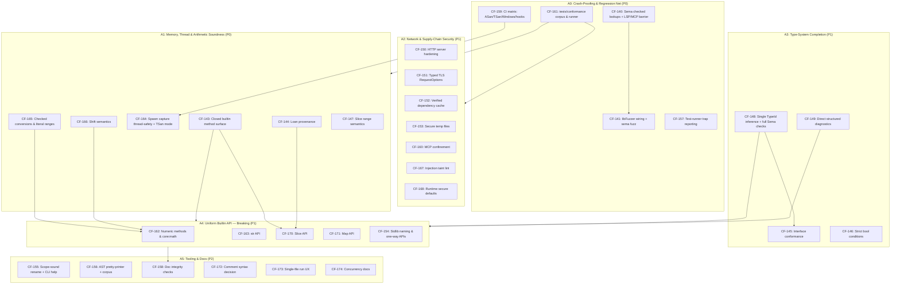

# Project Backlog

This document tracks the interactively triaged and architecturally audited backlog for `cfire` (`CF-001` – `CF-181`).

---

## A. Language Audit 2026-11-11 (`CF-140` – `CF-181`)

Source: [`audit/reports/2026-11-11.md`](./audit/reports/2026-11-11.md). It holds the evidence, repro programs and file/line references; finding IDs (`A1`, `B2`, …) refer to that file. Every item below was reproduced against `main` @ `f611aa2`.

### A.1 Architectural Decision Record (resolved interactively 2026-11-11)

7. **Builtin Value API Convention (`Q7`)**: An operation on a value of a builtin type (`str`, integers, floats, `bool`, `[]T`, `[N]T`, `map[K]V`) is a **method on the value**: `s.trim()`, `s.split(",")`, `x.abs()`, `f.floor()`, `xs.reverse()`, `m.keys()`. Modules (`core:str`, `core:math`, `core:sort`) keep only things with no natural receiver: constructors, constants, and multi-input math (`math.atan2(y, x)`, `math.hypot(a, b)`). The old free-function forms (`str.trim(s)`, `math.sqrt(f)`, `sort.slice(mut xs)`, `str.parse_i32(s)`) become hard errors with fix-its (see `Q16`).
8. **Absence Is Optional (`Q8`)**: Search and lookup APIs return `T?`. Positions are `usize?` (`s.index_of("x") -> usize?`, `xs.index_of(v) -> usize?`, `xs.first() -> T?`, `xs.binary_search(v) -> usize?`), so there are no `-1` sentinels anywhere. `index_of` / `last_index_of` stay the single canonical names; `find` / `rfind` remain rejected (`CF-059` is reaffirmed).
9. **Checked Numeric Conversions (`Q9`)**: `T(x)` is a value-preserving conversion. A constant that doesn't fit is a compile error (`cfire/LITERAL-OUT-OF-RANGE`, covering `a: u8 = 300` and `u8(300)`). A runtime value that doesn't fit (narrowing ints, float→int out of range, NaN→int) panics with the source location in every build mode. The explicit escape hatches are `x.wrapping_as[T]()`, `x.saturating_as[T]()`, and `x.try_as[T]() -> T?`. Widening and int→float conversions are unchanged.
10. **Type-Associated Parsing, Limits & Constants (`Q10`)**: `i32.parse(s) -> i32?` and `f64.parse(s) -> f64?` (and so on for every numeric type and `bool`); limits are `i32.MAX`, `i32.MIN`, `u8.MAX`, `f64.EPSILON`, `f64.INF`, `f64.NAN`. Math constants are `math.PI`, `math.E`, `math.TAU`. The `str.parse_*` functions are retired.
11. **Defined Shift Semantics (`Q11`, amends `Q4`)**: A constant shift count `>=` the bit width (or negative) is a compile error. A runtime out-of-range shift panics in all builds. The explicit forms are `x.wrapping_shl(n)` / `x.wrapping_shr(n)` and `x.checked_shl(n) -> T?` / `x.checked_shr(n) -> T?`. (Today `i32(1) << 40` silently yields `0`; `CF-098` didn't cover it.)
12. **Slice Range Semantics (`Q12`)**: `xs[a..b]` panics with location when `a > b`, `b > len`, or either bound is negative, the same rule as `xs[i]`. `str` slicing stays byte-indexed and zero-copy, but panics if either bound falls inside a UTF-8 code point.
13. **Separator Amendment (`Q13`, amends `Q3`)**: `::` is reserved **only** for enum variant paths (`Enum::Variant`, `pkg.Enum::Variant`). `.` covers values, packages, fields, methods, and static/associated functions and constants on types (`http.Response.json(...)`, `i32.MAX`, `i32.parse(s)`). Patterns keep accepting unqualified variants.
14. **Closed Builtin Method Surface (`Q14`)**: The only methods callable on builtin types are the ones listed in the generated stdlib metadata table (`CF-117`). Raw C++ container members (`.size()`, `.length()`, `.substr()`, `.push_back()`, `.emplace_back()`, `.empty()`, `.back()`) are rejected with `cfire/UNKNOWN-METHOD` and fix-its; they stay usable only inside `cpp {}` blocks.
15. **MCP Workspace Confinement (`Q15`)**: Every path-taking MCP tool resolves paths with `weakly_canonical` and rejects anything outside the server's workspace root (including `..` and symlink escapes). `--allow-outside-root` is the explicit opt-out. `cfire_eval` runs in a per-call `mkdtemp` directory.
16. **Breaking-Change Migration (`Q16`, reaffirms `Q6`)**: Every API change from `Q7`–`Q14` lands as a hard compile error with a machine-applicable `cfire fix` rewrite. The repository's examples, guide, tests, `pkg/`, and runtime `.cf` sources are migrated in the same change. There is no dual-API or warning period.
17. **Sequencing (`Q17`)**: The order is safety first. (1) Crash-proofing and the regression net land first, so every later change is regression-checked. (2) Then memory and thread soundness. (3) Then network and supply-chain security. (4) Then type-system completion, followed by the breaking API uniformity migration. (5) Tooling and docs polish come last.

18. **Bitwise Complement on C Enums (`Q18`, resolves `CF-179`)**: For an unscoped enum (imported C enums and cfire plain enums lowered as unscoped), `~E` yields the enum's underlying integer type, so `flags & ~FLAG` / `flags &= ~FLAG` go through the mixed enum/integer operators and always stay in range. Scoped enums (`enum class`, whose underlying type is always fixed) keep `~E -> E`. Storing a complement back into an enum variable requires the explicit `E(...)` conversion, which `CF-165` range-checks.
19. **Floating-Point Conversions (`Q19`, refines `Q9`)**: `f32(x)` on an `f64` and integer→float conversions are IEEE-defined. They round to nearest, overflow to ±inf, keep NaN as NaN, and never panic. Only conversions that are UB in C++ or that silently change an integer value panic: integer narrowing and sign changes that don't fit, and float→int that is out of range or NaN. A `str` element (`s[i]`, C++ `char`) is a **byte**, read as unsigned 0..255 on every platform, so `u8(s[i])` never panics and doesn't depend on the target's `char` signedness.

20. **Spawned Tasks Never Write Through Shared Pointers (`Q20`, resolves `CF-164`, amends `Q2`)**: Inside a `scope.spawn` closure, any write through a captured outer pointer, view, or smart pointer (`*p = v`, `*p += v`, `p.field = v` on `shared[T]`/`own[T]`) is `cfire/SPAWN-SHARED-MUT`. That holds even for a single task, because the parent may still touch the target inside the scope body. The one provably disjoint form stays legal: `slot := &mut xs[i]` declared inside the spawning `for` body from that loop's own index variable, so each task writes a different slot. `shared[T]` is no longer treated as concurrency-safe by `ESCAPING-CAPTURE-MUT`. Use `sync.Mutex[T]`, `sync.Atomic[T]`, or `sync.Channel[T]` for shared results.

21. **LSP Workspace Roots (`Q21`, resolves `CF-178`)**: Without an editor `rootUri`, the workspace root is the nearest ancestor containing `build.cf`, `.git`, `.vscode`, or `.zed`. The cache directory `.cfire` is **not** a marker. With no marker, the workspace is the opened file's own directory, scanned non-recursively. Recursive discovery skips `.cfire/`, hidden directories, and `node_modules/`, and stops at 5,000 files with a log line.
22. **HTTP Server Framing & Limits (`Q22`, resolves `CF-150`)**: Chunked request bodies are decoded up to the max body size (10 MB default). A request with both `Content-Length` and `Transfer-Encoding`, an invalid or duplicate `Content-Length`, a malformed chunk, or a bare-LF header terminator is rejected with 400; an oversize body gets 413; a truncated body gets 400. Default limits: 10s header deadline, 30s body deadline, a worker pool of `hardware_concurrency()` (minimum 4), and an accept queue of 128. All of them are configurable via `server.set_limits(...)`. Responses keep `Connection: close`.

23. **One Type-Inference Path (`Q23`, resolves `CF-148` scope)**: `infer_expr_type_name_sema` (the string-based path) is deleted in W3. Every caller uses `infer_expr_type_id_sema`, and type names are produced only from `TypeId`s for messages. New Sema checks are written only against `TypeId`.
24. **Diagnostics Are Typed End to End (`Q24`, resolves `CF-149` scope)**: Every Sema/analysis diagnostic is created as a `StructuredDiagnostic` (code, severity, exact range, message, fix-its) at the point of detection. `parse_diagnostic_string` and fix-it synthesis by re-lexing message text are deleted in W3. Fix-its are attached by the code that knows the edit, and CLI/LSP/MCP only render.

25. **One Construction Builtin, Placement by Type (`Q25`, W4 pre-coding gate, resolves `CF-154`/`CF-170` construction scope)**: `make` is the single construction builtin, always written with the type as the first argument. The type, not the word, decides where memory lives:
    - `make(P)` builds a stack value from default field values; `make(P, args...)` calls the type's declared constructor.
    - `make(own[P], args...)` / `make(shared[P], args...)` construct the same way and place the result on the heap (`unique_ptr` / `shared_ptr`).
    - `make([]T, len)` gives `len` zero-filled elements; `make([]T, len, cap)` also reserves `cap`. The elements are heap storage owned by the slice handle.
    - A type declares its constructor as an associated function with an unbound receiver: `fn (P) make(x: i32, y: i32) -> P { ... }`. A type has at most one `make`. Alternative constructors stay plain module functions (`tcp.dial(addr)`, `tcp.listen(addr)`).
    - Retired, with `cfire fix` rewrites: the bracket form `make[own[T]](v)` / `make[shared[T]](v)` / `make[[]T](...)`, and the library constructor names `make_*()` / `new_*()` (`http.make_router()` → `make(http.Router)`). Extra or ill-typed `make` arguments are a compile error (today `make[[]i32](1, 2)` silently drops the `2`).
    - Raw heap allocation does not exist in safe code. The only bridge to C is `o.release() -> *mut T` and `own[T].from_raw(p)` (`CF-181`).
26. **Length Is a Method (`Q26`)**: `.len()` is the only length spelling on `str`, slices, arrays, and maps. The property form `xs.len` is a hard error with a fix-it.
27. **Map Iteration Order Is Unspecified (`Q27`)**: Maps keep lowering to `std::unordered_map`. `for k, v in m`, `m.keys()`, and `m.values()` have no guaranteed order; tests and docs that print maps sort first.
28. **Field Names Are snake_case (`Q28`)**: Struct fields use snake_case like functions and locals. Capitalization carries no meaning and there is no visibility system. A lint (`cfire/FIELD-NAME-CASE`) flags other styles with a `cfire fix` rename across the workspace.
29. **Connection Verbs (`Q29`, W4 gate, resolves `CF-154`)**: Clients open with `connect`, servers with `listen`, in every module: `net.connect(host, port)` (was `connect_tcp`), `net.listen(port, host = "0.0.0.0")` (merges `listen_tcp` and `listen_tcp_addr`), `tls.connect`, `websocket.connect`, `ssh.connect` (was `dial`). The old names are hard errors with `cfire fix` rewrites.
30. **One TLS Opt-Out (`Q30`)**: Certificate verification is turned off only through the typed `verify_peer: false` parameter, passed by label (`tls.connect(host, port, verify_peer: false)`, `websocket.connect(url, verify_peer: false)`, `http.get(url, verify_peer: false)`). Labeled arguments now reach stdlib calls by name (they used to be passed positionally), so no separate `RequestOptions` struct was added. `websocket.connect_insecure`, `http.get_insecure` and `http.post_insecure` are removed with `cfire fix` rewrites.
31. **TLS Servers Are an Option on `make` (`Q31`)**: `make(http.Server, port)` builds a plain server and `make(http.Server, port, tls: http.TlsConfig{cert_file: c, key_file: k})` (or `cert_pem` / `key_pem`) a TLS one; the same for `websocket.Server`. `make_tls_server` and `make_tls_server_pem` are removed with `cfire fix` rewrites. This needs stdlib struct types visible to `.cf` code, which `CF-180` also needs for `RequestOptions` and `ServerLimits`.
32. **Block Comments (`Q32`, W5 gate, resolves `CF-172`)**: `/* ... */` is a comment, and block comments nest (`/* a /* b */ c */`), as in Rust and Swift. An unterminated block comment is `cfire/SYNTAX` at its opening `/*`. `cfire fmt` keeps block comments verbatim; doc comments stay `///`.
33. **Retired Keywords Are Identifiers (`Q33`, resolves `CF-175`)**: `out` and `var` are not keywords. They are ordinary identifiers with no special handling, so the retired forms `fn f(out x: T)` and `var x = ...` are plain syntax errors, and `cfire/DEPRECATED-VAR` / `cfire/DEPRECATED-OUT-PARAM` no longer exist.
34. **Formatter Prints From the AST (`Q34`, resolves `CF-156` scope)**: `cfire fmt` replaces the line-based formatter. *As built*: the printer re-emits the exact text of every token and comment and decides only the whitespace between them (indentation from bracket depth, one spacing rule per token-kind pair, struct-literal vs block braces, closure pipes), splits `;`-joined statements, and keeps at most one blank line. The parsed AST validates the input and output. Because only whitespace and statement `;` separators can change, formatting cannot change the program; this is checked on every file in the repo. It is guarded by `tests/fmt/{in,out}/*.cf` pairs, an idempotence check, and a check that formatting never changes the generated C++ (modulo `#line`).
35. **An Explicit File Is the Whole Program (`Q35`, resolves `CF-173`)**: `cfire run/check/build a.cf`, where `a.cf` is a `package main` file that declares `fn main`, compiles `a.cf` and the packages it imports, like `go run a.go`. Test files (`*_test.cf`) and files of library packages still pull in their package's other files, because they are not programs on their own. Other `.cf` files in the same directory are not merged; when some exist, a one-line note says so and points at `cfire run .`. A directory argument (`cfire run .`, `cfire check examples/13-ios-native-ui`) compiles every file of the package.

### A.2 Execution Dependency Graph



> Note: `CF-143` is scheduled in `A1` because it closes the `push_back` loan bypass. It is scoped to the existing receiver-type lookup (`var_types_` + `src/sema/stdlib_index.hpp`), so it does **not** depend on `CF-148`. When `CF-148` lands, it moves the same allow-list onto TypeId-resolved receivers, with no behavior change.

### A.3 Prioritized Backlog Index

| Rank | ID | Phase | Priority | Size | Component | Summary | Audit Ref | Depends On | Status |
| :---: | :--- | :---: | :---: | :---: | :--- | :--- | :---: | :---: | :---: |
| 1 | `CF-140` | A0 | **P0** | S | `src/sema/`, `src/lsp/server.hpp`, `src/mcp.hpp` | **Sema Checked Lookups & Tool Exception Barriers**: No `.at()` crashes; LSP/MCP survive any request | A1 | None | `[DONE]` |
| 2 | `CF-161` | A0 | **P0** | M | `tests/conformance/`, `tests/test_harness.hpp`, `Makefile` | **Language Conformance Corpus & Directive Runner**: One `.cf` per expectation, `xfail` for known holes | E2, E6, §Corpus | None | `[DONE]` |
| 3 | `CF-157` | A0 | **P0** | S | `src/codegen/test_runner.hpp`, `src/main.cpp` | **Test-Runner Trap & Crash Reporting**: Name the failing test and location on SIGTRAP/SIGILL/SIGSEGV | C4 | None | `[DONE]` |
| 4 | `CF-141` | A0 | **P0** | S | `tests/fuzz/`, `Makefile`, `.github/` | **libFuzzer Wiring & Sema Fuzz Target**: Build and run the 6 existing targets, add parse+analyze target | E1 | `CF-140` | `[DONE — CI pending]` |
| 5 | `CF-159` | A0 | **P0** | M | `.github/workflows/`, `Makefile`, `.githooks/` | **CI Sanitizer Matrix & Gate Hygiene**: ASan all suites + Linux, TSan job, full Windows runner, non-phony build, no auto-staging hook | E3, E4, C6, E7 | None | `[DONE — CI pending]` |
| 5a | `CF-177` | A0 | **P0** | S | `runtime/core/sync.hpp` | **`sync.context` Reference Cycle & Cancelled-Parent Deadlock**: Children leaked through their parent (and timer threads were never joined); `with_cancel` on a cancelled parent self-deadlocked | Found by the `CF-159` TSan job | `CF-159` | `[DONE]` |
| 6 | `CF-143` | A1 | **P0** | M | `src/sema/fn_checker.hpp`, `src/sema/stdlib_index.hpp` | **Closed Builtin Method Surface (`Q14`)**: Reject raw C++ members, close `push_back` loan bypass | B1, A2 | `CF-161` | `[DONE]` |
| 7 | `CF-144` | A1 | **P0** | L | `src/sema/fn_checker.hpp` | **Loan Provenance**: Through returns, temporaries, struct fields, map element refs | A3–A6 | `CF-161` | `[DONE]` |
| 8 | `CF-164` | A1 | **P0** | M | `src/sema/`, `src/buildsys.hpp`, `src/build/pch.hpp` | **Spawn Capture Thread-Safety & `--sanitize=thread`**: Reject racy pointer/view captures | G1, G3 | `CF-161`, `CF-159` | `[DONE]` |
| 9 | `CF-165` | A1 | **P0** | M | `src/sema/`, `src/codegen/expr.hpp`, `runtime/cfire_prelude.hpp` | **Checked Numeric Conversions & Literal Ranges (`Q9`)**: No UB float→int, no silent narrowing | A8, §Numbers | `CF-161` | `[DONE]` |
| 10 | `CF-166` | A1 | **P0** | S | `src/sema/`, `src/codegen/expr.hpp`, `runtime/cfire_prelude.hpp` | **Defined Shift Semantics (`Q11`)**: Out-of-range shifts error/panic; `wrapping_shl`/`checked_shl` | §Numbers | `CF-161` | `[DONE]` |
| 10a | `CF-179` | A1 | **P0** | S | `runtime/cfire_prelude.hpp` | **UB in Bitmask-Enum Operators (*needs decision*)**: `~FLAG` on an unscoped C enum without a fixed underlying type yields an out-of-range enum value (UBSan: `load of value 4294967293 ... not a valid value for type 'TestBitmask'`); then make UBSan fatal in `test-asan` | Found by the `CF-159` full-suite ASan/UBSan run | `CF-159` | `[DONE — CI pending]` |
| 11 | `CF-147` | A1 | **P1** | S | `runtime/cfire_prelude.hpp`, `src/sema/` | **Slice Range Semantics (`Q12`)**: Panic on invalid ranges; UTF-8 boundary check on `str` | B2 | `CF-161` | `[DONE]` |
| 12 | `CF-150` | A2 | **P1** | M | `runtime/core/net/http.hpp`, `runtime/core/net/tcp.hpp` | **HTTP Server Hardening**: Deadlines, worker pool, strict framing, peer address, IPv6 | D1, D7 | `CF-161` | `[DONE]` |
| 13 | `CF-151` | A2 | **P1** | S | `runtime/core/net/http.hpp` | **Typed TLS `RequestOptions`**: Remove in-band `x-cfire-tls-*` header controls | D2 | None | `[DONE]` |
| 14 | `CF-152` | A2 | **P1** | M | `src/build/deps.hpp`, `src/clang_bridge.hpp` | **Verified Dependency Cache & argv Execution**: Lock-verified hits, per-user cache, no option injection | D3 | None | `[DONE]` |
| 15 | `CF-153` | A2 | **P1** | S | `runtime/core/ai/`, `src/`, `tests/` | **Secure Temporary Files**: `mkstemp`/`mkdtemp` everywhere; no fixed shared names | D4, E5 | None | `[DONE]` |
| 16 | `CF-160` | A2 | **P1** | S | `src/mcp.hpp` | **MCP Workspace Confinement (`Q15`)** | D6 | `CF-140` | `[DONE]` |
| 17 | `CF-167` | A2 | **P1** | M | `src/sema/fn_checker.hpp` | **Injection Taint Tracking**: Flow `SHELL/SQL-INJECTION-RISK` through locals and returns; promote to error | D5 | `CF-161` | `[DONE]` |
| 18 | `CF-168` | A2 | **P2** | S | `runtime/core/ssh.hpp`, `runtime/core/keychain.hpp` | **Runtime Secure Defaults**: No default `root` SSH user; atomic keychain update | D6 | None | `[DONE]` |
| 19 | `CF-148` | A3 | **P1** | L | `src/sema/fn_checker.hpp`, `src/sema/types.hpp` | **Single TypeId Inference & Complete Sema Type Checks**: No user type errors from clang | B5, B6 | `CF-161` | `[DONE]` |
| 20 | `CF-149` | A3 | **P1** | M | `src/diagnostics.hpp`, `src/sema/`, `src/lsp/` | **Direct Structured Diagnostic Emission**: Real columns/ranges, no string re-parsing | C1 | `CF-161` | `[DONE]` |
| 21 | `CF-145` | A3 | **P1** | M | `src/sema/fn_checker.hpp`, `examples/07-types-match-map/` | **Interface Conformance at Generic Call Sites** | A7 | `CF-148` | `[DONE]` |
| 22 | `CF-146` | A3 | **P2** | S | `src/sema/fn_checker.hpp` | **Strict `bool` Conditions**: Reject `if x` / `for x` on non-`bool` | B5 | `CF-148` | `[DONE]` |
| 23 | `CF-162` | A4 | **P1** | L | `runtime/core/math.hpp`, `src/docgen/catalog_types.hpp`, `src/sema/` | **Numeric Methods, Associated Items & Complete `core:math` (`Q7`, `Q10`)** | F1, F2, §Numbers | `CF-148`, `CF-143`, `CF-165`, `CF-166` | `[DONE]` |
| 24 | `CF-163` | A4 | **P1** | M | `runtime/core/str.hpp`, `src/docgen/`, `src/sema/` | **Uniform `str` API (`Q7`, `Q8`)**: Methods, `usize?` positions, missing basics | F3 | `CF-148`, `CF-143` | `[DONE]` |
| 25 | `CF-170` | A4 | **P1** | M | `runtime/cfire_prelude.hpp`, `runtime/core/sort.hpp`, `src/sema/` | **Uniform Slice API (`Q7`, `Q8`)**: Methods, loan-modelled mutators | F4 | `CF-143`, `CF-144`, `CF-148` | `[DONE]` |
| 26 | `CF-171` | A4 | **P1** | S | `runtime/cfire_prelude.hpp`, `src/sema/` | **Uniform Map API (`Q7`, `Q8`)**: `keys`/`values`/`entries`, `remove -> V?` | §Numbers (maps) | `CF-143`, `CF-148` | `[DONE]` |
| 27 | `CF-154` | A4 | **P2** | M | `runtime/core/{sync,webui,net/*,ssh}.hpp`, `examples/` | **Stdlib Naming & One-Way APIs**: `make_*`, one `Mutex`, connect/dial, TLS insecure | B3, B4, B7 | `CF-149` | `[DONE]` |
| 28 | `CF-155` | A5 | **P2** | S | `src/refactor.hpp`, `src/main.cpp` | **Scope-Sound Rename for Closure Params, Diff Output & Subcommand `--help`** | C2 | `CF-161` | `[DONE]` |
| 29 | `CF-156` | A5 | **P2** | L | `src/formatter.hpp`, `tests/fmt/` | **True AST Pretty-Printer & Ugly→Canonical Corpus** | C3, E6 | `CF-161` | `[DONE]` |
| 30 | `CF-158` | A5 | **P2** | S | `src/docgen/`, `docs/GUIDE.md` | **Doc Integrity Checks**: No `file://` links, generated diagnostics table, accurate wording | C5 | `CF-149` | `[DONE]` |
| 31 | `CF-174` | A5 | **P2** | S | `docs/GUIDE.md`, `src/docgen/catalog_types.hpp` | **Concurrency Documentation**: `Mutex[T]` guard pattern, fix `with_lock` example | G2 | `CF-164` | `[DONE]` |
| 32 | `CF-173` | A5 | **P3** | S | `src/main.cpp`, `src/analysis.hpp` | **Single-File `run`/`check` UX & Duplicate Code Suffix** | C7, C1 | None | `[DONE]` |
| 33 | `CF-172` | A5 | **P3** | S | `src/lexer.hpp`, `docs/GUIDE.md` | **Comment Syntax Decision**: Block comments or a clear diagnostic | B8 | None | `[DONE]` |
| 34 | `CF-176` | A3 | **P2** | S | `src/analysis.hpp`, `src/build/syntax_check.hpp` | **`cfire check` Honors `build.cf` Include Paths & Dependencies**: `examples/08` fails `check` (`'fastcrc.h' file not found`) though `run` works | Found during W0 | None | `[DONE]` |
| 35 | `CF-175` | A5 | **P3** | S | `src/lexer_types.hpp`, `src/parser.hpp` | **Retired Keyword Policy** (*needs decision*): `out` is still reserved after its removal as an intent, so `out := 3` is a syntax error | Found during W0 | None | `[DONE]` |
| 36 | `CF-178` | A2 | **P1** | M | `src/lsp/server.hpp`, `tests/unit/test_lsp_docgen.hpp` | **Bounded LSP Workspace Discovery & Hermetic LSP Tests**: A stray `.cfire/` cache makes `/tmp` (or `~`) a workspace root that the LSP crawls recursively; LSP tests hard-code `file:///tmp/*.cf` and fail when unrelated `.cf` files exist under `/tmp` | Found during W0 | `CF-153` | `[DONE]` |
| 37 | `CF-180` | A4 | **P2** | M | `runtime/core/net/{tcp,http}.hpp`, `src/docgen/catalog_types.hpp` | **IPv6 Dual-Stack Server & `.cf`-Level Network Options**: AF_INET6 listener with `IPV6_V6ONLY=0`, IPv6 `remote_addr`; expose `http.ServerLimits` / `server.set_limits` and a `RequestOptions` struct to `.cf` code | Deferred from `CF-150`/`CF-151` (W2) | `CF-154` | `[DONE]` |
| 38 | `CF-181` | A4 | **P2** | S | `src/sema/fn_checker.hpp`, `src/codegen/expr.hpp`, `runtime/cfire_prelude.hpp` | **`own[T]` Release & Adopt for C Interop** (`Q25`): `o.release() -> *mut T` and `own[T].from_raw(p)` | W4 pre-coding gate | `CF-154` | `[DONE]` |

`CF-142` is merged into `CF-161`.

### A.3a Execution Order: Waves, Lanes & Exit Gates (`Q17`)

The work proceeds in **waves**. A wave starts only when the previous wave's exit gate is green. Phase `An` in the index is wave `Wn`. Inside a wave, items in different **lanes** touch disjoint files and may run in parallel; items in the same lane run top to bottom. Each item still passes the standard pre-coding gate in [`README.md`](./README.md) when it's promoted to `active.md`.

**Why this order.**
- **Regression net first:** every later change in this section changes language semantics, so the conformance corpus (`CF-161`) and crash-proof tools (`CF-140`) must exist before anything else moves. Each fix then flips a tracked `xfail` instead of relying on memory.
- **Soundness before security:** use-after-free, data races, and UB are reachable from *safe-looking* cfire code today. They undermine every claim in the guide.
- **Security before uniformity:** network and supply-chain issues are exploitable now, while API inconsistency is only friction.
- **Type system before the API migration:** the breaking API migration depends on `CF-148` (TypeId receivers) and `CF-149` (structured fix-its). Doing it earlier would mean writing every `cfire fix` rewrite twice.
- **Polish last:** tooling and docs polish lands after the API stops moving, so docs and the formatter are rewritten only once.

| Wave | Goal | Lane 1 (compiler) | Lane 2 (tests / CI) | Lane 3 (runtime / tools) | Exit gate |
| :---: | :--- | :--- | :--- | :--- | :--- |
| **W0** | Crash-proof tools and a regression net | `CF-140` | `CF-161` → `CF-157` → `CF-141` | `CF-159` → `CF-177` (blocker found by TSan) | All 34 fuzz crash seeds produce diagnostics. LSP/MCP survive them. `make test` runs the conformance corpus, with every audit hole present as a tracked `xfail`. ASan runs on all suites (macOS + Linux), and a TSan job runs on the sync tests. |
| **W1** | Memory, thread and arithmetic soundness | `CF-143` → `CF-144` → `CF-147` | `CF-164` (after `CF-159` TSan job) | `CF-179` → `CF-165` → `CF-166` | Every `unsound/` xfail for A2–A8, B2, and G1 is flipped to passing. TSan is clean on `conformance/concurrency`. There are no new false positives on `examples/`, `pkg/`, or GUIDE doc-tests. |
| **W2** | Network and supply-chain security | `CF-167` | `CF-153` → `CF-178` | `CF-150` → `CF-151`; `CF-152`; `CF-160` (after `CF-140`); `CF-168` | Slowloris and smuggling tests pass. A tampered cache and option-injection refs are rejected. No predictable temp paths remain (grep gate). MCP path escapes are rejected. Injection-lint bypass probes are rejected. |
| **W3** | Type-system completion | `CF-148` → `CF-145` → `CF-146` | `CF-149` | `CF-176` | Zero `UNKNOWN-TYPE` in examples and the guide. No clang diagnostic is reachable from a well-typed program (ICE gate). Every diagnostic has an exact LSP range, with golden ranges per code. |
| **W4** | Uniform builtin API (breaking, `Q16`) | `CF-162` → `CF-163` | `CF-170` → `CF-171` | `CF-154` → `CF-181` → `CF-180` | `cfire fix` migrates the repo with zero manual edits. No free-function, sentinel, `make[...]` or `make_*`/`new_*` constructor forms remain. `stdlib/{math,str,slices,maps}` conformance passes. The STDLIB reference is regenerated. |
| **W5** | Tooling and docs polish | `CF-155` → `CF-173` → `CF-172` → `CF-175` | `CF-156` | `CF-158` → `CF-174` | The formatter corpus round-trips. `doc --check` rejects local links and generates the diagnostics table. Rename passes the closure-scope tests. |

**Release cadence**: cut a minor release at the end of each wave (`W0` → `0.12.0`, …, `W4` → the breaking `0.16.0`). Every wave closes with the [audit playbook](./audit/PLAYBOOK.md) re-run, and the new report must show the wave's findings as fixed.

**Re-planning rule**: if a re-run of the audit finds a new P0 (a crash or soundness hole), it enters the *current* wave as a blocker. Anything lower goes into the backlog at its rank.

### A.4 Detailed Item Specifications

#### `CF-140` — Sema Checked Lookups & Tool Exception Barriers `[DONE]`
- **Problem & Evidence**: `import "./pkg/nothere"` plus `nothere.f()` aborts `cfire check` with an uncaught `std::out_of_range` from `unordered_map::at` in `check_call_expr`. It also kills `cfire lsp` (exit -6), because `src/lsp/server.hpp` has no `catch`. All 34/1,200 mutation-fuzz crashes share this cause.
- **Files Touched**: `src/sema/fn_checker.hpp` (lines 1254, 1264, 1289, 2112, 2185, 2464, 2812), `src/lsp/server.hpp`, `src/mcp.hpp`.
- **Implementation**:
  1. Replace every `.at()` in Sema with `find()`. A miss emits `cfire/MISSING-IMPORT` or `cfire/UNRESOLVED-PACKAGE` at the call site.
  2. Wrap each LSP request/notification dispatch in `try/catch`. On an exception, return JSON-RPC `-32603 InternalError` for requests, log notifications, and keep serving. Do the same in the MCP tool dispatch.
  3. Add a CI grep gate that forbids `.at(` in `src/sema/`.
- **Tests**:
  - *Conformance*: `tests/conformance/imports/missing_local_package.cf` (`expect: error`).
  - *LSP*: a stream test that opens the repro, then hovers, and asserts the server answers a subsequent request.
- **Acceptance Criteria**: The 34 fuzz crash inputs all produce diagnostics and no aborts, and the LSP survives them.
- **Delivered (W0)**: `lookup_or`/`lookup_or_empty` and `StdlibCatalogIndex::import_path_for` replace every throwing lookup in `src/sema/`. The stdlib check is skipped for local-package namespaces. A missing local package is now `cfire/UNRESOLVED-PACKAGE` at the import line (`src/analysis.hpp`, previously `(void)`-discarded) instead of a clang leak. Exception barriers wrap LSP message dispatch (`-32603` responses), the diagnostics worker, and MCP `tools/call` (`isError`). Tests: `test_cf140_crash_proof_tools` (repro, the 34 seeds in `tests/fuzz/corpus/sema_crashes/`, LSP survival, a throwing MCP tool, and a `.at(` source gate). A post-fix re-fuzz of 1,200 inputs found 0 crashes.

#### `CF-161` — Language Conformance Corpus & Directive Runner `[DONE]`
- **Problem & Evidence**: Language expectations are pinned only indirectly. That means example stdout substrings, 5 golden snapshots, ~115 programs embedded as C++ string literals in milestone-named functions, and one `test` block in `tests/stdlib_suite_test.cf`. Concurrency has no contention tests in cfire, and none of the soundness holes A2–A8/G1 is captured anywhere.
- **Files Touched**: `tests/conformance/**`, `tests/test_harness.hpp`, `tests/test_main.cpp`, `Makefile`, `.github/workflows/ci.yml`.
- **Implementation**:
  1. Layout: one expectation per file, organized by feature:
     - `tests/conformance/{syntax,types,ownership,errors,match,generics,closures,arith,imports,concurrency,stdlib/math,stdlib/str,stdlib/slices,stdlib/maps,unsound}/NNN_name.cf`
  2. Header directives, parsed from leading `//` comments:
     - `// expect: stdout` followed by `// | line` lines (exact match)
     - `// expect: error cfire/CODE @L[:C]` (repeatable; exact set)
     - `// expect: warning cfire/CODE @L`
     - `// expect: panic "<substring>" @L`
     - `// expect: exit N`
     - `// expect: xfail CF-xxx <reason>` (an xfail that starts passing fails the run, forcing directive cleanup)
     - `// flags: --sanitize | --sanitize=thread`
  3. Runner: `make test-conformance` (wired into `make test`) runs files in parallel with per-file `mkdtemp` and a `--filter <glob>` option, and prints a pass/fail/xfail summary. Every file in `concurrency/` also runs under TSan once `CF-164` adds the mode.
  4. Seed corpus (≥ 80 files), starting by porting the 35 audit probes in `scripts/audit/probes/`. Their `ideal:` headers map directly to `expect:` directives: `hole` → `xfail`, `guard` → plain expectation. The corpus should include:
     - Every verified-working behavior from the audit (moves, iterator invalidation, `DANGLING-RETURN`, match exhaustiveness, escaping capture, arity, assignment/return mismatch, immutable assignment, index panic, div-by-zero panic).
     - Concurrency: scope join and defer ordering; channel close/drain/`recv_timeout`; `Mutex[T]`/`Atomic` 8×10k contention producing exact counts; context cancel cascade; nested `scope.spawn`; panic inside a task.
     - Current stdlib math/str/slice/map behavior.
     - `unsound/` xfails for A2–A8, B2, G1, D5.
  5. Policy (added to `docs/planning/README.md`): every language or stdlib-semantics change must add or adjust conformance files. Inline C++-string programs migrate opportunistically.
- **Tests**:
  - *Unit*: directive parser tests (malformed directive, unexpected extra diagnostic, xfail that starts passing).
- **Acceptance Criteria**: `make test` runs the corpus. The audit's soundness holes are visible as tracked xfails, and each of `CF-143`–`CF-166` flips its xfails to passing.
- **Delivered (W0)**: `scripts/run_conformance.py` (directive runner, parallel, `--filter`, `--run-flags`, `--self-test` with 9 classification cases) and `make test-conformance` (part of `make test`). The 97-file corpus in `tests/conformance/` (README with the grammar and policy) gives 64 PASS and 33 XFAIL, each XFAIL citing its backlog ID. Gate 5 was added to `docs/planning/README.md`.

#### `CF-157` — Test-Runner Trap & Crash Reporting `[DONE]`
- **Problem & Evidence**: An overflow trap inside a `test` block exits with 133 (file) or 1 (dir) and prints nothing, not even `=== RUN`, because buffered stdout is lost.
- **Implementation**:
  1. The generated test main flushes before each test and installs `SIGTRAP`/`SIGILL`/`SIGSEGV`/`SIGABRT`/`SIGFPE` handlers that print `--- FAIL: <name> (signal <sig>: <reason>)` via `write(2)`.
  2. Map UBSan trap reasons to cfire messages (overflow, shift, division) and include the `#line` location where available.
  3. Add a `--isolate` flag that forks per test, so one crash doesn't stop the remaining tests.
- **Tests**:
  - *Conformance*: `arith/overflow_trap_in_test.cf` asserting the failure output.
- **Acceptance Criteria**: Every crashing test reports its name, cause, and `.cf` location.
- **Delivered (W0)**: `testing_detail::begin_test`/`end_test`/`install_crash_handlers` (async-signal-safe `write`, exit 1) in `runtime/cfire_test_runtime.hpp`, emitted around every test, bench, and auto-JSON test. Output: `--- FAIL: <name> (<file>:<line>: test crashed: <cause>)`. Conformance: `arith/006`. *Deferred*: `--isolate` fork mode, and the in-test source line (it reports the test's declaration line).

#### `CF-141` — libFuzzer Wiring & Sema Fuzz Target `[DONE — CI pending]`
- **Problem & Evidence**: The six `tests/fuzz/*.cpp` targets aren't referenced by the Makefile, CI, or any script. A naive mutation fuzz found `CF-140` within minutes, and parse-only fuzzing would have missed it.
- **Implementation**:
  1. Add a `make fuzz-lib` target that uses `$(LLVM_CLANG)` (Homebrew LLVM on macOS, system clang on Linux).
  2. Add `fuzz_sema.cpp` (parse + `analyze_resilient`) and `fuzz_fmt.cpp` (format idempotence + re-parse).
  3. Seed corpora from `examples/`, `tests/golden/`, and `tests/conformance/`.
  4. CI runs a 2-minute smoke on each PR (Linux), plus a nightly 30-minute job that uploads crashes as artifacts.
- **Acceptance Criteria**: Every fuzz target builds and runs in CI, and the 34 known crash inputs are committed as regression seeds.
- **Delivered (W0)**:
  - Fixed `src/parser.hpp` not being self-contained, which had kept `fuzz_parser`/`fuzz_fmt` from compiling.
  - Added `fuzz_sema.cpp`, `fuzz_fmt.cpp` (re-parse + idempotence invariants), `replay_main.cpp`, and seed corpora.
  - `make fuzz-replay` runs all 8 targets over the committed corpora under ASan+UBSan and works with Apple clang (305 `.cf` seeds clean).
  - `make fuzz-lib` runs libFuzzer.
  - CI: a `fuzz-smoke` job, plus `.github/workflows/fuzz-nightly.yml`.
  - *Unverified locally*: `fuzz-lib` (Apple clang has no libFuzzer). It's verified by the first Linux CI run.

#### `CF-159` — CI Sanitizer Matrix & Gate Hygiene `[DONE — CI pending]`
- **Problem & Evidence**:
  - `test-asan` runs only the `unit` suite, and only on macOS.
  - There's no TSan job.
  - Windows runs only `tests/stdlib_suite_test.cf`.
  - `build` is `.PHONY`, so `review-check` relinks 3× (~90s).
  - The pre-commit hook runs `git add docs/`, which stages unrelated WIP.
  - Gate 1's text omits `-Wno-parentheses-equality`.
- **Implementation**:
  1. ASan+UBSan over unit, stdlib, e2e, and conformance on macOS and Linux.
  2. A TSan job over `conformance/concurrency` and the sync unit tests.
  3. Run the full `.cfire_test_runner` on Windows, with platform skips declared per test.
  4. Make `cfire` a real file target.
  5. The hook fails with an actionable message (or stages only the generated files), never `docs/` wholesale.
  6. Make the gate text in `docs/planning/README.md` match the Makefile flags.
- **Acceptance Criteria**: All three OSes run the full suite, and sanitizer jobs are required checks.
- **Delivered (W0)**:
  - `cfire` is now a real file target, with a `.cfire_gitsha` stamp so version info stays correct. `review-check` went from 5:20 to 3:53.
  - `make test-asan` covers all C++ suites plus the conformance corpus with `--sanitize`.
  - New `make test-tsan` target: runtime sync tests via `tests/tsan_main.cpp`, plus `conformance/concurrency` under TSan. Its first run found `CF-177`.
  - Linux CI runs ASan/TSan.
  - Windows CI builds and runs the unit runner and the conformance corpus.
  - The pre-commit hook stages only files `cfire doc` regenerated, and aborts on unstaged hand edits (sandbox-tested).
  - Gate text now matches the Makefile.
  - *Unverified locally*: the Windows steps and Linux sanitizer jobs, which await the first CI run.
  - *Follow-ups*: UBSan stays recoverable until `CF-179` lands, and `CF-178` is needed before the LSP suites are hermetic.

#### `CF-143` — Closed Builtin Method Surface (`Q14`) `[DONE]`
- **Problem & Evidence**:
  - `.size()`, `.length()`, `.substr()`, `.back()`, `.empty()`, `.push_back()`, and `.emplace_back()` all compile on `str`/`[]T`.
  - `xs.push_back()` while a view is live passes `check` and is an ASan heap-use-after-free (A2).
  - This contradicts `CF-059`.
- **Implementation**:
  1. Resolve every method call on a builtin receiver against the stdlib metadata table, and emit `cfire/UNKNOWN-METHOD` otherwise.
  2. Fix-it map: `size`/`length` → `len`; `push_back`/`emplace_back` → `push`; `substr(a, n)` → `[a..a+n]`; `empty()` → `is_empty()`; `back()` → `last()`.
  3. The metadata table carries a `mutates_receiver` flag that the loan tracker consumes. No more hard-coded `push`/`clear` lists.
  4. Skip the check inside `cpp {}`.
  5. Migrate examples (`01-hello-core` uses `.size()` and `.capacity()`).
- **Tests**:
  - *Conformance*: one `types/unknown_method_*.cf` per leaked member.
  - *Unsound*: flip `unsound/push_back_view_uaf.cf`.
- **Acceptance Criteria**: No C++ container member is reachable from cfire code outside `cpp {}`.
- **Delivered (W1)**:
  - `check_builtin_method_surface` in `src/sema/fn_checker.hpp` allow-lists methods for `str`, slices, fixed arrays, and maps. Anything else is `cfire/UNKNOWN-METHOD`, with canonical replacements (`size`/`length` → `len`, `push_back`/`emplace_back` → `push`, `pop_back` → `pop`, map `erase` → `remove`, map `count`/`find` → `contains`) applied by `cfire fix` (`src/diagnostics.hpp`).
  - `empty` stays allowed because the GUIDE documents it. The W4 rename to `is_empty` is tracked in `CF-163`/`CF-170`.
  - `str.pop()` is allowed because `examples/13` uses it.
  - A separate `mutates_receiver` flag wasn't needed: the closed surface leaves only `push`/`pop`/`clear`/`remove`/`erase` as mutators, which the loan tracker already models.

#### `CF-144` — Loan Provenance `[DONE]`
- **Problem & Evidence**: Each of these passes `check` and then shows a UAF or garbage at runtime:
  - `v := make()[0..5]` (view of a temporary).
  - `h := head(s)`, where `head` returns `&str` derived from `s`, followed by `s = ...`.
  - `Holder{p: &nums[0]}` followed by pushes.
  - `p := &m["a"]` followed by inserts.
- **Implementation**:
  1. Reject views or pointers whose root is a temporary (`cfire/DANGLING-TEMPORARY`), with a fix-it to bind the owner first.
  2. Elided-lifetime rule: a function returning a view or pointer borrows from its view/pointer/`str`/`[]T` parameters (all of them if ambiguous). Call results inherit those loans.
  3. Struct literals and field assignments holding pointers or views carry the source's loans for the struct binding's lifetime.
  4. `&m[k]` loans the map, and inserts/removes invalidate it.
- **Tests**:
  - *Conformance*: four `ownership/*` negative files, plus positive files proving loans end after the last use.
- **Acceptance Criteria**: A3–A6 are rejected at compile time, with no false positives on `examples/` or `pkg/`.
- **Delivered (W1)**:
  - `extract_borrow_sources` and `extra_borrow_origins_` add multi-owner loans:
    - Calls whose declared return type is `&T`/`*T` borrow from their receiver and from path arguments.
    - Struct literals inherit their fields' loans.
  - New `cfire/DANGLING-TEMPORARY` for views of temporaries bound to variables, assigned, or returned. Inline use and string-literal slices stay legal.
  - `DANGLING-RETURN` now also covers `return head(local)`.
  - **A6 was a false finding**: map element references survive inserts (node-based map), and `remove` invalidation was already enforced. The corpus now pins both (`ownership/015`, `022`).

#### `CF-164` — Spawn Capture Thread-Safety & `--sanitize=thread` `[DONE]`
- **Problem & Evidence**:
  - `p := &mut counter` with 8 spawned tasks doing `*p += 1` passes `check`. TSan reports a data race, and the count was 400000 instead of 800000 under TSan (G1).
  - There's no TSan mode: `buildsys.hpp:979` and `pch.hpp:138` hard-code `address,undefined` (G3).
- **Implementation**:
  1. A closure passed to `scope.spawn` may not capture `*mut T`, `&mut`, mutable views, or a non-thread-safe handle (`cfire/SPAWN-SHARED-MUT`), unless the pointee is provably disjoint per task. The allowed disjoint case is `&mut xs[i]`, where `i` is the loop variable of the enclosing `for` that spawns (keeps `examples/04` legal).
  2. Thread-safe capture types: `Mutex[T]`, `Atomic[T]`, `Channel[T]`, `Context`, and immutable values.
  3. Add `--sanitize=thread` to `run`, `test`, and `build`, with its own PCH key.
- **Tests**:
  - *Conformance*: `concurrency/racy_pointer_capture.cf` (`expect: error`) and `concurrency/disjoint_slot_capture.cf` (`expect: stdout`).
  - *CI*: the TSan job runs the concurrency corpus.
- **Acceptance Criteria**: G1 is rejected, `examples/04` still compiles, and TSan is clean across the corpus.
- **Delivered (W1)**:
  - `--sanitize=thread` / `--sanitize=address` on `run`/`build`/`test`, with a separate `tsan` PCH tag (`g_sanitizer_set` in `src/build/pch.hpp`).
  - New `cfire/SPAWN-SHARED-MUT` (`Q20`, the strict rule chosen during W1, amending `Q2`). The allowed per-task form is `slot := &mut xs[i]` from the spawning loop's index; `examples/04` is unchanged.
  - `shared[T]` is no longer treated as concurrency-safe.
  - The two CF-097-era tests were updated (`esc_capture_ptr.cf` now expects the error, and `test_scope_raii` uses the slot pattern).

#### `CF-165` — Checked Numeric Conversions & Literal Ranges (`Q9`) `[DONE]`
- **Problem & Evidence**:
  - `a: u8 = 300` prints `44`, and `c: u32 = -1` prints `4294967295`.
  - `u8(300)` silently gives `44`.
  - `i32(1e20)` is UB (UBSan: "outside the range of representable values") and gives `-312868648` in release.
- **Implementation**:
  1. Constant-fold literals and conversions, and emit `cfire/LITERAL-OUT-OF-RANGE` for constants that don't fit the target type.
  2. Lower narrowing `T(x)` to `cfire::checked_cast<T>(x, loc)`, which panics on loss, NaN, or ±inf.
  3. Add `wrapping_as[T]`, `saturating_as[T]`, and `try_as[T] -> T?` methods.
  4. Keep the cost zero for widening casts.
- **Tests**:
  - *Conformance*: `arith/literal_range_*.cf`, `arith/narrowing_panic_*.cf`, and `arith/explicit_casts.cf`.
- **Acceptance Criteria**: No conversion is silent or UB in any build mode.
- **Delivered (W1)**:
  - `i8`…`isize`/`byte` lower to `detail::checked_numeric_cast` (`std::in_range` plus float range/NaN checks). Panics carry the `.cf` location via `#line` + `std::source_location`, so codegen didn't change.
  - New `cfire/LITERAL-OUT-OF-RANGE` for typed var decls and literal conversions. Literals are parsed as 128-bit, with hex/octal/binary and `_` separators.
  - New `x.wrapping_as[T]()`, `x.saturating_as[T]()`, and `x.try_as[T]() -> T?` (Sema type and optional inference included).
  - `char` (a `str` byte) converts as unsigned 0..255 on every platform (`Q19` note). This was found by `pkg/raygui_ext`'s property fuzzer.
  - Also fixed: `DIVIDE-BY-ZERO` no longer flags float division (IEEE-defined).

#### `CF-166` — Defined Shift Semantics (`Q11`) `[DONE]`
- **Problem & Evidence**: `one: i32 = 1; one << 40` compiles and prints `0` in release. `CF-098` claimed defined shift semantics.
- **Implementation**:
  1. A constant shift count `>=` the bit width, or a negative one, is `cfire/SHIFT-OUT-OF-RANGE`.
  2. Runtime shifts lower to `cfire::checked_shl(x, n, loc)`, which panics when out of range.
  3. Add `wrapping_shl`/`wrapping_shr` and `checked_shl`/`checked_shr -> T?` methods.
- **Tests**:
  - *Conformance*: `arith/shift_*.cf`.
- **Acceptance Criteria**: Every shift in every build mode is either defined or a panic.
- **Delivered (W1)**:
  - `<<`/`>>`/`<<=`/`>>=` lower to `cfire::shl`/`shr`. They keep C++'s promoted result type and panic for counts outside `[0, bits)`.
  - New `cfire/SHIFT-OUT-OF-RANGE` for constant counts.
  - New `x.wrapping_shl/shr(n)` and `x.checked_shl/shr(n) -> T?`.
  - Also: `INT_MIN / -1` and `INT_MIN % -1` (UB, and a trap on x86) now follow `Q4` release wrapping, giving `MIN` and `0`.

#### `CF-179` — UB in Bitmask-Enum Operators `[DONE]`
- **Problem & Evidence**: The first `make test-asan` run over *all* suites (`CF-159`) logged two recoverable UBSan errors at `runtime/cfire_prelude.hpp:1966` and `:1985`: `load of value 4294967293, which is not a valid value for type 'TestBitmask'` (from `tests/unit/test_stdlib.cpp:646`, `perms &= ~MASK_WRITE`). `enum_operators::operator~` casts `~underlying` back to `E`. For an unscoped enum without a fixed underlying type, the result is outside the enum's value range, which is undefined behavior. This is the common C idiom for clearing imported flags (raylib `ConfigFlags`, POSIX-style masks).
- **Decision needed (pre-coding gate)**: either (a) `~E` yields the underlying integer type, so `flags & ~FLAG` goes through the existing mixed enum/integral operators and stays in range, or (b) keep `~E -> E` only for enums with a fixed underlying type (always true for scoped enums) and reject `~` on others with a fix-it.
- **Implementation**: Apply the decision. Then add `-fno-sanitize-recover=undefined` to `ASAN_CXXFLAGS`/`ASAN_LDFLAGS`, so any UBSan report fails `make test-asan`.
- **Acceptance Criteria**: `make test-asan` is clean with UBSan fatal.
- **Delivered (W1)**: `enum_operators::operator~` is constrained to scoped enums (`Q18`). Unscoped enums use the built-in `~` (integer), and the mixed operators keep `flags &= ~FLAG` in range. `-fno-sanitize-recover=undefined` is now in `ASAN_CXXFLAGS`/`ASAN_LDFLAGS`, so any UBSan report fails `make test-asan`.

#### `CF-147` — Slice Range Semantics (`Q12`) `[DONE]`
- **Problem & Evidence**:
  - `xs[1..10]` on 3 elements returns 2 elements, and `xs[2..1]` returns empty.
  - `"ab"[0..4]` returns `"ab"`, while `xs[7]` panics.
  - `"héllo"[0..2]` yields invalid UTF-8.
- **Implementation**:
  1. `cfire::slice` panics with the location for `a > b`, `b > len`, or negative bounds.
  2. `str` slices also panic on non-boundary bytes, using a `(b & 0xC0) == 0x80` check.
  3. Constant-range violations are flagged at compile time via `INDEX-OUT-OF-BOUNDS`.
- **Tests**:
  - *Conformance*: `ownership/slice_range_*.cf` and `stdlib/str/slice_utf8_boundary.cf`.
- **Acceptance Criteria**: Indexing and slicing follow one panic rule.
- **Delivered (W1)**: `cfire::slice` takes generic integer bounds, panics on `a > b`, `b > len`, or a negative bound, and checks UTF-8 boundaries for `str`. `0` and `len()` are always valid boundaries, even for invalid UTF-8 (`raygui_ext` fuzz finding). Location reporting uses `std::source_location`.

#### `CF-150` — HTTP Server Hardening `[DONE]`
- **Problem & Evidence**:
  - `listen_and_serve` handles connections serially with no per-connection read deadline, so one idle client blocks the server.
  - An invalid `Content-Length` becomes `0`, duplicate CL headers overwrite each other, and short bodies are accepted.
  - Bare-LF header terminators are accepted, and inbound chunked requests are ignored.
  - Every accepted `TcpConn` reports `"127.0.0.1"`, and there's no IPv6.
- **Implementation**:
  1. Configurable header and body deadlines (default 10s/30s).
  2. A bounded worker pool (default `hardware_concurrency`) with an accept backlog limit.
  3. Reject invalid or duplicate `Content-Length` and CL+TE conflicts with a 400. Implement chunked decoding for requests (with a size cap) or reject it with a 411/501.
  4. Return a 400 on truncated bodies, and require CRLF.
  5. Add `conn.peer_addr() -> str` and `req.remote_addr`, with dual-stack listening.
- **Tests**:
  - *Stdlib*: a slowloris test (idle client plus a concurrent normal request succeeds), smuggling-vector tests, and peer-address tests.
  - *Fuzz*: extend `fuzz_http`.
- **Acceptance Criteria**: No single client can stall the server, and malformed framing is always rejected.
- **Delivered (W2)**:
  - `ServerLimits` + `HttpServer::set_limits` per `Q22`.
  - Deadline-bounded reads: a 10s header deadline and a 30s body deadline, enforced across reads.
  - A bounded worker pool (CPU count, minimum 4, 128 pending, 503 when full).
  - Strict framing: duplicate CL/TE, CL+TE, invalid CL, bare LF, and malformed chunks get 400; oversize gets 413; deadlines get 408; oversized headers get 431.
  - A strict incremental chunked decoder with the body cap.
  - `Request.remote_addr`, using the real `inet_ntop` peer instead of a hard-coded `127.0.0.1`.
  - Test: `test_cf150_http_server_hardening` (slowloris, smuggling vectors, chunked), also run under TSan via `tests/tsan_main.cpp`.
  - *Deferred*: IPv6 dual-stack listening, which touches the listener, the in-process loopback registry, and address handling. It's tracked as `CF-180`.
  - *Not exposed to `.cf` code yet*: `set_limits` (needs stdlib struct support, W4).

#### `CF-151` — Typed TLS `RequestOptions` `[DONE]`
- **Problem & Evidence**: `extra_headers` containing `x-cfire-tls-verify: false` disables certificate verification, and `x-cfire-tls-ca` swaps the CA (`http.hpp:653,833`). Any proxy-style code that forwards user headers can be downgraded this way.
- **Implementation**: Add a `http.RequestOptions{verify_peer, ca_file, timeout_ms, headers}` parameter. Strip any `x-cfire-*` headers from outgoing requests, and make the old header usage a hard error via `cfire fix`.
- **Acceptance Criteria**: No header value can change TLS behavior.
- **Delivered (W2)**:
  - The `x-cfire-tls-verify` / `x-cfire-tls-ca` header interpretation is removed. Every `x-cfire-*` header is reserved and stripped from outgoing requests (`detail::is_reserved_cfire_header`).
  - TLS comes only from typed parameters: the existing `verify_peer`, plus a new `ca_file` on `http.request` and `post_sse`.
  - *Deviation*: a typed `ca_file` parameter instead of a `RequestOptions` struct. Runtime struct types aren't in the stdlib catalog yet, so a struct-based options API moves to W4 with `CF-154`.
  - Test: `test_cf151_no_inband_tls_controls`. The headers don't reach the wire, and a spoofed header can't bypass verification of a self-signed server.

#### `CF-152` — Verified Dependency Cache & argv Execution `[DONE]`
- **Problem & Evidence**:
  - A git cache hit returns HEAD without comparing it to `build.lock`, and an archive cache hit skips the SHA-256 check.
  - Without `$HOME`, the cache falls back to the shared `/tmp/cfire_cache/pkg`.
  - `git clone`/`checkout` have no `--` separator, and `curl` has no `--proto =https`.
- **Implementation**:
  1. On every hit, verify the locked commit (`rev-parse HEAD == lock.commit`) and the archive SHA (stored as a sidecar manifest). On mismatch, refetch, or fail with `cfire/INTEGRITY-MISMATCH`.
  2. Use a per-user cache only (`$XDG_CACHE_HOME`, falling back to a `0700` `mkdtemp`).
  3. Spawn every subprocess with `posix_spawnp` and an argv vector, plus `--`.
  4. Use `curl --proto =https --tlsv1.2`.
  5. Add `cfire vendor --verify`.
- **Tests**:
  - *Integration*: a tampered cache directory triggers a refetch or an error; option-injection URLs and refs are rejected.
- **Acceptance Criteria**: Builds are reproducible from `build.lock`, and tampering is detected.
- **Delivered (W2)**:
  - Git cache hits must equal the `build.lock` commit with no modified tracked files, otherwise they're refetched. A fetched commit that differs from a still-applicable pin is `cfire/INTEGRITY-MISMATCH`.
  - Archive cache hits must match a `.cfire_sha256` record written after a verified download.
  - `validate_fetch_arg` rejects `-`-prefixed and `ext::`/`fd::` arguments, and `--` separates options from positional arguments.
  - `-c protocol.ext.allow=never -c protocol.fd.allow=never`, and `curl --proto =https --proto-redir =https --tlsv1.2`.
  - The pin no longer blocks an intentional ref change.
  - Test: `test_cf152_verified_dependency_cache`, using a local git repo (tamper, drift, mismatch) and archive sidecar checks.

#### `CF-153` — Secure Temporary Files `[DONE]`
- **Problem & Evidence**:
  - `/tmp/cfire_{jpg,ocr,pdf}_<pid>_<seq>` hold user documents with no `O_EXCL`.
  - Fixed shared names are used for `cfire_mcp_cache`, `cfire_doc_cache`, and `<stem>_check.cpp`.
  - 13 fixed temp paths remain in `tests/` (`CF-094` regression).
- **Implementation**: Add a `cfire::detail::secure_temp_file/dir` helper (`mkstemp`/`mkdtemp`, `0600`/`0700`, with RAII cleanup), and use it at every call site. Put caches under per-user cache directories. Add a CI grep gate on `temp_directory_path() / "`.
- **Acceptance Criteria**: No predictable or shared temp path remains in `src/`, `runtime/`, or `tests/`.
- **Delivered (W2)**:
  - New `cfire::detail::SecureTempDir` (mkdtemp, 0700, RAII) and `user_cache_dir()` in the prelude.
  - Every temp/cache site in `src/`, `runtime/`, and `tests/` moved to them, including the `run`/`test`/wasm/iOS binaries, which are *executed* (a binary swapped at a fixed `/tmp` name would run as the user).
  - Removed the `/tmp/cfire_cache/pkg/vendor_raylib*` lookups in `src/buildsys.hpp`, so a library planted there is no longer linked.
  - Test: `test_cf153_secure_temp_storage`, covering helper semantics plus a source gate over `src/`/`runtime/`/`tests/`.

#### `CF-160` — MCP Workspace Confinement (`Q15`) `[DONE]`
- **Implementation**: Add a `resolve_in_root(path)` helper for `cfire_check`, `cfire_outline`, `cfire_test`, `cfire_inspect`, and `cfire_rename`. It rejects paths outside the root and symlink escapes. Add the `--allow-outside-root` flag, and run `cfire_eval` in a per-call `mkdtemp` directory. Document the trust model in GUIDE Ch1 (MCP).
- **Tests**:
  - *Integration*: `../../etc/passwd` and a symlink escape are both rejected.
- **Acceptance Criteria**: Tools can't touch files outside the workspace without the opt-out.
- **Delivered (W2)**: `McpOptions` and `resolve_in_root` (`weakly_canonical`, so `..` and symlinks are resolved) on `cfire_check`, `cfire_outline`, `cfire_test`, `cfire_inspect`, and `cfire_rename` (including every file a rename would modify). `cfire mcp --allow-outside-root` opts out, and `--dir` sets the root (default: cwd). `cfire_eval` runs in a per-call `SecureTempDir`. Test: `test_cf160_mcp_workspace_confinement` (absolute path, `..`, symlink, rename, opt-out).

#### `CF-167` — Injection Taint Tracking `[DONE]`
- **Problem & Evidence**: `cmd := "ls " + user; os.exec(cmd)` and `os.exec(build(user))` bypass `SHELL-INJECTION-RISK`, which is also only a warning even though the docs say "rejected".
- **Implementation**: Run an intra-procedural taint pass over locals. A value is tainted when it's a non-literal concatenation or interpolation, and the taint is propagated through function return summaries. Promote both lints to errors, with fix-its toward `os.command(bin, args)` / `?N` parameters.
- **Acceptance Criteria**: The D5 variants are all rejected, and examples are unaffected.
- **Delivered (W2)**:
  - The rule is now *provably constant* instead of taint-tracking. Only literals without interpolation, constant concatenations, and locals whose every assignment was constant may reach `os.exec`/`exec_output` or SQLite `exec`/`query` (`is_sql_receiver`).
  - Both lints are errors. Parameters, call results, interpolation, and runtime concatenation are rejected, which covers the D5 local and helper bypasses.
  - Corpus: `security/001`–`006`.
  - Found along the way: `"a" + "b"` (two string literals) fails in clang, tracked as `types/016` under `CF-148`.

#### `CF-168` — Runtime Secure Defaults `[DONE]`
- **Implementation**: Make `ssh.dial` take `user` with no default (currently `"root"`). macOS `keychain.set` uses `SecItemUpdate`, falling back to `SecItemAdd`, so a failed add can't delete the existing secret.
- **Acceptance Criteria**: No privileged defaults, and secret updates are atomic.
- **Delivered (W2)**: `ssh.dial` defaults to the local login name (`$USER`/`$LOGNAME`/`$USERNAME`, like ssh(1)), never `root`, and errors if none is set. macOS `keychain.set` uses `SecItemUpdate` and falls back to `SecItemAdd` only for new items. Test: `test_cf168_secure_runtime_defaults`.

#### `CF-148` — Single TypeId Inference & Complete Sema Type Checks `[TODO]`
- **Problem & Evidence**:
  - Two parallel inference paths exist (`infer_expr_type_name_sema` → string and `infer_expr_type_id_sema` → TypeId).
  - Argument types, struct-field init types, unknown fields and methods, and `i32? + 1` are only caught by clang (`cfire/TYPE-ERROR` with C++ text).
  - `UNKNOWN-TYPE` warnings fire on stdlib calls (`req.param`, `server.port`) inside canonical `examples/11`.
- **Implementation**:
  1. Delete the string path.
  2. Give every stdlib signature a TypeId return type from the metadata table.
  3. Add Sema checks for call arguments, struct literal fields, field and method existence, and optional/fallible operands, with fix-its (`or`, `try`).
  4. Add a gate: any clang diagnostic on generated code for a well-typed program is an internal compiler error.
- **Tests**:
  - *Conformance*: `types/*` negative files, one per previously leaked clang error.
- **Acceptance Criteria**: Zero `UNKNOWN-TYPE` in examples and the guide, and no user-facing C++ type errors.

#### `CF-149` — Direct Structured Diagnostic Emission `[TODO]`
- **Problem & Evidence**:
  - Sema formats strings that `diagnostics.hpp:48` re-parses, and fix-its are rebuilt by re-lexing message text.
  - 46 sites hard-code column 1.
  - CLI output repeats the code (`(cfire/X) (cfire/X)`).
- **Implementation**: Sema pushes `StructuredDiagnostic` values with AST node ranges and attached fix-its. Delete `parse_diagnostic_string`, and render the CLI output from the structure.
- **Tests**:
  - *LSP*: golden range assertions for every diagnostic code.
- **Acceptance Criteria**: Every diagnostic has an exact range, and the code is printed once.

#### `CF-145` — Interface Conformance at Generic Call Sites `[TODO]`
- **Problem & Evidence**: `describe[T: Renderable](s)` compiles with a struct that lacks `tag()`. `examples/07-types-match-map` relies on this.
- **Implementation**: Check that each constrained type argument has the interface's methods (name, receiver intent, signature), and emit `cfire/UNSATISFIED-CONSTRAINT`, listing the missing methods. Fix `examples/07`.
- **Acceptance Criteria**: Constraint violations are compile errors.

#### `CF-146` — Strict `bool` Conditions `[TODO]`
- **Implementation**: `if`/`for` conditions and `&&`/`||`/`!` operands must have type `bool`. Emit `cfire/NON-BOOL-CONDITION` with a fix-it (`x != 0`, `p != none`).
- **Acceptance Criteria**: `if x` on `x: i32` is rejected.

#### `CF-162` — Numeric Methods, Associated Items & Complete `core:math` (`Q7`, `Q10`) `[DONE]`
- **Problem & Evidence**:
  - Numbers have no methods (`x.abs()`, `f.floor()`, `x.min(3)`, `f.is_nan()` all fail), and there are no type limits (`i32.MAX`).
  - `core:math` is `sqrt`, `sqrt_f64`, `abs_f64`, `clamp_*`, and i64 checked/wrapping/saturating add/sub/mul.
  - There's no `pow`/`floor`/`round`/trig/`min`/`max`/constants, and float `%` fails to compile.
  - `clamp_i64(5, 10, 0)` silently returns `10` (UB in `std::clamp`).
  - GUIDE line 199 uses a nonexistent `math.pi()`.
- **Implementation**:
  1. *Integer methods* (all widths):
     - `abs`, `min`, `max`, `clamp` (panics when lo > hi), `pow(u32)`, `signum`
     - `count_ones`, `leading_zeros`, `trailing_zeros`
     - `checked_*`, `wrapping_*`, `saturating_*` for `add`/`sub`/`mul`/`div`/`neg`
     - `div_euclid`, `rem_euclid`, `is_power_of_two`
  2. *Float methods*:
     - `abs`, `min`, `max`, `clamp`, `floor`, `ceil`, `round`, `trunc`, `fract`, `sqrt`, `cbrt`, `pow`, `powi`
     - `exp`, `ln`, `log2`, `log10`, trig and inverse trig, `is_nan`, `is_inf`, `is_finite`
  3. *Associated items*:
     - `T.MIN`/`T.MAX` for every numeric type, plus `f64.EPSILON`/`INF`/`NEG_INF`/`NAN`
     - `T.parse(s) -> T?` for every numeric type and `bool`
  4. *Module*: `math.PI`, `E`, `TAU`, `SQRT_2`; the multi-input functions `math.atan2`, `math.hypot`, `math.gcd`, `math.lcm`.
  5. Float `%` (`fmod`).
  6. Remove `math.sqrt`, `sqrt_f64`, `abs_f64`, `clamp_i64`/`clamp_f64`, the free `checked_add` and friends, and `str.parse_*` as hard errors, with `cfire fix` rewrites.
  7. Regenerate the reference and fix GUIDE line 199.
- **Tests**:
  - *Conformance*: `stdlib/math/*.cf` covering edge values (MIN/MAX, NaN, −0.0, overflow on `checked_*`).
  - *Fuzz*: `parse` round-trip.
- **Acceptance Criteria**: Every numeric type exposes the same method set, and no math function is UB.

#### `CF-163` — Uniform `str` API (`Q7`, `Q8`) `[DONE]`
- **Problem & Evidence**:
  - `s.index_of`, `s.contains`, and `s.starts_with` are methods, but `trim`, `split`, `to_upper`, and `replace` are only `str.*(s)` free functions.
  - `index_of`/`rfind` return an `i64` −1, while `find` returns `usize?`.
  - `str.find` is still documented but doesn't compile.
- **Implementation**:
  1. Make the full method set:
     - `len`, `is_empty`, `contains`, `starts_with`, `ends_with`
     - `index_of`/`last_index_of -> usize?`
     - `split`, `split_n`, `lines`, `trim`, `trim_start`, `trim_end`, `strip_prefix`/`strip_suffix -> &str?`
     - `replace`, `replace_all`, `repeat`, `to_upper`, `to_lower`
     - `runes()` (iterates code points), `rune_count`, `bytes`, `data`
  2. Remove the free functions with fix-its.
  3. Remove `str.find`/`rfind` from the reference (they stay rejected under `CF-059`).
  4. Every function that returns a view returns `&str` and is loan-tracked.
- **Tests**:
  - *Conformance*: `stdlib/str/*.cf` covering UTF-8, empty inputs, and not-found.
- **Acceptance Criteria**: One spelling per operation, and no sentinels.

#### `CF-170` — Uniform Slice API (`Q7`, `Q8`) `[DONE]`
- **Problem & Evidence**:
  - `xs.contains`, `index_of`, `insert`, `remove`, `reverse`, `first`/`last`, `is_empty`, and `sort` all fail.
  - Sorting is `sort.slice(mut xs)`, yet the loan docs cite a nonexistent `.remove()`.
  - `examples/04` uses `hosts.len` with no parens and `make([]i32, n)`.
- **Implementation**:
  1. Methods:
     - `len`, `is_empty`, `contains`, `index_of -> usize?`, `first`/`last -> T?`
     - `push`, `pop -> T?`, `insert`, `remove -> T`, `swap_remove`, `clear`, `truncate`, `extend`
     - `reverse`, `sort`, `sort_by`, `binary_search -> usize?`
  2. Each mutator is flagged `mutates_receiver` for the loan tracker (`CF-143`).
  3. Retire `sort.slice`/`sort.slice_by`.
  4. Length is `.len()` only (`Q26`); slices are created with `make([]T, len[, cap])` (`Q25`). Migrate `examples/04` (`hosts.len`).
- **Tests**:
  - *Conformance*: `stdlib/slices/*.cf`, plus loan negatives for each mutator.
- **Acceptance Criteria**: Slices offer the same method set as `str`, and every mutator is loan-tracked.

#### `CF-171` — Uniform Map API (`Q7`, `Q8`) `[DONE]`
- **Problem & Evidence**: `m.keys()` and `m.values()` fail.
- **Implementation**: Add `len`, `is_empty`, `contains`, `get -> V?`, `insert -> V?` (returns the previous value), `remove -> V?`, `keys()`, `values()`, and `for k, v in m`. Iteration order is unspecified (`Q27`); conformance tests sort before comparing.
- **Acceptance Criteria**: Maps expose a complete, uniform method set.

#### `CF-154` — Stdlib Naming & One-Way APIs `[DONE]`
- **Problem & Evidence**:
  - `new_mutex()` and `new_app()` sit beside `make_*`, and the untyped `sync.Mutex` sits beside the data-bearing `Mutex[T]`.
  - Connection constructors are split three ways (`connect` / `dial` / `connect_tcp`).
  - TLS has both a `verify_peer` flag and `connect_insecure`.
  - Field capitalization (`Title` vs `a`) carries no meaning.
- **Implementation** (`Q25`, `Q28`):
  1. One construction builtin: `make(T[, args])`, `make(own[T][, args])`, `make(shared[T][, args])`, `make([]T, len[, cap])`. Parse and check the type-first form; constructors are declared as `fn (T) make(...) -> T`.
  2. Retire `make[...](...)`, `make_*()` and `new_*()` constructors (`new_mutex`, `new_app`, `make_router`, `make_server`, `make_channel`, …) as hard errors with `cfire fix` rewrites to `make(T, ...)`. Alternative constructors remain module functions with verb names (`tcp.dial`, `tcp.listen`).
  3. `Mutex[T]` as the only mutex (`Mutex[void]` for a pure lock); one TLS opt-out spelling; one connection constructor per transport.
  4. Reject extra or ill-typed `make` arguments (today `make[[]i32](1, 2)` lowers to `vector(1)` and drops the `2`).
  5. snake_case field names enforced by `cfire/FIELD-NAME-CASE` lint with a workspace-wide `cfire fix` rename.
- **Acceptance Criteria**: One spelling per concept across `core:*` and `ext:*`.

#### `CF-181` — `own[T]` Release & Adopt for C Interop (`Q25`) `[DONE]`
- **Problem & Evidence**: Under `Q25` the heap is reachable only through `own`/`shared`, so handing ownership to a C API (or taking it back) has no spelling outside `cpp {}`.
- **Implementation**: `o.release() -> *mut T` consumes `o` (a move for the loan tracker) and returns the raw pointer; `own[T].from_raw(p: *mut T) -> own[T]` adopts one. `from_raw` on a pointer that was not produced by `release` is documented UB, with an ASan conformance test for the round trip. Not available on `shared[T]`.
- **Tests**: *Conformance*: round trip through a C function in `build.cf`; use-after-release is `cfire/USE-AFTER-MOVE`. *Unit*: the lowering emits `unique_ptr::release` / the `unique_ptr` constructor.
- **Acceptance Criteria**: Ownership crosses the C boundary in both directions without a `cpp {}` block, and the loan tracker sees `release` as a move.

#### `CF-182` — Everyday-Program Ergonomics: `parse` and `&str` Friction (user report, 2026-11-12) `[DONE]`
- **Report**: `/Users/memo/Programming/adventofcode/2025/day1_01.cf` and `day1_02.cf` are very simple programs, yet `parse` and `&str` get in the way of simple common actions.
- **Questions to answer**: Is `&str` a C++ construct leaking into the language? Should these cases resolve automatically (for example by copying a view into an owned `str` where the program needs one), or differently? What else makes these programs hard to write?
- **Findings (reproduced 2026-11-12)**:
  1. `i32.parse(line[1..])` is rejected: `'i32.parse' expects 'str', got '&str'`. Every slice of a line is a `&str`, so parsing a substring needs `str(...)` (`day1_01`).
  2. A user function `fn f(s: str)` rejects a slice too, and so does `fn f(s: &str)`: the slice-to-owned check fires even when the parameter is declared `&str` (bug).
  3. Read-only `str` parameters lower to `const std::string&`, which cannot take a view without a copy; that is why the language makes the user choose. The `str`/`&str` split is a real ownership concept (zero-copy slicing), but managing the boundary by hand is the C++ part that leaks.
  4. The obvious workarounds reach clang instead of a cfire diagnostic: `*line[1..]` (`day1_02`), `mut owned: str = line[1..]`, and `s[0] == "L"`.
  5. No character literal: `s[0] == 'L'` is a lexer error; the only spelling is `s[0] == byte(76)`.
  6. Mixed integer/float arithmetic is silent: `(value - current) / 100 - 0.5` does integer division and then promotes to `f64` (`n / 2 + 0.5` with `n = 7` is `3.5`). `day1_02` uses `- 0.5` to emulate ceiling division.
  7. `%` truncates toward zero (`(50 - 68) % 100 == -18`); a dial puzzle wants `rem_euclid` (exists since W4). `day1_02`'s `(current - value + 100) % 100` is wrong when `value > 100`.
  8. Works fine: `try os.stdin().read_lines()`, `for line in lines`, `match line[0..1] { "L" => ... }`, `starts_with`, `log.info` interpolation.
- **Decisions (asked 2026-11-12)**:
  - `Q36` *Views in, copies out*: read-only `str` parameters lower to `std::string_view`, so owned strings, slices and literals all pass with no copy. Wherever an owned `str` is required (`mut`/`move` parameter, struct field, `str` variable, return value), a `&str` is copied implicitly. Users never have to write `&str` in ordinary code: slices are inferred, and diagnostics and hovers name it "`str` slice". `&str` stays only as an opt-in spelling for deliberately stored zero-copy views (struct fields, return values); `mut str` is not a substitute, since `mut` means the callee modifies the caller's owned string (decided 2026-11-12: keep `&str` as opt-in). Risk to cover: an escaping closure that captures a view parameter must capture a copy.
  - `Q37` `'L'` is a `byte` literal (ASCII only, with escapes like `'\n'`) that compares with `s[i]`; a non-ASCII character in quotes is an error suggesting `.runes()`.
  - `Q38` Mixed integer/float arithmetic keeps C-style promotion, with no new diagnostic.
- **Also found**: free `len(s)` / `cap(s)` passed Sema and failed in clang (they are reserved names, not functions); now `cfire/UNDECLARED-IDENT` with a `s.len()` hint.
- **Implementation scope**: `Q36` lowering and implicit copies; `Q37` lexer + byte type; fix the `&str`-parameter check (finding 2); turn the clang leaks in finding 4 into cfire diagnostics; conformance tests built from `day1_01`/`day1_02` patterns.

#### `CF-183` — AoC 2024 Corpus Findings (2026-11-12) `[DONE]`
- **Source**: all 25 days of Advent of Code 2024 (49 parts) written in plain cfire under `~/Programming/adventofcode/2024/`, with 51 sample checks passing. The full log, with snippets, is `2024/FRICTION.md`. Decisions `Q39`–`Q46` are below.
- **ICEs (Sema accepts, clang rejects)**, highest impact:
  1. `s[i]` is `byte` in Sema but lowers to `char`, while `byte` lowers to `std::byte`. So returning it from `-> byte`, using it as a `map[byte]` key, or passing it to a `byte` parameter reaches clang. Comparisons with `'L'` work. Workaround everywhere: `byte(s[i])`.
  2. `collections.PriorityQueue.pop()`: an unmatched `.pop()` is lowered to `.pop_back()` (`src/codegen/expr.hpp`, the `mem->field == "pop"` fallback), and Sema types the result as unknown. The GUIDE documents `.pop() -> T`; the runtime returns `T?`.
  3. `grid.push(line.bytes())` into `[][]byte`: `bytes()` is typed as an owned `[]byte` but lowers to a view.
- **Bugs**:
  - `regex.find_all` / `regex.find` are listed in the GUIDE strings table but don't exist as module functions (`cfire/UNKNOWN-STDLIB-FN`); only `Regex` methods do.
  - `Regex` method results are untyped (`cfire/UNKNOWN-TYPE` on `nums := re.find_all(text)`).
  - `x: i64 = 1 << 50` passes the Q11 constant shift check (which treats literals as 64-bit), but the generated C++ shifts an `int` and panics at runtime.
  - The formatter writes `[][]i64` as `[][] i64`, over-indents closure bodies passed as arguments, and dedents wrapped continuation lines.
- **Gaps**: no `if` expression; `PriorityQueue` is max-only, with no comparator.
- **Verbose**: `i64`/`usize` casts for grid coordinates on every grid day; no `for k, v in m`; tuples or structs can't be heap/map keys, so state is packed into `i64`; Q35's per-run `note:` is noise in a folder of standalone solutions.
- **Decisions (accepted 2026-11-12, as recommended)**:
  - `Q39` *`byte` is `u8`*: `byte` becomes an alias of `u8` (lowered to `std::uint8_t`), so `s[i]`, `'L'` and `byte` share one numeric type, and `c - '0'` works. This removes ICE 1 at its root.
  - `Q40` *`if` expression*: `if c { a } else { b }` is an expression. `else` is required, and both branches must have the same type.
  - `Q41` *Any-integer indexing*: slices, arrays and strings can be indexed by any integer type. The existing runtime check panics on a negative or out-of-range index, so `grid[r][c]` with `r: i64` needs no casts.
  - `Q42` *`for k, v in m`* iterates a map's keys and values together.
  - `Q43` *Tuples and structs as keys*: tuples are ordered and hashed element by element, so `map[(i64, i64)]bool` and heaps of `(cost, cell)` work. Structs get ordering and hashing automatically when every field has them.
  - `Q44` *Priority queues*: `pop() -> T?` (as on slices), and a new `collections.MinQueue[T]` beside the max-first `PriorityQueue[T]`. The GUIDE is corrected to match.
  - `Q45` *Quiet single-file runs*: the Q35 `note:` is skipped when every sibling is a standalone `package main` with its own `fn main` (a folder of scripts or puzzle solutions); it stays otherwise.
  - `Q46` *Regex module functions*: add `regex.find(pat, text) -> str?!` and `regex.find_all(pat, text) -> []str!`, matching `regex.is_match`, so the GUIDE table is true. `Regex` method results get types.
- **No decision needed (plain fixes)**: `PriorityQueue.pop()` lowering; `line.bytes()` lowering; the `1 << 50` literal shift uses the 64-bit type Sema already assumes; the three formatter bugs.
- **Delivered (2026-11-12)**: all of `Q39`–`Q46` and the plain fixes; see `active.md` for the gate results. `Q41`/`Q42` turned out to be supported already. *Also found*: mixed-sign integer comparisons compared bit patterns (`-1 < xs.len()` was `false`), now value-correct via `cfire::cmp_*`; `cfire fmt` silently ignored unknown flags such as `--diff` and rewrote files, now an error.
- **Worked well**: CF-182 views (slices straight into `parse`, `design[i..j] == t`); `'#'` byte literals; `or continue`; `if x := opt { }`; `m[k].push(v)` and `m[k] += n` on maps; `match` on ints and strings; `rem_euclid`; `regex.compile(...).find_all`.

#### `CF-185` — Remove Built-In raylib Support for Linux/Windows Parity (2026-11-12) `[DONE]`
- **Goal**: every OS runs the same suite with no optional downloads, so Linux and Windows get first-class coverage. Together with `CF-184` this is the Linux/Windows parity track; do `CF-185` before `CF-184` step 6, which it makes unnecessary.
- **Problem & Evidence**:
  - Windows has no raylib path: `cfire setup --raylib` (`src/doctor.hpp:720`) has download URLs only for macOS and Linux, so raylib code is never built or tested on Windows.
  - Linux needs a pinned 6.2 download (not packaged for Ubuntu); without it `make test` fails because the `CFIRE_RAYLIB_FALLBACK` stub lacks `GetGlyphInfo` (found on the Linux VM).
  - iOS runs cfire's own reimplementation of the raylib 5.0 API (`runtime/core/ios_raylib.hpp`, 2,120 lines) while desktop links real raylib 6.2, so the two drift.
  - `ext:webui` already has native backends on macOS, iOS, Linux (GTK) and Windows (WebView2).
- **Removal (~7,000 lines)**: `runtime/core/ios_raylib.hpp`, `runtime/core/desktop_raylib.hpp`, `runtime/vendor/raygui.h`; `pkg/raygui_ext` (~2,300 lines); examples `06-raylib-viz`, `12-raygui-controls`, `13-ios-native-ui`; the raylib search and link logic in `src/buildsys.hpp` (lines 449–633), the include block in `src/codegen.hpp`, the `doctor` checks, `setup --raylib`/`--gui`, the catalog entries; the three CI "Install raylib 6.x" steps; GUIDE Chapter 15 and the README `vendor:*` section; `test_raylib_vendor_codegen_and_eject`, the raylib checks in the LSP/docs tests, and the 27 fuzz-corpus files that import raylib.
- **Replacements (required)**:
  1. A small bundled C library as a test fixture, so the C header bridge keeps the coverage the raylib test gave it (C structs, math helpers, string and pointer conversion).
  2. The `--subsystem gui`, iOS `.app` bundle and `--web` tests use an `ext:webui` or plain program instead of a raylib one.
  3. `cfire new --template gui` generates a webui app (or merges into the `webui` template).
  4. `import "vendor:raylib"` / `"vendor:raygui"` gives a cfire diagnostic pointing to `ext:webui`, or to `import cpp` plus `build.cf` for using raylib as an ordinary C library.
- **Lost**: built-in immediate-mode 2D/3D drawing (still possible through `import cpp`, but not bundled or tested); GUI in WebAssembly (`--web` uses raylib as its canvas, and `ext:webui` has no browser backend); the raygui_ext widgets.
- **Decisions (accepted 2026-11-12, as recommended)**:
  - `Q49` *No WebAssembly GUI*: `--web` builds are console, networking and audio programs; the raylib `canvas` profile goes. A browser backend for `ext:webui` would be its own item.
  - `Q50` *raygui_ext is deleted*: HTML in `ext:webui` covers its widgets; nothing is ported.
- **Tests**: `make test`, `review-check`, ASan and TSan pass on macOS with raylib uninstalled; the Linux VM passes `make test` with no raylib download step; the C-interop fixture test passes on macOS, Linux and Windows; a conformance case pins the removed-import diagnostic; `cfire doc --check` passes after the GUIDE changes.
- **Acceptance Criteria**: no file under `src/`, `runtime/`, `tests/` or CI references raylib except the removed-import diagnostic and its test (and fuzz-replay inputs), and the same suite runs on macOS, Linux and Windows with no optional downloads. Met; see `active.md`.

#### `CF-184` — Windows Test Parity (found on the Windows VM, 2026-11-12) `[DONE]`
- **Problem & Evidence** (MSYS2 CLANG64, clang 23.1.5; all predate CF-183):
  - The C++ unit runner does not build on Windows: `tests/unit/test_stdlib_tooling_fuzz_bench.hpp` uses `::socketpair`, `MSG_DONTWAIT` and POSIX `send`/`setsockopt` signatures, `test_stdlib_webui_ext.hpp` uses `::setenv`, and `tests/test_main.cpp` uses `SIGPIPE`. The CI `windows` job's "Build & Run C++ Unit Suites" step cannot pass as written.
  - Five `concurrency/*` conformance files use `// flags: --sanitize=thread`, which clang's `x86_64-w64-windows-gnu` target rejects; the runner should skip TSan files on Windows rather than fail them.
  - `security/005_sql_constant_statements_ok.cf` fails with a PCH mismatch: the prelude PCH is built without `-static` (`__STATIC__` disabled) but the sqlite program builds with it.
  - Six C++ warnings in Windows-only code: `src/mcp.hpp:189` unused `timeout_seconds`, and clang 23's `-Wunnecessary-virtual-specifier` on `~Wv2Handler` in `runtime/core/webui/windows_webview2.hpp:560`.
  - ~~Linux without raylib: `make test` fails because the raylib fallback stub lacks `GetGlyphInfo`.~~ Resolved by `CF-185`.
- **Decisions (2026-11-12)**:
  - `Q47` *TSan files on Windows*: conformance files with `// flags: --sanitize=thread` run on Windows without the sanitizer, still checking their output; the runner notes that TSan was skipped.
  - `Q48` *VM tooling in the repo*: the UTM helpers and the Linux/Windows gate scripts move to `scripts/vm/` behind optional `make test-vm-linux` / `make test-vm-windows` targets, with VM names and the host address as variables, and `docs/planning/README.md` lists them as a pre-release step.
- **Plan**:
  1. Unit runner builds on Windows: the raw `::socketpair` tests use the portable `cfire::net::socketpair()`, a harness `set_env()` wraps `setenv`/`_putenv_s`, and the `SIGPIPE` lines are guarded.
  2. Run the unit suite in the Windows VM and fix or file each runtime failure (the unknown part).
  3. `Q47` in `scripts/run_conformance.py`.
  4. Reproduce `security/005` and make the PCH flags match the `-static` link (or keep `-static` out of the compile step).
  5. Remove the two Windows-only warnings.
  6. ~~Add the raylib stub functions the suite needs.~~ Dropped: `CF-185` removed raylib, so Linux `make test` needs no raylib.
  7. `Q48`.
- **Not changed**: with `$HOME` unset the package cache is per-process (CF-153); at most `cfire setup` warns about it.
- **Tests**: the CI `windows` job's steps pass in the Windows VM with 0 warnings; the macOS gate as usual.
- **Acceptance Criteria**: the CI `windows` job builds and runs the unit suite, conformance passes on Windows (TSan files run unsanitized), and the Windows build has 0 warnings.
- **Outcome (2026-11-13)**: all three criteria are met in the Windows VM. The unit suite's 52 first-run failures were all test portability or Windows runtime bugs fixed here (`core:sqlite` `load_extension` used `dlsym`; MCP timeouts were ignored; LSP URIs, drive-letter `file:line`, `count_open_fds`); none needed a separate item. Details in `active.md`.

#### `CF-155` — Scope-Sound Rename for Closure Params, Diff Output & Subcommand `--help` `[DONE]`
- **Problem & Evidence**:
  - Renaming outer `count` also renames `|count: i32|` and its uses.
  - `--diff` emits malformed hunks and `a//private/...` paths.
  - `cfire refactor rename --help` prints the global help.
- **Acceptance Criteria**: Closure parameters and match bindings are separate scopes for rename, the diff output applies with `git apply`, and `--help` works per subcommand.

#### `CF-156` — True AST Pretty-Printer & Ugly→Canonical Corpus `[DONE]`
- **Problem & Evidence**: `fmt` normalizes `a:i32=-1` but leaves `b : str`, `type   P struct{`, `fn  f( mut p`, `->i32{`, and `;`-joined one-liners. `CF-130` is only partially delivered.
- **Implementation**: Print from the AST with comment attachment, and add `tests/fmt/{in,out}/*.cf` pairs plus an idempotence/re-parse fuzz (`CF-141`).
- **Acceptance Criteria**: The corpus round-trips, and formatting never changes the generated C++ (golden diff modulo `#line`).

#### `CF-158` — Doc Integrity Checks `[DONE]`
- **Problem & Evidence**:
  - The GUIDE and `guide.html` contain 21 `file:///Users/memo/...` links.
  - The "Complete 18-Rule" table is stale (~78 codes exist), and `USE-AFTER-FREE` is described differently in Ch5 and Ch12.
  - Injection lints are described as "rejected".
- **Implementation**: `doc --check` fails on `file://` and absolute local links, and the diagnostics table is generated from the code registry. All code blocks, including `cfire eval` shell examples, become doc-tests.
- **Acceptance Criteria**: Docs can't drift from the compiler's diagnostic set.

#### `CF-174` — Concurrency Documentation `[DONE]`
- **Problem & Evidence**: The reference's `mu.with_lock(|| { count += 1 })` example is rejected inside `spawn`. The working `Mutex[T]` pattern (`mut g := mu.lock(); *g += 1`) and its methods aren't documented.
- **Acceptance Criteria**: The reference lists `Mutex[T]`/guard methods, and the GUIDE Ch10 shared-state examples are doc-tested.

#### `CF-173` — Single-File `run`/`check` UX & Duplicate Code Suffix `[DONE]`
- **Problem & Evidence**: `cfire run a.cf` compiles every sibling `.cf` and reports errors from files you didn't name. The diagnostic code is also printed twice.
- **Implementation**: An explicit file argument compiles that file plus its declared package files only, with a clear notice. The duplicate code suffix gets fixed as part of `CF-149`.

#### `CF-177` — `sync.context` Reference Cycle & Cancelled-Parent Deadlock `[DONE]`
- **Problem & Evidence**: The first run of the new `make test-tsan` (`CF-159`) reported a *thread leak* in `with_timeout`. The root cause was that `with_cancel` registered a parent callback capturing the parent context *by value*, so the parent kept itself alive forever. Every child, and every `with_timeout` timer thread, then lived as long as its parent. For contexts derived from `background()`, that means forever, which gives unbounded memory and thread growth in servers that create per-request contexts. Separately, `on_cancel` ran the callback while holding the parent's mutex, and the callback read `parent.reason()`, which locks that mutex again. So `with_cancel(already_cancelled_parent)` deadlocked (reproduced as a hang).
- **Decision**: The parent holds only weak references to children, and a child unregisters its callback from the parent when it's cancelled or destroyed. `on_cancel` invokes callbacks outside the lock.
- **Files Touched**: `runtime/core/sync.hpp`, `tests/unit/test_audit_w0.hpp`, `tests/tsan_main.cpp`, `tests/conformance/concurrency/009_context_from_cancelled_parent.cf`.
- **Tests**:
  - *Unit / TSan*: a freed child is `weak_ptr`-expired; 1000 dropped `with_cancel`/`with_timeout` children leave 0 callbacks on `background()`; deriving from a cancelled parent completes within 5s.
  - *Conformance*: `concurrency/009`.
- **Acceptance Criteria**: `make test-tsan` is clean, and there's no context leak or deadlock. Met.

#### `CF-178` — Bounded LSP Workspace Discovery & Hermetic LSP Tests `[DONE]`
- **Problem & Evidence**: During the W0 gate run, `LSP-07` (struct layout hover) and `E7` (call hierarchy) failed on unchanged HEAD sources. They pass again once unrelated `.cf` files under `/tmp` are moved away.
  - `get_workspace_root_for_uri` (`src/lsp/server.hpp:985`) walks up to the first directory containing `build.cf`, `.git`, `.cfire`, `.vscode`, or `.zed`. A leftover `/tmp/.cfire/` cache makes `/tmp` the root.
  - `discover_workspace_cf_files` then recursively loads every `.cf` under `/tmp` (188 files here), which shadows or overloads the opened document's symbols, so hover returns `null`.
  - The same applies to any file opened under `~` when `~/.cfire` exists. That's slow, and it's a correctness bug.
  - The tests hard-code 60 `file:///tmp/...` URIs, so results depend on machine state. On shared Linux runners that includes other users' files.
- **Decision needed (pre-coding gate)**: the workspace-root marker set. The proposal is to drop the cache directory `.cfire` and editor dirs as markers, and to keep only `build.cf`, `.git`, and the LSP `rootUri`. Recursion should be capped by depth and file count, and should skip `.cfire/`, `node_modules/`, and hidden dirs.
- **Implementation**: Bound discovery as decided. Move the LSP tests to `ScopedTempDir` workspaces (with a `build.cf` marker) instead of `/tmp` literals.
- **Acceptance Criteria**: The LSP suites pass with a polluted `/tmp` (a CI step creates 200 junk `.cf` files under `/tmp` first). Opening a file under `$HOME` never crawls `$HOME`.
- **Delivered (W2)**:
  - `resolve_workspace_root` per `Q21`: markers are `build.cf`/`.git`/`.vscode`/`.zed`, not `.cfire`. A marker-less directory is scanned non-recursively, with a 5,000-file cap.
  - The LSP tests rebase their `file:///tmp/` URIs into a hermetic `ScopedTempDir` inside `rpc_frame`, before `Content-Length` is computed.
  - The unit and stdlib suites pass with 200 conflicting `.cf` files under `/tmp`, and a CI step now pollutes `/tmp` before the Linux suites.

#### `CF-176` — `cfire check` Honors `build.cf` Include Paths & Dependencies `[TODO]`
- **Problem & Evidence (widened during W1)**: `cfire check` (directory mode) reports clang `fatal error: '<header>' file not found` for **9 canonical examples plus `pkg/raygui_ext`**: `zstd.h` (02, 05), `raylib.h` (06, 12, 13, `pkg/raygui_ext`), `kvstore.h` (10), and `fastcrc.h` (08). The headers are installed (e.g. `/opt/homebrew/include/zstd.h`) and `cfire run`/`build` succeed, because the build plan adds pkg-config, Homebrew, and `build.cf` include paths that the check pipeline doesn't. Identical counts with the `f611aa2` binary confirm it predates this work. Original evidence: `./cfire check examples/08-multi-pkg-cc-build` fails with `fatal error: 'fastcrc.h' file not found (cfire/TYPE-ERROR)` on `main.cf` and `pkg/checksum/checksum.cf`. This was already true at `f611aa2`. `cfire run` succeeds because the build plan adds the `build.CC` include directories. `review-check` never runs `check` over `examples/`, so CI doesn't notice. The audit's first example sweep missed it too, because it only grepped for `checked`.
- **Implementation**: Make the C++ backend syntax check in `src/analysis.hpp` use the same `BuildPlan` include and define resolution as `cfire build` (the nearest ancestor `build.cf` plus `external_deps`). Add `for d in examples/*/; do ./cfire check $d; done` (failing on any error) to `review-check`.
- **Acceptance Criteria**: `cfire check` passes on every canonical example, and `review-check` enforces it.

#### `CF-175` — Retired Keyword Policy `[DONE]`
- **Problem & Evidence**: `out` was removed as a parameter intent (`CF-103`) but is still a reserved word, so `out := 3` fails with `cfire/SYNTAX` (the conformance file is `syntax/008_out_is_not_reserved.cf`, currently xfail). Seeding the corpus hit this twice, as `out := ...` and `results` vs `out`. `var` is in the same position.
- **Decision needed (pre-coding gate)**: either (a) release retired keywords as identifiers and keep only the context-sensitive `DEPRECATED-*` fix-its where the old form is unambiguous, or (b) keep them reserved and emit a dedicated `cfire/RESERVED-KEYWORD` diagnostic with a rename fix-it.
- **Acceptance Criteria**: The chosen policy is documented in GUIDE Ch4, and `syntax/008` matches it.

#### `CF-172` — Comment Syntax Decision `[DONE]`
- **Problem & Evidence**: `/* */` produces `expected 'IDENT', got '/'`, and its absence isn't documented.
- **Implementation**: The choice of supporting block comments or emitting `cfire/UNSUPPORTED-BLOCK-COMMENT` is made at the pre-coding gate. Document the result in GUIDE Ch4.

---

## 0. Quality Audit 2026-11 (`CF-091` – `CF-139`)

### 0.1 Architectural Decision Record

The following architectural decisions were established during the interactive PL audit and code evaluation on 2026-11-09:

1. **Closure & Concurrency Capture Model (`Q2`)**:
   - Closures that escape their declaring stack frame (closures spawned via `scope.spawn`, returned from functions, stored in structs/collections, or passed to standard library parameters marked `escaping`) capture by value (`[=]() mutable`) with an explicit capture list.
   - Assigning to an outer local variable inside an escaping closure is rejected at compile time (`cfire/ESCAPING-CAPTURE-MUT`), with an auto-fix suggesting channels, atomics, or a mutex. *(Amended by `Q20`: pointer "heap indirection" is no longer a valid fix for spawned tasks.)*
   - Non-escaping trailing closure blocks (e.g., `for_each`, local algorithms) remain zero-overhead reference borrows (`[&]`).
2. **Path & Member Separator Orthogonality (`Q3`)** *(amended by `Q13`: `::` is for enum variants only; static/associated functions use `.`)*:
   - The dot operator (`.`) is strictly reserved for value member access, package qualification, and method invocations (`obj.field`, `pkg.func()`).
   - The double colon (`::`) is strictly reserved for type-level paths and algebraic enum variant constructors (`pkg.Type::Variant`, `Enum::Variant`).
   - Deprecated forms like `log.Level.Debug` or `Type.Variant` trigger `cfire/DEPRECATED-SEPARATOR` with auto-fixes to `::`.
3. **Integer Overflow & Arithmetic Soundness (`Q4`)** *(extended by `Q9` checked conversions and `Q11` shift semantics)*:
   - Release binaries compile with `-fwrapv` to enforce well-defined two's-complement wrapping without undefined behavior.
   - Conformance test runs (`cfire test`) and debug builds (`--debug`) compile with `-fsanitize=signed-integer-overflow,shift,integer-divide-by-zero -fsanitize-trap=all` to halt immediately on accidental overflow.
   - Division and modulo by zero are checked in codegen to panic deterministically across all architectures.
   - Explicit arithmetic semantics are provided via `core:math` (`checked_add`, `wrapping_add`, `saturating_add`, etc.).
4. **Language Feature Scope & Downstream Realities (`Q5`)**:
   - Plain C-style enums are elevated to first-class primitives with equality comparison (`==`), string formatting (`{}`), integer conversion (`i32(e)` / `from_i32`), and JSON string serialization.
   - Multi-pattern or-arms (`"a" | "b" =>`, `Ev::A | Ev::B =>`) are supported in `match`.
   - Generic type application syntax is made uniform across all user and standard library types (`Name[A, B]`).
   - Complex nested pattern matching, match guards, and type aliases are deferred until driven by concrete downstream requirements.
5. **Deprecation Transition Policy (`Q6`)**:
   - Deprecated language constructs (`var`, `out` intent, `x: mut T` parameter annotations, explicit `in`, `make(own[T], v)`, `_ :=`, `Type.Variant`, and `(*p).Field` on smart pointers) are treated as hard compile errors accompanied by machine-executable auto-fixes (`cfire fix`).
   - The entire `cfire` repository (examples, guide, tests, and standard library) is migrated concurrently to guarantee zero deprecation warnings.
6. **Network & Development Server Binding**:
   - The development server (`cfire dev` / `cfire server`) retains its intentional default binding to `0.0.0.0` (`INADDR_ANY`), enabling immediate local network testing from mobile devices, containers, and LAN clients. Optional `--host` flags permit restricting to loopback when explicitly requested.

---

### 0.2 Execution Dependency Graph

```mermaid
flowchart TD
    subgraph P0 ["Phase 0: Regression Net & Safety Core"]
        CF091["CF-091: GUIDE Doc-Test Runner"]
        CF092["CF-092: Golden Codegen Snapshot Suite"]
        CF093["CF-093: CI Matrix & Sanitizers"]
        CF094["CF-094: Test Suite Hygiene & Determinism"]
        CF095["CF-095: MCP Server Sandbox & Limits"]
        CF096["CF-096: Formatter Invariance & Safety"]
        CF097["CF-097: Closure Capture Lowering"]
        CF098["CF-098: Arithmetic Overflow & Debug Mode"]
        CF099["CF-099: Missing Return Divergence Check"]
        CF100["CF-100: Expr-Node Move Safety"]
        CF101["CF-101: Codegen Namespace Guard Hotfix"]
    end

    subgraph P1 ["Phase 1: Compiler Diagnostics & Deprecations"]
        CF102["CF-102: Terminal Warning Visibility"]
        CF103["CF-103: Hard Deprecation Error Enforcement"]
        CF104["CF-104: Duplicate Definition Pass"]
        CF105["CF-105: Catalog-Gated Import Validation"]
        CF106["CF-106: Plain Enum Usability Cluster"]
        CF107["CF-107: Uniform Generic Type Application"]
        CF108["CF-108: C++ Backend Error Leak Prevention"]
        CF109["CF-109: FFI Namespace Resolution"]
        CF110["CF-110: Match Exhaustiveness Gaps"]
        CF111["CF-111: Left-Associative Or Chaining"]
        CF112["CF-112: Lexer Exponents & Keywords"]
        CF113["CF-113: Content-Hashed PCH & Invocation"]
        CF114["CF-114: Lambda #line Tracking"]
        CF131["CF-131: Negative Parser Corpus & Fuzzing"]
    end

    subgraph P2 ["Phase 2: Resolved AST & Unified Engine"]
        CF115["CF-115: Semantic AST Resolution Pass"]
        CF116["CF-116: Interned TypeId Lattice"]
        CF117["CF-117: Single Stdlib Metadata Table"]
        CF118["CF-118: Unified Diagnostic Pipeline"]
        CF119["CF-119: Scope-Sound Refactor Engine"]
        CF120["CF-120: Compiler Modularization"]
    end

    subgraph P3 ["Phase 3: Extended Language Features"]
        CF121["CF-121: User-Defined Generic Structs/Enums"]
        CF122["CF-122: Match Or-Patterns"]
        CF123["CF-123: Enum Idiom Guide & Lint"]
        CF124["CF-124: FFI Boundary Loan Invalidation"]
    end

    subgraph P4 ["Phase 4: Tooling Depth & IDE Protocol"]
        CF125["CF-125: Standards-Compliant LSP JSON-RPC"]
        CF126["CF-126: LSP Document Lifecycle & Watchers"]
        CF127["CF-127: Position Encoding & UTF-16 Sync"]
        CF128["CF-128: Incremental Sync & Cancellation"]
        CF129["CF-129: Extended LSP Capabilities"]
        CF130["CF-130: AST-Level Formatter Pretty Printer"]
    end

    subgraph CrossCutting ["Cross-Cutting & Infrastructure"]
        CF132["CF-132: Downstream Ecosystem Fix Run"]
        CF133["CF-133: Pre-Commit & Release CI Gates"]
    end

    P0 --> P1
    P1 --> P2
    P2 --> P3
    P2 --> P4
    P1 -.-> CrossCutting
```



---

### 0.3 Master Backlog Index (`CF-091` – `CF-139`)

| ID | Phase | Priority | Component | Summary | Depends On | Lane | Status |
| :--- | :---: | :---: | :--- | :--- | :---: | :---: | :---: |
| `CF-091` | **P0** | **P0** | `src/docgen/`, `docs/` | **GUIDE Doc-Test Runner & Specification Alignment**: Compile/diff all GUIDE code blocks; sync stale text | None | Docs | `[DONE]` |
| `CF-092` | **P0** | **P0** | `tests/golden/`, `src/codegen/` | **Golden Codegen Snapshot & `#line` Verification Suite**: Characterize ISO C++23 emission regression net | None | Codegen | `[DONE]` |
| `CF-093` | **P0** | **P0** | `.github/`, `Makefile` | **Multi-Platform CI Matrix & Sanitizer Hardening**: Linux job, ASan/UBSan targets, coverage reporting | None | CI | `[DONE]` |
| `CF-094` | **P0** | **P0** | `tests/` | **Conformance Test Suite Hygiene & Determinism**: Isolate temps, remove wall-clock asserts, purge dead code | None | Tests | `[DONE]` |
| `CF-095` | **P0** | **P0** | `src/mcp.hpp` | **MCP Server Security, Process Isolation & Resource Limits**: Replace shell formatting with argv exec | None | Security | `[DONE]` |
| `CF-096` | **P0** | **P0** | `src/formatter.hpp` | **Code Formatter String-Awareness & AST-Level Round-Trip**: Fix `"http://"` corruption in struct defaults | `CF-092` | Tooling | `[DONE]` |
| `CF-097` | **P0** | **P0** | `src/sema.hpp`, `src/codegen/` | **Closure & Spawn Capture Semantics**: Escape analysis, explicit value captures, prohibit outer mut writes | `CF-092` | Language | `[DONE]` |
| `CF-098` | **P0** | **P0** | `src/buildsys.hpp`, `runtime/` | **Defined Integer Overflow, Shift & Division Semantics**: Add `-fwrapv`, UBSan traps, div-by-zero panics | `CF-093` | Runtime | `[DONE]` |
| `CF-099` | **P0** | **P0** | `src/sema.hpp` | **Control-Flow Divergence & Missing-Return Verification**: Enforce all execution branches return | None | Sema | `[DONE]` |
| `CF-100` | **P0** | **P0** | `src/sema.hpp`, `src/codegen/` | **Expr-Node-Keyed Move Tracking & CFG Loop Safety**: Eliminate line-number-based `std::move` tags | `CF-092` | Sema | `[DONE]` |
| `CF-101` | **P0** | **P0** | `src/codegen/expr.hpp` | **Codegen Namespace & Member Access Guard Isolation**: Prevent locals matching stdlib from hijacking C++ | `CF-092` | Codegen | `[DONE]` |
| `CF-102` | **P1** | **P1** | `src/cli/cmd_check_fix.hpp` | **Terminal Warning Visibility**: Surface semantic warnings in human terminal output | None | CLI | `[DONE]` |
| `CF-103` | **P1** | **P1** | `src/sema.hpp`, `src/parser.hpp` | **Hard Deprecation Error Enforcement**: Convert `var`, `out`, `x: mut T`, etc. to hard errors | `CF-091`, `CF-102` | Language | `[DONE]` |
| `CF-104` | **P1** | **P1** | `src/sema.hpp` | **Duplicate Declaration Pass**: Reject redefinitions of functions, structs, and enum variants | None | Sema | `[DONE]` |
| `CF-105` | **P1** | **P1** | `src/sema.hpp`, `src/module_registry.hpp` | **Catalog-Gated Import Validation**: Reject unknown standard library modules with clear diagnostics | None | Sema | `[DONE]` |
| `CF-106` | **P1** | **P1** | `src/codegen/`, `runtime/` | **Plain Enum Usability Cluster**: Add `==`, `{}` display, `i32` cast, JSON variant-name serialization | `CF-092` | Runtime | `[DONE]` |
| `CF-107` | **P1** | **P1** | `src/parser.hpp`, `src/codegen.hpp` | **Uniform First-Class Multi-Argument Generic Type Application**: Unify `Name[A, B]` lowering | `CF-092` | Compiler | `[DONE]` |
| `CF-108` | **P1** | **P1** | `src/sema.hpp`, `runtime/` | **C++ Backend Error Leak Prevention**: Fix `error(m, c)` arity, `[]Interface` diagnostics, channel loops | None | Compiler | `[DONE]` |
| `CF-109` | **P1** | **P1** | `src/sema.hpp` | **Scoped Name Resolution in C++ FFI Files**: Do not disable cfire checks on `import cpp` | None | Sema | `[DONE]` |
| `CF-110` | **P1** | **P1** | `src/sema.hpp` | **Match Statement Exhaustiveness & Arm Reachability**: Validate statement matches and arm types | None | Sema | `[DONE]` |
| `CF-111` | **P1** | **P1** | `src/parser.hpp` | **Left-Associative Or Chaining & Unambiguous Block Parsing**: Support `a or b or c` syntax | None | Parser | `[DONE]` |
| `CF-112` | **P1** | **P1** | `src/lexer.hpp`, `src/parser.hpp` | **Lexer Exponent Literals, Control Keywords & Interpolation**: Tokenize `1e9`, reserve keywords | None | Lexer | `[DONE]` |
| `CF-113` | **P1** | **P1** | `src/buildsys.hpp`, `src/server.hpp` | **Content-Hashed PCH Cache & Multi-Arg Subprocess Execution**: Cache based on dep hashes | None | Buildsys | `[DONE]` |
| `CF-114` | **P1** | **P1** | `src/codegen.hpp` | **Accurate Multi-Line Lambda Source Mapping**: Reset `#line` directives following lambdas | `CF-092` | Codegen | `[DONE]` |
| `CF-115` | **P2** | **P1** | `src/sema.hpp`, `src/codegen.hpp` | **Semantic AST Resolution Pass**: Attach binding `Resolution` to AST; delete codegen name heuristics | `CF-092`, `CF-101` | Architecture | `[DONE]` |
| `CF-116` | **P2** | **P1** | `src/sema.hpp` | **Interned TypeId Lattice & Unknown Diagnostics**: Replace ad-hoc type strings with type system | `CF-115` | Architecture | `[DONE]` |
| `CF-117` | **P2** | **P1** | `src/docgen/`, `src/module_registry.hpp` | **Unified Generated Standard Library Metadata Table**: Single source of truth for all modules | `CF-115` | Metadata | `[DONE]` |
| `CF-118` | **P2** | **P1** | `src/diagnostics.hpp`, `src/lsp/` | **Unified Diagnostic Pipeline**: End-to-end structured diagnostics across CLI, LSP, and MCP | `CF-115` | Diagnostics | `[DONE]` |
| `CF-119` | **P2** | **P1** | `src/refactor.hpp`, `src/lsp/` | **Scope-Sound Semantic Workspace Refactoring**: Disambiguate shadowed symbols during renames | `CF-115`, `CF-118` | Tooling | `[DONE]` |
| `CF-120` | **P2** | **P2** | `src/sema.hpp`, `src/buildsys.hpp` | **Compiler Modularization & High-Complexity Function Decomposition**: Modularize 3,600-line checker | `CF-116` | Architecture | `[DONE]` |
| `CF-121` | **P3** | **P2** | `src/parser.hpp`, `src/sema.hpp` | **User-Defined Generic Struct & Algebraic Enum Declarations**: `type Box[T] struct` lowering | `CF-107`, `CF-116` | Language | `[DONE]` |
| `CF-122` | **P3** | **P2** | `src/parser.hpp`, `src/sema.hpp` | **Multi-Pattern Or-Arms in Match Expressions**: Support `Pattern1 | Pattern2 =>` | `CF-110` | Language | `[DONE]` |
| `CF-123` | **P3** | **P2** | `docs/GUIDE.md`, `src/sema.hpp` | **Enum Idiom Documentation & `PREFER-ENUM` Diagnostic**: Guide updates and constant linting | `CF-106`, `CF-122` | Docs/Linter | `[DONE]` |
| `CF-124` | **P3** | **P2** | `src/sema.hpp` | **FFI Boundary Loan & Null Pointer Invariant Invalidation**: Invalidate loan state across C++ | `CF-115` | Safety | `[DONE]` |
| `CF-125` | **P4** | **P2** | `src/lsp/json_rpc.hpp` | **Standards-Compliant LSP JSON-RPC Protocol Parser**: Handle Unicode escapes, invalid methods | None | Tooling | `[DONE]` |
| `CF-126` | **P4** | **P2** | `src/lsp/server.hpp` | **LSP Document Lifecycle & Workspace File-Watcher Integration**: Handle `didClose` and cache expiry | None | Tooling | `[DONE]` |
| `CF-127` | **P4** | **P2** | `src/lsp/` | **Protocol-Compliant Position Encoding & Accurate Ranges**: UTF-16 support and exact token ranges | `CF-118` | Tooling | `[DONE]` |
| `CF-128` | **P4** | **P2** | `src/lsp/server.hpp` | **Incremental Sync & Worker Thread Request Pipeline**: Avoid whole-project sync on keystrokes | `CF-118` | Performance | `[DONE]` |
| `CF-129` | **P4** | **P2** | `src/lsp/` | **Extended LSP Capabilities**: Folding ranges, selection ranges, document highlights, pull diags | `CF-118` | Tooling | `[DONE]` |
| `CF-130` | **P4** | **P2** | `src/formatter.hpp` | **AST-Level Formatter Pretty-Printing Engine**: Normalize spacing, indentation, and expressions | `CF-096` | Tooling | `[DONE]` |
| `CF-131` | **P1** | **P1** | `tests/unit/`, `tests/fuzz/` | **Negative Parser Corpus, LibFuzzer Targets & Runtime Coverage**: Coverage for parsers and FFI | `CF-093` | Tests | `[DONE]` |
| `CF-132` | **Post** | **P2** | Ecosystem | **Downstream Ecosystem Automated Migration**: Run `cfire fix` across downstream client projects | `CF-103` | Ecosystem | `[DONE]` |
| `CF-133` | **Post** | **P2** | `.githooks/`, `.github/` | **Pre-Commit & Release CI Verification Gates**: Enforce automated checks on release workflows | None | CI | `[DONE]` |

---

### 0.4 Detailed Item Specifications

#### `CF-091` — GUIDE Doc-Test Runner & Specification Alignment `[DONE]`
- **Problem & Evidence**:
  - The language guide (`docs/GUIDE.md`) contains 50 ` ```cfire ` code blocks with `# Output:` expectations, but none are validated in CI.
  - Stale syntax documented in the guide is actively rejected by the compiler: `const MAX_RETRIES: i32 = 5` (GUIDE:440), `count as f64` (GUIDE:434), `^T` (GUIDE:574), `new(Session{...})` (GUIDE:1016), `nil` (GUIDE:925), and teaching `out` parameters (GUIDE:651).
  - Chapter 10's channel iteration (`for val in ch`) triggers an unhandled C++ compilation error (`no viable 'begin' function available`).
- **Decision**: Reconciled findings `R-01` through `R-13`. Align `docs/GUIDE.md` to reflect canonical compiler syntax and implement an automated doc-test runner inside `cfire doc --check`.
- **Files Touched**: `src/docgen/catalog.hpp`, `src/docgen/html.hpp`, `src/main.cpp`, `docs/GUIDE.md`, `runtime/core/sync.hpp`.
- **Implementation**:
  1. Add a markdown code-block extractor in `src/docgen/catalog.hpp` to parse all ` ```cfire ` blocks containing `# Output:` in `docs/GUIDE.md`.
  2. Implement execution and output diffing during `cfire doc --check` (or `cfire test --doctests`).
  3. Update `docs/GUIDE.md` to replace `const` with `:=`, `as T` with constructor conversions `T(x)`, `new(...)` with `make[own[T]](...)`, `nil` with `none`, and update `out` examples to return tuples.
  4. Implement `begin()` and `end()` iterators on `cfire::sync::Channel<T>` in `runtime/core/sync.hpp` to support `for val in ch` iteration.
- **Tests**:
  - *Unit*: Validate markdown block extraction and output normalization.
  - *Integration*: Run `./cfire doc --check` ensuring all 50 code blocks compile and match expected outputs.
  - *Conformance*: Verify `for val in ch` runs to completion and terminates upon `ch.close()`.
- **Acceptance Criteria**: `./cfire doc --check` verifies 100% of GUIDE code blocks without manual intervention.

---

#### `CF-092` — Golden Codegen Snapshot & `#line` Verification Suite `[DONE]`
- **Problem & Evidence**:
  - Code generation is currently tested through fragile `contains(...)` substring searches on emitted C++ text (e.g. `test_canonical.cpp:16-20`).
  - Harmless whitespace changes break tests, while catastrophic semantic regressions in unasserted lines go undetected.
- **Decision**: Test audit finding `H3`. Establish golden snapshot testing for compiler output with `#line` directive fidelity tracking.
- **Files Touched**: `tests/golden/*.cf`, `tests/golden/*.expected.cpp`, `tests/test_harness.hpp`, `tests/test_main.cpp`, `Makefile`.
- **Implementation**:
  1. Create a `tests/golden/` test directory containing representative programs covering all language constructs.
  2. Add snapshot assertion logic in `tests/test_harness.hpp` comparing emitted C++ against normalized `.expected.cpp` snapshots.
  3. Add an `UPDATE_GOLDEN=1` environment variable flag to regenerate expected outputs when intentional codegen improvements are made.
  4. Assert presence and numerical accuracy of `#line` directives across all statement boundaries.
- **Tests**:
  - *Unit*: Snapshot comparison test harness validation.
  - *Integration*: Full pass of `tests/golden/` under `make test`.
- **Acceptance Criteria**: Any unintended alteration in ISO C++23 emission fails the test suite with a unified diff.

---

#### `CF-093` — Multi-Platform CI Matrix & Sanitizer Hardening `[DONE]`
- **Problem & Evidence**:
  - CI only executes full tests on macOS. The Windows runner executes a single test file, and Linux CI is entirely absent despite documented Linux support (GUIDE:76).
  - CI does not build or test with AddressSanitizer or UndefinedBehaviorSanitizer, allowing memory safety regressions to go unnoticed.
- **Decision**: Test audit finding `H1` and `H2`. Stand up Linux CI, native sanitizer runs, and test coverage tracking.
- **Files Touched**: `.github/workflows/ci.yml`, `Makefile`.
- **Implementation**:
  1. Add an `ubuntu-latest` workflow job in `.github/workflows/ci.yml` running `make review-check` with GCC/Clang and standard dependencies (`libzstd-dev`, `simdjson-dev`, `libsqlite3-dev`, `libsodium-dev`).
  2. Add a `make test-asan` target in `Makefile` compiling the test runner with `-fsanitize=address,undefined -fno-omit-frame-pointer -O1 -g`.
  3. Configure code coverage measurement via `llvm-cov` / `gcov` in CI.
- **Tests**:
  - *Integration*: Clean green status across macOS, Ubuntu, and Windows on pull requests.
- **Acceptance Criteria**: CI automatically validates AddressSanitizer and Linux platform parity on every push.

---

#### `CF-094` — Conformance Test Suite Hygiene & Determinism `[DONE]`
- **Problem & Evidence**:
  - Statistical benchmarks containing brittle wall-clock assertions (`sec < 5.0`, `elapsed_ms < 500`) execute during the default `make test` pass (`tooling_fuzz_bench.hpp:907`).
  - Concurrent test runs collide on hardcoded `/tmp/cfire_conformance_bins` directories.
  - Test suites print `--- PASS` unconditionally even when assertions fail, relying solely on global failure counters.
- **Decision**: Test audit finding `H4` and `M7`. Quarantine benchmarks, isolate temporary storage, and ensure deterministic reporting.
- **Files Touched**: `tests/test_main.cpp`, `tests/test_harness.hpp`, `tests/unit/test_stdlib_tooling_fuzz_bench.hpp`, `tests/unit/test_stdlib_net_sync.hpp`, `tests/conformance_test.cpp`.
- **Implementation**:
  1. Move `test_performance_benchmarks` from the standard test runner to an opt-in `cfire bench` invocation.
  2. Update `ScopedTempDir` in `tests/test_harness.hpp` to utilize PID-unique temporary directories (`mkdtemp` semantics).
  3. Update `require(...)` macros to track test pass/fail state per function and make `--- PASS` conditional.
  4. Expand `require_sema_error` to assert line, column, and diagnostic count.
  5. Delete obsolete stub `tests/conformance_test.cpp`.
- **Tests**:
  - *Unit*: Verify failing assertions prevent `--- PASS` output and bubble up exit code 1.
  - *Integration*: Run 4 concurrent instances of `make test` without temp directory collision.
- **Acceptance Criteria**: `make test` runs 100% deterministically with zero flaky timing assertions.

---

#### `CF-095` — MCP Server Security, Process Isolation & Resource Limits `[DONE]`
- **Problem & Evidence**:
  - In `src/mcp.hpp:443-444`, `cfire_test` executes shell commands by formatting user-supplied strings directly into a shell string:
    ```cpp
    std::string cmd = "\"" + cfire_bin + "\" " + (in.bench ? "bench" : "test");
    if (!in.filter.empty()) cmd += " --filter \"" + in.filter + "\"";
    ```
    An injection string like `$(rm -rf ~)` executes under shell interpolation.
  - `cfire_eval` compiles and executes arbitrary code without timeout or resource limits, risking server deadlocks on infinite loops.
- **Decision**: Tooling audit finding `H2` and `H3`. Eliminate shell interpolation, enforce execution timeouts, and isolate workspaces.
- **Files Touched**: `src/mcp.hpp`, `src/buildsys.hpp`.
- **Implementation**:
  1. Replace shell invocation in `cfire_test` with direct argument vector execution (`execv` / `CreateProcessW`).
  2. Implement process timeouts with SIGKILL termination (default 10 seconds) on all `cfire_eval` executions.
  3. Allocate PID- and timestamp-isolated workspace directories for eval passes.
  4. Prune automatic import injection to only include libraries referenced in the evaluated snippet.
- **Tests**:
  - *Unit*: Test command runner with inputs containing `";"`, `"$"`, and quotes.
  - *Conformance*: Evaluate an infinite loop (`for {}`) and ensure MCP returns a timeout error within 10 seconds.
- **Acceptance Criteria**: Command execution is completely immune to shell injection and runaway processes terminate cleanly.

---

#### `CF-096` — Code Formatter String-Awareness & AST-Level Round-Trip `[DONE]`
- **Problem & Evidence**:
  - `cfire fmt` corrupts string default values containing `//`:
    ```cfire
    type Cfg struct {
        url: str = "http://x.com"
    }
    ```
    formats into `"http: //x.com"`.
  - The internal round-trip check (`formatter.hpp:419-426`) compares only declaration counts, completely missing this silent corruption.
- **Decision**: Tooling audit finding `H1`. Reconciled finding `R-39`. Make comment scanning string-aware and upgrade verification to token-stream equality.
- **Files Touched**: `src/formatter.hpp`.
- **Implementation**:
  1. Update `try_parse_struct_field_line` in `src/formatter.hpp` to scan for `//` while skipping string and raw string literals using the lexical brace scanner.
  2. Upgrade `format_source` round-trip verification: tokenize the formatted source and assert that non-whitespace token streams match identically.
  3. Ensure `format_path` writes updated files atomically using temporary files and rename operations.
  4. Ensure a syntax error in one file does not abort processing of subsequent directory targets.
- **Tests**:
  - *Unit*: Format struct fields containing URLs, regex patterns, and nested quotes.
  - *Conformance*: Run `./cfire fmt --check` across all canonical examples.
- **Acceptance Criteria**: `cfire fmt` idempotently formats string defaults without corrupting embedded characters.

---

#### `CF-097` — Closure & Spawn Capture Semantics (Escaping Copies, Non-Escaping Borrows) `[DONE]`
- **Problem & Evidence**:
  - General closures unconditionally capture by reference (`[&]`, `src/codegen/expr.hpp:903`). Returning a closure that references stack variables yields dangling pointers and invalid memory reads (reproduced: returned closure printed `1841243945` instead of `42`).
  - Closures passed to `scope.spawn` are hardcoded to capture by value (`[=]() mutable`, `expr.hpp:634`). Direct assignments to outer variables inside `spawn` silently mutate private copies (reproduced: `total += 5` inside `spawn` produced `total = 0`).
- **Decision**: Architectural decision `Q2`. Implement escaping analysis: escaping closures capture by value (`[=]`), non-escaping closures borrow by reference (`[&]`), and direct writes to outer bindings in escaping closures trigger `cfire/ESCAPING-CAPTURE-MUT`.
- **Files Touched**: `src/sema.hpp`, `src/codegen/expr.hpp`, `src/docgen/catalog_types.hpp`.
- **Implementation**:
  1. In `src/sema.hpp`, classify closures into:
     - *Non-escaping*: Trailing blocks passed to synchronous higher-order functions (e.g., `for_each_above`, `sync.with_lock`). Lower to `[&]`.
     - *Escaping*: Closures passed to `spawn`, returned from functions, stored in structs or collections, or passed to standard library APIs annotated with `escaping` (e.g. `http` router handlers). Lower to `[=]` with explicit captures.
     2. Implement diagnostic `cfire/ESCAPING-CAPTURE-MUT`: reject direct reassignment or mutation of outer local variables inside escaping closures, suggesting pointers, atomics, or channels.
  3. In `src/codegen/expr.hpp`, construct explicit lambda capture lists for escaping closures, omitting unread bindings.
- **Tests**:
  - *Conformance*: Verify returned closures retain captured values on the heap/stack without memory corruption.
  - *Sema Negative*: Assert `cfire/ESCAPING-CAPTURE-MUT` triggers when mutating an outer variable directly inside `scope.spawn`.
- **Acceptance Criteria**: Escaping closures execute safely without dangling stack references or silent mutation loss.

---

#### `CF-098` — Defined Integer Overflow, Shift & Division Semantics `[DONE]`
- **Problem & Evidence**:
  - Integer arithmetic compiles down to raw C++23 operators without overflow guards. Signed overflow and out-of-range bit shifts invoke C++ undefined behavior.
  - Division by zero on ARM64 hardware can silently return zero without trapping.
- **Decision**: Architectural decision `Q4`. Enforce defined two's-complement arithmetic in production, trap on overflow during test and debug passes, and panic on division by zero.
- **Files Touched**: `src/buildsys.hpp`, `src/codegen/expr.hpp`, `runtime/cfire_prelude.hpp`, `runtime/core/math.hpp`.
- **Implementation**:
  1. In `src/buildsys.hpp`, append `-fwrapv` to CFLAGS/CXXFLAGS for standard builds.
  2. For `cfire test` and `--debug` builds, append `-fsanitize=signed-integer-overflow,shift,integer-divide-by-zero -fsanitize-trap=all`.
  3. In `src/codegen/expr.hpp`, lower binary `/` and `%` operators through a checked inline helper (`cfire::div` / `cfire::mod`) that calls `cfire::panic("division by zero")` if the divisor is zero.
  4. Expose `checked_add`, `wrapping_add`, and `saturating_add` in `runtime/core/math.hpp`.
  5. Add `--debug` (`-O0 -g`) and `--profile` (`-g -fno-omit-frame-pointer`) options to the CLI.
- **Tests**:
  - *Unit*: Test overflow wrapping and division-by-zero panics.
  - *Conformance*: Ensure `cfire test` cleanly halts on intentional integer overflow with an accurate source location.
- **Acceptance Criteria**: Signed integer overflow is deterministic and division by zero panics predictably.

---

#### `CF-099` — Control-Flow Divergence & Missing-Return Semantic Verification `[DONE]`
- **Problem & Evidence**:
  - Functions declaring a non-void return type that fall off the end of their execution path without a `return` are not flagged by Sema (reproduced: `fn f(x: i64) -> i64` with an open `if` statement compiled and returned garbage).
  - Fall-through relies on the underlying C++ compiler's `-Wreturn-type` warning, leading to undefined behavior.
- **Decision**: Compiler audit finding `H4`. Reconciled finding `R-30`. Add complete return divergence verification in semantic analysis.
- **Files Touched**: `src/sema.hpp`.
- **Implementation**:
  1. Implement a recursive `block_diverges(const BlockStmt&)` analysis in `src/sema.hpp`.
  2. Recognize divergence across `return`, `panic(...)`, `exit(...)`, `for {}` infinite loops without breaks, and exhaustive `match` expressions where all arms diverge.
  3. Emit a compile-time diagnostic `cfire/MISSING-RETURN` if a non-void function's body does not definitively diverge across all control paths.
- **Tests**:
  - *Sema Negative*: Test missing returns across `if/else` ladders, loops, and pattern matches.
  - *Sema Positive*: Verify valid functions with early returns and exhaustive matches pass cleanly.
- **Acceptance Criteria**: Non-void functions missing return statements on any code path are rejected at compile time.

---

#### `CF-100` — Expr-Node-Keyed Move Tracking & CFG Loop Safety `[DONE]`
- **Problem & Evidence**:
  - Last-use move analysis keys variable tracking strictly by line number: `last_read_line[name] = line` (`sema.hpp:614-616`).
  - In codegen, every instance of an identifier on that line is wrapped in `std::move` (`expr.hpp:92`). Passing `f(x, x)` on a single line emits two moves, and variables read inside a loop can be moved on the first iteration.
- **Decision**: Compiler audit finding `H1`. Reconciled finding `R-36`. Track moves by unique AST expression node identifiers and prohibit automatic moves inside loops.
- **Files Touched**: `src/sema.hpp`, `src/codegen/expr.hpp`.
- **Implementation**:
  1. Associate each `IdentExpr` with a unique node ID or pointer identity rather than a line number.
  2. In `src/sema.hpp`, track lexical loop depth. Suppress automatic last-use move inference for any reference residing inside a loop construct (`loop_depth_ > 0`).
  3. Ensure that if an identifier appears multiple times within a single statement, only the final evaluated expression is marked for `move`.
- **Tests**:
  - *Conformance*: Verify `f(x, x)` preserves the first argument and moves the second.
  - *Conformance*: Verify variables used across multiple loop iterations are never moved automatically.
- **Acceptance Criteria**: Variable moves are resolved per-expression and never invalidate loop state.

---

#### `CF-101` — Codegen Namespace Guard Hotfix `[DONE]`
- **Problem & Evidence**:
  - In `src/codegen/expr.hpp:136`, `is_core_ns_ident(id->name)` checks whether an identifier matches any of the 35 standard library namespace names before checking if it exists as a local variable.
  - Declaring a local variable or parameter named `url`, `time`, `log`, `hex`, or `str` results in codegen rewriting `url.host` to `cfire::url::host`, generating invalid C++ (reproduced: parameter `url: U` caused `return cfire::url::host`).
  - User struct fields named `len` are rewritten to `.size()`, and methods named `len()` are rewritten to call standard library length functions.
- **Decision**: Compiler audit finding `H6`. Reconciled findings `R-33` and `R-34`. Ensure local bindings and user methods take precedence over standard library namespaces and builtins.
- **Files Touched**: `src/codegen/expr.hpp`, `src/codegen.hpp`.
- **Implementation**:
  1. In `src/codegen/expr.hpp`, reorder member access lowering: check `local_vars_` and parameter bindings before `is_core_ns_ident`.
  2. Remove the heuristic rewrite converting arbitrary `.len` fields to `.size()`.
  3. Ensure user-defined UFCS methods (such as `fn (s: Stack) len()`) take precedence over builtin scalar and collection length rewrites.
- **Tests**:
  - *Conformance*: Compile and execute programs declaring parameters named `url`, `log`, `str`, and `time`.
  - *Conformance*: Call user method `len()` on a struct and verify the user implementation executes.
- **Acceptance Criteria**: Local variables and user methods are never shadowed or rewritten by standard library name heuristics.

---

#### `CF-102` — Terminal Warning Visibility `[DONE]`
- **Problem & Evidence**:
  - Running `cfire check <file.cf>` in human terminal mode silently suppresses all compiler warnings. It prints `✓ checked cleanly` even when multiple deprecation warnings are active.
  - Warnings are only visible when passing the machine-readable `--json` flag.
- **Decision**: Reconciled finding `R-14`. Ensure semantic warnings are rendered cleanly to stderr during standard human terminal executions.
- **Files Touched**: `src/cli/cmd_check_fix.hpp`, `src/main.cpp`.
- **Implementation**:
  1. In `src/cli/cmd_check_fix.hpp`, loop over `chk.warnings` and format them to `stderr` with standard location indicators (`path:line:col: warning: ...`).
  2. Display warning counts in the summary line (e.g. `✓ checked (0 errors, 2 warnings)`).
- **Tests**:
  - *Integration*: Run `cfire check` on a file triggering warnings and assert they appear in terminal output.
- **Acceptance Criteria**: Semantic warnings are prominently displayed in human-readable CLI outputs.

---

#### `CF-103` — Hard Deprecation Error Enforcement & Migration `[DONE]`
- **Problem & Evidence**:
  - Multiple redundant syntactic forms clutter the language: `var`, `out` parameter intent, `x: mut T` parameter placement, explicit `in` annotations, `make(own[T], v)`, `_ :=`, `Type.Variant`, and `(*p).Field` on smart pointers.
  - Allowing multiple ways to declare variables and parameters violates language orthogonality.
- **Decision**: Architectural decisions `Q3`, `Q6`, and LD-07/LD-13. Elevate all deprecated syntactic forms to hard compile-time errors with automated fix-it hints, and migrate the repository to 100% canonical syntax.
- **Files Touched**: `src/parser.hpp`, `src/sema.hpp`, `src/diagnostics.hpp`, `docs/`, `examples/`, `tests/`.
- **Implementation**:
  1. In `src/sema.hpp` and `src/parser.hpp`, convert the following warnings to compile errors:
     - `var` declarations $\rightarrow$ `cfire/DEPRECATED-VAR` (use `:=` or `mut`)
     - `out` intent $\rightarrow$ `cfire/DEPRECATED-OUT-PARAM` (use tuple return values)
     - `x: mut T` in params $\rightarrow$ `cfire/DEPRECATED-INTENT-POS` (use `mut x: T`)
     - explicit `in` $\rightarrow$ `cfire/DEPRECATED-IN-PARAM` (omit intent)
     - `make(own[T], v)` $\rightarrow$ `cfire/INVALID-SMART-PTR-CTOR` (use `make[own[T]](v)`)
     - `_ :=` discard binding $\rightarrow$ `cfire/DEPRECATED-DISCARD` (use `_ =`)
     - `Type.Variant` $\rightarrow$ `cfire/DEPRECATED-SEPARATOR` (use `Type::Variant`)
     - `(*p).Field` on `own`/`shared` $\rightarrow$ `cfire/REDUNDANT-DEREF` (use `p.Field`)
  2. Provide automated fix-its for each diagnostic.
  3. Migrate all files across `examples/`, `pkg/`, `tests/`, and `docs/`.
  4. Add a CI check ensuring zero deprecation diagnostics exist within the repository.
- **Tests**:
  - *Sema Negative*: Test that each deprecated form produces a hard error with an actionable fix-it.
  - *Conformance*: Verify all migrated examples compile cleanly.
- **Acceptance Criteria**: The compiler strictly rejects deprecated forms, and the repository is 100% compliant.

---

#### `CF-104` — Program-Wide Duplicate Declaration Pass `[DONE]`
- **Problem & Evidence**:
  - Redefining functions, structs, or enums within the same package is not diagnosed in Sema. Symbol maps silently overwrite earlier declarations (`sema.hpp:4069-4076`).
  - Two distinct enums sharing a variant name (e.g. `None`) overwrite `variant_to_enum`, corrupting match exhaustiveness checking.
- **Decision**: Compiler audit finding `H5`. Reconciled finding `R-31`. Introduce early duplicate symbol detection across package declarations.
- **Files Touched**: `src/sema.hpp`.
- **Implementation**:
  1. Add a symbol registration pre-pass in `analyze_resilient`.
  2. Record declared source locations for every function, method (`Type.method`), struct, enum, and top-level variable.
  3. Emit `cfire/DUPLICATE-DECLARATION` referencing the original declaration location when a duplicate name is encountered.
  4. Scope enum variant lookups by their parent enum to prevent variant map collisions.
- **Tests**:
  - *Sema Negative*: Assert duplicate functions, structs, and methods trigger `cfire/DUPLICATE-DECLARATION`.
  - *Conformance*: Verify distinct enums sharing variant names perform exhaustive matching correctly.
- **Acceptance Criteria**: Redefinitions within a package are rejected at compile time with source-mapped diagnostics.

---

#### `CF-105` — Catalog-Gated Import Validation `[DONE]`
- **Problem & Evidence**:
  - Typing an invalid standard library import (e.g. `import "core:tyme"`) bypasses Sema validation (`module_registry.hpp:159`).
  - The compiler generates `#include "core/tyme.hpp"`, producing an unformatted clang fatal error (`file not found`).
- **Decision**: Compiler audit finding `M2`. Reconciled finding `R-32`. Validate all standard library imports against the catalog index during semantic analysis.
- **Files Touched**: `src/sema.hpp`, `src/module_registry.hpp`.
- **Implementation**:
  1. Verify imported module paths against the master list of known `core:*` and `ext:*` packages in `src/sema.hpp`.
  2. Emit `cfire/UNKNOWN-MODULE` with "did you mean" levenshtein suggestions when an unknown path is imported.
- **Tests**:
  - *Sema Negative*: Test `import "core:tyme"` triggers `cfire/UNKNOWN-MODULE` with a suggestion for `core:time`.
- **Acceptance Criteria**: Typos in standard library imports are caught in Sema with friendly error suggestions.

---

#### `CF-106` — Plain Enum Usability Cluster `[DONE]`
- **Problem & Evidence**:
  - Plain C-style enums are severely limited: comparing with `==` triggers raw C++ errors, printing via `println("{}", e)` fails to compile, integer casting via `i32(e)` fails, and serializing via `json.stringify` emits empty `{}` objects (silently discarding data).
  - Downstream applications avoid enums completely, resorting to 76 global integer constants (`MODE_PASS_PLAY`, `VIEW_CODE`).
- **Decision**: Reconciled finding `R-60`. Elevate plain enums to full first-class primitives.
- **Files Touched**: `src/codegen/stmt.hpp`, `src/codegen/reflect.hpp`, `runtime/cfire_prelude.hpp`, `runtime/core/json.hpp`.
- **Implementation**:
  1. In `src/codegen/stmt.hpp`, emit `bool operator==(const Enum&, const Enum&) = default;` for generated enum representations.
  2. Implement string formatting: emit `std::formatter<Enum>` returning the textual name of each variant.
  3. Support explicit integer conversions: implement `i32(e)` and generated factory method `Enum::from_i32(val) -> Enum?`.
  4. In `src/codegen/reflect.hpp`, serialize enums to JSON as strings containing their variant name, and parse them back with error handling.
- **Tests**:
  - *Conformance*: Verify equality, string interpolation, integer conversion, and round-trip JSON serialization for plain enums.
- **Acceptance Criteria**: Plain enums support comparison, display, conversion, and JSON reflection natively.

---

#### `CF-107` — Uniform First-Class Multi-Argument Generic Type Application `[DONE]`
- **Problem & Evidence**:
  - Generic type application syntax is hardcoded for a handful of types in `lower_owning_type`: `own`, `shared`, `map`, and `sync::Channel`.
  - Standard library collections like `collections.Set[str]` drop their type arguments and emit unparameterized C++: `cfire::collections::Set s{};`, failing compilation.
  - The parser only supports a single generic argument (`elem_type`), making `Name[K, V]` unrepresentable outside of builtin `map`.
- **Decision**: Architectural decision `Q5` (Option C). Reconciled finding `R-63`. Generalize type application to arbitrary nominal types and multiple parameters.
- **Files Touched**: `src/ast.hpp`, `src/parser.hpp`, `src/codegen.hpp`.
- **Implementation**:
  1. In `src/ast.hpp`, update `TypeRef` to store `std::vector<TypeRef> type_args`.
  2. In `src/parser.hpp`, parse comma-separated generic argument lists within `[...]`.
  3. In `src/codegen.hpp`, replace hardcoded type matching with a generalized lowering: any nominal type `Pkg.Type[A, B]` lowers to `Pkg::Type<A, B>`.
- **Tests**:
  - *Conformance*: Declare and use `collections.Set[str]`, `collections.Deque[i64]`, and multi-argument template structures.
- **Acceptance Criteria**: Any standard library or C++ template type can be parameterized with arbitrary type arguments.

---

#### `CF-108` — C++ Backend Error Leak Prevention `[DONE]`
- **Problem & Evidence**:
  - Calling `error("msg", 3)` produces an unhandled clang error `use of undeclared identifier 'error'` because the 2-argument constructor is not wired.
  - Declaring a slice of an interface (`[]Shape`) leaks a concept compilation failure: `too few template arguments for concept 'Shape'`.
  - Calling `println(s, x)` where `s` is a runtime string variable fails C++23 `consteval` format string checking.
- **Decision**: Reconciled findings `R-12`, `R-61`, and `R-62`. Catch and format all invalid operations within Sema before emitting C++.
- **Files Touched**: `src/sema.hpp`, `src/codegen/expr.hpp`, `runtime/cfire_prelude.hpp`.
- **Implementation**:
  1. Wire 2-argument `cfire::error(msg, code)` in `runtime/cfire_prelude.hpp`.
  2. In `src/sema.hpp`, reject slices of interfaces (`[]Interface`) with a clear diagnostic explaining that structural interfaces lower to concepts and cannot be stored dynamically.
  3. In `src/codegen/expr.hpp`, ensure runtime strings passed as format strings to `println` fall back to runtime formatting rather than `std::format_string` consteval templates.
- **Tests**:
  - *Conformance*: Verify `error("not found", 404)` compiles and exposes its code and message.
  - *Sema Negative*: Assert `[]Interface` produces `cfire/DYNAMIC-INTERFACE-UNSUPPORTED`.
- **Acceptance Criteria**: Common invalid type and function patterns receive clean compiler diagnostics rather than raw C++ errors.

---

#### `CF-109` — Scoped Name Resolution in C++ FFI Files `[DONE]`
- **Problem & Evidence**:
  - In `src/sema.hpp:1855`, `UNDECLARED-IDENT` checking is completely disabled across the entire file if `has_cpp_imports_` or `seen_cpp_block_` is true.
  - Including a single C++ header turns off type and return checking for pure cfire functions, causing typos to leak as clang errors.
- **Decision**: Compiler audit finding `H2`. Reconciled finding `R-37`. Resolve symbols against cfire lexical scopes first before falling back to C++ foreign symbols.
- **Files Touched**: `src/sema.hpp`.
- **Implementation**:
  1. In `src/sema.hpp`, resolve all unqualified identifiers against local variables, functions, and standard library modules first.
  2. Only defer undefined symbols to C++ when they are explicitly prefixed with `cpp::` or match foreign symbols ingested via the Clang bridge.
  3. Keep return-path and intent checks fully active regardless of C++ imports.
- **Tests**:
  - *Sema Negative*: Introduce a typo in a file containing `import cpp` and assert `cfire/UNDECLARED-IDENT` is triggered.
- **Acceptance Criteria**: C++ interop files retain full semantic checking for all cfire code.

---

#### `CF-110` — Match Statement Exhaustiveness & Arm Reachability `[DONE]`
- **Problem & Evidence**:
  - Statement-form `match` on primitive scalars (integers, strings) does not verify reachability or require an exhaustive `_ =>` default arm.
  - Typos in enum variant names in match arms pass unchecked if all arms are misspelled, because `enum_name` is inferred from the last arm.
- **Decision**: Compiler audit finding `M6`. Reconciled finding `R-38`. Make exhaustiveness and arm reachability validation robust.
- **Files Touched**: `src/sema.hpp`.
- **Implementation**:
  1. Determine the target enum type from the matched expression, not the arm patterns.
  2. Require a default wildcard arm `_ =>` for all statement matches on primitive types.
  3. Reject unreachable arms resulting from duplicate variants or redundant wildcard patterns.
- **Tests**:
  - *Sema Negative*: Test missing default arm on string statement match triggers `cfire/NON-EXHAUSTIVE-MATCH`.
  - *Sema Negative*: Test duplicate enum variant triggers `cfire/UNREACHABLE-MATCH-ARM`.
- **Acceptance Criteria**: Match expressions and statements enforce full exhaustiveness and arm validity.

---

#### `CF-111` — Left-Associative Or Chaining & Unambiguous Block Parsing `[DONE]`
- **Problem & Evidence**:
  - The `or` operator is non-associative in the parser (`src/parser.hpp:1486-1511`). Chaining fallbacks (`a or b or c`) fails with a syntax error.
  - Distinguishing `x or err { ... }` from a struct literal `x or Struct{ ... }` relies on `isupper` checks on the identifier, which misparses in loop and conditional headers.
- **Decision**: Reconciled findings `R-19` and `R-20`. Support left-associative `or` chaining and use parser context guards to disambiguate error blocks.
- **Files Touched**: `src/parser.hpp`.
- **Implementation**:
  1. Update `parse_or_expr` to parse left-associative chains of fallback expressions.
  2. Use `allow_struct_lit_` tracking to accurately disambiguate error blocks from struct literals without relying on uppercase heuristics.
- **Tests**:
  - *Conformance*: Evaluate chained optionals: `opt1 or opt2 or default_value`.
  - *Conformance*: Parse struct literals in `or` expressions within `if` conditions.
- **Acceptance Criteria**: `or` chains seamlessly and error handling blocks parse unambiguously.

---

#### `CF-112` — Lexer Exponent Literals, Control Keywords & Interpolation Grammar `[DONE]`
- **Problem & Evidence**:
  - Scientific float literals like `1e9` are mis-tokenized as integer `1` followed by identifier `e9`.
  - `break` and `continue` are plain identifiers, allowing nonsensical code like `break := 1` to parse.
  - String interpolation heuristics (`{` followed by identifier characters) silently fail on `{1+2}` without emitting a diagnostic.
- **Decision**: Reconciled findings `R-21`, `R-22`, and `R-23`. Lex exponents, make control flow tokens reserved keywords, and formalize interpolation grammar.
- **Files Touched**: `src/lexer.hpp`, `src/lexer_types.hpp`, `src/ast.hpp`, `src/parser.hpp`.
- **Implementation**:
  1. In `src/lexer.hpp`, scan `[eE][+-]?[0-9]+` in numeric literals.
  2. Promote `break` and `continue` to `TokenKind::KwBreak` and `TokenKind::KwContinue` with dedicated AST statement nodes.
  3. Formalize interpolation rules: `{}` and `{:spec}` are positional; any other braced sequence is parsed as an expression. Emit a clean diagnostic if an invalid expression is embedded.
- **Tests**:
  - *Unit*: Lex `1e9`, `2.5e-3`, `1E+6`.
  - *Sema Negative*: Assert assigning to `break` or `continue` is rejected as a keyword syntax error.
- **Acceptance Criteria**: Float exponents tokenize accurately and control keywords cannot be shadowed.

---

#### `CF-113` — Content-Hashed PCH Cache & Multi-Arg Subprocess Execution `[DONE]`
- **Problem & Evidence**:
  - The precompiled header (PCH) cache in `/tmp/cfire_pch_cache` invalidates based solely on the mtime of two top-level headers, missing edits to nested headers and racing on concurrent multi-user builds.
  - The development server's binding was audited, but retaining `0.0.0.0` is intentional for mobile/LAN workflows.
- **Decision**: Tooling audit finding `M8`. Reconciled finding `R-46`. Key the PCH cache on a cryptographic hash of all transitive includes and store it in a user-isolated path. Retain `0.0.0.0` default binding on dev server.
- **Files Touched**: `src/buildsys.hpp`, `src/server.hpp`.
- **Implementation**:
  1. Compute a SHA-256 hash of `cfire_prelude.hpp` and all transitively included headers to key the PCH cache.
  2. Relocate cache storage to `~/.cfire/cache/pch/` with atomic temporary writes.
  3. Keep `0.0.0.0` as the default bind address in `src/server.hpp`, adding an optional `--bind <ip>` flag for users who wish to restrict access to `127.0.0.1`.
- **Tests**:
  - *Integration*: Modify an included header and verify the PCH automatically rebuilds.
- **Acceptance Criteria**: Build caching is 100% sound across header modifications and multi-user environments.

---

#### `CF-114` — Accurate Multi-Line Lambda Source Mapping `[DONE]`
- **Problem & Evidence**:
  - When emitting multi-line lambda expressions (such as `try` lowering or `scope.spawn`), emitted newlines advance the C++ compiler's line counter.
  - Errors occurring later in the same cfire function are attributed to incorrect line numbers.
- **Decision**: Compiler audit finding `M3`. Reconciled finding `R-42`. Re-emit `#line` directives immediately after multi-line lambda fragments.
- **Files Touched**: `src/codegen.hpp`, `src/codegen/expr.hpp`.
- **Implementation**:
  1. Track emitted newlines within expression sub-emitters.
  2. Automatically re-emit `#line <current_cfire_line> "<file>"` immediately following the closing brace of generated lambdas.
- **Tests**:
  - *Integration*: Force an error following a `try` expression and verify the reported line matches the source line.
- **Acceptance Criteria**: Compiler errors and sanitizer stack traces report accurate line numbers throughout complex functions.

---

#### `CF-115` — Semantic AST Resolution Pass & Codegen Decoupling `[DONE]`
- **Problem & Evidence**:
  - The compiler backend resolves identifiers and members by string matching in codegen (`expr.hpp:136-583`), leading to widespread name hijacking and requiring fragile guard lists.
  - The parser merges `a.B` into `IdentExpr("a.B")` based on capitalization heuristics, breaking downstream name analysis.
- **Decision**: Architectural decision `R-50`. Implement a dedicated name and member resolution pass in Sema that annotates AST nodes with explicit `Resolution` metadata, and strip all name heuristics from codegen.
- **Files Touched**: `src/ast.hpp`, `src/sema.hpp`, `src/codegen.hpp`, `src/codegen/expr.hpp`, `src/parser.hpp`.
- **Implementation**:
  1. Add `enum class SymbolKind { Local, Param, Global, Function, Struct, EnumVariant, Field, Method, Package, CoreNamespace }` and attach `Resolution` structs to `IdentExpr`, `MemberExpr`, and `CallExpr`.
  2. Perform full scope resolution in `src/sema.hpp`, populating the resolution metadata.
  3. In `src/parser.hpp`, stop merging `a.B` into a single identifier; parse all dot expressions uniformly as `MemberExpr`.
  4. In `src/codegen/expr.hpp`, emit C++ based solely on AST `Resolution` data, deleting all string name-matching heuristics.
- **Tests**:
  - *Golden*: Verify all `tests/golden/` output files match their expected ISO C++23 forms.
  - *Conformance*: Test complex member and method accesses that previously collided with heuristics.
- **Acceptance Criteria**: Codegen is 100% decoupled from identifier names and capitalization patterns.

---

#### `CF-116` — Interned TypeId Lattice & Explicit Unknown-Type Diagnostics `[DONE]`
- **Problem & Evidence**:
  - Types in Sema are represented as ad-hoc strings (`std::string`). When type inference fails, `infer_expr_type_name_sema` returns `""`, which causes downstream type checks to pass silently and leak errors to clang.
- **Decision**: Compiler audit finding `H3`. Reconciled finding `R-51`. Replace type strings with an interned `TypeId` type system supporting primitive, nominal, pointer, borrow, container, and explicit `Unknown` states.
- **Files Touched**: `src/sema.hpp`.
- **Implementation**:
  1. Implement a `TypeTable` storing canonical type descriptors and interning `TypeId` values.
  2. Update all inference functions to return `TypeId`.
  3. When an expression resolves to `TypeId::Unknown()`, emit a compile-time warning or error rather than silently bypassing type validation.
- **Tests**:
  - *Sema Negative*: Test that type mismatches on unannotated expressions trigger `cfire/TYPE-MISMATCH` within cfire.
- **Acceptance Criteria**: All types are validated within Sema and never pass through unchecked to the C++ compiler.

---

#### `CF-117` — Unified Generated Standard Library Metadata Table `[DONE]`
- **Problem & Evidence**:
  - Knowledge of standard library functions, types, and headers is duplicated across 6+ locations (`catalog_types.hpp`, `module_registry.hpp`, `sema.hpp`, `codegen.hpp`, and LSP modules).
  - The module registry array of 35 namespaces was missing `build`, and new APIs regularly drift between docgen and sema.
- **Decision**: Compiler audit finding `M1`. Reconciled finding `R-52`. Generate a single unified standard library metadata table consumed by all compiler and tooling subsystems.
- **Files Touched**: `src/docgen/catalog_types.hpp`, `src/module_registry.hpp`, `src/sema.hpp`, `src/codegen.hpp`.
- **Implementation**:
  1. Define the authoritative standard library specification in a single data structure (module name, header path, namespaces, exposed types, functions, and escaping parameters).
  2. Replace independent arrays and maps across Sema, Codegen, ModuleRegistry, and Docgen with lookups against this shared metadata.
  3. Add an automated test asserting that catalog metadata matches the header exports in `runtime/core/*.hpp`.
- **Tests**:
  - *Unit*: Validate that all standard library modules and functions are represented in the registry.
- **Acceptance Criteria**: Adding or modifying a standard library API requires editing only one metadata entry.

---

#### `CF-118` — Unified Diagnostic Pipeline Across CLI, LSP & MCP `[DONE]`
- **Problem & Evidence**:
  - Three divergent diagnostic engines exist: LSP uses resilient parsing and AST merging, CLI uses batch resilient checking plus emit analysis, and MCP stops at the first error and inspects only the first file in a directory.
  - Diagnostics are formatted as strings and lossily re-parsed by splitting on `:`, breaking on Windows paths like `C:\path`.
- **Decision**: Tooling audit findings `H6` and `M4`. Reconciled findings `R-41` and `R-53`. Build a unified diagnostic engine producing structured diagnostics.
- **Files Touched**: `src/diagnostics.hpp`, `src/cli/cmd_check_fix.hpp`, `src/lsp/server.hpp`, `src/mcp.hpp`.
- **Implementation**:
  1. Implement `analysis::check(target, workspace_dir) -> std::vector<StructuredDiagnostic>` as the single shared analysis engine.
  2. Maintain 1-based line/column numbers, severity, diagnostic code, clean message, and automated fix-its directly in `StructuredDiagnostic`.
  3. Route CLI `cfire check`, LSP background diagnostics, and MCP `cfire_check` through this unified function.
- **Tests**:
  - *Conformance*: Verify identical diagnostics are returned across CLI `--json`, LSP, and MCP for the same erroneous file.
- **Acceptance Criteria**: Diagnostics are identical across all editor, command line, and agent interfaces.

---

#### `CF-119` — Scope-Sound Semantic Workspace Refactoring `[DONE]`
- **Problem & Evidence**:
  - LSP rename and reference searches are text-based: renaming a local variable renames shadowed variables in nested blocks, and renaming a struct field renames every identically named field across the entire workspace (`navigation.hpp:431-566`).
  - LSP rename lacks keyword and collision validation, and multi-file rename writes files in place without atomic rollback.
- **Decision**: Tooling audit finding `H4` and `M7`. Reconciled findings `R-45` and `R-50`. Implement scope-aware refactoring backed by AST resolution.
- **Files Touched**: `src/refactor.hpp`, `src/lsp/navigation.hpp`, `src/lsp/server.hpp`.
- **Implementation**:
  1. Query `Resolution` data when renaming an identifier to find all references binding to that specific declaration.
  2. Disambiguate field access by verifying the receiver struct's type.
  3. Add workspace collision checking: reject renames that would shadow existing declarations in the target scopes.
  4. Perform atomic multi-file updates: prepare all edits in memory and abort without modifying disk if any file fails.
- **Tests**:
  - *Conformance*: Rename a local variable shadowed in an inner closure; verify the shadowed variable is untouched.
  - *Conformance*: Rename a struct field in a multi-struct project and ensure distinct structs are not modified.
- **Acceptance Criteria**: Renaming symbols across a workspace is 100% semantically sound and collision-checked.

---

#### `CF-120` — Compiler Modularization & High-Complexity Function Decomposition `[DONE]`
- **Problem & Evidence**:
  - `SemaFnChecker` in `src/sema.hpp` is an unwieldy 3,600-line monolithic class, and core routines in `buildsys.hpp` and `codegen/expr.hpp` span 400 to 700 lines each.
  - Everything is declared inline across headers, causing long recompile times during compiler development.
- **Decision**: Compiler audit findings on maintainability. Modularize Sema into focused validation components.
- **Files Touched**: `src/sema.hpp`, `src/sema/*.hpp`, `src/codegen/expr.hpp`.
- **Implementation**:
  1. Decompose `SemaFnChecker` into distinct passes: type inference, control-flow/divergence checking, loan/borrow checking, and call/intent validation.
  2. Break up oversized functions in codegen and buildsys into single-responsibility subroutines.
- **Tests**:
  - *Conformance*: Pass full `make review-check` suite before and after modularization.
- **Acceptance Criteria**: No single source file exceeds 1,500 lines and compiler maintainability is restored.

---

#### `CF-121` — User-Defined Generic Struct & Algebraic Enum Declarations `[DONE]`
- **Problem & Evidence**:
  - Generic type declarations are currently unsupported for user code (`type Box[T] struct` triggers a syntax error).
  - Users are unable to author reusable data structures (custom trees, ring buffers, caches) without dropping into raw C++ blocks.
- **Decision**: Architectural decision `Q5` (Option C). Implement first-class generic struct and enum declarations.
- **Files Touched**: `src/ast.hpp`, `src/parser.hpp`, `src/sema.hpp`, `src/codegen.hpp`.
- **Implementation**:
  1. In `src/parser.hpp`, parse optional type parameters `[T]` or `[T: Constraint]` on struct and enum declarations.
  2. In `src/sema.hpp`, validate generic type instantiation against declared constraints.
  3. In `src/codegen.hpp`, lower generic structs and algebraic enums to C++23 `template <typename T> struct`.
- **Tests**:
  - *Conformance*: Declare, instantiate, and use a generic `Box[T]` struct and `Result[T]` enum in pure cfire code.
- **Acceptance Criteria**: Users can author and instantiate generic structs and enums with full type safety.

---

#### `CF-122` — Multi-Pattern Or-Arms in Match Expressions & Statements `[DONE]`
- **Problem & Evidence**:
  - Downstream applications frequently write repetitive match arms or fallback to `if/else` ladders because matching multiple values in a single arm (`"set_word", "auto_fill" =>`) triggers a syntax error.
- **Decision**: Architectural decision `Q5` (Option A/C). Reconciled downstream finding from `linkup` and `pulse`. Support or-patterns in match arms.
- **Files Touched**: `src/ast.hpp`, `src/parser.hpp`, `src/sema.hpp`, `src/codegen/stmt.hpp`.
- **Implementation**:
  1. Update `MatchArm` in `src/ast.hpp` to hold `std::vector<Pattern> patterns`.
  2. In `src/parser.hpp`, parse `Pattern1 | Pattern2 =>` within match blocks.
  3. In `src/sema.hpp`, ensure all alternatives in an or-pattern bind identical variable names and types.
  4. In `src/codegen/stmt.hpp`, emit multi-case C++ dispatch for alternatives.
- **Tests**:
  - *Conformance*: Match strings and enum variants using `|` syntax and verify control jumps to the common body.
- **Acceptance Criteria**: Multiple patterns can be combined in match arms with full exhaustiveness tracking.

---

#### `CF-123` — Enum Idiom Documentation & `PREFER-ENUM` Diagnostic `[DONE]`
- **Problem & Evidence**:
  - Downstream code contains 76 uppercase integer constants grouped as pseudo-enums because developers were unaware enums were supported or ran into early bugs.
- **Decision**: Architectural decision `Q5`. Document enum patterns in `docs/GUIDE.md` and introduce an optional lint to help developers modernize legacy integer flags.
- **Files Touched**: `docs/GUIDE.md`, `src/sema.hpp`, `src/cli/cmd_check_fix.hpp`.
- **Implementation**:
  1. Add a dedicated section in Chapter 6 of `docs/GUIDE.md` showcasing plain enums, string matching, and JSON serialization.
  2. Add an optional diagnostic `cfire/PREFER-ENUM` that detects clusters of 3+ identically prefixed integer constants (`VIEW_*`, `MODE_*`) and suggests converting them to an `enum`.
  3. Provide an LSP code action to automatically scaffold the replacement enum.
- **Tests**:
  - *Integration*: Run `cfire check` on a file declaring multiple integer constants and verify the suggestion appears.
- **Acceptance Criteria**: Enums are prominently documented and assisted via editor suggestions.

---

#### `CF-124` — FFI Boundary Loan & Null Pointer Invariant Invalidation `[DONE]`
- **Problem & Evidence**:
  - The lexical loan and null tracker assumes variables remain untouched across foreign `cpp { ... }` blocks and foreign C function calls, risking false safety guarantees when C code mutates buffers.
- **Decision**: Architectural decision `Q5` (F9). Treat C++ blocks and raw FFI calls as safety boundaries that invalidate active loans.
- **Files Touched**: `src/sema.hpp`.
- **Implementation**:
  1. In `src/sema.hpp`, inspect bindings referenced inside `cpp { ... }` blocks.
  2. Invalidate any active loan facts, nullability proofs, or non-null assumptions on variables passed into or accessed by foreign C++ code.
- **Tests**:
  - *Sema Negative*: Assert dereferencing a pointer following a `cpp {}` block that touched it requires a null check.
- **Acceptance Criteria**: Foreign C++ boundaries safely invalidate compiler memory invariants.

---

#### `CF-125` — Standards-Compliant LSP JSON-RPC Protocol Parser `[DONE]`
- **Problem & Evidence**:
  - The LSP JSON-RPC reader uses hand-rolled substring searches: Unicode escapes like `\u00e9` are stripped of their backslash, `extract_json_int_after` throws uncaught `std::stoi` exceptions on overflow (crashing the server), and unknown methods return `result: null` instead of standard error `-32601` (`MethodNotFound`).
- **Decision**: Tooling audit finding `M3`. Reconciled finding `R-43`. Adopt a robust JSON parser for protocol communication.
- **Files Touched**: `src/lsp/json_rpc.hpp`, `src/lsp/server.hpp`.
- **Implementation**:
  1. Integrate the existing `simdjson` dependency or a minimal standards-compliant JSON scanner for protocol parsing.
  2. Correctly decode Unicode escape sequences and handle large numeric payloads without throwing.
  3. Return standard JSON-RPC 2.0 error objects (`-32601`) when unknown method requests are received.
  4. Properly percent-decode `file://` URIs handling spaces and Windows drive letters.
- **Tests**:
  - *Unit*: Parse malformed, large, and escaped JSON-RPC frames and verify clean protocol responses.
- **Acceptance Criteria**: The LSP server conforms strictly to the JSON-RPC 2.0 specification without crashing.

---

#### `CF-126` — LSP Document Lifecycle & Workspace File-Watcher Integration `[DONE]`
- **Problem & Evidence**:
  - The LSP server only handles `didOpen`, `didChange`, and `didSave`. Closed files linger in `docs_` memory indefinitely, and external edits from `git` or external formatters leave stale text in memory.
  - Caches (`cpp_header_cache_`, `last_good_ast_`) are never invalidated, leading to memory bloat.
- **Decision**: Tooling audit finding `H5`. Reconciled finding `R-44`. Implement complete LSP document lifecycle management.
- **Files Touched**: `src/lsp/server.hpp`.
- **Implementation**:
  1. Implement `textDocument/didClose`: release in-memory document buffers and read subsequent queries from disk.
  2. Register `workspace/didChangeWatchedFiles` capability to invalidate caches when `.cf` files are modified externally.
  3. Implement LRU eviction for AST and C++ header caches.
- **Tests**:
  - *Integration*: Open, edit, close, and externally modify a document; verify LSP hover reflects the updated on-disk text.
- **Acceptance Criteria**: LSP memory remains bounded and document state accurately mirrors disk.

---

#### `CF-127` — Protocol-Compliant Position Encoding & Accurate Ranges `[DONE]`
- **Problem & Evidence**:
  - The LSP assumes all character offsets are raw byte indices into UTF-8 strings. Files containing non-ASCII characters or emojis drift out of alignment on hover, rename, and diagnostic markers.
  - Diagnostic and symbol ranges are hardcoded to dummy values (`col..col+10`, `character 0..20`).
- **Decision**: Tooling audit findings `M1` and `M4`. Negotiate position encodings and emit exact AST token ranges.
- **Files Touched**: `src/lsp/json_rpc.hpp`, `src/lsp/server.hpp`, `src/lsp/navigation.hpp`.
- **Implementation**:
  1. Advertise `positionEncoding: ["utf-8", "utf-16"]` in server initialize response.
  2. Implement UTF-16 to UTF-8 byte offset translation when operating with UTF-16 clients (such as VS Code).
  3. Populate real starting and ending positions on all AST nodes and compute accurate ranges for document symbols and diagnostics.
- **Tests**:
  - *Unit*: Translate character positions on strings containing multi-byte UTF-8 sequences.
- **Acceptance Criteria**: Editor cursor positions and highlighted ranges align perfectly across all Unicode text.

---

#### `CF-128` — Incremental Sync & Worker Thread Request Pipeline `[DONE]`
- **Problem & Evidence**:
  - Document sync is full-text only (`textDocumentSync: 1`). Every keystroke causes a full re-parse and triggers a synchronous `resolve_workspace` pass on the reader thread.
  - Large workspaces experience typing latency, and long-running requests cannot be cancelled via `$/cancelRequest`.
- **Decision**: Tooling audit finding `M2`. Implement incremental sync and offload request handling to a background thread pool.
- **Files Touched**: `src/lsp/server.hpp`.
- **Implementation**:
  1. Support `textDocumentSync: 2` (Incremental) applying line and character diff patches to memory buffers.
  2. Offload request processing to a dedicated worker thread, keeping the reader thread responsive to cancellation requests (`$/cancelRequest`).
  3. Cache per-file ASTs keyed by content hash to avoid re-parsing unchanged workspace files.
- **Tests**:
  - *Integration*: Send rapid incremental change notifications and verify memory text matches expected content.
- **Acceptance Criteria**: LSP server response times remain sub-10ms even in multi-package workspaces.

---

#### `CF-129` — Extended LSP Capabilities `[DONE]`
- **Problem & Evidence**:
  - Standard IDE capabilities are unadvertised and unimplemented: folding ranges, selection ranges, document highlights, and pull diagnostics.
  - Code action queries ignore requested diagnostic contexts and re-run full analysis synchronously.
- **Decision**: Tooling audit finding `M5`. Expand LSP feature coverage to provide a rich IDE experience.
- **Files Touched**: `src/lsp/server.hpp`, `src/lsp/navigation.hpp`.
- **Implementation**:
  1. Implement `textDocument/foldingRange` based on block and statement braces.
  2. Implement `textDocument/selectionRange` expanding selections syntactically from expressions to enclosing blocks.
  3. Implement `textDocument/documentHighlight` highlighting all references to the symbol under the cursor.
  4. Optimize `textDocument/codeAction` to inspect the supplied diagnostic context without triggering duplicate compilation passes.
- **Tests**:
  - *Integration*: Query folding and selection ranges on complex functions.
- **Acceptance Criteria**: The LSP server provides comprehensive IDE support across Zed, VS Code, and Claude Code.

---

#### `CF-130` — AST-Level Formatter Pretty-Printing Engine `[DONE]`
- **Problem & Evidence**:
  - The formatter is currently a line-based indentation adjuster rather than a true pretty-printer. It does not normalize infix operator spacing, continuation line wrapping, or argument list layouts.
- **Decision**: Tooling audit finding `M6`. Upgrade the formatter to an AST- and token-aware pretty printer.
- **Files Touched**: `src/formatter.hpp`.
- **Implementation**:
  1. Parse the token stream with comment preservation and compute consistent expression and statement layout.
  2. Normalize spacing around binary operators, colon annotations, and struct literals.
  3. Enforce idiomatic continuation indentation for wrapped expressions.
- **Tests**:
  - *Conformance*: Format unformatted source files and verify they converge to canonical style in a single pass.
- **Acceptance Criteria**: `cfire fmt` acts as a complete, deterministic, and idempotent code formatter.

---

#### `CF-131` — Negative Parser Corpus, LibFuzzer Targets & Runtime Coverage `[DONE]`
- **Problem & Evidence**:
  - Parser negative testing is near zero (only 1 expected parse error assertion exists in the entire test suite).
  - Runtime libraries handling untrusted network and document input (`doc_zip_deflate.hpp`, `doc_pdf.hpp`, `net/http.hpp`, `net/websocket.hpp`) have zero fuzz testing or direct unit tests.
- **Decision**: Test audit findings `M5` and `M6`. Build a comprehensive negative parser test suite and stand up continuous fuzzing targets.
- **Files Touched**: `tests/parse_fail/*.cf`, `tests/fuzz/`, `tests/unit/test_stdlib.cpp`.
- **Implementation**:
  1. Create a `tests/parse_fail/` corpus containing erroneous programs asserting specific error codes and line numbers.
  2. Implement standalone libFuzzer targets for parser resilience, HTTP request parsing, WebSocket decoding, and ZIP deflate routines.
  3. Add unit tests for `tako`, `core/net/tcp.hpp`, and document processing utilities.
- **Tests**:
  - *Integration*: Run all parse failure tests verifying expected syntax error diagnostics.
- **Acceptance Criteria**: Parser error recovery is thoroughly tested and untrusted parsers are fuzz-tested.

---

#### `CF-132` — Downstream Ecosystem Automated Migration `[DONE]`
- **Problem & Evidence**:
  - Enforcing hard errors for deprecated forms (`CF-103`) will break downstream applications (`flautas`, `linkup`, `pulse`, `phosphor`, `tako`, `adventofcode`) until their source code is updated.
- **Decision**: Provide an automated migration step executing `cfire fix` across the downstream workspace repositories.
- **Files Touched**: Downstream repositories (`../flautas`, `../linkup`, etc.).
- **Implementation**:
  1. Execute `./cfire fix` across all downstream projects to replace `var`, `out`, and deprecated syntax automatically.
  2. Rebuild downstream targets to verify clean compilation under the updated toolchain.
- **Tests**:
  - *Integration*: Build and test `flautas` and `linkup` using the updated compiler.
- **Acceptance Criteria**: All downstream applications build cleanly with zero errors.

---

#### `CF-133` — Pre-Commit & Continuous Integration Verification Hardening `[DONE]`
- **Problem & Evidence**:
  - The local pre-commit hook runs only format and doc checks, omitting automated tests.
  - Release workflows triggered via `workflow_dispatch` skip `review-check` gates.
- **Decision**: Test audit finding `L10`. Ensure all release and commit workflows strictly enforce quality gates.
- **Files Touched**: `.githooks/pre-commit`, `.github/workflows/release.yml`.
- **Implementation**:
  1. Update `.githooks/pre-commit` to execute fast unit tests alongside format checks.
  2. Remove conditional skips in `.github/workflows/release.yml` so manual releases require green test suites.
- **Tests**:
  - *CI*: Run test release workflow verifying test gates are evaluated.
- **Acceptance Criteria**: Quality gates are inviolable across all development and release triggers.

---

## 1. Selected Backlog (Active Scope)

*(Previous active milestone entries `CF-001` through `CF-090` are archived below)*

### Phase 1: P0 Security, Storage Integrity & Uniform Library Diagnostics

| ID | Priority | Component | Summary | Status |
| :--- | :---: | :--- | :--- | :---: |
| `CF-006` / `CF-070` | **P0** | `src/module_registry.hpp`, `src/sema.hpp`, `src/buildsys.hpp`, `runtime/core/sodium.hpp` | **Strict `ext:crypto/sodium` + Hard `libsodium` Requirement**: Make `sodium` strictly `ext:crypto/sodium` (reject `core:crypto/sodium`), expose `sodium.blake2b` & `sodium.derive_subkey`, remove the pure-C++ fallback from `sodium.hpp`, and fail hard with a clear diagnostic at build time if `libsodium` is not installed. | `[DONE]` |
| `CF-007` / `CF-069` | **P0** | `runtime/core/sqlite.hpp`, `src/buildsys.hpp` | **Fail-Closed `sqlite.open_encrypted` & `sqlcipher` Detection**: Auto-detect `sqlcipher` via `pkg-config`/system paths in `buildsys.hpp` and verify `PRAGMA cipher_version;` in `apply_key()` / `open_encrypted()` so it returns an explicit `Err` instead of silently writing plaintext when linked against unencrypted `libsqlite3`. | `[DONE]` |
| `CF-008` / `CF-071` | **P0** | `runtime/core/keychain.hpp` | **Linux `secret-tool lookup`, Error Checking & No Plaintext Cache**: Implement `secret-tool lookup` in `keychain::get` on Linux, check `SecItemAdd` `OSStatus` on macOS and `pclose` status on Linux, and restrict `memory_fallback_store()` strictly to `CFIRE_TEST_MODE`. | `[DONE]` |
| `CF-075` | **P1** | `src/buildsys.hpp`, `src/doctor.hpp` | **Uniform Library Discovery (`~/.local`) & Version Diagnostics (No Network Auto-Download)**: Treat all `core:` / `ext:` C/C++ libraries uniformly — never auto-download during `cfire build`; search `~/.local/{include,lib}` alongside system prefixes and emit clear diagnostics in `cfire build` and `cfire doctor` when a required library is missing or incompatible (e.g., `simdjson < 4.0` with `clang >= 19`). | `[DONE]` |

### Phase 2: P1 Compiler, Sema & Codegen Fixes (Orthogonality-Preserving)

| ID | Priority | Component | Summary | Status |
| :--- | :---: | :--- | :--- | :---: |
| `CF-059` / `CF-063` | **P1** | `src/sema.hpp` | **Fix `os.getenv` False `NULL-DEREF` & Reject `str.find` in Favor of `str.index_of`**: Remove `os.getenv` and `find`/`rfind` from `expr_returns_optional_sema`, and reject `.find()` / `.rfind()` on `str` in Sema with a diagnostic + fix-it pointing to the single canonical `s.index_of(sub)` / `s.last_index_of(sub)`. | `[DONE]` |
| `CF-062` | **P1** | `src/sema.hpp` | **`[]byte` Element Type Diagnostic**: Report a compile-time `cfire/TYPE-MISMATCH` diagnostic (with `byte(...)` fix-it) when integer literals or `u8` values are stored into `[]byte` literals or indexed assignments. | `[DONE]` |
| `CF-017` / `CF-034` / `CF-060` | **P1** | `src/codegen.hpp`, `src/codegen/expr.hpp`, `src/build/package_loader.hpp`, `src/sema.hpp` | **String Interpolation Lowering, Zero-Copy `str` Slice Diagnostics & Cross-Package Mangling**: Keep `a[0..5]` on `str` as zero-copy `std::string_view` (emitting a Sema hint for `&str` or `str(a[0..5])` when passed to an owning `str` param), lower `{...}` interpolation expressions (including `p.helper()`, `a[0..5]`, and nested calls) through `Emitter::emit_expr`, and consistently mangle non-`main` package functions and types (`struct`/`enum`) across packages. | `[DONE]` |
| `CF-057` | **P1** | `src/codegen/reflect.hpp` | **Honor `` `default:"..."` `` Tags in `ext:json`**: Apply field `default_val` tags in generated `cfire::json::parse_struct<T>` when a JSON key is missing or `null`. | `[DONE]` |
| `CF-066` | **P1** | `src/codegen/reflect.hpp` | **Guard JSON Struct Codegen on Field Serializability**: Skip emitting `json::parse_struct` / `stringify_struct` for structs containing non-serializable runtime handles (`webui.App`, `sync.Mutex`, `sqlite.Conn`, etc.). | `[DONE]` |
| `CF-067` | **P1** | `runtime/cfire_prelude.hpp` | **Support Braced Slice Literals in `vec_push` (`rows.push(["a", "b"])`)**: Add `template <typename T> void vec_push(std::vector<T>& v, T val)` overload so braced initializer lists deduce `T`. | `[DONE]` |
| `CF-068` | **P1** | `src/ast.hpp`, `src/parser.hpp`, `src/build/package_loader.hpp`, `src/codegen.hpp` | **Per-Declaration Source File Tracking in `#line` Directives**: Preserve each AST declaration's originating `source_path` across package merges and emit `#line <line> "<source_path>"`. | `[DONE]` |
| `CF-076` | **P1** | `src/clang_bridge.hpp` | **Suppress Partial AST JSON Dump on `import cpp` Error**: Filter out JSON AST lines when `clang++ -Xclang -ast-dump=json` exits non-zero so only Clang diagnostics are displayed. | `[DONE]` |
| `CF-078` | **P1** | `src/parser.hpp` | **Negative Numeric Literals in Struct Field Defaults**: Support unary `-` before integer and float literals in struct field default values (`a: i32 = -1`). | `[DONE]` |
| `CF-085` | **P1** | `src/sema.hpp`, `src/codegen.hpp`, `src/codegen/expr.hpp` | **`shared[T]` / `own[T]` Auto-Deref on `.field` & `.method()` (Keep `make[shared[T]]` Canonical)**: Keep `make[shared[T]](...)` as the sole constructor (emitting a Sema diagnostic with fix-it if `shared(v)` is written), and auto-dereference `shared[T]` / `own[T]` on member accesses and UFCS method calls. | `[DONE]` |

### Phase 3: P1 Build System, Installer, Test Runner & IDE Tooling

| ID | Priority | Component | Summary | Status |
| :--- | :---: | :--- | :--- | :---: |
| `CF-011` / `CF-072` | **P1** | `docs/install.sh`, `Makefile`, `src/doctor.hpp` | **Atomic Binary Install on macOS & Version/Tag/SHA Support**: Install `cfire` via temp file + `mv -f` in `docs/install.sh` (preventing macOS code-signature cache `SIGKILL`), support tags/SHAs in `CFIRE_VERSION`, and pass `GIT_SHA` into `make`. | `[DONE]` |
| `CF-018` / `CF-080` | **P1** | `src/codegen/test_runner.hpp` | **Skip FD-Leak Canary on Foreign `import cpp` FFI & Pre-Warm `libsodium`**: Automatically exempt test suites that use `import cpp` from the FD-leak canary (since foreign C libraries open process-lifetime FDs on first call), and pre-warm `sodium_init()` when `ext:crypto/sodium` is imported. | `[DONE]` |
| `CF-031` | **P1** | `src/buildsys.hpp` | **Inherit `build.cf` `Frameworks` & `Libraries` in `cfire test`**: Discover the nearest ancestor `build.cf` during `cfire test` and apply its `Frameworks`, `Libraries`, and `external_deps`. | `[DONE]` |
| `CF-058` | **P1** | `src/main.cpp`, `src/buildsys.hpp` | **Target Filtering in `cfire build <Name>`**: When `<Name>` matches a declared `build.Executable` in `build.cf`, build only that target (and report an error if `<Name>` matches neither a file nor a declared target). | `[DONE]` |
| `CF-074` | **P1** | `src/lsp/ide_setup.hpp`, `.claude-plugin/marketplace.json` | **Portable `cfire` Command in `.mcp.json` & Claude Code LSP Plugin Setup**: Write `"cfire"` instead of machine-specific absolute paths in `.mcp.json` and `.claude/rules/cfire.md`, ship `.claude-plugin/marketplace.json` + LSP plugin manifest, remove duplicate MCP from `plugin.json`, and update `cfire ide claude` / `cfire ide --status`. | `[DONE]` |

### Phase 4: P1 Desktop `ext:webui` & System Tray Enhancements

| ID | Priority | Component | Summary | Status |
| :--- | :---: | :--- | :--- | :---: |
| `CF-045` | **P1** | `runtime/core/webui/macos_ios.hpp` | **Return CSS Font Family Names from `monospace_fonts()` on macOS**: Resolve `[NSFont fontWithName:size:] familyName` so `app.monospace_fonts()` returns deduplicated CSS family names (`Menlo`) instead of PostScript face names (`Menlo-Regular`). | `[DONE]` |
| `CF-053` | **P1** | `runtime/core/webui.hpp`, `runtime/core/webui/linux_gtk.hpp` | **Hardened `clipboard_set_secret`**: Do not store concealed secrets in `state_->state["__clipboard"]`, set `x-kde-passwordManagerHint` (`"secret"`) on Linux, and dispatch delayed clipboard clearing on the GTK main loop (`g_timeout_add`) only if the clipboard generation matches. | `[DONE]` |
| `CF-077` | **P1** | `runtime/core/webui.hpp`, `runtime/core/webui/linux_gtk.hpp`, `runtime/core/webui/windows_webview2.hpp` | **Native Linux GTK 3 & Win32 File/Message Dialogs**: Implement `open_file_dialog`, `save_file_dialog`, and `message_dialog` on Linux using `GtkFileChooserDialog` / `GtkMessageDialog` (and Win32 dialogs on Windows). | `[DONE]` |
| `CF-082` | **P1** | `runtime/core/webui.hpp`, `runtime/core/webui/bridge.hpp`, `runtime/core/webui/macos_ios.hpp`, `runtime/core/webui/linux_gtk.hpp`, `runtime/core/webui/windows_webview2.hpp`, `src/docgen/catalog_types.hpp` | **System Tray / Menu Bar Status Item & Window Hide/Show**: Add `app.set_tray(icon_path, tooltip)`, `app.add_tray_item(title, event)`, `app.hide_window()`, `app.show_window()`, and `app.set_hide_on_close(enabled: bool)` across macOS (`NSStatusBar` / `NSStatusItem`), Linux, and Windows (`Shell_NotifyIconW`). | `[DONE]` |

### Phase 5: P2 Concurrency, Stdlib & Windows Core Runtime Fixes

| ID | Priority | Component | Summary | Status |
| :--- | :---: | :--- | :--- | :---: |
| `CF-083` | **P2** | `runtime/cfire_prelude.hpp` | **Copyable `cfire::async::Scope` Handle for Nested `scope.spawn`**: Back `cfire::async::Scope` with a shared `State` block so tasks spawned via `scope.spawn` can capture `scope` by value and call `scope.spawn` recursively, while `with_scope` joins all transitively spawned tasks. | `[DONE]` |
| `CF-026` | **P2** | `runtime/core/sync.hpp` | **Fix `ch.len()` Compilation on `sync.Channel[T]`**: Add `size()` alongside `len()` on `cfire::sync::Channel<T>` so `cfire::len(ch)` compiles cleanly. | `[DONE]` |
| `CF-042` | **P2** | `runtime/core/os.hpp` | **Restore `os.RawTerminal` on Process Exit (`std::atexit`)**: Track active raw terminal `termios` state and register an `atexit` hook so `os.exit()` restores the terminal cleanly. | `[DONE]` |
| `CF-054` | **P2** | `src/docgen/catalog_types.hpp`, `src/sema.hpp` | **Fix `fs.write_all` Docs & Document `fs.rename`**: Remove the inaccurate "atomically" claim from `fs.write_all` documentation and add `fs.rename(from: str, to: str) -> void!` to the `core:fs` reference catalog. | `[DONE]` |
| `CF-064` | **P2** | `runtime/core/os.hpp`, `src/sema.hpp`, `src/docgen/catalog_types.hpp` | **Add `os.getpid() -> i64` to `core:os`**: Expose `cfire::os::getpid()` (`::getpid()` on POSIX, `_getpid()` on Windows). | `[DONE]` |
| `CF-001.f,j` / `CF-010.a,b,cli,d,e,f,h,j,l,m` | **P2** | `runtime/cfire_prelude.hpp`, `runtime/core/os.hpp`, `runtime/core/fs.hpp`, `runtime/core/cli.hpp`, `runtime/core/keychain.hpp`, `runtime/core/webui/windows_webview2.hpp` | **Windows Header & Runtime Correctness Fixes**: Fix `c_str(path)` (`CStrViewHolder` via `u8string`) and `using cfire::byte;` collision in `cfire_prelude.hpp`; guard `<termios.h>` in `cli.hpp`; add `CommandLineToArgvW` quoting + `CreateProcessW` + concurrent stderr pipe draining in `os.command`; use `PeekNamedPipe` in `os.poll_fd`; enable `ENABLE_VIRTUAL_TERMINAL_INPUT` in `os.make_raw`; check `CredWriteW`/`CredDeleteW` status in `keychain.hpp`; set `CP_UTF8` console codepage; return `_fileno(fp_)` in `fs::File::fd()`; fix `win32_clipboard_set` HWND ownership; and fail clearly when WebView2 runtime/header is absent. | `[DONE]` |
| `CF-010.c-net,g` | **P2** | `runtime/core/net/tcp.hpp`, `runtime/core/net/tls.hpp`, `runtime/core/os.hpp`, `src/buildsys.hpp`, `tests/unit/test_stdlib_webui_ext.hpp`, `tests/e2e/test_canonical.cpp`, `.github/workflows/ci.yml` | **Windows Winsock2 (`ws2_32`) Networking Port & Multi-Layer Verification**: Port `core/net/tcp.hpp`, `core/net/tls.hpp`, and `os.socketpair()` to Winsock2 (`WSAStartup`, `SOCKET`, `closesocket`, `select`, `LoadLibraryA`), add in-process Win32 mock-header test harness (`CFIRE_TEST_WIN32_BACKEND`), add `mingw-w64` cross-compilation E2E verification, and add native `windows-latest` CI job. | `[DONE]` |
| `CF-086` | **P1** | `src/module_registry.hpp`, `src/sema.hpp`, `src/diagnostics.hpp`, `src/docgen/*`, `docs/*`, `examples/*`, `tests/*` | **`core:*` vs `ext:*` Taxonomy Realignment & Strict Import Enforcement**: Flip the 8 zero-setup modules (`audio`, `json`, `keychain`, `net`, `net/http`, `net/tls`, `net/url`, `net/websocket`) from `ext:*` to `core:*`, reserve `ext:*` for the 6 external C/platform engine modules (`ai`, `compress/zstd`, `crypto/sodium`, `db/sqlite`, `net/ssh`, `webui`), enforce canonical `core:*` / `ext:*` prefixes in Sema (`cfire/INVALID-IMPORT`) with `cfire fix` auto-replacement, and synchronize the 6-group Reference Dashboard and docs. | `[DONE]` |
| `CF-087` | **P1** | `runtime/core/ai*`, `runtime/core/json.hpp`, `src/sema.hpp`, `src/codegen*`, `src/docgen/*`, `docs/*`, `tests/*` | **Pydantic AI Capabilities (`ai.Agent`, `validate:"..."` Tags, Self-Correcting Retries & `ai.mock`) + `ext:ai` 6-Header Refactor**: Split `runtime/core/ai/` into 6 focused headers (`types.hpp`, `vectors.hpp`, `documents.hpp`, `vision.hpp`, `client.hpp`, `agent.hpp`), add `ai.Agent` with multi-turn tool dispatch, `agent.use_mcp`, `run_struct[T]` / `run_struct_validated[T]` self-correction loops, `ai.mock` / `ai.mock_sequence` offline providers, and compile-time `validate:"..."` struct tags in `core:json` + Sema/Codegen. | `[DONE]` |
| `CF-088` | **P1** | `runtime/core/ai*`, `src/sema.hpp`, `src/docgen/*`, `docs/*`, `examples/*`, `tests/*` | **Uniform Stateful `ai.Client` Interface & `ai.local()` Provider Alignment**: Add `ai.local()` (`Provider::Local`) as the canonical cross-platform on-device provider (with `ai.apple()` alias), equip `ai.Client` with a stateful `default_model` (`set_model`, `model`) and 1-arg overloads (`embed(text)`, `embed_image(path)`, `ask(prompt)`, `generate_struct[T](prompt)`), move `ocr` and `detect_language` onto `ai.Client`, and reject legacy top-level `ai.embed`/`ai.embed_image`/`ai.ocr`/`ai.detect_language` in Sema (`cfire/DEPRECATED-API`). | `[DONE]` |
| `CF-089` | **P1** | `runtime/cfire_prelude.hpp`, `runtime/core/{fs,os,cli,log,ssh,audio,net/*}.hpp`, `src/{sema,codegen,lsp/*,docgen/*,cli/*}.hpp`, `docs/*`, `examples/*`, `tests/*` | **Unified I/O Architecture (`stdin`/`stdout`, Files, Pipes & Sockets)**: Enforce strict `_bytes` / `_text` symmetry across `core:fs`, `fs.File`, `net.TcpConn`, and `ssh.Channel`; add bounded delimiter readers (`read_bytes_until`, `read_text_until`, `read_exact`, `read_into`); expose RAII handles for `os.stdin()`, `os.stdout()`, `os.stderr()`, `os.pipe() -> (File, File)!`, and `net.socketpair() -> (TcpConn, TcpConn)!`; remove global `readln`/`input` and raw `os.fd_*`; make `core:net` fail-closed; and emit Sema `cfire/DEPRECATED-API` fix-its. | `[DONE]` |
| `CF-090` / `CF-001.a–e,g` | **P1** | `src/{buildsys,clang_bridge,doctor,main}.hpp/cpp`, `src/build/{package_loader,toolchain_layout}.hpp`, `runtime/cfire_prelude.hpp`, `runtime/core/{os,fs,json,webui*}.hpp`, `Makefile`, `.github/workflows/ci.yml` | **Windows Parity, Self-Contained WebView2 & Toolchain Polish (`W-01`–`W-15`, `NW-01`–`NW-06`)**: Auto-discover `<triple>-clang++`, pass `CFIRE_CXX` to `import cpp`, target-based `.exe` suffix, UTF-8 `os.cwd()` & `os.args()`, `_O_BINARY` + `CP_UTF8` stdio, automatic Windows `-static` + `pkg-config --static`, `*_unix.cf`/`*_wasm.cf` platform filtering, `fs.exists()` on `AF_UNIX` reparse points, self-contained `ICoreWebView2` COM host with built-in Registry/loader fallback, PNG icons & `windres` `.exe` icon embedding, 32K dialog buffer, live `set_dark_mode` across macOS/Win32/GTK, and `Makefile`/CI fixes. | `[DONE]` |

---

## 2. Long-Term / Deferred Backlog

| ID | Priority | Component | Summary | Revisit Criteria | Status |
| :--- | :---: | :--- | :--- | :--- | :---: |
| `CF-081` | P3 | `runtime/core/net/tcp.hpp`, `src/docgen/catalog_types.hpp` | **Unix Domain Sockets & Peer Credentials (`ext:net`)**: `net.listen_unix`, `net.connect_unix`, and `conn.peer() -> PeerCred`. | When specialized IPC or daemon monitoring requires peer credentials. | `[DEFERRED]` |
| `CF-134` | P3 | `src/sema.hpp`, `src/parser.hpp` | **Nested Patterns, Match Guards & Optional Arms**: Complex nested `Out::W(In::A(v))` and `n if n > 0 =>` guards. | When downstream AST processing or compiler self-hosting presents deep match structures. | `[DEFERRED]` |
| `CF-135` | P3 | `src/parser.hpp`, `src/codegen/stmt.hpp` | **Labeled Loop Breaks & Continues**: `outer: for ...` and `break outer`. | When concrete downstream algorithms present nested loops requiring flags. | `[DEFERRED]` |
| `CF-136` | P3 | `src/parser.hpp`, `src/sema.hpp` | **Transparent Type Aliases**: `type Identifier = i64`. | When API modernization requires semantic nominal type synonyms without wrapper structs. | `[DEFERRED]` |
| `CF-137` | P3 | `src/codegen.hpp`, `runtime/` | **Dynamic-Dispatch Interface Views (`[]Interface`)**: Type-erased vtable views for runtime polymorphism. | When plugin architectures or heterogeneous collections require runtime polymorphism. | `[DEFERRED]` |
| `CF-138` | P3 | `src/build/package_loader.hpp`, `src/sema.hpp` | **Package-Level Explicit Symbol Visibility (`pub`)**: Explicit export boundaries between modules. | When multi-maintainer package ecosystems require private implementation hiding. | `[DEFERRED]` |
| `CF-139` | P3 | `src/parser.hpp` | **Postfix Operator Newline Termination Invariance**: Strict same-line postfix rules. | When real multi-line code formatting presents ambiguities. | `[DEFERRED]` |

---

## 3. Explicitly Excluded / Rejected Items

To prevent re-introducing previously rejected designs or violating language orthogonality, the following upstream requests were evaluated and intentionally excluded:

- **`CF-R01` (`if let` / `while let` conditional unwrapping)**: Rejected. Redundant with existing flow-sensitive narrowing (`if val != none`) and expression `or` fallbacks; violates language orthogonality by introducing a third way to unwrap optionals.
- **`CF-R02` (Generic Typed Error Enums `T!E`)**: Rejected. Splits ecosystem libraries into incompatible error hierarchies; `cfire::Error` (carrying human-readable message and integer code) provides uniform, zero-overhead error propagation across all packages.
- **`CF-003` (`ext:webui` binary streaming channel)**: Excluded. `app.emit` and `app.emit_bytes` are sufficient; running an embedded WebSocket/scheme streaming server inside `ext:webui` is out of scope.
- **`CF-005` (`ext:net/ssh` low-level `libssh` jump-host FD / algorithm preference / kbdint APIs)**: Excluded. `ext:net/ssh` remains a high-level stdlib module; specialized SSH clients should bind `libssh` directly.
- **`CF-018` (`@allow_fd_growth` / `@no_fd_check` test attribute)**: Rejected in both rounds. Keep the test grammar clean and exempt foreign `import cpp` FFI tests automatically.
- **`CF-026` (`sync.Mutex[T]` owning wrapper & multi-channel `select`)**: Excluded. Only the `ch.len()` bug fix is included.
- **`CF-031` (`@framework("...")` on `import cpp` & top-level `cpp {}`)**: Rejected in both rounds. Framework and library linkage belongs declaratively in `build.cf` (`Frameworks` / `Libraries`), which `cfire test` will now inherit.
- **`CF-043` (Raw joinable `Thread` struct handles)**: Excluded. `cfire` enforces structured concurrency via `async.scope`.
- **`CF-051` / `CF-073` (macOS default menu bar / `Cmd+W` opt-out toggles)**: Excluded. Keep the standard macOS menu bar in `ext:webui` unchanged.
- **`CF-054` (`fs.write_atomic`)**: Excluded. Only the `fs.write_all` documentation fix and `fs.rename` documentation addition are included.
- **`CF-059` (`s.find` as a synonym for `s.index_of`)**: Rejected for orthogonality. `s.index_of` / `s.last_index_of` is the single canonical method; `s.find` / `s.rfind` is rejected in Sema with a fix-it.
- **`CF-060` (Part 1 — Making `a[0..5]` allocate `std::string`)**: Rejected to preserve the Zero-Overhead Guarantee (`a[0..5]` stays `std::string_view`; use `&str` or `str(a[0..5])`).
- **`CF-065` (Rewriting `.stdout` inside `cpp {}` blocks)**: Rejected. `cpp {}` blocks remain 100% verbatim C++23.
- **`CF-079` (`if c { a } else { b }` expression)**: Rejected. Keep `if` as a statement and `match` as the expression-level branching construct for language orthogonality.
- **`CF-084` (OS screen lock, sleep, and wake events)**: Excluded. OS power management and screen-lock D-Bus/IOKit listeners are application-specific native concerns.
- **`CF-085` (Part 1 — `shared(v)` constructor syntax)**: Rejected for orthogonality. Keep `make[shared[T]](...)` as the sole smart-pointer constructor syntax; only auto-deref on `.field` and `.method()` is included.
