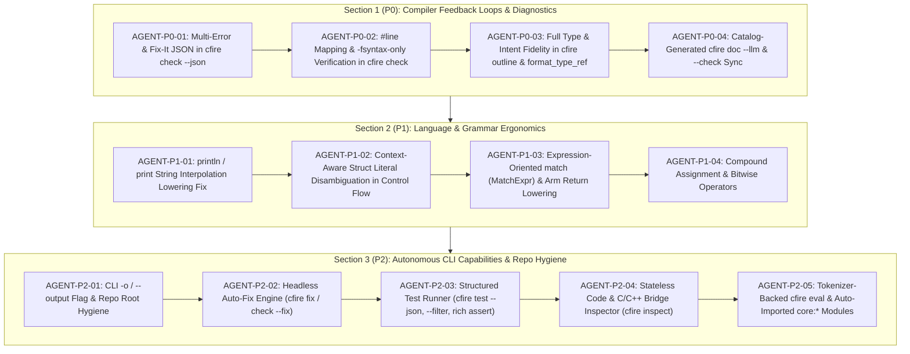

# Project Backlog

This backlog lists prioritized improvements, features, and tooling upgrades for `cfire`.
When selecting an item for implementation, promote it to [`active.md`](./active.md) and complete the pre-implementation scoping gate before writing code.

---

# Active Backlog: Agent-Friendliness & Language Ergonomics (`AGENT-*`)

> **MANDATORY INSTRUCTIONS FOR THE IMPLEMENTING AGENT — READ BEFORE WRITING ANY CODE**
>
> 1. **Do Not Skip Edge Cases or Make Silent Assumptions**: Every item below contains a **"Critical Details, Edge Cases & Pitfalls (Do Not Miss)"** checklist. Before writing code for an item, promote it to [`active.md`](./active.md), review every edge case listed, and if any requirement conflicts with an existing behavior or requires a product tradeoff, **stop and ask the user** rather than guessing.
> 2. **Preserve All Existing Invariants**:
>    - **Zero Warnings**: Every change must compile cleanly under `clang++ -std=c++2b -O2 -Wall -Wextra -Wpedantic -Wshadow -Wno-parentheses-equality -Iruntime -Isrc src/main.cpp`.
>    - **Zero Exceptions**: Do not introduce `try`/`catch` or `std::stoi` in `src/` or `runtime/`. Use `cfire::detail::parse_int<T>` (`<charconv>`) and `std::expected<T, E>`.
>    - **`AstArena` Lifetimes**: `ExprPtr` and `StmtPtr` are raw pointers into `FileAST::arena`. Whenever merging AST nodes from imported local packages into a parent `FileAST`, you **must** append the child's `ast.arena` and `ast.child_arenas` into `parent.child_arenas` so the backing memory outlives semantic analysis and codegen.
>    - **Documentation & Formatting Sync**: Any change to `src/docgen/*`, `docs/GUIDE.md`, `src/formatter.hpp`, or `examples/*` must pass `./cfire doc --check` and `./cfire fmt --check examples/`.
> 3. **Section-Level Success Gates**: At the end of each of the 3 sections below (`P0`, `P1`, `P2`), there is a mandatory **Section Success Instructions & Verification Gate**. You are **not** done with a section until every command, unit test, and edge-case assertion in that section's gate passes 100%.



---

## Section 1: Compiler Feedback Loops & Machine-Readable Diagnostics (Priority P0)

### `AGENT-P0-01`: Multi-Error Structured Diagnostics & Fix-It Payloads in `cfire check --json` `[Completed]`
- **Status**: Completed
- **Priority**: P0
- **Category**: CLI Diagnostics / Semantic Analyzer / AI Agent Feedback Loops
- **Target Files**:
  - `src/main.cpp` (`lines 712–741`)
  - `src/sema.hpp` (`lines 26–38`, `47–533`, `535–631`)
  - `src/parser.hpp` (`lines 1519–1542`)
  - `src/lsp/server.hpp` (`lines 558–613`, `2544–2767`)
  - `tests/unit/test_stdlib.cpp` (`test_agent_tooling_outline_and_json`)
- **Problem Statement**:
  1. `cfire check --json <file>` (`src/main.cpp:712-741`) hardcodes `"line": 1, "col": 1` on every syntax error, semantic error, and warning, even though the error strings already contain `<file>:<line>:<col>: ...`.
  2. It hardcodes `"code": "cfire/SEMA-ERROR"` and `"code": "cfire/WARNING"` instead of extracting the specific diagnostic code suffix (`(cfire/MUT-CALLSITE)`, `(cfire/USE-AFTER-MOVE)`, `(cfire/NON-EXHAUSTIVE-MATCH)`, `(cfire/DEPRECATED-VAR)`, etc.).
  3. It fails on the **first** error: `src/main.cpp:720` calls `parse_source` (which returns only `res.errors.front()` and discards the rest of `ParseResult::errors`), and `SemaFnChecker` (`src/sema.hpp:610`) returns `std::unexpected` on the very first semantic error in a function, aborting analysis of remaining statements and functions.
  4. `cfire check --json` does not resolve local package imports (`import "./pkg/..."`), causing false errors on multi-package files.
  5. `cfire check --json` does not include `"fixit"` replacement payloads, even though `Server::compute_code_actions` (`src/lsp/server.hpp:2544-2767`) already computes deterministic fixes for `cfire/MUT-CALLSITE`, `cfire/OUT-CALLSITE`, `cfire/IMMUTABLE-MUT-ARG`, `cfire/MUT-RECEIVER`, and `cfire/NON-EXHAUSTIVE-MATCH`.
- **Critical Details, Edge Cases & Pitfalls (Do Not Miss)**:
  - **1-Based vs. 0-Based Coordinates**: Lexer tokens and AST nodes use **1-based** line and column numbers (`line >= 1, col >= 1`). LSP (`src/lsp/server.hpp:572-573`) subtracts `1` for 0-based LSP JSON-RPC ranges. `cfire check --json` is a CLI tool and **must** emit **1-based** `line` and `col` (and 1-based `fixit` ranges). Do **not** blindly copy LSP's `- 1` subtraction into `cfire check --json`.
  - **Windows / Colon Path Parsing**: When parsing `<file>:<line>:<col>: <message> (cfire/<CODE>)`, start searching for `:` at `file_path.size()` (as done in `src/lsp/server.hpp:568`) so a path containing `:` never corrupts line/col extraction, and use `cfire::detail::parse_int<int>` from `runtime/cfire_prelude.hpp` (no `std::stoi` or `try`/`catch`).
  - **Accumulating Sema Errors Without Cascading Bogus Errors**: When `SemaFnChecker` records an error in `check_stmt` or `check_expr` (e.g., `cfire/USE-AFTER-MOVE` or `cfire/MUT-CALLSITE`), record it into a `std::vector<std::string> errors` vector and continue checking subsequent statements and functions so all independent errors in the file are reported in one run. Keep `analyze(FileAST) -> std::expected<CheckedFile, std::string>` compatible with existing callers (`require_sema_error` in `tests/test_harness.hpp:130-140`) by either joining `errors` or returning the first error when `analyze()` fails while providing `analyze_resilient(FileAST) -> CheckedFile` (with `CheckedFile::errors`) for `cfire check --json` and `cfire-lsp`!
  - **Arena Lifetime on Local Package Merging**: When `cfire check --json` merges local `.cf` packages (`resolve_local_cf_imports`), it **must** copy `pkg.ast.arena` into `merged.child_arenas` (`src/lsp/server.hpp:595-597`) before running `analyze_resilient(std::move(merged))`.
- **Detailed Engineering Requirements**:
  1. Define a shared `StructuredDiagnostic` struct and parser helper in a common header (or `src/sema.hpp`):
     ```cpp
     struct FixItEdit {
         std::string title{};
         int start_line = 1; // 1-based
         int start_col = 1;  // 1-based
         int end_line = 1;   // 1-based
         int end_col = 1;    // 1-based
         std::string replacement{};
     };
     struct StructuredDiagnostic {
         std::string file{};
         int line = 1;       // 1-based
         int col = 1;        // 1-based
         std::string severity{}; // "error" | "warning"
         std::string code{};     // e.g. "cfire/MUT-CALLSITE"
         std::string message{};  // clean message without redundant "<file>:<line>:<col>: " prefix
         std::vector<FixItEdit> fixits{};
     };
     ```
  2. Update `SemaFnChecker` and `CheckedFile` in `src/sema.hpp` so `analyze_resilient(FileAST)` collects **all** semantic errors across all functions, methods, and `test` blocks into `CheckedFile::errors` without aborting on the first statement error.
  3. Update `Server::compute_diagnostics_for_doc` in `src/lsp/server.hpp:603` to use `analyze_resilient` so LSP also publishes all semantic errors simultaneously (and replace the `try { std::stoi(...) } catch (...)` in `src/lsp/server.hpp:571-574` with `cfire::detail::parse_int<int>`).
  4. Extract the quick-fix synthesis logic (`cfire/MUT-CALLSITE`, `cfire/OUT-CALLSITE`, `cfire/IMMUTABLE-MUT-ARG`, `cfire/MUT-RECEIVER`, `cfire/NON-EXHAUSTIVE-MATCH`) into a reusable helper so both `Server::compute_code_actions` and `cfire check --json` populate `fixits`.
  5. Update `cfire check --json` in `src/main.cpp:712-741` to:
     - Use `parse_source_resilient` to collect all syntax errors with exact 1-based `line`, `col`, and `"code": "cfire/SYNTAX-ERROR"`.
     - Resolve local package imports (`resolve_local_cf_imports`) and merge declarations before running `analyze_resilient`.
     - Emit all errors and warnings with accurate 1-based `line`, `col`, specific `cfire/<CODE>`, clean `message`, and `fixits` array.
- **Acceptance Criteria**:
  - Running `cfire check --json` on a `.cf` file containing two syntax errors or two semantic errors on lines 10 and 22 returns `"success": false` and a `"diagnostics"` array of length 2 with exact `"line": 10` and `"line": 22`, specific `"code"` values (e.g., `"cfire/MUT-CALLSITE"`, `"cfire/USE-AFTER-MOVE"`), and non-empty `"fixits"` arrays where applicable.
  - Existing `test_agent_tooling_outline_and_json` and `require_sema_error` unit tests continue to pass 100%.

---

### `AGENT-P0-02`: `#line` Directive Source Mapping & `-fsyntax-only` Verification in `cfire check` `[Completed]`
- **Status**: Completed
- **Priority**: P0
- **Category**: Codegen / Build System / Type & Symbol Verification
- **Target Files**:
  - `src/codegen.hpp` (`lines 117–169`, `542–880`)
  - `src/buildsys.hpp` (`lines 1070–1360`)
  - `src/main.cpp` (`lines 712–751`)
  - `src/sema.hpp` (`lines 180–520`)
- **Problem Statement**:
  1. `cfire check` (`src/main.cpp:743`) calls `analyze_and_emit(..., check_only=true)`, which runs the `.cf` parser, `SemaFnChecker`, and C++ string emission, and then **returns `0` (`✓ checked cleanly`) without invoking `clang++ -fsyntax-only`**. Because `SemaFnChecker` only checks parameter intents (`mut`/`move`/`out`), mutability, move liveness, and enum `match` exhaustiveness—and does **not** check identifier existence, function call arity, or expression types—a file calling `totally_nonexistent_fn(1, 2, 3)` or assigning `x: i32 = "hello"` passes `cfire check` with exit code `0`!
  2. When the agent subsequently runs `cfire build` or `cfire run`, `clang++` fails with errors pointing to `.cfire/gen/<stem>.cpp:84:12` instead of the `.cf` source file and line, because `Emitter` in `src/codegen.hpp` never emits `#line <line> "<file.cf>"` directives.
- **Critical Details, Edge Cases & Pitfalls (Do Not Miss)**:
  - **Do Not Break Canonical E2E `expected_cpp` Substring Checks**: In `tests/e2e/test_canonical.cpp:149-152`, tests assert `gen_cpp->contains(snippet)` for single-line C++ snippets (e.g., `"std::string_view prefix, AuditLog& log, std::string&& msg"`, `"cfire::async::Scope scope(4);"`). Emit `#line <st->line> "<escaped_path>"` on its **own line** before statement/function emission (or only when `st->line > 0` and `st->line != last_emitted_line_`), and never inside an expression string! Double-check that all 10 canonical examples in `test_end_to_end_canonical_examples` pass `gen_cpp->contains(snippet)` with `#line` directives enabled.
  - **Escape Backslashes/Quotes in `#line` Path**: Ensure the file path in `#line <line> "<path>"` escapes any `\` or `"` characters.
  - **Keep `cfire check` Sub-50ms via Cached Prelude PCH**: In `src/buildsys.hpp`, `build_native` already builds and caches a precompiled header (`.cfire/cache/pch/cfire_prelude_<hash>.hpp.pch`) when `target_triple.empty()`. When `cfire check` invokes `clang++ -fsyntax-only`, it **must** use that same cached PCH and include/define flags from `BuildPlan` so verification completes in ~15–30ms without linking.
  - **Map Clang Errors into `cfire check --json`**: When `cfire check --json` runs and syntax + `SemaFnChecker` succeed, also run the `-fsyntax-only` check (unless `--fast` / `--no-backend` is passed) and parse any `clang++` diagnostic lines (`<file.cf>:<line>:<col>: error: <msg>`) into `StructuredDiagnostic` entries with `"code": "cfire/TYPE-ERROR"`!
  - **Native Sema Arity Check for Known `.cf` Functions**: In `SemaFnChecker::check_expr` (`src/sema.hpp`), when calling a known `.cf` function in `cf_.fn_sigs` or method in `cf_.methods`, also check `call.args.size() != sig.params.size()` and emit a clear `cfire/ARITY-MISMATCH` diagnostic directly in `sema.hpp` before even hitting Clang.
- **Detailed Engineering Requirements**:
  1. Add `int last_source_line_ = -1;` and `void emit_line_directive(int line)` to `Emitter` in `src/codegen.hpp`, emitting `#line <line> "<escaped_ast_path>"` before `FnDecl`, `TestDecl`, and `Stmt` nodes when `line > 0 && line != last_source_line_`.
  2. Add native arity validation in `SemaFnChecker` (`src/sema.hpp`) for calls to functions in `cf_.fn_sigs` and single-owner methods in `cf_.methods`, emitting `<path>:<line>:<col>: call to '<name>' expects <N> argument(s), got <M> (cfire/ARITY-MISMATCH)`.
  3. Add a `verify_cpp_syntax_only(const BuildPlan& plan, ...)` step in `src/buildsys.hpp` (using `clang++ -std=c++2b -fsyntax-only` + cached PCH + `plan` include paths) and invoke it in `cfire check` (both text and `--json` modes).
  4. Parse Clang diagnostics (which now automatically bear `<file.cf>:<line>:<col>: error: ...` thanks to `#line`!) into `StructuredDiagnostic` objects for `cfire check --json`.
- **Acceptance Criteria**:
  - `cfire check` and `cfire check --json` on a file calling `unknown_func(123)` or assigning `x: i32 = "not_an_int"` **fail** with non-zero exit code and report the exact `.cf` file, line, and column.
  - `cfire check` on a file calling a `.cf` function with the wrong number of arguments reports `cfire/ARITY-MISMATCH` at the call site's exact line and column.
  - All 10 canonical examples in `test_end_to_end_canonical_examples` pass 100% with `#line` emission active.

---

### `AGENT-P0-03`: Complete Type & Intent Fidelity in `cfire outline` and `format_type_ref` `[Completed]`
- **Status**: Completed
- **Priority**: P0
- **Category**: Formatter / AST Pretty-Printer / Codebase Discovery (`cfire outline`)
- **Target Files**:
  - `src/formatter.hpp` (`lines 20–85`)
  - `src/main.cpp` (`lines 499–622`)
  - `tests/unit/test_stdlib.cpp` (`test_agent_tooling_outline_and_json`)
- **Problem Statement**:
  1. `cfire outline` and `cfire outline --json` (`src/main.cpp:544-605`) print `f.type.name`, `p.type.name`, and `fn.return_type.name` directly instead of calling `cfire::fmt::format_type_ref(...)`. This strips `!` (fallible), `?` (optional), `&` (borrow), `&mut` (mutable borrow), `*` / `*mut` (pointers), `[T]` (generic type arguments like `own[T]`, `shared[T]`, `sync.Channel[i32]`), method receivers (`fn (mut self: Server)`), function type parameters (`[T: Constraint]`), and parameter intents (`mut`, `move`, `out`).
  2. `cfire::fmt::format_type_ref(const TypeRef& t)` (`src/formatter.hpp:20-47`) itself has two bugs:
     - It never checks `t.is_borrow` (`&`) or `t.is_mut_borrow` (`&mut `).
     - It only formats `t.elem_type` when `!t.smart_wrap.empty()` (`own[T]`, `shared[T]`), dropping `[T]` on generic user/stdlib types like `sync.Channel[i32]` or `collections.Set[str]`.
- **Critical Details, Edge Cases & Pitfalls (Do Not Miss)**:
  - **How `Parser::parse_type_ref` Populates `is_borrow` vs. Generic `elem_type`**:
    Look closely at `src/parser.hpp:485-500` and `579-588`:
    - When `&str` is parsed (`src/parser.hpp:489-499`), `tr.is_borrow = true`, `tr.name = "str"`, and `tr.elem_type` is set to a `TypeRef` with `name = "str"`.
    - When `&[]i32` is parsed, `tr.is_borrow = true`, `tr.is_slice = true`, `tr.name = "[]i32"`, and `tr.elem_type` is `i32`.
    - When `sync.Channel[i32]` is parsed (`src/parser.hpp:579-588`), `tr.is_borrow = false`, `tr.is_mut_borrow = false`, `tr.smart_wrap = ""`, `tr.name = "sync::Channel"`, and `tr.elem_type` is `i32`.
    - **Pitfall**: If you naively format `std::format("{}[{}]", t.name, format_type_ref(*t.elem_type))` whenever `t.elem_type != nullptr` in the `else` branch of `format_type_ref`, then `&str` will be misformatted as `&str[str]`! You **must** check: only append `[format_type_ref(*t.elem_type)]` in the nominal type branch when `!t.is_borrow && !t.is_mut_borrow && t.elem_type != nullptr` (or change `parse_type_ref` / `format_type_ref` so borrow wraps cleanly without duplicating `elem_type`). Also normalize `::` back to `.` in `format_type_ref` if `t.name` contains `::` from `sync.Channel` (`src/parser.hpp:577`) unless `t.name.starts_with("cpp::")`, or verify `cfire fmt --check examples/` before and after!
  - **Verify `cfire fmt --check examples/` Immediately**: Because `cfire fmt` calls `format_type_ref`, any bug in `format_type_ref` will immediately show up when running `./cfire fmt --check examples/`.
- **Detailed Engineering Requirements**:
  1. Fix `cfire::fmt::format_type_ref(const TypeRef& t)` in `src/formatter.hpp:20-47` to:
     - Prefix `"&mut "` when `t.is_mut_borrow` is true, or `"&"` when `t.is_borrow` is true.
     - Format generic nominal types (`!t.is_borrow && !t.is_mut_borrow && t.smart_wrap.empty() && !t.is_slice && !t.is_array && !t.is_map && !t.is_ptr && !t.is_mut_ptr && t.elem_type != nullptr`) as `std::format("{}[{}]", base_name, format_type_ref(*t.elem_type))`.
     - Preserve `?` (`is_optional`) and `!` (`is_fallible`) suffixes.
  2. Update `cfire outline` (both `--json` and human-readable text modes in `src/main.cpp:520-620`) to:
     - Use `cfire::fmt::format_type_ref` for all struct field types, parameter types, and return types.
     - Include parameter intents (`"intent": "mut"` / `"move"` / `"out"` / `"in"`, and prefix `mut ` / `move ` / `out ` in `"params"` strings).
     - Include method receivers (`"receiver": "(mut self: Server)"` or `"receiver": "(self: Server)"` when `fn.receiver.has_value()`).
     - Include generic type parameters (`"type_params": ["T: Renderable"]` when `!fn.type_params.empty()`).
     - Include `"interfaces"` and `"enums"` (with variant payload types formatted via `format_type_ref`, e.g., `Circle(f64)`).
- **Acceptance Criteria**:
  - `cfire outline --json` on a file containing `fn (mut s: Server) handle[T: Handler](mut req: &str, move payload: own[ Packet ]) -> (i32, str)!` outputs the full receiver, type parameters, parameter intents (`mut`, `move`), borrowed/generic types (`&str`, `own[Packet]`), and fallible tuple return type `(i32, str)!`.
  - `./cfire fmt --check examples/` passes with 0 diffs.

---

### `AGENT-P0-04`: Catalog-Generated `cfire doc --llm` & `--check` Synchronization Gate `[Completed]`
- **Status**: Completed
- **Priority**: P0
- **Category**: Documentation Generator / AI Context Sheet
- **Target Files**:
  - `src/docgen/markdown.hpp` (`lines 554–595`)
  - `src/docgen/catalog.hpp` (`lines 1–650`)
  - `src/docgen.hpp`
  - `tests/unit/test_frontend.cpp` (`test_formatter_lsp_and_docgen`)
- **Problem Statement**:
  1. `generate_llm_reference()` in `src/docgen/markdown.hpp:554-592` is a hardcoded raw string literal rather than being synthesized from `stdlib_catalog()` (`src/docgen/catalog.hpp`).
  2. Because it is hardcoded, it contains hallucinated/non-existent APIs that cause agents to write code that fails to compile:
     - Lists `json.decode[T](str)` (actual API in `catalog.hpp`: `json.parse[T](raw: str) -> T!` and `json.stringify(val: Any) -> str`).
     - Lists `sort.slice_by` (actual API in `catalog.hpp`: `sort.slice(mut s: []T)`, `sort.slice_desc(mut s: []T)`, `sort.binary_search(s: []T, target: T) -> isize`, `sort.is_sorted(s: []T) -> bool`).
     - Omits **14 of the 28** `core:*` modules (`core:cli`, `core:log`, `core:env`, `core:path`, `core:io`, `core:bytes`, `core:fmt`, `core:testing`, `core:net/tcp`, `core:net/url`, `core:encoding/csv`, `core:crypto/hmac`, `core:db/sqlite`, `core:compress/zstd`).
     - Omits call-site intent rules (`f(mut x)`, `f(move x)`), borrowed slice/string syntax (`&str`, `&[]T`), and multi-return tuple destructuring (`(a, b) := f()`).
- **Critical Details, Edge Cases & Pitfalls (Do Not Miss)**:
  - **Keep Existing Test Assertions Passing**: `test_agent_tooling_outline_and_json` (`tests/unit/test_stdlib.cpp:1354-1357`) asserts that `cfire doc --llm` contains `"Reference Sheet"` and `"core:unicode"`. Preserve those exact substrings!
  - **Token Efficiency + Completeness**: `generate_llm_reference()` should dynamically iterate over all 28 modules in `stdlib_catalog()` (`src/docgen/catalog.hpp`) and emit every module path (`core:<mod>`) along with its exported functions and exact `.cf` signatures (`s.signature`), plus an accurate, verified grammar & semantics header covering:
    - Variable declarations (`x := val`, `mut x := val`, `x: T = val`, `mut x: T = val`)
    - Parameter intents & call-site annotations (`mut` requires `f(mut x)` and a `mut` binding; `move` requires `f(move x)`)
    - Types (`i8`..`i64`, `u8`..`u64`, `f32`, `f64`, `bool`, `str`, `&str`, `bytes`, `[]T`, `&[]T`, `[N]T`, `map[K]V`, `own[T]`, `shared[T]`, `T?`, `T!`, `(T1, T2)`)
    - Error handling (`try expr`, `val := fallible() or err { return ... }`)
    - Foreign C/C++ interop (`import cpp "header.h" @pkg("lib")`, `cpp::fn()`, `cpp { ... }`)
    - CLI commands (`cfire check --json`, `cfire outline --json`, `cfire test`, `cfire eval`, `cfire refactor rename`)
  - **Enforce Sync in `./cfire doc --check`**: Update `check_docs_sync` in `src/docgen.hpp` so that `--check` also validates that every module and symbol in `stdlib_catalog()` appears in `generate_llm_reference()` and that no non-catalog `mod.fn` hallucinations exist.
- **Detailed Engineering Requirements**:
  1. Rewrite `generate_llm_reference()` in `src/docgen/markdown.hpp:554-592` to programmatically iterate `stdlib_catalog()` and render all 28 modules and their exact signatures alongside the canonical grammar and CLI reference.
  2. Add a verification check in `src/docgen.hpp` (`--check`) ensuring `generate_llm_reference()` contains all modules from `stdlib_catalog()`.
- **Acceptance Criteria**:
  - `./cfire doc --llm` includes all 28 `core:*` modules from `stdlib_catalog()` with exact signatures (`json.parse`, `sort.slice_desc`, etc.) and zero hallucinated function names.
  - `./cfire doc --check` passes 100%.

---

### ✅ Section 1 (P0) Success Instructions & Sign-Off Gate

> **STOP AND VERIFY BEFORE MOVING TO SECTION 2**
> The implementing agent must execute every step below and record the results in [`active.md`](./active.md) before marking `AGENT-P0-01` through `AGENT-P0-04` as `[Completed]`:
>
> 1. **Multi-Error & Fix-It JSON Verification (`AGENT-P0-01`)**:
>    - Add a dedicated unit test in `tests/unit/test_stdlib.cpp` (`test_agent_tooling_outline_and_json`) that writes a `.cf` file containing:
>      - An immutable variable passed to a `mut` parameter without `mut` at the call site on line $L_1$, and
>      - A use-after-move error on line $L_2$.
>    - Assert that `cfire check --json <file>` exits with non-zero code and returns **both** diagnostics in a single JSON payload with `"line"` equal to $L_1$ and $L_2$ (not `1`), `"code"` equal to `"cfire/MUT-CALLSITE"` and `"cfire/USE-AFTER-MOVE"`, and a non-empty `"fixits"` array for `cfire/MUT-CALLSITE`.
> 2. **`#line` & Backend Type/Symbol Check Verification (`AGENT-P0-02`)**:
>    - Add a test verifying that a `.cf` file calling an undefined function `nonexistent_fn(42)` **fails** `cfire check` and `cfire check --json` with a diagnostic pointing to the `.cf` filename and exact line number (not `.cfire/gen/*.cpp`).
>    - Add a test verifying that calling a defined `.cf` function with wrong argument count fails with `"cfire/ARITY-MISMATCH"`.
> 3. **Outline & Formatter Type Fidelity Verification (`AGENT-P0-03`)**:
>    - Add a test in `test_agent_tooling_outline_and_json` asserting that `cfire outline --json` preserves `&str`, `&[]i32`, `own[Box]`, `T?`, `T!`, method receivers `(mut self: Type)`, and `mut`/`move` parameter intents.
>    - Run `./cfire fmt --check examples/` and verify exit code `0`.
> 4. **LLM Reference Sheet Verification (`AGENT-P0-04`)**:
>    - Assert in `test_agent_tooling_outline_and_json` that `./cfire doc --llm` contains all 28 `core:*` modules, contains `json.parse`, does **not** contain `json.decode` or `sort.slice_by`, and `./cfire doc --check` exits `0`.
> 5. **Run Full Gate**: Run `make review-check` and confirm 0 warnings and 100% test pass rate.

---

## Section 2: Language & Grammar Ergonomics for Agent Code Generation (Priority P1)

### `AGENT-P1-01`: `println` / `print` String Interpolation Lowering Fix (`std::format_string` `consteval` Bug) `[Completed]`
- **Status**: Completed
- **Priority**: P1
- **Category**: Code Generation / String Interpolation Ergonomics
- **Target Files**:
  - `src/codegen.hpp` (`lines 993–1009`, `1118–1127`)
  - `tests/unit/test_frontend.cpp`
- **Problem Statement**:
  - In `cfire`, string literals support inline variable interpolation (`"Hello {name}"`), which `Emitter::emit_expr` (`src/codegen.hpp:993-1008`) lowers to `std::format("Hello {}", name)`.
  - However, when an interpolated string is passed as the first argument to `println("Hello {name}")` or `print("Hello {name}")`, `Emitter::emit_call` (`src/codegen.hpp:1119-1127`) wraps it in `std::println(...)`, emitting:
    ```cpp
    std::println(std::format("Hello {}", name));
    ```
  - In C++23 (`<print>`), the first parameter of `std::println` / `std::print` is `std::format_string<Args...>`, which has a `consteval` constructor requiring a **compile-time string literal**. Passing the runtime `std::string` returned by `std::format(...)` fails to compile in `clang++ -std=c++2b` (`error: call to consteval function 'std::basic_format_string<char>::basic_format_string<std::string>' is not a constant expression`)!
  - Furthermore, if a user calls `println(msg)` where `msg` is a runtime `str` variable (`println(s)`), `std::println(s)` **also** fails C++23 `consteval` format string checking!
- **Critical Details, Edge Cases & Pitfalls (Do Not Miss)**:
  - **Case 1: `println("Hello {name}")` (Interpolated String Literal as First Argument)**:
    When `call.args[0].expr` is a `LiteralExpr` of kind `TokenKind::String` containing `{var}` interpolations (or mixed `{var}` and `{}` placeholders with trailing `call.args[1..N]`), `emit_call` should flatten the format string and arguments directly into `std::println("Hello {}", name, ...)` instead of `std::println(std::format("Hello {}", name))`!
    *Edge Case*: What if the string mixes `{name}` interpolation and positional `{}` with extra arguments, e.g., `println("Hello {name}, count={}", count)`? Flattening the extracted interpolation expressions followed by `call.args[1..N]` handles both seamlessly!
  - **Case 2: `println(runtime_str_expr)` (Single Non-Literal Expression Argument)**:
    When `call.args.size() == 1` and `call.args[0].expr` is **not** a `LiteralExpr` of kind `TokenKind::String` or `TokenKind::RawString` (for example, `s := "hello"; println(s)` or `println(42)` or `println(get_msg())`), emitting `std::println(s)` fails C++23 `consteval` checking! Instead, when `call.args.size() == 1` and `call.args[0].expr` is not a string literal, emit `std::println("{}", <arg0>)` (and `std::print("{}", <arg0>)` for `print`)!
  - **Case 3: Zero-Argument `println()`**:
    When `call.args.empty()`, `println()` should emit `std::println("")` (or `std::println()`).
- **Detailed Engineering Requirements**:
  1. Refactor string interpolation extraction in `src/codegen.hpp` (`lines 993–1008`) into a helper `extract_string_interpolation(std::string_view raw_val, int line) -> std::optional<std::pair<std::string, std::vector<std::string>>>` returning `(fmt_str, interp_arg_exprs)`.
  2. In `Emitter::emit_call` (`src/codegen.hpp:1119-1127`) for `println` and `print`:
     - If `call.args.empty()`: emit `std::println("")` / `std::print("")`.
     - If `call.args[0].expr` is a `LiteralExpr` (`String` or `RawString`): check `extract_string_interpolation`. If it has `{ident}` interpolations, emit `std::println("<fmt_str>", <interp_args...>, <remaining call.args[1..N]...>)`. Otherwise emit `std::println("<literal>", <call.args[1..N]...>)`.
     - If `call.args[0].expr` is **not** a string literal and `call.args.size() == 1`: emit `std::println("{}", emit_call_arg(call.args[0]))` so `println(x)` works for any `str`, `i32`, `f64`, or `bool` variable!
- **Acceptance Criteria**:
  - `println("Hello {name}!")` compiles and prints `Hello world!`.
  - `println("Hello {name}, score={}", 100)` compiles and prints `Hello world, score=100`.
  - `msg := "dynamic string"; println(msg)` and `println(42)` compile and print `dynamic string` and `42`.
  - `s := "Hello {name}"` outside `println` still lowers to `std::format("Hello {}", name)`.

---

### `AGENT-P1-02`: Context-Aware Struct Literal Disambiguation (`allow_struct_lit_` in Control-Flow Headers) `[Completed]`
- **Status**: Completed
- **Priority**: P1
- **Category**: Parser / Grammar Soundness
- **Target Files**:
  - `src/parser.hpp` (`lines 920–1130`, `1420–1458`)
  - `tests/unit/test_frontend.cpp`
- **Problem Statement**:
  - In `Parser::parse_primary_expr` (`src/parser.hpp:1433-1435`), any identifier starting with an uppercase ASCII letter (`'A'`–`'Z'`) immediately followed by `{` is unconditionally parsed as a struct literal (`StructLitExpr`):
    ```cpp
    if (cur().kind == TokenKind::LBrace && !name.empty() &&
        (... || (name[0] >= 'A' && name[0] <= 'Z'))) {
        advance(); // consumes '{' as struct literal!
    ```
  - Consequently, whenever an uppercase constant, variable, or enum value appears at the end of an `if`, `for`, or `match` header before the block's opening `{`—such as:
    - `if count < MAX_RETRIES { ... }`
    - `for i < LIMIT { ... }`
    - `match STATE { ... }`
    the parser consumes the block's `{` as the start of a struct literal `MAX_RETRIES{ ... }`, failing with a cryptic syntax error inside the body!
- **Critical Details, Edge Cases & Pitfalls (Do Not Miss)**:
  - **How Go and Rust Solve This (`allow_struct_lit_` Flag)**:
    - Add a `bool allow_struct_lit_ = true;` member to `Parser` (`src/parser.hpp`).
    - When parsing the condition/header expression of `if` (`parse_if_stmt`), `for` (`parse_for_stmt`, both `for cond {` and the iterable in `for x in iter {`), and `match` (`parse_match_stmt`), save the previous state and set `allow_struct_lit_ = false` for the top-level header expression.
    - **Crucial Nested Expression Rule**: Inside parentheses `(Point{ x: 1, y: 2 })`, square brackets `[Point{ x: 1 }]`, or function call arguments `check_point(Point{ x: 1 })` within an `if`/`for`/`match` condition, struct literals **ARE** unambiguous and valid! Therefore, whenever entering `(...)` (`TokenKind::LParen` in `parse_primary_expr` and call arguments `(...)` in `parse_postfix_expr`) or `[...]` (`TokenKind::LBracket`), temporarily restore `allow_struct_lit_ = true` for the inner expressions, and restore the outer value on exit!
    - Only enter the `cur().kind == TokenKind::LBrace` struct literal branch in `parse_primary_expr` (`src/parser.hpp:1433`) when `allow_struct_lit_` is `true`.
- **Detailed Engineering Requirements**:
  1. Add `bool allow_struct_lit_ = true;` to `Parser` in `src/parser.hpp` with a small RAII guard `struct StructLitGuard { Parser& p; bool prev; ... };`.
  2. Set `allow_struct_lit_ = false` around the condition/scrutinee/iterable expressions in `parse_if_stmt`, `parse_for_stmt`, and `parse_match_stmt`.
  3. Set `allow_struct_lit_ = true` inside parenthesized expressions `(...)`, call argument lists `f(...)`, and array literals `[...]`.
  4. Gate the `StructLitExpr` branch at `src/parser.hpp:1433` on `allow_struct_lit_`.
- **Acceptance Criteria**:
  - `MAX_LIMIT := 10; if x < MAX_LIMIT { println("ok") }` parses, compiles, and runs cleanly.
  - `for i < MAX_ITER { i += 1 }` and `match CURRENT_MODE { ... }` parse, compile, and run cleanly.
  - `if is_origin(Point{ x: 0, y: 0 }) { ... }` and `if (Point{ x: 1 }.x == 1) { ... }` also parse and compile cleanly.

---

### `AGENT-P1-03`: First-Class Expression-Oriented `match` (`MatchExpr`) & Statement-Arm Return Lowering `[Completed]`
- **Status**: Completed
- **Priority**: P1
- **Category**: AST / Parser / Sema / Codegen / Formatter
- **Target Files**:
  - `src/ast.hpp` (`lines 195–270`, `320–360`)
  - `src/parser.hpp` (`lines 1036–1126`, `1407–1516`)
  - `src/sema.hpp` (`lines 320–450`)
  - `src/codegen.hpp` (`lines 750–860`, `960–1115`)
  - `src/formatter.hpp` (`lines 150–380`)
  - `tests/unit/test_frontend.cpp`
- **Problem Statement**:
  1. In `src/parser.hpp:1036-1126`, `match` is only parsed as a statement (`MatchStmt`), never in `parse_primary_expr()`. Agents writing `label := match status { Status::Active => "on", Status::Idle => "off" }` or `return match s { ... }` hit `unexpected token 'match' in expression`.
  2. Even worse, when a single expression is written on the right side of `=>` in a `match` arm (`Status::Active => "on"`), `Parser::parse_match_stmt` wraps it in an `ExprStmt`, and `Emitter::emit_stmt` (`src/codegen.hpp:804`) lowers `ExprStmt` to `(void)(expr);`!
- **Critical Details, Edge Cases & Pitfalls (Do Not Miss)**:
  - **How `MatchExpr` Should Lower to Valid C++23**:
    - For **tagged enum** `match` expressions (`std::visit(cfire::overloaded{ ... }, scrutinee._v)`): `std::visit` in C++23 **already returns the common return type** of the visitor lambdas! In `MatchStmt`, each arm's body currently emits `(void)(expr);` for an `ExprStmt`. In `MatchExpr`, each arm visitor lambda `[&](...) { ... }` must `return <last_expr>;` (when the arm ends in an `ExprStmt` that does not already diverge via `return`/`panic`).
    - For **primitive/string/slice** `match` expressions (which lower to `if` / `else if` chains in `MatchStmt`): wrap the `if` / `else if` chain in an immediately-invoked lambda `[&]() { ... }()` where each arm returns its resulting expression!
  - **Exhaustiveness Requirement in `SemaFnChecker`**:
    - Ensure `SemaFnChecker::check_expr` validates `MatchExpr` with the **exact same exhaustiveness and move-liveness checks** that `check_stmt` performs on `MatchStmt` (`cfire/NON-EXHAUSTIVE-MATCH`), AND enforces that a primitive/slice `MatchExpr` used as a value has a wildcard `_ => ...` fallback arm so the C++ lambda never reaches end of non-void function without returning!
  - **Formatter Support (`src/formatter.hpp`)**:
    - Do not forget to add `MatchExpr` handling to `Formatter::format_expr` in `src/formatter.hpp` so `cfire fmt` can format files containing `x := match v { ... }`!
  - **`AstArena` Allocation**:
    - `MatchExpr` holds `ExprPtr target` and `std::vector<MatchArm> arms` (where each `MatchArm` has `std::vector<StmtPtr> body`). Because `Expr` nodes are allocated in `AstArena` (`make_expr(MatchExpr{...}, line, col)`), `MatchExpr` is non-trivially destructible (`std::vector<MatchArm>`) and `AstArena::alloc` automatically registers its destructor (`src/ast.hpp:36-40`).
- **Detailed Engineering Requirements**:
  1. Add `struct MatchExpr { ExprPtr target = nullptr; std::vector<MatchArm> arms{}; int line = 0; };` to `ExprNode` variant in `src/ast.hpp`.
  2. Factor the arm-parsing loop of `Parser::parse_match_stmt` (`src/parser.hpp:1036-1126`) into a shared helper `parse_match_arms()` and handle `TokenKind::KwMatch` in `Parser::parse_primary_expr()` returning `MatchExpr`.
  3. Validate `MatchExpr` in `SemaFnChecker::check_expr` (`src/sema.hpp`), enforcing enum exhaustiveness (`cfire/NON-EXHAUSTIVE-MATCH`) and wildcard fallback for non-enum `MatchExpr`.
  4. Emit `MatchExpr` in `Emitter::emit_expr` (`src/codegen.hpp`), returning the arm value from each visitor lambda (for enums) or from an IIFE `[&]() { ... }()` (for primitives/strings/slices).
  5. Format `MatchExpr` in `src/formatter.hpp`.
- **Acceptance Criteria**:
  - Enum `match` expression: `name := match shape { Shape::Circle(r) => "circle", Shape::Rect(w, h) => "rect" }` compiles and evaluates to `"circle"` / `"rect"`.
  - Primitive/string `match` expression: `code := match verb { "GET" => 1, "POST" => 2, _ => 0 }` compiles and evaluates to the matched integer.
  - Non-exhaustive `MatchExpr` on an enum is rejected with `cfire/NON-EXHAUSTIVE-MATCH`.
  - `cfire fmt` cleanly formats `MatchExpr`.

---

### `AGENT-P1-04`: Full Compound Assignment (`*=`, `/=`, `%=`, `&=`, `|=`, `^=`, `<<=`, `>>=`) & Bitwise Operators (`&`, `|`, `^`, `~`, `<<`, `>>`) `[Completed]`
- **Status**: Completed
- **Priority**: P1
- **Category**: Lexer / Parser / Sema / Codegen / Formatter
- **Target Files**:
  - `src/lexer.hpp` (`lines 15–110`, `210–350`)
  - `src/parser.hpp` (`lines 970–995`, `1130–1250`, `1290–1335`)
  - `src/sema.hpp` (`lines 250–340`)
  - `src/codegen.hpp` (`lines 690–720`, `1015–1025`)
  - `src/formatter.hpp` (`lines 200–350`)
  - `tests/unit/test_frontend.cpp`
- **Problem Statement**:
  1. `src/lexer.hpp` and `src/parser.hpp:977` only support `=`, `+=`, and `-=` for assignments. Writing `x *= 2`, `x /= 10`, `x %= 3`, `mask |= flag`, `mask &= ~bit`, `hash ^= byte`, `x <<= 1`, or `x >>= 1` fails with a lex/parse error.
  2. Binary expressions in `src/parser.hpp:1130-1250` do not parse bitwise OR (`|`), bitwise XOR (`^`), bitwise AND (`&`), bitwise shift (`<<`, `>>`), or unary bitwise NOT (`~`).
- **Critical Details, Edge Cases & Pitfalls (Do Not Miss)**:
  - **Disambiguating Closure `|x| { ... }` vs. Bitwise OR `a | b`**:
    - In `src/parser.hpp:1384`, `TokenKind::Pipe` (`|`) at the **start of a primary expression** (`parse_primary_expr` / `parse_closure_expr`) starts a closure `|param| { ... }`.
    - In **infix binary position** (after an expression has already been parsed), `|` is bitwise OR (`a | b`)! Because `parse_primary_expr` handles leading `|` and the precedence climber / binary parser handles infix tokens *after* `parse_unary_expr`, infix `|` does **not** conflict with closure syntax `|x| { ... }`!
  - **Disambiguating Generic Type Arguments `>>` vs. Right Shift `a >> b`**:
    - Check how `Parser::parse_type_ref` parses nested brackets (`[T]` uses `[]`, not `<>`!). Because `cfire` uses square brackets `[T]` for generics (`own[own[i32]]`), `<<` and `>>` have **zero** ambiguity with generic types!
  - **Disambiguating Unary Address-Of `&x` vs. Infix Bitwise AND `a & b`**:
    - Prefix `&x` and `&mut x` are parsed in `parse_unary_expr()` (`src/parser.hpp:1299`). Infix `a & b` is parsed in the binary operator hierarchy after `parse_unary_expr()`, so they never conflict.
  - **Operator Precedence Order**:
    Ensure standard C/C++ precedence order in `src/parser.hpp`:
    1. `||` (logical OR)
    2. `&&` (logical AND)
    3. `|` (bitwise OR)
    4. `^` (bitwise XOR)
    5. `&` (bitwise AND)
    6. `==`, `!=` (equality)
    7. `<`, `<=`, `>`, `>=` (relational)
    8. `<<`, `>>` (bitwise shift)
    9. `+`, `-` (additive)
    10. `*`, `/`, `%` (multiplicative)
    11. Unary `!`, `-`, `~`, `&`, `&mut`, `*`, `move`, `try`
  - **Mutability Check in `SemaFnChecker`**:
    - In `src/sema.hpp`, `AssignStmt` checks that the LHS root variable is mutable (`mut_vars_.contains(name)`). Ensure all compound assignment operators (`+=`, `-=`, `*=`, `/=`, `%=`, `&=`, `|=`, `^=`, `<<=`, `>>=`) enforce the exact same mutability check (`cfire/ASSIGN-IMMUTABLE`) and record a read of both LHS and RHS for move-liveness analysis!
- **Detailed Engineering Requirements**:
  1. Add tokens to `TokenKind` and `tokenize()` in `src/lexer.hpp`: `StarEq` (`*=`), `SlashEq` (`/=`), `PercentEq` (`%=`), `AmpEq` (`&=`), `PipeEq` (`|=`), `CaretEq` (`^=`), `Caret` (`^`), `Tilde` (`~`), `Shl` (`<<`), `Shr` (`>>`), `ShlEq` (`<<=`), `ShrEq` (`>>=`).
  2. Update `Parser::parse_expr_or_assign_stmt` (`src/parser.hpp:977`) to accept all compound assignment tokens in `AssignStmt::op`.
  3. Update the binary expression hierarchy (`src/parser.hpp:1130-1250`) and `parse_unary_expr` (`~`) with the precedence table above.
  4. Verify `SemaFnChecker`, `Emitter`, and `Formatter` handle all new unary, binary, and compound assignment operators cleanly.
- **Acceptance Criteria**:
  - Bitwise expressions `(0xF0 & 0x3F) | (1 << 4) ^ (~0)` and `16 >> 2` parse, format, compile, and evaluate to the exact expected integer values.
  - All compound assignments (`*=`, `/=`, `%=`, `&=`, `|=`, `^=`, `<<=`, `>>=`) work on `mut` variables and are rejected with `cfire/ASSIGN-IMMUTABLE` on immutable variables.

---

### ✅ Section 2 (P1) Success Instructions & Sign-Off Gate

> **STOP AND VERIFY BEFORE MOVING TO SECTION 3**
> The implementing agent must execute every step below and record the results in [`active.md`](./active.md) before marking `AGENT-P1-01` through `AGENT-P1-04` as `[Completed]`:
>
> 1. **String Interpolation in `println` / `print` (`AGENT-P1-01`)**:
>    - Add unit + e2e execution tests in `tests/unit/test_frontend.cpp` verifying:
>      - `name := "cfire"; println("hello {name}")`
>      - `println("hello {name} #{}" , 1)`
>      - `println(name)` and `println(12345)`
>      - `s := "hello {name}"` assigned to a variable and then printed.
> 2. **Uppercase Identifier before `{` in Control Flow (`AGENT-P1-02`)**:
>    - Add parser + execution tests in `tests/unit/test_frontend.cpp` verifying `if count < MAX_COUNT { ... }`, `for idx < LIMIT { ... }`, `match STATE { ... }`, and `if check(Config{ threads: 4 }) { ... }`.
> 3. **Expression-Oriented `match` (`AGENT-P1-03`)**:
>    - Add parser, sema, formatter, and runtime execution tests in `tests/unit/test_frontend.cpp` for `MatchExpr` on both an algebraic enum (`Shape`) and a primitive/string value, plus a negative sema test verifying `require_sema_error` catches `cfire/NON-EXHAUSTIVE-MATCH` on an incomplete enum `MatchExpr`.
> 4. **Bitwise & Compound Assignment Operators (`AGENT-P1-04`)**:
>    - Add execution tests in `tests/unit/test_frontend.cpp` exercising every compound assignment (`*=`, `/=`, `%=`, `&=`, `|=`, `^=`, `<<=`, `>>=`) and bitwise operator (`&`, `|`, `^`, `~`, `<<`, `>>`), plus a negative sema test verifying `x *= 2` on an immutable `x := 5` fails with `cfire/ASSIGN-IMMUTABLE`.
> 5. **Run Full Gate**: Run `make review-check` and confirm 0 warnings, 0 formatting diffs, 0 doc sync errors, and 100% test pass rate.

---

## Section 3: Autonomous CLI Capabilities & Repository Hygiene (Priority P2)

### `AGENT-P2-01`: CLI `-o` / `--output` Flag Parsing & Repository Root Artifact Hygiene (`cfire_cross_*` Cleanup) `[Completed]`
- **Status**: Completed
- **Priority**: P2 (Run First in Section 3)
- **Category**: CLI Driver / Build Hygiene
- **Target Files**:
  - `src/main.cpp` (`lines 628–765`)
  - `.gitignore`
  - `Makefile` (`line 58`)
  - `tests/e2e/test_canonical.cpp` (`lines 250–268`)
- **Problem Statement**:
  - `test_cfire_cross_compile` (`tests/e2e/test_canonical.cpp:258`) invokes:
    ```cpp
    run_cfire(std::format("build \"{}\" -o \"{}\" --target arm64-apple-darwin", main_cf.string(), out_bin.string()))
    ```
  - However, `src/main.cpp:637-696` **does not parse `-o <path>` or `--output <path>`**! Instead, `"-o"` and `out_bin` fall through into `run_args`, and `src/main.cpp:754` computes `out_bin = target.parent_path().filename().string()` (`"cfire_cross_<pid>_0"`), writing a stray binary `cfire_cross_<pid>_0` directly into the repository root (`/Users/memo/Programming/cfire/`) on every single `make test` run! There are currently 18 untracked `cfire_cross_*` binaries sitting in the repository root.
- **Detailed Engineering Requirements**:
  1. In `src/main.cpp:637-696`, parse `-o <path>`, `--output <path>`, and `--output=<path>` into `std::string custom_output_path`.
  2. In `sub == "build"` (`src/main.cpp:753-765`), if `!custom_output_path.empty()`, use `custom_output_path` as `out_bin` (still appending `.exe` on Windows target triples if not already ending in `.exe`).
  3. Delete all existing untracked `cfire_cross_*` binaries from the repository root and update `Makefile` `clean` target if needed.
  4. In `test_cfire_cross_compile` (`tests/e2e/test_canonical.cpp:258`), assert `require(std::filesystem::exists(out_bin), "cfire build -o created output binary at requested path")`.
- **Acceptance Criteria**:
  - `cfire build main.cf -o /tmp/my_bin` writes the binary to `/tmp/my_bin` and leaves zero artifacts in the current working directory.
  - Running `make test` leaves `git status --short` with zero untracked `cfire_cross_*` files.

---

### `AGENT-P2-02`: Headless Auto-Fix Engine (`cfire fix` & `cfire check --fix`) `[Completed]`
- **Status**: Completed
- **Priority**: P2
- **Category**: CLI Tooling / Autonomous Repair
- **Target Files**:
  - `src/main.cpp`
  - `src/sema.hpp`
  - `src/lsp/server.hpp` (`lines 2544–2767`)
  - `tests/unit/test_stdlib.cpp`
- **Problem Statement**:
  - `cfire-lsp` (`src/lsp/server.hpp:2544-2767`) already computes deterministic quick-fixes for `cfire/MUT-CALLSITE` (insert `mut ` at call site), `cfire/OUT-CALLSITE` (insert `out ` at call site), `cfire/IMMUTABLE-MUT-ARG` / `cfire/MUT-RECEIVER` (insert `mut ` at variable declaration), and `cfire/NON-EXHAUSTIVE-MATCH` (generate missing enum variant arms).
  - However, CLI-driven agents cannot trigger these fixes without running a persistent LSP JSON-RPC client.
- **Critical Details, Edge Cases & Pitfalls (Do Not Miss)**:
  - **Apply Edits in Reverse Document Order (Bottom-to-Top, Right-to-Left)**:
    When applying multiple `FixItEdit` replacements to a file in a single pass, if you apply an edit on line 5 before an edit on line 20 (or column 4 before column 18 on the same line), the earlier edit shifts byte/line/column offsets for all subsequent edits! You **must** sort edits by `(start_line DESC, start_col DESC)` and skip any overlapping edits before mutating the file buffer.
  - **Missing `core:*` Standard Library Import Auto-Fix**:
    In addition to the 4 sema quick-fixes above, scan `MemberExpr` qualifiers in the AST (e.g., `json.parse`, `fs.read_all`, `http.get`, `sha256.hash_hex`) against the 28 modules in `stdlib_catalog()`. If a qualifier matches a known `core:*` module namespace that is not yet in `ast.imports` and not shadowed by a local variable/package, generate a `FixItEdit` inserting `import "core:<mod>"\n` right after the `package <name>` line!
- **Detailed Engineering Requirements**:
  1. Support `cfire fix <file.cf> [--dry-run] [--json]` and `cfire check --fix <file.cf> [--json]`.
  2. Collect all preferred `FixItEdit` items from `StructuredDiagnostic` (`AGENT-P0-01`) plus missing `core:*` stdlib imports.
  3. Sort non-overlapping edits in reverse position order `(start_line DESC, start_col DESC)` and apply them atomically (or print the planned edits without writing when `--dry-run` is set).
  4. In `--json` mode, output `{"success": true, "file": "...", "applied_fixes": N, "edits": [...]}`.
- **Acceptance Criteria**:
  - Given a `.cf` file that calls `fs.exists("a")` without `import "core:fs"` and calls `mutate_fn(x)` on `x := 10` without `mut` at declaration or call site, running `cfire fix <file.cf>` (at most 2 passes if declaration + call site are sequential, or 1 pass if both are emitted) produces a file that passes `cfire check` with 0 errors.

---

### `AGENT-P2-03`: Structured Test Runner (`cfire test --json`, `--filter`, Location-Aware `assert`) `[Completed]`
- **Status**: Completed
- **Priority**: P2
- **Category**: Test Runner / Runtime Prelude / Codegen
- **Target Files**:
  - `runtime/cfire_prelude.hpp` (`lines 280–287`)
  - `src/codegen.hpp` (`lines 291–321`, `1128–1134`)
  - `src/buildsys.hpp` (`lines 1300–1390`)
  - `src/main.cpp` (`lines 760–795`)
  - `tests/unit/test_stdlib.cpp`
- **Problem Statement**:
  1. `assert(cond)` lowers to `cfire::assert_true(cond)` (`runtime/cfire_prelude.hpp:281-286`), which prints `panic: assertion failed` with **no file name, no line number, no condition expression text**, and calls `std::abort()`, killing the entire test binary so subsequent `test "..."` blocks never run.
  2. `cfire test` does not support `--json` (structured per-test pass/fail/duration/location output) or `--filter <substring>` (running a single test block).
- **Critical Details, Edge Cases & Pitfalls (Do Not Miss)**:
  - **Do Not Break Existing E2E Test Output Assertions**:
    In `tests/e2e/test_canonical.cpp:201`, the e2e suite runs the compiled test binary for `examples/09-stdlib-test-pointers/main.cf` and asserts that stdout contains:
    - `=== RUN   <test_name>`
    - `--- PASS: <test_name>`
    - `PASS (2 cfire tests succeeded)`
    When `cfire test` runs in default (non-`--json`) mode and all tests pass, the stdout format **must** preserve those exact lines!
  - **How to Isolate Test Failures Without Exceptions or `std::abort()` in `test "..."` Mode**:
    Remember the repository's Zero-Exception rule (`ARCH-CPP-04` / `SENIOR_ENGINEER_REVIEW_GUIDELINES.md` Section 2.D.2: no `throw`/`try`/`catch`). How can a failed `assert(...)` inside `__cfire_test_i()` record a failure with file, line, and expression text and either abort the current test or report cleanly without using C++ exceptions?
    - In `runtime/cfire_prelude.hpp`, provide thread-local/global test runner state (`cfire::testing_detail::current_test_failed`, `failure_file`, `failure_line`, `failure_msg`) or `siglongjmp`/`setjmp` jump buffer when inside the test runner harness (`in_test_harness`), while falling back to `std::println(stderr, "{}:{}: panic: assertion failed: {}", file, line, expr_str); std::abort();` when `assert()` is called in normal non-test `main()`!
    - In `Emitter::emit_call` (`src/codegen.hpp:1128-1134`), pass `cf_.ast.path`, `call.args[0].expr->line`, and the stringified condition expression (e.g., `emit_call_arg(call.args[0])` escaped) to `cfire::assert_true_at(cond, msg, file, line, expr_str)`.
- **Detailed Engineering Requirements**:
  1. Add `cfire::assert_true_at(bool cond, std::string_view msg, std::string_view file, int line, std::string_view expr_text)` in `runtime/cfire_prelude.hpp` (keeping `cfire::assert_true` for backward compatibility).
  2. Update `Emitter::emit_call` (`src/codegen.hpp:1128-1134`) to emit `cfire::assert_true_at(cond, msg, "<file>", <line>, "<expr>")`.
  3. Update the generated `main(int argc, char** argv)` test harness in `Emitter::emit` (`src/codegen.hpp:296-308`) to:
     - Accept runtime flags `--cfire-test-json` and `--cfire-test-filter=<pattern>` via `argc`/`argv`.
     - Measure per-test elapsed duration (`std::chrono::steady_clock`).
     - Catch assertion failures via `cfire::testing_detail` jump buffer so remaining `test "..."` blocks still execute and report their status!
     - In default mode, print `=== RUN   <name>`, `--- PASS: <name>` or `--- FAIL: <name> (<file>:<line>: <msg>)`, and `PASS (<N> cfire tests succeeded)` or `FAIL (<F> of <N> cfire tests failed)` with exit code `1` on failure.
     - In `--cfire-test-json` mode, print a single JSON summary `{"success": bool, "passed": P, "failed": F, "tests": [{"name": "...", "status": "pass"|"fail", "duration_ms": ..., "file": "...", "line": ..., "error": "..."}]}`.
  4. Forward `--json` (as `--cfire-test-json`) and `--filter <pat>` (as `--cfire-test-filter=<pat>`) from `cfire test` in `src/main.cpp`.
- **Acceptance Criteria**:
  - `cfire test examples/09-stdlib-test-pointers/main.cf` still outputs `PASS (2 cfire tests succeeded)`.
  - `cfire test --json` on a file with 1 passing test and 1 failing test runs **both** tests, exits with code `1`, and outputs valid JSON containing the failing `assert`’s exact `.cf` file, line number, and failed expression string.
  - `cfire test --filter <substr>` runs only matching test blocks.

---

### `AGENT-P2-04`: Stateless CLI Symbol, Type & Foreign C/C++ Header Inspector (`cfire inspect`) `[Completed]`
- **Status**: Completed
- **Priority**: P2
- **Category**: CLI Tooling / LSP Reuse / Foreign C Interop Discovery
- **Target Files**:
  - `src/main.cpp`
  - `src/lsp/server.hpp` (`compute_hover`, `compute_definition`)
  - `src/clang_bridge.hpp`
  - `src/docgen/catalog.hpp`
  - `tests/unit/test_stdlib.cpp`
- **Problem Statement**:
  - Agents working via the CLI have no stateless command to query the inferred type/hover/definition of a symbol at `<file.cf>:<line>:<col>`, inspect the ingested `.cf` signatures of a foreign C/C++ header (`zstd.h`, `sqlite3.h`), or query a single `core:*` module without dumping the entire catalog.
- **Detailed Engineering Requirements**:
  1. Add subcommand `cfire inspect <target> [--json]` in `src/main.cpp` supporting three target forms:
     - **Form 1 (`<file.cf>:<line>:<col>`)**: Instantiate an in-memory `cfire::lsp::Server`, load `<file.cf>` (converting 1-based CLI `<line>:<col>` to 0-based LSP coordinates), and return `compute_hover`, `compute_definition`, and `compute_type_definition` as markdown or `--json`.
     - **Form 2 (`cpp <header.h> [@pkg("<lib>")]`)**: Run `cfire::bridge::inspect_header` (`src/clang_bridge.hpp`) and print all ingested C/C++ functions, structs, and macros mapped to their `cfire` call signatures (`cpp::<name>(...) -> ...`).
     - **Form 3 (`core:<module>` or `<module>.<symbol>`)**: Lookup the module or symbol in `stdlib_catalog()` and print its markdown/JSON documentation and example snippet.
- **Acceptance Criteria**:
  - `cfire inspect examples/01-hello-core/main.cf:18:10 --json` returns the hover signature and definition location of `record`.
  - `cfire inspect core:json --json` returns all `core:json` functions and signatures.
  - `cfire inspect cpp math.h --json` returns ingested C declarations from `<math.h>`.

---

### `AGENT-P2-05`: Tokenizer-Backed `cfire eval` Wrapping & Auto-Injected `core:*` Module Detection `[Completed]`
- **Status**: Completed
- **Priority**: P2
- **Category**: CLI Evaluator (`cfire eval`)
- **Target Files**:
  - `src/main.cpp` (`lines 393–495`)
  - `src/docgen/catalog.hpp`
  - `tests/unit/test_stdlib.cpp` (`test_cfire_eval`)
- **Problem Statement**:
  1. `cfire eval` (`src/main.cpp:427`) checks `code.find("package ") == std::string::npos` using a raw substring search. If an expression contains the word `"package "` inside a string literal (`cfire eval 'println("package manager ready")'`), `cfire eval` misclassifies the snippet as a standalone file with a `package` header, skips wrapping it in `package main` + `fn main()`, and fails with `expected KwPackage, got Ident`!
  2. `cfire eval` (`src/main.cpp:447`) only auto-imports 6 of the 28 `core:*` modules (`fs`, `str`, `math`, `time`, `json`, `unicode`). Evaluating `cfire eval -e 'sha256.hash_hex("abc")'` or `cfire eval -e 'base64.encode("hi")'` fails unless the user manually writes `import "core:crypto/sha256"`.
  3. Line-by-line top-level hoisting (`src/main.cpp:432-445`) tracks brace depth with raw character scans (`for (char ch : t)`) instead of tokens, which breaks if a string literal inside a `fn` or `type` declaration contains an unbalanced `'{'` or `'}'`.
- **Detailed Engineering Requirements**:
  1. Use `cfire::frontend::tokenize("<eval>", code)` in `cfire eval` (`src/main.cpp:425-465`):
     - Check whether the first token is `TokenKind::KwPackage` instead of `code.find("package ")`.
     - Partition top-level `import`, `type`, and `fn` declarations from executable statements using token-level brace depth (`TokenKind::LBrace` / `TokenKind::RBrace`) so braces inside string literals or comments are completely ignored.
  2. Scan identifier tokens (`<ident> . <member>`) in the token stream against all 28 modules in `stdlib_catalog()` (e.g., `sha256` $\to$ `core:crypto/sha256`, `hmac` $\to$ `core:crypto/hmac`, `aes` $\to$ `core:crypto/aes`, `base64` $\to$ `core:encoding/base64`, `hex` $\to$ `core:encoding/hex`, `csv` $\to$ `core:encoding/csv`, `regex` $\to$ `core:regex`, `sort` $\to$ `core:sort`, `collections` $\to$ `core:collections`, `http` $\to$ `core:net/http`, `url` $\to$ `core:net/url`, `env` $\to$ `core:env`, `path` $\to$ `core:path`, `log` $\to$ `core:log`, etc.) and automatically inject `import "core:<mod>"` for every referenced module!
- **Acceptance Criteria**:
  - `cfire eval 'println("package manager ready")'` succeeds and prints `package manager ready`.
  - `cfire eval -e 'sha256.hash_hex("abc")'` and `cfire eval -e 'base64.encode("hello")'` succeed without explicit `import` statements.
  - `cfire eval` with a helper function containing `"{unbalanced brace in string"` compiles and runs cleanly.

---

### ✅ Section 3 (P2) Success Instructions & Sign-Off Gate

> **STOP AND VERIFY BEFORE FINAL COMPLETION**
> The implementing agent must execute every step below and record the results in [`active.md`](./active.md) before marking `AGENT-P2-01` through `AGENT-P2-05` as `[Completed]`:
>
> 1. **Artifact & `-o` Flag Verification (`AGENT-P2-01`)**:
>    - Verify `git status --short` shows **zero** untracked `cfire_cross_*` binaries in `/Users/memo/Programming/cfire/` after running `make test`.
> 2. **Headless Auto-Fix Verification (`AGENT-P2-02`)**:
>    - Add a unit test in `tests/unit/test_stdlib.cpp` testing `cfire fix --dry-run --json` and `cfire fix` on a file with missing `mut` at declaration, missing `mut` at call site, non-exhaustive enum `match`, and missing `import "core:fs"`, confirming the repaired file passes `cfire check`.
> 3. **Structured Test Runner Verification (`AGENT-P2-03`)**:
>    - Add a unit test in `tests/unit/test_stdlib.cpp` running `cfire test --json` on a `.cf` file with 2 `test` blocks (1 failing `assert(1 == 2)`, 1 passing `assert(2 == 2)`), verifying both tests run, JSON output reports `"passed": 1, "failed": 1`, and the failed test entry includes the exact `.cf` line number and `"1 == 2"`.
>    - Verify `cfire test --filter` runs only matching tests.
> 4. **CLI Inspector Verification (`AGENT-P2-04`)**:
>    - Add a unit test in `tests/unit/test_stdlib.cpp` exercising `cfire inspect <file>:<line>:<col> --json`, `cfire inspect core:json --json`, and `cfire inspect cpp math.h --json`.
> 5. **Tokenizer-Backed `cfire eval` Verification (`AGENT-P2-05`)**:
>    - Extend `test_cfire_eval` in `tests/unit/test_stdlib.cpp` to assert `cfire eval 'println("package manager ready")'`, `cfire eval -e 'sha256.hash_hex("abc")'`, and `cfire eval` with braces inside string literals in helper functions.
> 6. **Final Four-Gate Sign-Off**:
>    - Gate 1: `clang++ -std=c++2b -Wall -Wextra -Wpedantic -Wshadow -Wno-parentheses-equality -Iruntime -Isrc src/main.cpp -o cfire` (0 warnings).
>    - Gate 2: Run `./cfire doc` and `./cfire doc --check` (0 discrepancies).
>    - Gate 3: Run `./cfire fmt --check examples/` (0 formatting diffs).
>    - Gate 4: Run `make review-check` (100% pass across `unit`, `stdlib`, and `e2e` suites).

---

# Completed Backlog Archive (`LSP-*`, `LD-*`, `BS-*`, `LIB-*`, `TOOL-*`, `IDE-*`)

## High Priority (P1)

### `LSP-01`: Snippet Completions for Core Language Constructs `[Completed]`
- **Status**: Completed
- **Category**: Language Server / Developer Ergonomics
- **Target Files**: `src/lsp.hpp`
- **Rationale**: Typing `fn`, `for`, `match`, or `type` currently only suggests keywords as plain text labels. Developers expect tabstop-enabled templates so they don't have to write boilerplate syntax by hand.
- **Detailed Requirements**:
  1. Set `insertTextFormat: 2` (Snippet format) in completion responses when completing keywords:
     - `fn`: `fn ${1:name}(${2:params}) -> ${3:void} {\n\t${0}\n}`
     - `type struct`: `type ${1:Name} struct {\n\t${0}\n}`
     - `type enum`: `type ${1:Name} enum {\n\t${0}\n}`
     - `match`: `match ${1:expr} {\n\t${2:case} => ${0}\n}`
     - `for in`: `for ${1:item} in ${2:iter} {\n\t${0}\n}`
     - `defer`: `defer ${0}`
     - `cplusplus`: `cplusplus {\n\t${0}\n}`
  2. Declare `snippetSupport: true` capability negotiation handling.
- **Acceptance Criteria**:
  - In Zed / VS Code, typing `fn` and selecting the snippet completion expands the full skeleton with tabstops.
  - Conformance test in `tests/conformance_test.cpp` verifies `insertTextFormat: 2` and snippet template structure.

---

### `LSP-02`: Go to Type Definition (`textDocument/typeDefinition`) `[Completed]`
- **Status**: Completed
- **Category**: Language Server / Navigation
- **Target Files**: `src/lsp.hpp`
- **Rationale**: When the cursor is on an instance variable (e.g. `audit` in `record("INFO", mut audit, ...)`), pressing "Go to Type Definition" should jump directly to `type AuditLog struct {` rather than where `audit` was declared.
- **Detailed Requirements**:
  1. Add `"typeDefinitionProvider": true` to `initialize` capabilities.
  2. Handle `textDocument/typeDefinition` RPC method:
     - Identify symbol at position.
     - Resolve symbol's inferred or explicit `.cf` type (`resolve_qualifier_type` or `env` binding lookup).
     - Locate the declaration line of the resolved struct/enum either in the current AST or in imported local packages (`ws.local_packages`).
     - Return `Location` `{ "uri": target_uri, "range": { ... } }`.
- **Acceptance Criteria**:
  - Invoking `textDocument/typeDefinition` on variable `audit` returns the URI and range pointing to line 3 of `examples/01-hello-core/main.cf` (`type AuditLog struct`).
  - Unit test added in `tests/conformance_test.cpp`.

---

### `LSP-03`: Semantic Tokens Provider (`textDocument/semanticTokens/full`) `[Completed]`
- **Status**: Completed
- **Category**: Language Server / Syntax Highlighting
- **Target Files**: `src/lsp.hpp`
- **Rationale**: Standard regex/TextMate grammars cannot distinguish mutable variables, parameter intents (`in`, `mut`, `move`, `out`), or native C++ bridge calls. Semantic tokens provide high-fidelity coloring in Zed and VS Code.
- **Detailed Requirements**:
  1. Add `semanticTokensProvider` to `initialize` capabilities with legend:
     - Token types: `type`, `struct`, `enum`, `parameter`, `variable`, `function`, `method`, `keyword`, `modifier`, `namespace`.
     - Token modifiers: `declaration`, `definition`, `readonly`, `modification` (for `mut`), `defaultLibrary`.
  2. Implement `compute_semantic_tokens(uri)` returning delta-encoded integer arrays per the LSP 3.17 specification.
  3. Mark variables declared with `mut` and parameters with intent `mut` with the `modification` modifier.
- **Acceptance Criteria**:
  - Zed renders mutable variables and parameter intents with distinct styling.
  - Automated test in `tests/conformance_test.cpp` validates the semantic token integer stream for `examples/01-hello-core/main.cf`.

---

## Medium Priority (P2)

### `LSP-04`: Multi-File Cross-Workspace References & Rename `[Completed]`
- **Status**: Completed
- **Category**: Language Server / Refactoring
- **Target Files**: `src/lsp.hpp`
- **Rationale**: `textDocument/references` and `textDocument/rename` currently only scan the active document. Renaming an exported struct or function in a package should update all importer files across the project workspace.
- **Detailed Requirements**:
  1. Scan all `.cf` files in the workspace directory when finding references or renaming public symbols.
  2. Return a `WorkspaceEdit` with changes across multiple document URIs.
- **Acceptance Criteria**:
  - Renaming `compute_tag` in `examples/08-multi-pkg-cc-build/pkg/checksum/checksum.cf` generates edits for both `checksum.cf` and `main.cf`.

---

### `LSP-05`: Auto-Import Completions for `core:*` Standard Library `[Completed]`
- **Status**: Completed
- **Category**: Language Server / Developer Ergonomics
- **Target Files**: `src/lsp.hpp`
- **Rationale**: Typing `read_all` should suggest `fs.read_all` even if `import "core:fs"` has not yet been added to the file, and selecting it should automatically insert the import statement at the top of the file.
- **Detailed Requirements**:
  1. Include all stdlib functions in unqualified completions with detail `core:<mod>`.
  2. Add `additionalTextEdits` to completion items that automatically insert `import "core:<mod>"` if not already present in the document.
- **Acceptance Criteria**:
  - Selecting an unimported stdlib function inserts both the call and the import header.

---

### `LSP-06`: Exhaustive `match` Arm Generation Code Action `[Completed]`
- **Status**: Completed
- **Category**: Language Server / Code Actions
- **Target Files**: `src/lsp.hpp`, `src/sema.hpp`
- **Rationale**: When matching on an algebraic enum, developers should have a quick-fix (`textDocument/codeAction`) to auto-generate skeleton arms for all missing variants.
- **Detailed Requirements**:
  1. Detect `cfire/NON-EXHAUSTIVE-MATCH` diagnostics or cursor on `match`.
  2. Determine missing variants from enum definition.
  3. Emit a code action "Fill missing match arms" inserting the variant templates.
- **Acceptance Criteria**:
  - Quick-fix appears on non-exhaustive match statements and populates missing cases.

---

### `LSP-07`: Sub-expression Type Hover & Struct Memory Layout Inspection `[Completed]`
- **Status**: Completed
- **Category**: Language Server / Inspection
- **Target Files**: `src/lsp.hpp`, `src/codegen.hpp`
- **Rationale**: Developers want to hover over expressions (`a + b`, `obj.method()`) to see their evaluated types, and hover over structs to see memory layout (`sizeof`, `alignof`, field offsets).
- **Detailed Requirements**:
  1. Compute range-based expression type inference for selected sub-expressions.
  2. Annotate struct hover cards with 64-bit alignment and byte offsets.
- **Acceptance Criteria**:
  - Hovering on `AuditLog` shows `Size: 24 bytes | Align: 8 bytes`.

---

## Lower Priority / Architectural (P3)

### `LSP-08`: Debounced Background Diagnostics Worker Thread `[Completed]`
- **Status**: Completed
- **Category**: Language Server / Performance
- **Target Files**: `src/lsp.hpp`
- **Rationale**: Currently, diagnostics are published synchronously on `textDocument/didChange`. A dedicated worker thread with a ~150ms debounce eliminates unnecessary re-parses during rapid typing bursts.
- **Detailed Requirements**:
  1. Background thread with condition variable and atomic timestamp.
  2. Debounces re-analysis requests per URI.
- **Acceptance Criteria**:
  - Zero editor UI lockup during typing streams.

---

### `LSP-09`: Resilient Statement-Level AST Recovery in Parser `[Completed]`
- **Status**: Completed
- **Category**: Frontend Compiler Architecture
- **Target Files**: `src/parser.hpp`
- **Rationale**: Current parser is recursive-descent fail-stop. While the LSP now synthesizes tokens for trailing dots, a broader resilient parser with statement-level synchronization tokens (panic mode recovery to `;`, `}`, `fn`, `type`) keeps valid AST nodes alive even when arbitrary statements contain syntax errors.
- **Detailed Requirements**:
  1. Add error recovery mode to `Parser::parse_stmt`.
  2. Synchronize to next statement boundary on token mismatch.
- **Acceptance Criteria**:
  - A syntax error on line 5 does not prevent functions on lines 10-20 from being parsed and checked.

---

### `LSP-10`: Selection Range Formatting `[Completed]`
- **Status**: Completed
- **Category**: Formatter / LSP
- **Target Files**: `src/formatter.hpp`, `src/lsp.hpp`
- **Rationale**: Support `textDocument/rangeFormatting` to format only user-selected blocks without reflowing the entire document.
- **Detailed Requirements**:
  1. Declare `documentRangeFormattingProvider: true`.
  2. Format AST sub-ranges and return bounded text edits.
- **Acceptance Criteria**:
  - Formatting a 3-line selection only modifies those 3 lines.

---

# Language Design & Frontend Backlog (LD)

Detailed rationale, theoretical foundations, and modern language parallels are documented in [`language-design-evaluation.md`](./language-design-evaluation.md).

---

## High Priority: Critical Soundness & Orthogonality (P1)

### `LD-01`: Recursive Monadic Type Orthogonality (`T!` and `T?` in Containers & Fields) `[Completed]`
- **Status**: Completed
- **Category**: Type System / Lowering
- **Target Files**: `src/ast.hpp`, `src/codegen.hpp`
- **Rationale**: Currently `is_fallible` (`!`) and `is_optional` (`?`) are ad-hoc flags on `TypeRef` that `lower_owning_type` ignores, silently stripping `std::expected` and `std::optional` from struct fields and slice element types (`[]i32!`, `Item: str?`).
- **Detailed Requirements**:
  1. Refactor `TypeRef` in `src/ast.hpp` so `Optional` and `Fallible` are first-class recursive type constructors.
  2. Unify `lower_owning_type` and `lower_return_type` in `src/codegen.hpp` into a single recursive lowering function.
- **Acceptance Criteria**:
  - `type Cache struct { Item: str?, Results: []i32! }` correctly lowers to `std::optional<std::string>` and `std::vector<std::expected<int32_t, cfire::Error>>`.
  - Conformance tests verify nested optional/fallible types roundtrip and compile cleanly.

---

### `LD-03`: Structured Concurrency Integrity & Destruction Ordering in `async.scope` `[Completed]`
- **Status**: Completed
- **Category**: Concurrency / Semantics
- **Target Files**: `src/codegen.hpp`, `runtime/cfire_prelude.hpp`
- **Rationale**: Currently `async.scope` lowers to a raw C++ lambda. An early `return` inside `async.scope` only exits the lambda, letting outer function execution continue prematurely. Additionally, local `defer` statements run *before* `scope.join_all()`, creating data races with background worker threads.
- **Detailed Requirements**:
  1. Emit structured scope control propagation so an early `return` within `async.scope` waits for `join_all()` and then returns from the enclosing function.
  2. Ensure local `defer` cleanup within `async.scope` executes strictly after all worker tasks have completed and joined.
- **Acceptance Criteria**:
  - Early `return` inside `async.scope` unwinds the full enclosing function after joining worker threads.
  - No use-after-free data races occur between `defer` and background tasks.

---

### `LD-04`: Explicit Borrow References (`&str`, `&[]T`) to Prevent Auto-View Dangling `[Completed]`
- **Status**: Completed
- **Category**: Memory Safety / Lowering
- **Target Files**: `src/codegen.hpp`, `src/sema.hpp`
- **Rationale**: `in` parameters typed `str` and `[]T` automatically lower to `std::string_view` and `std::span<const T>`. When callers pass temporaries (e.g. `f(str.to_upper("x"))` or `f([1, 2, 3])`), the non-owning view immediately dangles if stored or returned.
- **Detailed Requirements**:
  1. Distinguish owned value types (`str`, `[]T`) from borrowed views (`&str`, `&[]T`).
  2. Owned parameters lower to `const std::string&` and `const std::vector<T>&`, guaranteeing safe lifetime extension. Only explicit `&` borrows lower to `string_view` / `span`.
- **Acceptance Criteria**:
  - Functions returning slices/views must take explicit borrow parameters.
  - Temporaries passed to owned parameters compile safely without AddressSanitizer use-after-free diagnostics.

---

### `LD-05`: CFG-Based Definite Assignment & Move Analysis `[Completed]`
- **Status**: Completed
- **Category**: Semantic Analysis / Compiler Architecture
- **Target Files**: `src/sema.hpp`, `src/codegen.hpp`
- **Rationale**: The move checker currently tracks line numbers (`moved_at_line_`). It is blind to loops (moving inside a loop causes runtime UB on iteration 2), prevents reassigning to moved variables (`x = new_val`), and misreports branches.
- **Detailed Requirements**:
  1. Build a basic Control Flow Graph (CFG) representation of functions in `src/sema.hpp`.
  2. Compute forward dataflow for liveness and definite assignment.
  3. Emit `std::move` based on CFG edge liveness rather than line numbers.
- **Acceptance Criteria**:
  - Re-initializing a moved variable (`x = new_val`) compiles and allows subsequent use.
  - Moving a variable inside a loop produces a compile-time error.
  - Branch-conditioned moves only mark the variable moved along the taken branch.

---

### `LD-11`: Composable Expression-Level `try` Lowering `[Completed]`
- **Status**: Completed
- **Category**: Error Handling / Expressions
- **Target Files**: `src/codegen.hpp`, `runtime/cfire_prelude.hpp`
- **Rationale**: `try` is parsed as an expression, but codegen lowers it as a statement-level macro. Inside sub-expressions (e.g. `10 + try f()`), the `try` keyword is silently discarded, emitting invalid C++.
- **Detailed Requirements**:
  1. Lower `try` using GNU/Clang statement expressions `({ ... })` or normalize expressions during a pre-codegen IR pass.
  2. Ensure `try` can be placed arbitrarily in any sub-expression position.
- **Acceptance Criteria**:
  - `val := 10 + try calculate_offset()` compiles cleanly and early-returns error if `calculate_offset()` fails.
  - Multiple `try` expressions in a single statement do not collide.

---

### `LD-12`: Definite Divergence Verification for `or err { ... }` Blocks `[Completed]`
- **Status**: Completed
- **Category**: Control Flow / Safety
- **Target Files**: `src/sema.hpp`, `src/codegen.hpp`
- **Rationale**: If an `or err { ... }` block does not return, codegen unconditionally dereferences the empty `std::expected`, causing runtime undefined behavior.
- **Detailed Requirements**:
  1. Add control-flow divergence analysis in `src/sema.hpp`.
  2. Enforce that `or err { ... }` either diverges (`return`, `panic`) or explicitly yields a fallback value.
- **Acceptance Criteria**:
  - Non-diverging `or err { ... }` produces compile error: `cfire/NON-DIVERGING-OR-BLOCK`.
  - Diverging blocks compile cleanly and safely.

---

## Medium Priority: Soundness & Ergonomics (P2)

### `LD-02`: Value-Category-Aware Variant Matching (Moving Out of Match Arms) `[Completed]`
- **Status**: Completed
- **Category**: Pattern Matching / Ownership
- **Target Files**: `src/codegen.hpp`
- **Rationale**: `match` arm visitors currently bind variant payloads as `const auto&`, preventing `own[T]` or move-only payloads from being moved out.
- **Detailed Requirements**:
  1. When matching on an rvalue or moved union, emit `[&](Enum::_Variant&& _m)` visitors.
  2. Bind payload variables as rvalue references to allow `return move payload`.
- **Acceptance Criteria**:
  - Matching an owned `Payload::Packet(b)` allows moving `b` into a return value without copy errors.

---

### `LD-06`: Path-Based Mutation Exclusivity Verification (`cfire/MUT-ALIAS`) `[Completed]`
- **Status**: Completed
- **Category**: Semantic Analysis / Aliasing
- **Target Files**: `src/sema.hpp`
- **Rationale**: `cfire/MUT-ALIAS` only checks bare identifier nodes; wrapping in field access (`p.data`) or indexing (`arr[0]`) bypasses aliasing checks.
- **Detailed Requirements**:
  1. Implement projection path checking (`RootVar + Field/Index Projections`).
  2. Disallow aliasing between overlapping projection paths.
- **Acceptance Criteria**:
  - `transform(mut p.data, p.data)` is rejected with `cfire/MUT-ALIAS`.

---

### `LD-08`: Unify Foreign Escape Syntax to `cpp { ... }` `[Completed]`
- **Status**: Completed
- **Category**: Lexer / Language Consistency
- **Target Files**: `src/lexer.hpp`
- **Rationale**: Standardize on concise, ergonomic `cpp { ... }` as the single foreign C++ escape syntax.
- **Detailed Requirements**:
  1. Update `src/lexer.hpp` to recognize `cpp {` as `TokenKind::CppBlock`.
  2. Standardize solely on `cpp { ... }`.
- **Acceptance Criteria**:
  - `cpp { ... }` blocks parse and emit verbatim C++23.

---

### `LD-09`: Unambiguous Generic Call Disambiguation (`f[T, U](...)`) `[Completed]`
- **Status**: Completed
- **Category**: Parser / Grammar
- **Target Files**: `src/parser.hpp`
- **Rationale**: The previous 4-token lookahead `[Ident](` failed on multiple generic arguments (`make_pair[i32, str]()`) and compound types (`cast[[]i32]()`).
- **Detailed Requirements**:
  1. Implement balanced bracket lookahead to parse multiple and compound type arguments `f[T1, T2](...)` without turbofish operator noise.
  2. Allow arbitrary type arguments in generic calls.
- **Acceptance Criteria**:
  - Multi-type generic calls `pair := make_pair[i32, str](1, "one")` parse and lower correctly to C++23.

---

### `LD-13`: Multi-Return Tuples & Deconstructing Assignment `[Completed]`
- **Status**: Completed
- **Category**: Language Ergonomics / Types
- **Target Files**: `src/parser.hpp`, `src/sema.hpp`, `src/codegen.hpp`
- **Rationale**: Provide first-class value semantics for returning multiple values, avoiding mutable parameter boilerplate.
- **Detailed Requirements**:
  1. Support first-class multi-return tuples `fn parse() -> (f64, f64)!`.
  2. Support deconstructing assignments `(x, y) := parse()`.
- **Acceptance Criteria**:
  - Functions can return multiple values as tuples and deconstruct with `(x, y) := parse()`.

---

## Low Priority: Polish & Regularity (P3)

### `LD-07`: Unify Variable Declarations `[Completed]`
- **Status**: Completed
- **Category**: Syntax Regularity
- **Target Files**: `src/parser.hpp`
- **Rationale**: Establish one clean, consistent syntax for binding declarations across all scopes.
- **Detailed Requirements**:
  1. Standardize on `x := val` / `mut x := val` (inferred) and `x: T = val` / `mut x: T = val` (typed).
  2. Allow these four forms uniformly at both local and package scope.
- **Acceptance Criteria**:
  - Cleaner syntax with zero keyword noise and uniform scope rules.

---

### `LD-10`: Decouple Struct Tags from Compiler Codegen `[Completed]`
- **Status**: Completed
- **Category**: Architecture / Metaprogramming
- **Target Files**: `src/parser.hpp`, `src/codegen.hpp`
- **Rationale**: The compiler core currently has hardcoded logic for `simdjson` and `sqlite3`, while discarding user-defined struct tags (`yaml`, `toml`).
- **Detailed Requirements**:
  1. Parse arbitrary backtick key-value tags into struct metadata.
  2. Expose compile-time reflection descriptors so serialization libraries can be implemented in user-space or modular headers.
- **Acceptance Criteria**:
  - Any valid struct tag can be declared and inspected without compiler hardcoding.

---

### `LD-14`: Remove Phantom Parameter Intent `forward` `[Completed]`
- **Status**: Completed
- **Category**: Language Hygiene
- **Target Files**: `src/ast.hpp`, `src/parser.hpp`, `src/lexer.hpp`
- **Rationale**: `forward` is accepted in function signatures, but silently lowers to `const T&` and is unsupported at call sites.
- **Detailed Requirements**:
  1. Remove `KwForward` from the grammar and AST until universal forwarding reference semantics are formally designed.
- **Acceptance Criteria**:
  - Clean language surface without dead or misleading keywords.

---

# Build System & Project Extensibility Backlog (BS)

Detailed rationale, failure modes, and industry comparisons are documented in [`buildsys-evaluation.md`](./buildsys-evaluation.md).

---

## High Priority: Correctness & Build Performance (P1)

### `BS-01`: Reconcile Documentation & AST Scraper (Phantom `build.Context` API) `[Completed]`
- **Status**: Completed
- **Category**: Build System / Ergonomics
- **Target Files**: `src/buildsys.hpp`, `docs/GUIDE.md`
- **Rationale**: `docs/GUIDE.md` Chapter 8 describes a programmatic `pub fn configure(mut b: build.Context)` API that does not exist in the compiler. `buildsys.hpp` only scrapes top-level `var X = build.<Driver>()` expressions.
- **Detailed Requirements**:
  1. Either implement the programmatic `build.Context` evaluator or update `GUIDE.md` to document the actual declarative syntax.
- **Acceptance Criteria**:
  - Documented examples compile cleanly without silently ignoring dependencies.

---

### `BS-02`: Object-Level Timestamp / Content Caching for `build.CC` `[Completed]`
- **Status**: Completed
- **Category**: Build System / Performance
- **Target Files**: `src/buildsys.hpp`
- **Rationale**: Every invocation of `cfire run`/`build` recompiles all C/C++ source files from scratch. Furthermore, identical file stems in different directories collide in `<cache>/objs/<dep>/<stem>.o`.
- **Detailed Requirements**:
  1. Record source file mtime/hash manifests in `.cfire/cache/objs/<dep>/manifest.txt` and skip unmodified translation units.
  2. Disambiguate object file stems using relative path hashes.
- **Acceptance Criteria**:
  - Rebuilding an unmodified C dependency takes < 10ms.

---

### `BS-03`: Structured Header AST Ingestion (Preserve Namespaces & Overloads) `[Completed]`
- **Status**: Completed
- **Category**: Clang Bridge / Interop
- **Target Files**: `src/clang_bridge.hpp`
- **Rationale**: Substring searching in Clang AST JSON dumps drops C++ namespaces and overwrites overloaded functions.
- **Detailed Requirements**:
  1. Replace raw substring searches with structured JSON parsing using the embedded `simdjson` library.
  2. Preserve C++ namespace paths and map function overloads to unique signatures.
- **Acceptance Criteria**:
  - Headers with namespaces (e.g. `ImGui::*`) and overloads index reliably without symbol loss.

---

## Medium Priority: Interop & Modularity (P2)

### `BS-04`: Hermetic & Relocatable CMake Ejection (`cfire eject`) `[Completed]`
- **Status**: Completed
- **Category**: Toolchain / Ejection
- **Target Files**: `src/buildsys.hpp`
- **Rationale**: `cfire eject` emits broken CMake configurations for dependencies with empty `dep.sources`, drops custom linker flags, and leaves vendor paths un-copied.
- **Detailed Requirements**:
  1. Mirror vendor source trees into `out_dir/vendor/`.
  2. Emit `FetchContent` or `add_subdirectory` for CMake dependencies and propagate linker flags into CMake targets.
- **Acceptance Criteria**:
  - Moving the ejected folder to another machine builds cleanly with standard `cmake -B build && cmake --build build`.

---

### `BS-05`: Preprocessor Macro Injection for Header-Only C Libraries `[Completed]`
- **Status**: Completed
- **Category**: Foreign Interop / Syntax
- **Target Files**: `src/parser.hpp`, `src/codegen.hpp`
- **Rationale**: Single-file libraries like `stb_image.h` require `#define STB_IMAGE_IMPLEMENTATION` before inclusion.
- **Detailed Requirements**:
  1. Support an attribute on C imports: `import cpp "stb_image.h" @define("STB_IMAGE_IMPLEMENTATION")`.
  2. Emit defined macros immediately before the corresponding `#include` in the generated C++ source.
- **Acceptance Criteria**:
  - Header-only libraries compile without unresolved symbol errors.

---

### `BS-06`: Shared Library (`.so` / `.dylib`) & Dynamic Link Support `[Completed]`
- **Status**: Completed
- **Category**: Build System / Linking
- **Target Files**: `src/buildsys.hpp`
- **Rationale**: CMake and Make dependencies generating shared libraries fail because `buildsys.hpp` only links `.a` archives.
- **Detailed Requirements**:
  1. Support `.so` and `.dylib` detection in `build_local_dep`.
  2. Automatically append `-Wl,-rpath` flags pointing to the built library directory.
- **Acceptance Criteria**:
  - Dependencies producing shared libraries link and execute without `dlopen`/dyld errors.

---

### `BS-07`: Recursive Local Package Resolution & Subpackage `build.cf` `[Completed]`
- **Status**: Completed
- **Category**: Module System / Build
- **Target Files**: `src/buildsys.hpp`
- **Rationale**: Local package import resolution is non-recursive, and subdirectories cannot declare isolated `build.cf` manifests.
- **Detailed Requirements**:
  1. Make local package resolution recursive across transitive dependencies.
  2. Traverse subdirectories to aggregate C dependency specifications from subpackage `build.cf` files.
- **Acceptance Criteria**:
  - Transitive local package imports resolve properly without manual hoisting into root `build.cf`.

---

## Low Priority: Tooling (P3)

### `BS-08`: Pre-Build Code Generation Hooks (`build.Command`) `[Completed]`
- **Status**: Completed
- **Category**: Build System / Metaprogramming
- **Target Files**: `src/buildsys.hpp`, `src/parser.hpp`
- **Rationale**: Projects using Protobuf, Flatbuffers, or parser generators cannot declare pre-compilation generation steps in `build.cf`.
- **Detailed Requirements**:
  1. Add a `build.Command` or `build.Gen` step primitive to `build.cf`.
- **Acceptance Criteria**:
  - Pre-build commands execute prior to compiling dependent targets.

---

# Core Standard Library Backlog (LIB)

Detailed rationale, API designs, and modern language parity analyses are documented in [`stdlib-evaluation.md`](./stdlib-evaluation.md).

---

## High Priority: Critical Infrastructure & Security (P1)

### `LIB-01`: High-Level HTTP Client, Server & URL Parsing (`core:net/http`, `core:net/url`) `[Completed]`
- **Status**: Completed
- **Category**: Networking / Web
- **Target Files**: `runtime/cfire_core_stdlib.hpp`, `src/docgen.hpp`
- **Rationale**: Essential for REST APIs, webhooks, microservices, and external cloud communication.
- **Detailed Requirements**:
  1. Provide `http.get`, `http.post`, and `http.make_server`.
  2. Provide `url.parse` with query parameter extraction.
  3. Support DNS resolution via POSIX `getaddrinfo`.
- **Acceptance Criteria**:
  - Developers can make outbound HTTPS requests and serve JSON endpoints without writing raw socket loops.

---

### `LIB-02`: Safe Process Execution, Piping & Signal Trapping (`core:os/exec`, `core:os/signal`) `[Completed]`
- **Status**: Completed
- **Category**: OS / Process Management
- **Target Files**: `runtime/cfire_core_stdlib.hpp`
- **Rationale**: Replaces vulnerable `popen` shell interpolation with parameter-list execution (`execve`), stdin/stdout streaming pipes, and POSIX signal trapping.
- **Detailed Requirements**:
  1. Implement `exec.command(binary, [args...])` with isolated stdin/stdout/stderr pipes.
  2. Provide `signal.notify([SIGINT, SIGTERM])` returning a `sync.Channel[i32]`.
- **Acceptance Criteria**:
  - Subprocesses run safely without shell injection; child stdin can be written to and stdout/stderr read independently.

---

### `LIB-03`: Cryptographic Suite & True CSPRNG (`core:crypto/sha256`, `core:crypto/rand`) `[Completed]`
- **Status**: Completed
- **Category**: Security / Cryptography
- **Target Files**: `runtime/cfire_core_stdlib.hpp`
- **Rationale**: Replaces misnamed blake3 and static PRNG seed with standard SHA-256, HMAC-SHA256, and OS-backed random bytes (`arc4random_buf` / `getentropy`).
- **Detailed Requirements**:
  1. Provide `rand.bytes(n)` reading from OS CSPRNG.
  2. Seed `core:rand` MT19937 with `std::random_device{}()`.
  3. Provide `sha256.hash_hex` and `hmac.sha256_hex`.
- **Acceptance Criteria**:
  - Random numbers are cryptographically unpredictable, and SHA-256/HMAC digests verify against test vectors.

---

### `LIB-12`: Reconcile Core Library Documentation & Catalog Desyncs `[Completed]`
- **Status**: Completed
- **Category**: Quality / Consistency
- **Target Files**: `runtime/cfire_core_stdlib.hpp`, `src/docgen.hpp`
- **Rationale**: Fixes all 7 naming and return type discrepancies between `docgen.hpp` and `cfire_core_stdlib.hpp`.
- **Detailed Requirements**:
  1. Rename `read_bytes` / `write_bytes` to `read_all` / `write_all` in `cfire_core_stdlib.hpp`.
  2. Implement `core:str.contains(s, needle)`.
  3. Implement `core:math.clamp_f64(v, lo, hi)` and alias `sqrt_f64` to `sqrt`.
  4. Implement `core:rand.u64()` and `core:rand.f64_unit()`.
  5. Correct `core:os.exec` / `exec_output` naming consistency.
- **Acceptance Criteria**:
  - `./cfire doc --check` confirms 100% agreement between runtime headers and compiler catalog.

---

## Medium Priority: Daily Developer Staples (P2)

### `LIB-04`: Standard Data Encodings (`core:encoding/base64`, `core:encoding/hex`, `core:encoding/csv`) `[Completed]`
- **Status**: Completed
- **Category**: Text / Data Formats
- **Target Files**: `runtime/cfire_core_stdlib.hpp`
- **Rationale**: Required for API authentication tokens, hashes, and CSV data processing.
- **Detailed Requirements**:
  1. Provide `base64.encode` and `base64.decode`.
  2. Provide `hex.encode` and `hex.decode`.
  3. Provide RFC 4180 `csv.read_all` and `csv.write_all`.
- **Acceptance Criteria**:
  - Encodings roundtrip binary and text buffers accurately.

---

### `LIB-05`: Regular Expressions Engine (`core:regex`) `[Completed]`
- **Status**: Completed
- **Category**: Text Processing
- **Target Files**: `runtime/cfire_core_stdlib.hpp`
- **Rationale**: Input validation, text sanitization, and pattern matching.
- **Detailed Requirements**:
  1. Provide `regex.compile`, `is_match`, `find_all`, and `replace_all`.
- **Acceptance Criteria**:
  - Standard regex patterns match and extract capture groups correctly.

---

### `LIB-06`: Time, Date & Duration Modernization (`core:time`) `[Completed]`
- **Status**: Completed
- **Category**: Time / Dates
- **Target Files**: `runtime/cfire_core_stdlib.hpp`
- **Rationale**: Adds typed `Duration` arithmetic, calendar breakdowns (year, month, day), and ISO 8601 / RFC 3339 parsing and formatting via C++20 `<chrono>`.
- **Detailed Requirements**:
  1. Implement `time.Duration` with scalar multiplications (`5 * time.Second`).
  2. Implement `format_rfc3339()` and `parse_rfc3339()`.
- **Acceptance Criteria**:
  - Time instances serialize to ISO 8601 / RFC 3339 strings and compute duration intervals accurately.

---

### `LIB-07`: Data Structures & Algorithms (`core:collections`, `core:sort`) `[Completed]`
- **Status**: Completed
- **Category**: Collections / Algorithms
- **Target Files**: `runtime/cfire_core_stdlib.hpp`
- **Rationale**: Adds `Set[T]`, `PriorityQueue[T]`, `Deque[T]`, `sort.slice()`, and `sort.binary_search()`.
- **Detailed Requirements**:
  1. Implement generic `Set[T]` backed by `std::unordered_set`.
  2. Implement `PriorityQueue[T]` backed by `std::priority_queue`.
  3. Implement `sort.slice(mut s)` and `sort.binary_search(s, val)`.
- **Acceptance Criteria**:
  - Common collections and sorting algorithms operate natively on `cfire` value types and slices.

---

### `LIB-08`: Structured Leveled Logging (`core:log` / `slog`) `[Completed]`
- **Status**: Completed
- **Category**: Observability
- **Target Files**: `runtime/cfire_core_stdlib.hpp`
- **Rationale**: Leveled, structured logging (`DEBUG`, `INFO`, `WARN`, `ERROR`) with key-value contextual attributes and JSON / terminal formatters.
- **Detailed Requirements**:
  1. Implement zero-allocation logger with configurable minimum severity.
  2. Support key-value attributes and JSON / ANSI console output formatters.
- **Acceptance Criteria**:
  - Log lines format cleanly with timestamps, severity levels, and structured context.

---

### `LIB-09`: Streaming Filesystem I/O (`core:fs` Modernization) `[Completed]`
- **Status**: Completed
- **Category**: Filesystem / I/O
- **Target Files**: `runtime/cfire_core_stdlib.hpp`
- **Rationale**: Introduces streaming `File` handles with explicit open modes (`Read`, `Write`, `Append`), chunked reading, and path utility functions (`dirname`, `basename`, `extension`).
- **Detailed Requirements**:
  1. Implement `fs.open_file` returning a streaming `File` handle with `read`, `write`, `seek`, and `close`.
  2. Add path helpers: `fs.dirname`, `fs.basename`, and `fs.extension`.
- **Acceptance Criteria**:
  - Large files can be read in chunks without loading the entire payload into RAM.

---

### `LIB-10`: JSON Dynamic DOM & Structured Serializer Fixes (`core:json`) `[Completed]`
- **Status**: Completed
- **Category**: Serialization
- **Target Files**: `src/codegen.hpp`, `runtime/cfire_core_stdlib.hpp`
- **Rationale**: Adds dynamic JSON DOM inspection (`simdjson::dom`) and enforces character escaping in string serialization.
- **Detailed Requirements**:
  1. Integrate `simdjson::dom` for dynamic document traversal (`json.parse_dynamic`).
  2. Enforce character escaping in `stringify_struct` code generation.
- **Acceptance Criteria**:
  - Dynamic JSON payloads can be traversed, and serialized strings with quotes/newlines produce valid JSON.

---

## Low Priority: Text Refinement (P3)

### `LIB-11`: Multi-Byte UTF-8 & Unicode Support (`core:unicode`) `[Completed]`
- **Status**: Completed
- **Category**: Unicode / Text
- **Target Files**: `runtime/cfire_core_stdlib.hpp`
- **Rationale**: Safe UTF-8 rune iteration, rune counting, and validation without multi-byte corruption.
- **Detailed Requirements**:
  1. Implement `unicode.rune_count` and `unicode.runes` iterator based on branchless UTF-8 DFA tables.
- **Acceptance Criteria**:
  - Multi-byte international text and emojis are iterated and measured by codepoint rather than byte length.

---

# Developer, Editor & AI Agent Tooling (TOOL / IDE)

### `TOOL-01`: Agent Tooling Suite (`--json`, `outline`, `--llm`) `[Completed]`
- **Status**: Completed
- **Category**: CLI Tooling / AI Agent Ergonomics
- **Target Files**: `src/main.cpp`
- **Rationale**: Eliminates fragile stderr regex parsing for agents, saves 90% context tokens on codebase discovery, and eliminates hallucinated syntax.
- **Detailed Requirements**:
  1. Implement `cfire check --json <file>` emitting structured JSON diagnostics with codes and severity.
  2. Implement `cfire outline --json [path]` generating token-compressed symbol outlines of packages, structs, and functions.
  3. Implement `cfire doc --llm` generating a ~350-token grammar and stdlib cheat-sheet.
- **Acceptance Criteria**:
  - Commands output valid JSON or markdown reference without invoking Clang when inspecting structure.

---

### `IDE-01`: Universal Multi-IDE Auto-Detection & Setup (`cfire ide`) `[Completed]`
- **Status**: Completed
- **Category**: Developer Ergonomics / IDE Integration
- **Target Files**: `src/lsp.hpp`
- **Rationale**: Automatically configures language servers and format hooks for VS Code, Cursor, Zed, Neovim, and CLion.
- **Detailed Requirements**:
  1. Detect active editor via environment variables (`TERM_PROGRAM`, `VSCODE_PID`, `ZED_TERM`, `NVIM`) or workspace markers.
  2. Generate configuration manifests: `.vscode/settings.json`, `.vscode/extensions.json`, `.zed/settings.json`, `.nvim.lua`, `.idea/lsp.xml`.
- **Acceptance Criteria**:
  - Running `cfire ide` or `cfire ide --all` sets up full LSP integration and format-on-save across all major editors.

---

### `TOOL-02`: One-Shot REPL & CLI Evaluator (`cfire eval`) `[Completed]`
- **Status**: Completed
- **Category**: CLI Tooling / Developer Ergonomics
- **Target Files**: `src/main.cpp`
- **Rationale**: Developers and agents frequently want to evaluate snippets, test expressions, or run ad-hoc scripts without creating scratch projects or writing boilerplate `package main` and `fn main()`.
- **Detailed Requirements**:
  1. Implement `cfire eval [options] [code_or_path]`:
     - Positional code string or `-` / stdin piping (`echo 'println(1+1)' | cfire eval`).
     - `-e <expr>` evaluates expression and prints result with `println("{}", <expr>)`.
  2. Auto-wrap code without `package` in an ephemeral module with default stdlib imports (`core:fs`, `core:str`, `core:math`, `core:time`, `core:json`).
  3. Compile via ephemeral `/tmp` directory, execute binary, stream stdout/stderr, and clean up artifacts.
- **Acceptance Criteria**:
  - `cfire eval 'println("hello")'` runs and outputs `hello`.
  - `cfire eval -e '2 + 2'` prints `4`.
  - `echo 'println("piped")' | cfire eval` prints `piped`.

---

### `TOOL-03`: Semantic CLI Renaming & Refactoring Engine (`cfire refactor rename`) `[Completed]`
- **Status**: Completed
- **Category**: CLI Tooling / Refactoring / AI Ergonomics
- **Target Files**: `src/refactor.hpp`, `src/main.cpp`, `src/lsp.hpp`
- **Rationale**: Headless AI agents and CLI users need scriptable, multi-file semantic renaming with collision checks and atomic diff previews without needing a running LSP JSON-RPC daemon.
- **Detailed Requirements**:
  1. Implement `src/refactor.hpp` with AST-backed symbol reference finding, identifier validation, and scope collision detection.
  2. Implement `cfire refactor rename <target> <new_name> [flags]` supporting:
     - Target syntax: `<file>:<line>:<col>` or `--file <file> --line <n> --col <n> --to <new_name>`
     - `--dry-run`: report planned edits without modifying files.
     - `--diff`: emit unified diff preview of all file modifications.
     - `--apply`: atomically rewrite target files.
     - `--json`: emit machine-readable JSON summary for AI agents.
- **Acceptance Criteria**:
  - Renaming a local variable updates only occurrences within that function.
  - Renaming an exported struct or function updates both the definition and importer files across packages.
  - Collisions with existing identifiers in scope return an explicit error and abort without touching disk.

---

### `BS-EXT-01`: Remote Fetching, Integrity Lockfile & Offline Vendoring (`cfire vendor`) `[Completed]`
- **Status**: Completed
- **Category**: Build System / Package Management & Hermeticity
- **Target Files**: `src/buildsys.hpp`, `src/main.cpp`
- **Rationale**: Real-world projects need remote Git repositories and tarball archives without manual submodules. Developers require reproducible builds via `build.lock` and air-gapped repositories via `cfire vendor`.
- **Detailed Requirements**:
  1. Extend `build.cf` parsing to recognize remote Git (`build.Git`) and tarball archives (`build.Archive` / URLs in `build.CC` / `build.CMake`).
  2. Implement caching in `~/.cfire/cache/pkg/` with shallow Git clones and archive extraction.
  3. Implement `build.lock` recording exact commit hashes and cryptographic SHA-256 digests.
  4. Implement `cfire vendor [dest_dir]` copying remote dependencies into `./vendor/` for air-gapped builds.
- **Acceptance Criteria**:
  - `build.cf` with remote dependencies fetches and compiles seamlessly.
  - `build.lock` records exact commit hashes and archive digests.
  - `cfire vendor` extracts dependencies to `./vendor/` and enables builds with zero network access.

---

### `IDE-EXT-01`: LSP Semantic Parameter & Type Inlay Hints (`textDocument/inlayHint`) `[Completed]`
- **Status**: Completed
- **Category**: Language Server Protocol / Developer Ergonomics
- **Target Files**: `src/lsp.hpp`
- **Rationale**: Developers in modern editors (Zed, VS Code, Neovim) expect inline parameter name hints on function and method call arguments alongside existing type inference annotations.
- **Detailed Requirements**:
  1. Recursively traverse AST call expressions within functions, methods, and test bodies.
  2. Resolve callee parameter names for local, package-imported, and stdlib functions/methods.
  3. Emit `kind: 2` (Parameter) inlay hints for positional call arguments.
  4. Suppress redundant hints for explicit argument labels and matching variable names.
  5. Sort combined type and parameter hints by line and character position.
- **Acceptance Criteria**:
  - `compute_inlay_hints` returns `kind: 1` (Type) hints for `:=` declarations and `kind: 2` (Parameter) hints for call arguments.
  - Calling `calculate_total(10, 20)` emits `"label":"base:"` and `"label":"multiplier:"`.
  - Zero collisions and 100% test pass in `make test`.

---

### `BS-EXT-02`: Multi-Target Cross-Compilation (`--target <triple>`) `[Completed]`
- **Status**: Completed
- **Category**: Build System / Cross-Compilation & Portability
- **Target Files**: `src/buildsys.hpp`, `src/main.cpp`
- **Rationale**: Developers need to cross-compile `.cf` binaries for remote deployment (Linux x86_64, aarch64, Windows, etc.) directly using Clang's multi-target backend.
- **Detailed Requirements**:
  1. Add CLI flags `--target <triple>` and `--sysroot <path>` to `build`, `emit-cpp`, `check`, `run`, and `test`.
  2. Forward target triple and sysroot flags to Clang compilation and linking steps.
  3. Ensure external C/C++ libraries compiled in `build_local_dep` respect the target triple.
  4. Automatically bypass host PCH when a non-empty `target_triple` is specified.
  5. Append `.exe` binary extension when compiling for Windows targets.
- **Acceptance Criteria**:
  - `cfire build --target arm64-apple-darwin` and `cfire build --target x86_64-apple-darwin` produce binaries with correct architecture.
  - 100% test pass in `make test`.

---

### `LIB-EXT-01`: Cryptographic Hashing & Symmetric Encryption (`core:crypto/aes`, `core:crypto/hmac`) `[Completed]`
- **Status**: Completed
- **Category**: Standard Library / Cryptography & Security
- **Target Files**: `runtime/cfire_core_stdlib.hpp`, `src/docgen.hpp`, `src/codegen.hpp`
- **Rationale**: Production services require constant-time message authentication comparison and standard AES-256 symmetric authenticated encryption (CTR and GCM AEAD) without external dynamic library linkages.
- **Detailed Requirements**:
  1. Implement constant-time `hmac.equal` for strings and byte spans to prevent timing attacks.
  2. Implement `core:crypto/aes` with pure C++23 header-only AES-256 block cipher, Key Expansion, and Galois Counter Mode (GCM) with GHASH MAC calculation.
  3. Provide `aes.encrypt_gcm`, `aes.decrypt_gcm`, `aes.decrypt_gcm_str`, `aes.encrypt_ctr`, and `aes.decrypt_ctr`.
  4. Ensure authentication tag mismatches, corrupted ciphertext, or altered AAD cleanly reject decryption with `cfire::Error`.
- **Acceptance Criteria**:
  - AES-256 and GCM conform to NIST FIPS 197 and NIST SP 800-38D test vectors.
  - End-to-end `.cf` programs successfully encrypt and decrypt with GCM and verify HMAC equality.
  - 100% test pass in `make test` and `./cfire doc --check` clean.

---

### `LD-EXT-01`: Slice Pattern Matching & Destructuring (`match slice { [head, ..tail] => ... }`) `[Completed]`
- **Status**: Completed
- **Category**: Language Design / Pattern Matching & Ergonomics
- **Target Files**: `src/ast.hpp`, `src/parser.hpp`, `src/sema.hpp`, `src/codegen.hpp`
- **Rationale**: Slices are idiomatic in systems programming. Slicing and pattern matching on head/tail or fixed elements reduces boilerplate indexing and boundary checks.
- **Detailed Requirements**:
  1. Extend `MatchArm` AST with slice pattern fields (`is_slice_pattern`, `slice_head`, `slice_rest`, `slice_has_rest`, `slice_tail`).
  2. Parse slice patterns `[]`, `[head, ..tail]`, `[a, b]`, `[..init, last]`, `[first, ..mid, last]`, and wildcard `_`.
  3. Lower slice matching to clean sequential length and bounds checks with zero-copy `cfire::slice` destructuring.
  4. Update semantic analysis to bypass enum variant exhaustiveness on slice patterns.
- **Acceptance Criteria**:
  - `match` seamlessly destructures slices (`[]T`, `&[]T`, `std::vector<T>`, `std::span<const T>`).
  - Recursive slice matching functions (e.g. recursive sum) compile and execute with zero memory overhead.
  - 100% test pass in `make test`.

---

### `LIB-EXT-04`: Structured Concurrency Cancellation Tokens & Context (`core:sync/context`) `[Completed]`
- **Status**: Completed
- **Category**: Concurrency / Structured Cancellation
- **Target Files**: `runtime/cfire_core_stdlib.hpp`, `src/docgen.hpp`, `src/codegen.hpp`, `tests/conformance_test.cpp`
- **Rationale**: Modern concurrent systems require deterministic propagation of deadlines and cancellation signals without thread leaking or polling.
- **Detailed Requirements**:
  1. Implement `cfire::sync::context::Context` with cancellation propagation, deadline timer threads, and `on_cancel` callbacks.
  2. Implement `context.background()`, `context.with_cancel(parent)`, and `context.with_timeout(parent, ms)`.
  3. Integrate with channels: `Channel<T>::recv_ctx(ctx)` wakes blocked threads immediately upon context cancellation.
  4. Integrate with timers: `time::sleep_ctx(ctx, ms)` aborts early upon cancellation.
- **Acceptance Criteria**:
  - Manual cancellation and timeout expiration cancel child contexts while preserving parent context.
  - `Channel.recv_ctx` unblocks immediately with error on cancelled context.
  - 100% test pass in `make test` and `./cfire doc --check` clean.

---

### `LIB-EXT-02`: High-Level WebSockets Client & Server (`core:net/websocket`) `[Completed]`
- **Status**: Completed
- **Category**: Networking / Web Protocols
- **Target Files**: `runtime/cfire_core_stdlib.hpp`, `src/docgen.hpp`, `src/codegen.hpp`, `tests/conformance_test.cpp`
- **Rationale**: Real-time services, distributed agents, and interactive frontends require standard RFC 6455 WebSockets for full-duplex streaming without heavy external dependencies.
- **Detailed Requirements**:
  1. Pure C++23 RFC 3174 SHA-1 digest calculation for opening handshake (`Sec-WebSocket-Accept`).
  2. RFC 6455 client handshake (`websocket.connect(url)`) and server upgrade (`websocket.upgrade(req, conn)`).
  3. Full RFC 6455 frame framing (Text, Binary, Ping/Pong, Close, 7/16/64-bit length, client masking).
  4. RAII `websocket::Conn` with `send_text`, `send_binary`, `recv_text`, `recv_binary`, `ping`, `close`.
- **Acceptance Criteria**:
  - Full-duplex messaging between client and server across loopback.
  - Correct masking of client frames and unmasked server frames.
  - Automatic Pong reply to incoming Ping control frames.
  - 100% test pass in `make test` and `./cfire doc --check` clean.

---

### `LIB-EXT-05`: Production HTTP/1.1 Server, Request/Response Wire Engine & Standalone Router (`core:net/http`) `[Completed]`
- **Status**: Completed
- **Category**: Networking / Web Services & Routing
- **Target Files**: `runtime/core/net.hpp`, `src/docgen.hpp`, `src/codegen.hpp`, `examples/11-http-server-router/main.cf`, `tests/unit/test_stdlib.cpp`
- **Rationale**: Production web services and microservices require a complete HTTP/1.1 request parser, fluent response builder, middleware-capable router with path parameters (`:id`) and wildcards (`*filepath`), and background server execution.
- **Detailed Requirements**:
  1. Implement `http.parse_request(raw)` and `Response.to_wire()` supporting headers, query strings, and status codes.
  2. Implement fluent `http.Response` builders (`Response.text`, `Response.json`, `Response.html`, `Response.redirect`, `with_header`).
  3. Implement standalone `http.Router` (`make_router`, `get`, `post`, `put`, `delete_`, `patch`, `all`, `use`, `dispatch`) supporting `:param`, `*wildcard`, automatic `405 Method Not Allowed` with `Allow` header, and `404 Not Found` handlers.
  4. Implement `Server.serve_in_background(router)` and `Server.listen_and_serve(router)`.
- **Acceptance Criteria**:
  - Standalone `Router.dispatch(req)` executes in-memory unit tests without opening sockets.
  - Live `Server.serve_in_background(router)` serves concurrent HTTP client requests cleanly.
  - Verified in `test_net_http_and_router` and `examples/11-http-server-router/main.cf`.


