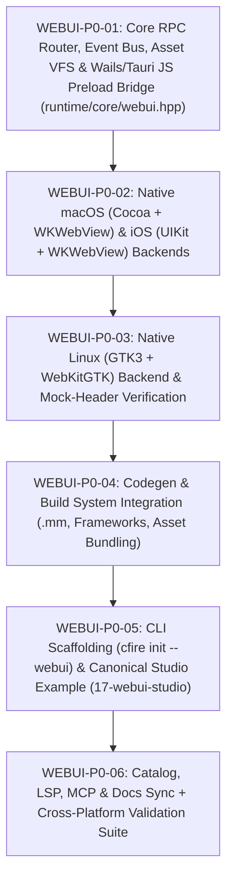
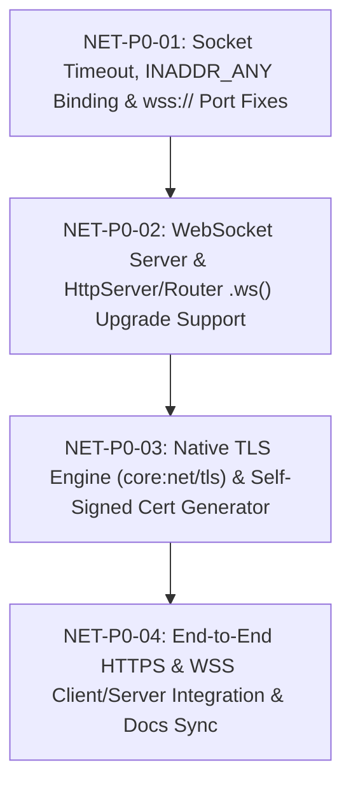
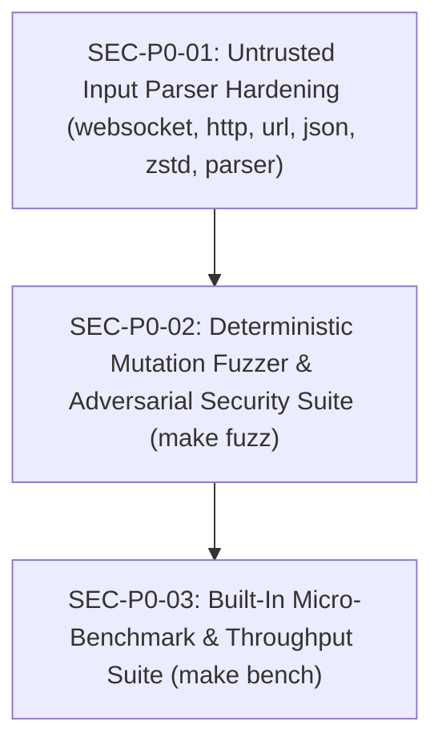

# Project Backlog

This backlog tracks prioritized improvements, features, and tooling upgrades for `cfire`.
When selecting an item for implementation, promote it to [`active.md`](./active.md) and complete the pre-implementation scoping gate before writing code.

---

# Active Backlog: Native WebView & Two-Way RPC Application Framework (`WEBUI-*`)

> **MANDATORY HANDOVER INSTRUCTIONS FOR THE IMPLEMENTING AGENT — READ BEFORE WRITING ANY CODE**
>
> 1. **Zero Core Language Changes & No `ext:wails` Alias**:
>    - Do **NOT** modify `src/lexer.hpp`, `src/parser.hpp`, `src/ast.hpp`, or core type-system rules in `src/sema.hpp`.
>    - The module import path is strictly **`import "ext:webui"`** (backed by `runtime/core/webui.hpp`). **Do NOT add an `ext:wails` or `runtime/core/wails.hpp` alias.**
>    - `ext:webui` is a **pure C++23 / Objective-C++ runtime library module** (`runtime/core/webui.hpp`) that relies on `cfire`'s existing generic method invocation (`app.bind[ReqStruct]("name") |req| { ... }`) and trailing closure syntax (`app.on("event") |payload| { ... }`), identical to how `ext:ai`'s `srv.register_tool[Args]` (`runtime/core/ai.hpp:3965`) works.
> 2. **Do Not Reinvent Ergonomics — Use Proven Wails v2/v3 & Tauri v2 (`wry`) Principles**:
>    - **Frontend JS API**: Expose the standard Wails runtime (`await window.backend.<method>(args)`, `window.runtime.EventsOn`, `window.runtime.EventsOnce`, `window.runtime.EventsOff`, `window.runtime.EventsEmit`, `window.runtime.WindowSetTitle`, `window.runtime.WindowSetSize`, `window.runtime.WindowFullscreen`, `window.runtime.WindowMinimise`, `window.runtime.Quit`, and CSS `--wails-draggable: drag` / `[data-webui-drag-region]`) **AND** Tauri's `await window.invoke("method", args)`. Do not require proprietary HTML attributes or a separate JS code-generation build step—use an ES6 `Proxy` on `window.backend` in the injected preload script.
>    - **Custom URI Scheme (`app://localhost/`)**: Serve all HTML/CSS/JS/assets via `WKURLSchemeHandler` (macOS & iOS) and `webkit_web_context_register_uri_scheme` (Linux) under `app://localhost/...` so the WebView runs in a secure context (`window.isSecureContext === true`) with zero open TCP ports.
>    - **Thread-Safe Main-Loop Dispatch**: All WebKit mutations (`evaluateJavaScript`, window title/size changes, `quit`) must be marshaled onto the main UI thread (`dispatch_async(dispatch_get_main_queue(), ...)` on macOS/iOS, `g_idle_add_full` on Linux).
> 3. **Preserve All Toolchain Invariants**:
>    - **Zero Warnings**: Every change must compile cleanly under `clang++ -std=c++2b -O2 -Wall -Wextra -Wpedantic -Wshadow -Wno-parentheses-equality -Iruntime -Isrc src/main.cpp`.
>    - **Zero Exceptions**: Never use `try`/`catch` or `std::stoi` in `src/` or `runtime/`. Use `cfire::detail::parse_int<T>` (`<charconv>`) and `std::expected<T, cfire::Error>`.
>    - **PCH & Objective-C++ Compatibility**: `cfire_prelude.pch` is compiled with `-x c++-header`. When `ext:webui` adds `-fobjc-arc` on macOS/iOS, `verify_cpp_syntax_only` and `build_native` in `src/buildsys.hpp` **must skip `-include-pch`** and compile as Objective-C++ (`-x objective-c++` / `.mm`), otherwise Clang will reject the C++ PCH!
>    - **LSP, MCP, Documentation & Formatting Sync**: Update `src/lsp/json_rpc.hpp`, `src/lsp/server.hpp`, `src/lsp/ide_setup.hpp`, `src/mcp.hpp`, `src/docgen/catalog.hpp`, `src/docgen/markdown.hpp`, and `docs/GUIDE.md`, then run `./cfire doc` and `./cfire fmt examples/` so `./cfire doc --check`, `./cfire fmt --check examples/`, and `make review-check` pass 100%.



---

### `WEBUI-P0-01`: Core RPC Router, Event Bus, Asset VFS & Wails/Tauri JS Preload Bridge `[Completed]`
- **Status**: Completed
- **Priority**: P0
- **Category**: Standard Library / Extension Runtime (`ext:webui`)
- **Target Files**:
  - `runtime/core/webui.hpp` (new)
  - `runtime/cfire_core_stdlib.hpp`
- **Problem Statement**:
  - `cfire` currently supports immediate-mode OpenGL/Canvas GUIs (`vendor:raylib`, `vendor:raygui`) and HTTP servers (`ext:net/http`), but lacks a Wails/Tauri-style hybrid application runtime where standard HTML5/CSS3/JS UIs interact with typed `cfire` functions, structs, and live events in-process.
- **Critical Details, Edge Cases & Pitfalls (Do Not Miss)**:
  - **Namespace Exposure (No `wails` Alias)**:
    - `runtime/core/webui.hpp` must define `namespace cfire::webui`, alias `namespace cfire::core { namespace webui = ::cfire::webui; }`, and alias `namespace webui = ::cfire::webui;` at global scope (matching `runtime/tako.hpp` and `runtime/core/audio.hpp`) so `.cf` files can call `webui.new_app(...)` with `import "ext:webui"`. Do not create a `wails.hpp` header or `ext:wails` package alias.
  - **Generic `app.bind[ReqStruct]` Return Type Deduction**:
    - In `cfire`, a closure passed to `app.bind[ReqStruct]("method") |req| { ... }` may return:
      1. `T` (a reflected struct, `std::string`, `int64_t`, `double`, `bool`, or `std::vector<U>`)
      2. `void` (no return statement)
      3. `std::expected<T, cfire::Error>` (when the closure uses `try` or has an explicit fallible return type `!T`)
      4. `std::expected<void, cfire::Error>`
    - Use `if constexpr` with `std::invoke_result_t<Fn&, const ReqStruct&>` to handle all 4 cases cleanly, serializing non-void results with `cfire::json::stringify(val)` and converting `std::unexpected` errors into JSON-RPC error responses.
  - **Dynamic `window.backend` ES6 Proxy (Zero JS Codegen Step)**:
    - In the injected JS preload script (`kPreloadBridgeJs`), define `window.backend = new Proxy({}, { get: (_, method) => (params) => window.invoke(String(method), params) })`. This allows frontend JS to call `await window.backend.set_track({ channel: 1, gain_db: -3.0 })` or `await window.invoke("set_track", { ... })` immediately without running a separate CLI binding generator.
- **Detailed Engineering Requirements**:
  1. **Asset VFS & MIME Table (`cfire::webui::App`)**:
     - Support `app.set_html(std::string_view html)` (registers `/index.html`), `app.embed_asset(std::string_view path, std::string_view content, std::string_view mime = "")`, and `app.serve_dir(std::string_view dir_path)`.
     - Normalize asset paths (`""` or `"/"` $\rightarrow$ `"/index.html"`).
     - Resolve relative `serve_dir` paths against: (a) current working directory, (b) `<executable_dir>/../Resources/ui` (macOS `.app` bundle), (c) `<executable_dir>/ui` (iOS `.app` bundle or portable dir), and (d) source directory if available.
     - Provide accurate MIME types for `.html`, `.css`, `.js`, `.mjs`, `.json`, `.svg`, `.png`, `.jpg`, `.jpeg`, `.webp`, `.gif`, `.ico`, `.woff2`, `.woff`, `.ttf`, `.otf`, `.wasm`, `.wav`, `.mp3`, `.ogg`.
     - Guard against path traversal (`..` segments rejected in `serve_dir` lookup).
  2. **JSON-RPC 2.0 & Event Dispatcher**:
     - Wire incoming IPC JSON messages of three shapes:
       - **RPC Call**: `{"id": 1, "method": "set_track", "params": {...}}` $\rightarrow$ invokes `rpc_handlers_[method](params_json)` and resolves via `window.__cfire_rpc_resolve(id, true, result)` or `window.__cfire_rpc_resolve(id, false, error_str)`.
       - **Frontend Event**: `{"event": "fader:move", "data": ...}` $\rightarrow$ invokes all callbacks registered via `app.on(event, fn)`.
       - **System Window Command**: `{"__sys": "quit" | "drag_window" | "set_title" | "set_size" | "fullscreen" | "minimize" | "maximize" | "center", ...}` $\rightarrow$ executes the native window operation.
  3. **Public `.cf`-Callable `webui::App` API**:
     - Constructors: `webui::new_app(title: str, width: i32 = 960, height: i32 = 640) -> App`
     - RPC & Events:
       - `app.bind[T](name: str) |req: T| -> R`
       - `app.bind_action(name: str) || -> R` (also accepting `|raw_json: str| -> R`)
       - `app.bind_raw(name: str) |raw_json: str| -> str`
       - `app.on(event: str) |payload: str| { ... }`
       - `app.emit(event: str, payload: any)` (serializes `payload` via `cfire::json::stringify` and pushes to `window.runtime.EventsOn` listeners)
       - `app.set_state(key: str, val: str)` and `app.get_state(key: str) -> str`
       - `app.eval(js: str)`
     - Window & Dialogs:
       - `app.set_title(title: str)`, `app.set_size(w: i32, h: i32)`, `app.set_min_size(w: i32, h: i32)`, `app.set_max_size(w: i32, h: i32)`
       - `app.set_frameless(frameless: bool)`, `app.set_transparent(transparent: bool)`, `app.set_dark_mode(dark: bool)`, `app.set_always_on_top(top: bool)`
       - `app.fullscreen()`, `app.minimize()`, `app.maximize()`, `app.center()`, `app.quit()`, `app.close()`
       - `app.open_file_dialog(title: str = "Open File") -> str`, `app.save_file_dialog(title: str = "Save File", default_name: str = "") -> str`, `app.message_dialog(title: str, message: str)`
     - Headless Test & Inspection Helpers (usable in `cfire test` without opening a window):
       - `app.call_rpc(method: str, params_json: str = "{}") -> !str`
       - `app.dispatch_event(event: str, data_json: str = "{}")`
       - `app.emitted_events_count(event: str) -> i64` and `app.last_emitted_payload(event: str) -> str`
- **Acceptance Criteria**:
  - In-memory headless tests can instantiate `webui.new_app(...)`, bind typed struct handlers (`app.bind[Req]`), action handlers (`app.bind_action`), and event listeners (`app.on`), invoke `try app.call_rpc(...)` and `app.dispatch_event(...)`, and verify emitted events and state mutations with zero OS window creation.

---

### `WEBUI-P0-02`: Native macOS (`Cocoa` + `WKWebView`) & iOS (`UIKit` + `WKWebView`) Backends `[Completed]`
- **Status**: Completed
- **Priority**: P0
- **Category**: Platform Native WebView Backends (macOS & iOS)
- **Target Files**:
  - `runtime/core/webui.hpp`
- **Problem Statement**:
  - On macOS and iOS, `webui::App::run()` must create a native OS window (`NSWindow` on macOS, `UIWindow` + `UIViewController` on iOS) hosting a hardware-accelerated `WKWebView` that loads `app://localhost/index.html` and bridges `window.webkit.messageHandlers` bidirectionally with `cfire`.
- **Critical Details, Edge Cases & Pitfalls (Do Not Miss)**:
  - **Guarding Objective-C++ Blocks with `#if defined(__APPLE__) && defined(__OBJC__)`**:
    - `runtime/cfire_core_stdlib.hpp` is included by pure C++ unit tests (`tests/unit/test_stdlib.cpp`) compiled *without* `-x objective-c++`.
    - Therefore, all Objective-C++ classes (`@interface`, `@implementation`, `Cocoa/Cocoa.h`, `UIKit/UIKit.h`, `WebKit/WebKit.h`) inside `runtime/core/webui.hpp` **must be guarded by `#if defined(__APPLE__) && defined(__OBJC__)`**! When `__OBJC__` is not defined (e.g., during `-fsyntax-only` C++ checks or headless C++ unit tests), `App::run()` cleanly executes in headless fallback mode so pure C++ compilation never sees `@interface` syntax.
  - **Custom `WKURLSchemeHandler` Lifecycle**:
    - In `webView:startURLSchemeTask:`, look up `urlSchemeTask.request.URL.path` in the `App`'s asset registry (`set_html`, `embed_asset`, `serve_dir`).
    - Construct an `NSHTTPURLResponse` with status `200` (or `404` if not found), headers `{"Content-Type": mime, "Access-Control-Allow-Origin": "*", "Cache-Control": "no-cache"}`, call `[urlSchemeTask didReceiveResponse:resp]`, `[urlSchemeTask didReceiveData:data]`, and `[urlSchemeTask didFinish]`.
    - Track stopped tasks in `webView:stopURLSchemeTask:` safely.
  - **Headless / Automated Live `WKWebView` Test Mode on macOS (`CFIRE_HEADLESS_TEST=1` & `run_webview_test`)**:
    - If `CFIRE_HEADLESS_TEST=1` is set in the environment, `app.run()` returns immediately (0ms) so CLI smoke tests (`make test-examples`) never hang waiting for user window closure.
    - Also provide `app.run_webview_test(timeout_ms: i32 = 3000) -> !bool` on macOS: creates an offscreen/hidden `NSWindow` + real `WKWebView`, pumps `CFRunLoopRunInMode(kCFRunLoopDefaultMode, 0.01, true)` until the frontend JS calls `window.runtime.Quit()` (or `timeout_ms` elapses), and cleans up the window. This enables automated E2E tests to verify real `WKWebView` JS execution, `window.backend.*` RPC promises, and `EventsOn`/`EventsEmit` in CI without popping up a visible window!
  - **iOS `UIApplicationMain` RunLoop Integration**:
    - On iOS (`PLATFORM_IOS`), store a static pointer to the active `cfire::webui::App` instance before calling `UIApplicationMain(0, nullptr, nil, NSStringFromClass([CfireWebUIAppDelegate class]))`, and inside `application:didFinishLaunchingWithOptions:`, create the `UIWindow`, `UIViewController`, and `WKWebView` (with `scrollView.contentInsetAdjustmentBehavior = UIScrollViewContentInsetAdjustmentNever` and `autoresizingMask = UIViewAutoresizingFlexibleWidth | UIViewAutoresizingFlexibleHeight`), then load `[NSURL URLWithString:@"app://localhost/index.html"]`.
- **Detailed Engineering Requirements**:
  1. Implement `CfireWebUISchemeHandler : NSObject <WKURLSchemeHandler>` and `CfireWebUIMessageHandler : NSObject <WKScriptMessageHandler>` shared between macOS and iOS (`#if defined(__APPLE__) && defined(__OBJC__)`).
  2. On macOS (`!defined(PLATFORM_IOS)`):
     - Implement `CfireWebUIWindowDelegate : NSObject <NSWindowDelegate>` handling `windowWillClose:` to stop `[NSApp stop:nil]`.
     - Support dark/light appearance (`NSAppearanceNameDarkAqua` / `NSAppearanceNameAqua`), frameless titlebar (`NSWindowStyleMaskFullSizeContentView`, `titlebarAppearsTransparent = YES`), window drag (`[window performWindowDragWithEvent:[NSApp currentEvent]]`), and native `NSOpenPanel` / `NSSavePanel` / `NSAlert` dialogs.
  3. On iOS (`defined(PLATFORM_IOS)`):
     - Implement `CfireWebUIAppDelegate : UIResponder <UIApplicationDelegate>` creating the full-screen `WKWebView` and loading `app://localhost/index.html`.
- **Acceptance Criteria**:
  - On macOS, a `.cf` test using `app.run_webview_test(3000)` boots a real `WKWebView`, loads `app://localhost/index.html`, executes `await window.backend.<method>(...)` and `window.runtime.EventsEmit(...)` in WebKit's JavaScriptCore engine, receives `app.emit(...)` via `window.runtime.EventsOn(...)`, and calls `window.runtime.Quit()` within <500ms.
  - On iOS Simulator (`--target ios-sim`), `clang++` compiles the `UIKit` + `WKWebView` Objective-C++ backend cleanly with zero warnings or errors.

---

### `WEBUI-P0-03`: Native Linux (`GTK3` + `WebKitGTK`) Backend & Mock-Header Verification `[Completed]`
- **Status**: Completed
- **Priority**: P0
- **Category**: Platform Native WebView Backend (Linux)
- **Target Files**:
  - `runtime/core/webui.hpp`
  - `tests/unit/test_stdlib.cpp`
- **Problem Statement**:
  - On Linux desktops, `webui::App::run()` must use native `GTK3` + `WebKitGTK` (`webkit2gtk-4.1` or `webkit2gtk-4.0`), using the exact same `app://localhost/` custom URI scheme and `window.webkit.messageHandlers.external.postMessage` IPC contract as macOS and iOS.
- **Critical Details, Edge Cases & Pitfalls (Do Not Miss)**:
  - **WebKitGTK 4.0 vs 4.1 API Compatibility**:
    - Use `webkit_web_context_register_uri_scheme(webkit_web_context_get_default(), "app", scheme_cb, this, nullptr)` to serve `app://localhost/...` via `g_memory_input_stream_new_from_data` and `webkit_uri_scheme_request_finish`.
    - Register the script message handler on `"external"` via `webkit_user_content_manager_register_script_message_handler(ucm, "external")` and connect `"script-message-received::external"`.
    - Extract the JS string payload using `jsc_value_to_string(webkit_javascript_result_get_js_value(js_result))` (compatible across both `webkit2gtk-4.0` and `webkit2gtk-4.1`!).
    - Use `g_idle_add_full` to marshal `app.eval(...)`, `app.emit(...)`, `app.set_title(...)`, and `gtk_main_quit()` safely onto the GTK main thread.
  - **Graceful Headless Fallback on Linux CI**:
    - If `CFIRE_HEADLESS_TEST=1` is set OR `gtk_init_check(nullptr, nullptr)` returns `FALSE` (e.g., in a headless Linux container without X11/Wayland), `app.run()` must cleanly fall back to headless no-op rather than aborting the process.
  - **Cross-Platform Compile Verification on macOS Host**:
    - Because developers often work on macOS while targeting Linux in CI, create a self-contained test in `tests/unit/test_stdlib.cpp` that verifies the Linux WebKitGTK code path using mock GTK/WebKitGTK C signatures (`CFIRE_TEST_LINUX_WEBKITGTK_BACKEND`) so any syntax or type error is caught immediately by `make test-unit` on macOS as well as Linux.
- **Detailed Engineering Requirements**:
  1. Implement the `#if (defined(__linux__) && __has_include(<webkit2/webkit2.h>)) || defined(CFIRE_TEST_LINUX_WEBKITGTK_BACKEND)` backend inside `runtime/core/webui.hpp`.
  2. Add a mock-header compile & callback dispatch test in `tests/unit/test_stdlib.cpp` exercising the Linux `app://` URI scheme callback, script-message-received callback, and `g_idle_add` main-thread dispatch logic.
- **Acceptance Criteria**:
  - The Linux `GTK3` + `WebKitGTK` backend compiles with zero warnings under `-std=c++2b -Wall -Wextra` and passes the URI scheme + IPC round-trip unit test in `tests/unit/test_stdlib.cpp`.

---

### `WEBUI-P0-04`: Codegen & Build System Integration (`.mm`, Frameworks, Asset Bundling) `[Completed]`
- **Status**: Completed
- **Priority**: P0
- **Category**: Compiler Codegen & Build System (`src/codegen.hpp`, `src/buildsys.hpp`)
- **Target Files**:
  - `src/codegen.hpp`
  - `src/buildsys.hpp`
  - `tests/unit/test_sema.cpp`
- **Problem Statement**:
  - When a `.cf` program imports `"ext:webui"`, `src/codegen.hpp` must ensure JSON struct reflection is emitted for all structs in the file, and `src/buildsys.hpp` must configure the right platform compiler/linker flags (`-fobjc-arc`, `-framework Cocoa -framework WebKit` on macOS, `-framework UIKit -framework WebKit` on iOS, `webkit2gtk-4.1` on Linux), handle Objective-C++ `.mm` compilation without PCH conflict, and bundle `./ui` assets into `.app` bundles.
- **Critical Details, Edge Cases & Pitfalls (Do Not Miss)**:
  - **Auto-Enabling `json` & Struct Reflection in `src/codegen.hpp`**:
    - In `Emitter::init_imports()` (`src/codegen.hpp:111-116`) and `Emitter::emit_file()` (`src/codegen.hpp:219-226`), add:
      ```cpp
      } else if (path == "core:webui") {
          used_core_.insert("webui");
          used_core_.insert("json");
      ```
      (and in `emit_file()`, also add `#define CFIRE_USE_SIMDJSON 1` and `-lsimdjson`, identical to `core:tako`).
    - Also in `src/codegen.hpp`, ensure `parse_struct<T>` and `stringify_struct<T>` are emitted for **every struct in the file** when `used_core_.contains("webui")` (even if the user wrote `type TrackMix struct { Channel: i32 }` without explicit `` `json:"..."` `` tags, defaulting each field's JSON key to `field.name`).
    - In `src/codegen.hpp:2994-3020` (`lower_raw_owning_type`), map `tr.name == "webui::App" || tr.name == "App"` (when `used_core_.contains("webui")`) to `"cfire::webui::App"`.
  - **Critical PCH vs Objective-C++ Fix in `src/buildsys.hpp`**:
    - Add `bool uses_objc{false};` to `struct BuildPlan` (`src/buildsys.hpp:330`).
    - When `imp.path == "core:webui" || imp.path == "ext:webui"` in `analyze_and_emit` (`src/buildsys.hpp:1892`):
      - Set `plan.is_gui = true;`
      - Call `add_pc("simdjson");`
      - On Apple targets (`#if defined(__APPLE__)` or `plan.is_ios`): set `plan.uses_objc = true;` and add `-fobjc-arc` to `plan.cflags`.
      - On macOS (`!plan.is_ios && !is_wasm`): append `{"-framework", "Cocoa", "-framework", "WebKit", "-lobjc"}` to `plan.ldflags`.
      - On iOS (`plan.is_ios`): append `{"-framework", "UIKit", "-framework", "WebKit", "-framework", "Foundation", "-framework", "CoreGraphics", "-lobjc"}` to `plan.ldflags`.
      - On Linux (`#if defined(__linux__)`): check `pkg-config --exists webkit2gtk-4.1` (else `webkit2gtk-4.0`) and `gtk+-3.0`, calling `add_pc(...)` when present.
    - In `verify_cpp_syntax_only` (`src/buildsys.hpp:2456`):
      - Change `if (plan.target_triple.empty())` to `if (plan.target_triple.empty() && !plan.uses_objc)` so the C++-only PCH is NOT passed when `-fobjc-arc` is in `plan.cflags`!
      - When `plan.uses_objc` is true, pass `-x objective-c++` before the `.cpp` path in `verify_cpp_syntax_only`.
    - In `build_native` (`src/buildsys.hpp:2689` and `2702`):
      - Change `(plan.is_ios && plan.is_gui ? ".mm" : ".cpp")` to `((plan.uses_objc || (plan.is_ios && plan.is_gui)) ? ".mm" : ".cpp")`.
      - Change `if (plan.target_triple.empty())` for `ensure_prelude_pch` to `if (plan.target_triple.empty() && !plan.uses_objc)`!
  - **Bundling `./ui` Directory into `.app` Bundles (`src/buildsys.hpp:2770` & `2840`)**:
    - In `build_native`, when creating `plan.macos_app_bundle` (`Contents/Resources/ui`) or `plan.ios_app_bundle` (`<App>.app/ui`), check if `cf_file.parent_path() / "ui"` exists and is a directory; if so, copy it recursively (`std::filesystem::copy_options::recursive | overwrite_existing`) into the bundle!
  - **FD Leak Canary Exemption for Live `WKWebView` Tests (`src/codegen.hpp`)**:
    - In `src/codegen.hpp` where `stmts_reference_ident(td.body, "InitWindow")` skips the per-test FD leak canary, also check `!stmts_reference_ident(td.body, "run_webview_test") && !stmts_reference_ident(td.body, "InitWindow")` because initializing macOS `WKWebView` spawns WebKit XPC/Mach file descriptors that live for the process lifetime.
- **Acceptance Criteria**:
  - `cfire check`, `cfire test`, `cfire build`, and `cfire build --target ios-sim` succeed with 0 warnings on `.cf` files importing `ext:webui`.
  - Structs both with and without explicit `` `json:"..."` `` tags round-trip automatically through `app.bind[MyStruct]("...")`.

---

### `WEBUI-P0-05`: CLI Scaffolding (`cfire init --webui`) & Canonical Studio Example (`examples/17-webui-studio/`) `[Completed]`
- **Status**: Completed
- **Priority**: P0
- **Category**: CLI Scaffolding & Canonical Examples (`src/main.cpp`, `examples/17-webui-studio/`)
- **Target Files**:
  - `src/main.cpp`
  - `examples/17-webui-studio/main.cf` (new)
  - `examples/17-webui-studio/ui/index.html` (new)
  - `Makefile`
  - `tests/e2e/test_canonical.cpp`
- **Detailed Engineering Requirements**:
  1. **Update `cfire init` / `cfire new` (`src/main.cpp:34-35`, `390-418`, `102-205`)**:
     - Support `--template webui` and `--webui` (update `print_usage()` to show `[--template cli|tako|gui|webui]`).
     - Generate `build.cf` (`targets: ["native", "ios-sim"]`, `subsystem: "gui"`), `main.cf` (importing `"ext:webui"`, binding a typed struct RPC handler + action + event listener, loading `./ui`), `ui/index.html` (modern dark-mode responsive UI calling `window.backend.*` and `window.runtime.EventsOn`), and `main_test.cf` (testing the bound RPC handler via `app.call_rpc`).
  2. **Create `examples/17-webui-studio/main.cf` & `examples/17-webui-studio/ui/index.html`**:
     - Build an interactive "Pocket Mastering & Telemetry Studio" showcasing:
       - Multi-channel audio fader tracks (`<input type="range">`), channel mute/solo buttons, master limiter toggle, and preset selector.
       - Typed `cfire` structs (`TrackMixReq`, `TrackStatusRes`, `PresetConfig`) bound via `app.bind[T]`.
       - Real-time event streaming (`window.runtime.EventsEmit("fader:input", ...)` and `app.emit("meter:peak", ...)`).
       - Built-in `///` doc-test, unit `test "..."` blocks (including a live `WKWebView` round-trip test on macOS via `app.run_webview_test`), `fuzz "..."` block fuzzing the RPC handlers, and `bench "..."` block benchmarking RPC dispatch throughput.
  3. **Wire into `Makefile` & `tests/e2e/test_canonical.cpp`**:
     - Add `examples/17-webui-studio/main.cf` to `Makefile` (`test-examples` with `CFIRE_HEADLESS_TEST=1`) and `tests/e2e/test_canonical.cpp`.
- **Acceptance Criteria**:
  - `./cfire new --webui /tmp/test_webui_proj --force && ./cfire test /tmp/test_webui_proj && ./cfire check /tmp/test_webui_proj` succeeds 100%.
  - `./cfire test examples/17-webui-studio/main.cf` passes all unit, doc-test, live `WKWebView`, and fuzz tests.

---

### `WEBUI-P0-06`: Stdlib Catalog, LSP, MCP & Docs Sync + Cross-Platform Validation Suite `[Completed]`
- **Status**: Completed
- **Priority**: P0
- **Category**: Documentation, LSP, MCP & Verification (`src/docgen/catalog.hpp`, `src/docgen/markdown.hpp`, `src/lsp/json_rpc.hpp`, `src/lsp/server.hpp`, `src/lsp/ide_setup.hpp`, `src/mcp.hpp`, `docs/GUIDE.md`)
- **Target Files**:
  - `src/docgen/catalog.hpp`
  - `src/docgen/markdown.hpp`
  - `src/lsp/json_rpc.hpp`
  - `src/lsp/server.hpp`
  - `src/lsp/ide_setup.hpp`
  - `src/mcp.hpp`
  - `docs/GUIDE.md`
  - `tests/unit/test_lsp.cpp`
- **Critical Details, Edge Cases & Pitfalls (Do Not Miss)**:
  - **Strict Alphabetical Ordering & Audit Rules in `src/docgen/catalog.hpp`**:
    - `audit_documentation_catalog()` (`src/docgen/catalog.hpp:1440-1514`) enforces 4 strict checks during `./cfire doc --check`:
      1. `stdlib_catalog()` **must be sorted strictly alphabetically by `import_path`**. Therefore, `"ext:webui"` **must be inserted right after `"ext:net/websocket"` and before `"vendor:raygui"`**!
      2. `discover_runtime_modules()` (`src/docgen/catalog.hpp:1401`) **must** map `else if (rel == "webui.hpp") discovered.push_back({"ext:webui", "core/" + rel, false});`.
      3. Every function in `ext:webui` must have non-empty `name`, `cf_sig`, `cpp_lowering`, `summary`, and `example`.
      4. `detail::module_practical_example(mod)` (`src/docgen/catalog.hpp:1260+`) **must** return a complete, syntactically valid `.cf` program for `mod == "ext:webui"` (it is lexed and parsed by `audit_documentation_catalog()`!).
  - **LSP Closure Parameter Inference & Handle Method Autocomplete (`src/lsp/json_rpc.hpp`, `src/lsp/server.hpp`)**:
    - In `src/docgen/catalog.hpp`, name `App` handle methods `"App.bind"`, `"App.bind_action"`, `"App.bind_raw"`, `"App.on"`, `"App.emit"`, `"App.set_state"`, `"App.get_state"`, `"App.set_html"`, `"App.serve_dir"`, `"App.embed_asset"`, `"App.eval"`, `"App.set_title"`, `"App.set_size"`, `"App.set_min_size"`, `"App.set_max_size"`, `"App.set_dark_mode"`, `"App.set_frameless"`, `"App.set_transparent"`, `"App.open_file_dialog"`, `"App.save_file_dialog"`, `"App.message_dialog"`, `"App.call_rpc"`, `"App.dispatch_event"`, `"App.run"`, `"App.run_webview_test"`, and `"App.close"`, and give `new_app` return type `-> App`.
    - In `src/lsp/json_rpc.hpp` (`infer_expr_cf_type`, around line 629), map `ret == "App"` on `webui.new_app` to `"webui.App"`.
    - In `src/lsp/json_rpc.hpp` (`collect_stmt_bindings`, around line 1089), handle `ExprStmt` containing a `CallExpr` with `call->block_arg`:
      - When a method call has generic type arguments (e.g. `app.bind[TrackMix]("set_track") |req| { ... }` or `srv.register_tool[CalculateArgs]("calc", "...") |args| { ... }`) and `call->block_arg->params` has 1 untyped parameter, bind that parameter in `env` to `cfire::fmt::format_type_ref(call->type_args[0])` (`TrackMix`), and when `.on(...)` or `.bind_raw(...)` has 1 untyped parameter, bind it to `"str"`, then recursively call `collect_stmt_bindings(call->block_arg->body, ...)`.
      - This gives developers automatic LSP field completions (`req.`), hover types, and inlay hints inside `app.bind[T]("...") |req| { ... }` and `app.on("...") |payload| { ... }`!
- **Detailed Engineering Requirements**:
  1. **Stdlib Catalog (`src/docgen/catalog.hpp`) & Markdown Generator (`src/docgen/markdown.hpp`)**:
     - Register `"ext:webui"` (`ns_alias: "webui"`) in `stdlib_catalog()`, `discover_runtime_modules()`, and `detail::module_practical_example()`.
     - Update `src/docgen/markdown.hpp` (around line 1397) to list `import "ext:webui"` among the canonical Domain Extensions.
  2. **LSP Server (`src/lsp/json_rpc.hpp`, `src/lsp/server.hpp`, `src/lsp/ide_setup.hpp`, `tests/unit/test_lsp.cpp`)**:
     - Add `webui.App` return type inference and generic trailing-closure parameter binding (`app.bind[T]("...") |req|`) in `src/lsp/json_rpc.hpp`.
     - Update agent/IDE rules in `src/lsp/ide_setup.hpp` to document `import "ext:webui"` and `cfire init --webui`.
     - Add an LSP unit test in `tests/unit/test_lsp.cpp` verifying completions on `webui.`, handle completions on `app.`, and struct field completions on `req.` inside `app.bind[TrackMix]("...") |req| { req. }`.
  3. **MCP Server (`src/mcp.hpp`)**:
     - Update tool descriptions, stdlib lookup examples, and eval prelude imports in `src/mcp.hpp` to include `ext:webui` and `cfire init --webui`.
  4. **User Guide (`docs/GUIDE.md`) & Generated Docs (`docs/*`)**:
     - Add a comprehensive section to `docs/GUIDE.md` covering `ext:webui` (typed `app.bind[T]`, `app.bind_action`, `app.on`, `app.emit`, `window.backend.*`, `window.invoke`, `window.runtime.*`, `app://localhost/` asset serving, macOS/iOS/Linux builds, and headless testing in `cfire test`).
     - Run `./cfire doc` and `./cfire fmt examples/`.
- **Acceptance Criteria**:
  - `./cfire doc --check` and `./cfire fmt --check examples/` pass with zero diffs.
  - LSP unit tests in `tests/unit/test_lsp.cpp` verify `webui.`, `app.`, and `|req|` completions and hover.
  - `make review-check` passes 100% with zero compiler warnings.

---

# Active Backlog: Memory Safety, Use-After-Free & Bounds Verification (`SAFE-*`)

- `SAFE-P0-01` `[Completed]`: **Compile-Time Loan/Origin Use-After-Free (`cfire/USE-AFTER-FREE`), Escape (`cfire/DANGLING-POINTER`, `cfire/DANGLING-RETURN`), and Loop Iterator Invalidation (`cfire/ITERATOR-INVALIDATION`)** (`src/sema.hpp`)
- `SAFE-P0-02` `[Completed]`: **Zero-Overhead Flow-Sensitive Null-Pointer Verification (`cfire/NULL-DEREF`) & Constant Index Bounds Check (`cfire/INDEX-OUT-OF-BOUNDS`)** (`src/sema.hpp`)
- `SAFE-P0-03` `[Completed]`: **Inline Dynamic Bounds-Checked Indexing (`cfire::index_at`) & Conformance Suite** (`runtime/cfire_prelude.hpp`, `src/codegen.hpp`, `tests/unit/test_sema.cpp`)

---

# Active Backlog: WebSocket Server, Router Upgrade & Native TLS (`https://` / `wss://`) (`NET-*`)

> **MANDATORY INSTRUCTIONS FOR THE IMPLEMENTING AGENT — READ BEFORE WRITING ANY CODE**
>
> 1. **Do Not Skip Edge Cases or Make Silent Assumptions**: Every item below contains a **"Critical Details, Edge Cases & Pitfalls (Do Not Miss)"** checklist. Review every edge case before writing code.
> 2. **Preserve All Existing Invariants**:
>    - **Zero Warnings**: Every change must compile cleanly under `clang++ -std=c++2b -O2 -Wall -Wextra -Wpedantic -Wshadow -Wno-parentheses-equality -Iruntime -Isrc src/main.cpp`.
>    - **Zero Exceptions**: Do not introduce `try`/`catch` or `std::stoi` in `src/` or `runtime/`. Use `cfire::detail::parse_int<T>` (`<charconv>`) and `std::expected<T, E>`.
>    - **Zero External Compiler Flag Requirement for Standard Builds**: `Makefile` and `cfire check` compile against `runtime/cfire_core_stdlib.hpp` using `clang++ -std=c++2b -O2 -Iruntime -Isrc` without requiring external `-I` or `-L` flags on the command line. Native TLS support in `runtime/core/net/tls.hpp` must use dynamic symbol loading (`<dlfcn.h>` `dlopen`/`dlsym` for `libssl` & `libcrypto`) so that both standalone C++ test binaries and `.cf` binaries work out of the box without breaking Precompiled Header (PCH) caching.
>    - **Documentation & Formatting Sync**: Any change to `src/docgen/*`, `docs/GUIDE.md`, `src/formatter.hpp`, or `examples/*` must pass `./cfire doc --check` and `./cfire fmt --check examples/`.



---

### `NET-P0-01`: Socket Timeout, `INADDR_ANY` Binding & `wss://` URL Port Fixes `[Completed]`
- **Status**: Completed
- **Priority**: P0
- **Category**: Networking Runtime (`core:net`, `core:net/url`, `core:net/websocket`)
- **Target Files**:
  - `runtime/core/net/tcp.hpp`
  - `runtime/core/net/url.hpp`
  - `runtime/core/net/websocket.hpp`
- **Problem Statement**:
  1. `TcpConn::TcpConn` (`runtime/core/net/tcp.hpp:51-52`) sets a hardcoded 2-second `SO_RCVTIMEO` on the socket file descriptor. When `websocket::upgrade` or `websocket::connect` takes ownership of the socket via `tcp.release_fd()`, that 2-second timeout stays on the file descriptor. Any WebSocket connection that goes >2 seconds without receiving a frame fails `::recv()` with `EAGAIN`/`EWOULDBLOCK` and disconnects (`"websocket connection closed by peer"`).
  2. `net::listen_tcp` (`runtime/core/net/tcp.hpp:155`) binds exclusively to `INADDR_LOOPBACK` (`127.0.0.1`) rather than `INADDR_ANY` (`0.0.0.0`), preventing connections from LAN peers or container bridge networks.
  3. `url::parse` (`runtime/core/net/url.hpp:87-91`) only checks `u.scheme == "https"` when assigning default port `443`, leaving `wss://host/path` with port `80` instead of `443`.
- **Critical Details, Edge Cases & Pitfalls (Do Not Miss)**:
  - **Keep `HttpServer::stop()` Responsive**: `HttpServer::listen_and_serve` relies on `listener_.accept()` returning periodically so the loop can check `running_.load()`. Keep a bounded default poll timeout (e.g., `2000ms`) or configurable `accept(int timeout_ms = 2000)` on `TcpListener` while ensuring `HttpServer::listen_and_serve` continues looping while `running_` is true.
  - **Clear `SO_RCVTIMEO` on `websocket::Conn` Upgrade/Connect (and Provide `set_read_timeout`)**: When `websocket::Conn` takes ownership of an `fd_`, reset `SO_RCVTIMEO` to `{0, 0}` (blocking until frame arrives or peer closes) by default, and expose `ws.set_timeout_ms(i32)` so callers can opt into a custom read timeout when desired.
- **Detailed Engineering Requirements**:
  1. In `runtime/core/net/url.hpp`, treat both `"https"` and `"wss"` as default port `443` when no explicit `:port` is present in the URL.
  2. In `runtime/core/net/tcp.hpp`, bind `listen_tcp` to `INADDR_ANY` (`0.0.0.0`) by default and add `listen_tcp_addr(host, port)` for explicit interface binding.
  3. Add `TcpConn::set_timeout_ms(int ms)` and clear `SO_RCVTIMEO` (`{0, 0}`) in `websocket::Conn` constructor (with `websocket::Conn::set_timeout_ms(int ms)`).
- **Acceptance Criteria**:
  - `url.parse("wss://echo.example.com/chat")` sets `scheme == "wss"` and `port == 443`.
  - A WebSocket connection can remain idle for >2 seconds (or use custom timeout) without spurious disconnect.

---

### `NET-P0-02`: First-Class WebSocket Server & `http::Router` `.ws()` Route Upgrade `[Completed]`
- **Status**: Completed
- **Priority**: P0
- **Category**: WebSocket Server / HTTP Router (`core:net/http`, `core:net/websocket`)
- **Target Files**:
  - `runtime/core/net/http.hpp`
  - `runtime/core/net/websocket.hpp`
  - `src/codegen.hpp`
- **Problem Statement**:
  1. `http::Router` (`runtime/core/net/http.hpp:411-577`) only supports standard HTTP routes (`Response(const Request&)`) and `http::HttpServer` always writes `Response::to_http_wire()` with `Connection: close`. Users cannot register a WebSocket endpoint on an HTTP router (e.g., `router.ws("/ws/:room", |req, mut ws| { ... })`).
  2. `core:net/websocket` lacks a dedicated `websocket::Server` (`websocket.make_server(port)`) convenience class mirroring `http::HttpServer`.
- **Critical Details, Edge Cases & Pitfalls (Do Not Miss)**:
  - **Use `websocket::upgrade(req, conn)` Directly on the Accepted `TcpConn`**: In `HttpServer::serve_once` and `HttpServer::listen_and_serve`, before dispatching as a normal HTTP response that closes the socket, check if the router matches a registered WebSocket route (`.ws(pattern, handler)`). If it matches, run any router middlewares; if no middleware short-circuits, perform `cfire::websocket::upgrade(req, conn)` (which writes `HTTP/1.1 101 Switching Protocols` and transfers the socket + TLS stream into `websocket::Conn`) and invoke the WebSocket handler `ws_handler(req, ws)`.
  - **Header Order Dependency**: Currently `websocket.hpp` includes `http.hpp`. For `http.hpp` (`Router` and `HttpServer`) to reference `websocket::Conn` and `websocket::upgrade`, either move the core `websocket::Conn` / `websocket::upgrade` definitions before `Router`/`HttpServer` or include `websocket.hpp` cleanly so both `import "core:net/http"` and `import "core:net/websocket"` have full access to `Router::ws` and `websocket::Server`.
  - **Trailing Closure / Lambda Parameter Lowering in `src/codegen.hpp`**: When a `.cf` program writes `router.ws("/ws", |req, mut ws| { ... })` or `srv.serve_in_background(|mut ws| { ... })`, C++ lambda parameter emission in `src/codegen.hpp` emits `auto&& param`. Because `mut ws` is bound to an lvalue reference (`websocket::Conn&`), `auto&& ws` deduces to `websocket::Conn&` which allows calling non-const methods (`ws.recv_text()`, `ws.send_text(...)`) seamlessly! Verify this works in `.cf` codegen.
- **Detailed Engineering Requirements**:
  1. Add `using WsHandler = std::function<void(const Request&, cfire::websocket::Conn&)>;` and `.ws(std::string_view pattern, WsHandler handler)` to `cfire::http::Router`.
  2. Update `HttpServer::serve_once` and `HttpServer::listen_and_serve` so requests matching a `.ws` route upgrade the `TcpConn` to a server-side `websocket::Conn` and invoke the `WsHandler`. Also support passing a `Router` directly to `HttpServer::serve_once(router)`, `listen_and_serve(router)`, and `serve_in_background(router)`.
  3. Add `cfire::websocket::Server` and `cfire::websocket::make_server(port)` in `runtime/core/net/websocket.hpp` supporting `.port()`, `.serve_once(handler)`, `.listen_and_serve(handler)`, `.serve_in_background(handler)`, and `.stop()`.
- **Acceptance Criteria**:
  - A `.cf` program can register both `router.get("/health", ...)` and `router.ws("/chat/:room", |req, mut ws| ...)` on the same `HttpServer`, serve HTTP `GET /health` AND connect via `websocket.connect("ws://127.0.0.1:<port>/chat/general")`, exchange bidirectional text and binary messages, and read `req.param("room") == "general"`.
  - A standalone `websocket.make_server(0)` accepts `websocket.connect("ws://127.0.0.1:<port>/")` clients and exchanges frames cleanly.

---

### `NET-P0-03`: Native TLS / SSL Engine (`core:net/tls`) with Dynamic OpenSSL Bridge & Self-Signed Cert Generator `[Completed]`
- **Status**: Completed
- **Priority**: P0
- **Category**: Cryptography & Transport Security (`core:net/tls`, `core:net`)
- **Target Files**:
  - `runtime/core/net/tls.hpp` (new)
  - `runtime/core/net/tcp.hpp`
  - `runtime/core/net.hpp`
- **Problem Statement**:
  - `TcpConn` and `websocket::Conn` perform raw `::send` and `::recv` syscalls with no TLS encryption, SNI hostname extension, X.509 certificate verification, or server-side TLS certificate loading.
- **Critical Details, Edge Cases & Pitfalls (Do Not Miss)**:
  - **Zero-Flag Compilation via `<dlfcn.h>` (`dlopen` / `dlsym`)**:
    `Makefile` compiles `tests/unit/test_stdlib.cpp` with `clang++ -std=c++2b -O2 -Iruntime -Isrc` (no `-I/opt/homebrew/...` or `-lssl -lcrypto`), and `cfire` uses a precompiled header (`cfire_prelude_opt.pch`). Therefore, `runtime/core/net/tls.hpp` **must not** require `<openssl/ssl.h>` at compile time or `-lssl` at link time! Instead, load `libssl` and `libcrypto` dynamically via `dlopen` (searching `/opt/homebrew/opt/openssl@3/lib/`, `/opt/homebrew/lib/`, `/usr/local/opt/openssl/lib/`, and standard `libssl.3.dylib` / `libssl.dylib` / `libssl.so.3` / `libssl.so`), and resolve the minimal C ABI function pointers (`OPENSSL_init_ssl`, `TLS_client_method`, `TLS_server_method`, `SSL_CTX_new`, `SSL_CTX_free`, `SSL_CTX_set_verify`, `SSL_CTX_set_default_verify_paths`, `SSL_CTX_load_verify_locations`, `SSL_CTX_use_certificate_file`, `SSL_CTX_use_PrivateKey_file`, `BIO_new_mem_buf`, `BIO_free`, `PEM_read_bio_X509`, `PEM_read_bio_PrivateKey`, `SSL_CTX_use_certificate`, `SSL_CTX_use_PrivateKey`, `X509_free`, `EVP_PKEY_free`, `SSL_new`, `SSL_free`, `SSL_set_fd`, `SSL_ctrl`, `SSL_connect`, `SSL_accept`, `SSL_read`, `SSL_write`, `SSL_shutdown`, `SSL_get_verify_result`, `ERR_get_error`, `ERR_error_string_n`).
  - **Transport Hook on `TcpConn` and `websocket::Conn`**:
    Add a `std::shared_ptr<cfire::net::TlsStream>` member to both `TcpConn` and `websocket::Conn`. When non-null, `TcpConn::write`, `TcpConn::read_str`, and `websocket::Conn` (`send_text`, `send_binary`, `ping`, `recv_frame`, `close`) route all reads and writes through `TlsStream::read_fn` (`SSL_read`) and `TlsStream::write_fn` (`SSL_write`). When `websocket::upgrade` or `websocket::connect` transitions a `TcpConn` into a `websocket::Conn`, transfer both `fd_` and `tls_` (`tcp.release_tls()`)!
  - **System CA Bundle Auto-Discovery on macOS & Linux**:
    When `verify_peer` is `true`, in addition to `SSL_CTX_set_default_verify_paths`, check standard CA bundle locations (`/etc/ssl/cert.pem` on macOS, `/opt/homebrew/etc/openssl@3/cert.pem`, `/etc/ssl/certs/ca-certificates.crt` on Debian/Ubuntu, `/etc/pki/tls/certs/ca-bundle.crt` on RHEL/Fedora) and load the first existing bundle via `SSL_CTX_load_verify_locations` so certificate verification against real public servers works reliably even when Homebrew OpenSSL's default `OPENSSLDIR` is unconfigured.
- **Detailed Engineering Requirements**:
  1. Create `runtime/core/net/tls.hpp` with `cfire::tls`:
     - `tls::available() -> bool`
     - `tls::CertKeyPair { std::string cert_pem; std::string key_pem; }`
     - `tls::generate_self_signed_pem(std::string_view common_name = "localhost") -> std::expected<CertKeyPair, cfire::Error>`
     - `tls::wrap_client(cfire::net::TcpConn& conn, std::string_view hostname, bool verify_peer = true, std::string_view ca_file = "") -> std::expected<void, cfire::Error>`
     - `tls::ServerContext` wrapping a server `SSL_CTX*` loaded from PEM files (`from_files(cert_path, key_path)`) or PEM strings in memory (`from_pem(cert_pem, key_pem)`), plus `wrap_server(cfire::net::TcpConn& conn) -> std::expected<void, cfire::Error>`.
     - `tls::connect(host, port, verify_peer = true) -> std::expected<cfire::net::TcpConn, cfire::Error>`
  2. Wire `TlsStream` into `TcpConn` (`runtime/core/net/tcp.hpp`) and `websocket::Conn` (`runtime/core/net/websocket.hpp`).
- **Acceptance Criteria**:
  - `tls::available()` returns `true` on the host machine.
  - `tls::generate_self_signed_pem("localhost")` generates a valid X.509 PEM certificate and private key in memory.
  - A server `TcpListener` using `tls::ServerContext::from_pem` and a client `TcpConn` using `tls::wrap_client` complete a real TLS 1.3 handshake over loopback and exchange encrypted data.

---

### `NET-P0-04`: End-to-End `https://` & `wss://` Client/Server Integration & Catalog Sync `[Completed]`
- **Status**: Completed
- **Priority**: P0
- **Category**: HTTP/WebSocket TLS Integration & Documentation (`core:net/http`, `core:net/websocket`, `src/docgen/catalog.hpp`)
- **Target Files**:
  - `runtime/core/net/http.hpp`
  - `runtime/core/net/websocket.hpp`
  - `src/codegen.hpp`
  - `src/docgen/catalog.hpp`
  - `tests/unit/test_stdlib.cpp`
- **Problem Statement**:
  1. `http::request` (`http.get`, `http.post`) and `websocket::connect` do not invoke TLS when given `https://` or `wss://` URLs.
  2. `http::HttpServer` and `websocket::Server` cannot be configured with TLS certificates to serve `https://` and `wss://` directly.
- **Detailed Engineering Requirements**:
  1. In `http::request` (`runtime/core/net/http.hpp`):
     - When `u->scheme == "https"`, call `cfire::tls::wrap_client(conn, u->host, verify_peer, ca_file)` before sending the HTTP request.
     - Support `verify_peer` control via `http::get(url, headers, verify_peer = true)` / `http::post(url, body, content_type, headers, verify_peer = true)` or header `"x-cfire-tls-verify": "false"`.
  2. In `http::HttpServer`:
     - Add `.enable_tls_files(cert_path, key_path) -> std::expected<void, cfire::Error>` and `.enable_tls_pem(cert_pem, key_pem) -> std::expected<void, cfire::Error>`, plus factory functions `http::make_tls_server(port, cert_path, key_path)` and `http::make_tls_server_pem(port, cert_pem, key_pem)`.
     - When TLS is enabled on `HttpServer`, `serve_once` and `listen_and_serve` automatically perform `tls_ctx_->wrap_server(conn)` on every accepted connection before reading the HTTP request or upgrading to a `wss://` WebSocket!
  3. In `websocket::connect` (`runtime/core/net/websocket.hpp`):
     - Add `bool verify_peer = true` parameter (`websocket::connect(url_str, verify_peer = true)` and `websocket::connect_insecure(url_str)`).
     - When `u->scheme == "wss"`, call `cfire::tls::wrap_client(tcp, u->host, verify_peer)` before sending the HTTP `101` upgrade handshake, and pass `tcp.release_tls()` into the returned `websocket::Conn`.
     - Add `.enable_tls_files` / `.enable_tls_pem` and `websocket::make_tls_server` / `websocket::make_tls_server_pem` to `websocket::Server`.
  4. Register `core:net/tls` (and updated `core:net/http` / `core:net/websocket` signatures) in `src/codegen.hpp` and `src/docgen/catalog.hpp`, regenerate `docs/` with `./cfire doc`, and add comprehensive unit and `.cf` end-to-end tests in `tests/unit/test_stdlib.cpp`.
- **Acceptance Criteria**:
  - End-to-end `https://` test: `http.make_tls_server_pem(0, cert.cert_pem, cert.key_pem)` serves a `Router` with both `GET /secure` and `.ws("/wss-echo", ...)`, and a `.cf` client successfully executes `http.get("https://127.0.0.1:<port>/secure", ...)` AND `websocket.connect("wss://127.0.0.1:<port>/wss-echo", false)` over real TLS 1.3!
  - `make review-check` passes 100% (0 warnings, 0 formatting diffs, 0 doc discrepancies, 100% conformance tests pass).

---

# Active Backlog: Security Hardening, Fuzzing & Performance Benchmarks (`SEC-*`)



---

### `SEC-P0-01`: Untrusted Input Parser Hardening (`websocket`, `http`, `url`, `json`, `zstd`, `parser`) `[Completed]`
- **Status**: Completed
- **Priority**: P0
- **Category**: Runtime & Compiler Security Hardening
- **Target Files**:
  - `runtime/core/net/websocket.hpp`
  - `runtime/core/net/http.hpp`
  - `runtime/core/net/url.hpp`
  - `runtime/core/json.hpp`
  - `runtime/core/compress.hpp`
  - `src/parser.hpp`
- **Problem Statement**:
  1. `websocket::decode_frame` trusts 64-bit wire lengths (`len == 127`) and calls `f.payload.resize(len)` before reading payload bytes or checking a max frame bound, allowing a 10-byte packet to trigger an OOM crash (`std::bad_alloc`).
  2. `http::Response::to_http_wire`, `http::Response::redirect`, and `http::request` do not sanitize `\r`/`\n` in header keys/values, status text, or target paths (HTTP Response Splitting / CRLF Header Injection), and `http::parse_request` / `http::parse_response` / `url::parse` do not cap header or query parameter counts.
  3. `url::decode` does not verify `std::isxdigit` on `%XX` sequences.
  4. `json::DynamicJsonParser` and `frontend::Parser` lack recursion depth limits on nested arrays/objects/expressions/blocks, allowing 64KB of `[[[[...` or `((((...` to overflow the call stack (`SIGSEGV`).
  5. `zstd::decompress` trusts `ZSTD_getFrameContentSize` without a maximum output size limit (decompression bomb).
- **Detailed Engineering Requirements**:
  1. **WebSocket Frame Size Limit & Chunked Read (`websocket.hpp`)**:
     - Add `static constexpr std::size_t kDefaultMaxFrameSize = 16 * 1024 * 1024;` (16 MiB) to `decode_frame` and `max_frame_size_` (with `ws.set_max_frame_size(bytes)`) to `websocket::Conn`.
     - Reject any frame where `len > max_frame_size` before allocating memory. Read large payloads in bounded chunks (e.g., 64 KiB) rather than resizing multi-megabyte buffers upfront.
  2. **HTTP CRLF Sanitization & Header/Query Caps (`http.hpp`, `url.hpp`)**:
     - Strip `\r` and `\n` in `Response::set_header`, `Response::to_http_wire`, `Response::redirect`, and `http::request` wire serialization.
     - Cap HTTP headers at `kMaxHttpHeaders = 128` and URL query parameters at `kMaxQueryParams = 256`.
     - In `url::decode`, require both characters after `%` to satisfy `std::isxdigit`; otherwise preserve the literal `%` character.
  3. **Recursion Depth Guards (`json.hpp`, `src/parser.hpp`)**:
     - In `DynamicJsonParser` (`runtime/core/json.hpp`), enforce `kMaxJsonDepth = 128` across `parse_val` / `parse_obj` / `parse_arr`, returning a clean `cfire::Error("maximum JSON nesting depth exceeded")` when exceeded.
     - In `frontend::Parser` (`src/parser.hpp`), enforce `kMaxParseDepth = 256` across `parse_expr`, `parse_stmt`, `parse_block`, and `parse_type_ref`.
  4. **Zstandard Decompression Bomb Limit (`compress.hpp`)**:
     - Add `std::size_t max_output_bytes = 64 * 1024 * 1024` (64 MiB default) to `zstd::decompress` and reject frames exceeding `max_output_bytes`.
- **Acceptance Criteria**:
  - Crafting a 10-byte WebSocket header with `len = 0x7FFFFFFFFFFFFFFF` returns `std::nullopt` / `Error` in <1ms with zero large allocation.
  - Passing 10,000 nested `[` to `json::parse_dynamic` or 10,000 nested `(` to `frontend::parse_source` returns a clean error without stack overflow.
  - CRLF characters in HTTP headers or redirect URLs cannot inject extra headers or split responses.

---

### `SEC-P0-02`: Deterministic Mutation Fuzzer & Adversarial Security Suite (`make fuzz`) `[Completed]`
- **Status**: Completed
- **Priority**: P0
- **Category**: Security Testing & Fuzzing
- **Target Files**:
  - `tests/unit/test_stdlib.cpp`
  - `tests/test_harness.hpp`
  - `tests/test_main.cpp`
  - `Makefile`
- **Detailed Engineering Requirements**:
  1. Implement `test_security_and_fuzzing` in `tests/unit/test_stdlib.cpp` (invoked in `test_main.cpp` under both `all`, `stdlib`, and a dedicated `fuzz` target in `Makefile`).
  2. Include deterministic PRNG mutation fuzzing (bit flips, byte insertions, truncations, length-field corruption, boundary values) + adversarial security corpora across:
     - `websocket::decode_frame` (64-bit length bombs, truncated extended lengths, partial masks, random byte streams over socketpair)
     - `http::parse_request` & `http::parse_response` (CRLF injection, 1,000+ headers, malformed status lines, negative/huge `Content-Length`)
     - `url::parse` & `url::decode` (`%` at EOF, `%ZZ`, 1,000+ query params, missing host/scheme)
     - `json::parse_dynamic` (10,000-deep nesting, truncated `\uXXXX`, unclosed strings/objects, random mutated JSON)
     - `base64::decode`, `hex::decode`, `csv::parse`, `unicode::is_valid_utf8` / `unicode::runes` (overlong UTF-8, lone surrogates, invalid padding, unclosed CSV quotes)
     - `frontend::tokenize`, `frontend::parse_source_resilient`, and `lsp::detail::find_json_key` (deeply nested expressions/types, random mutated `.cf` source, malformed JSON-RPC)
- **Acceptance Criteria**:
  - `make fuzz` and `./.cfire_test_runner fuzz` execute 10,000+ adversarial & mutated inputs across all parsers in <2 seconds with zero crashes, hangs, or sanitizer faults.

---

### `SEC-P0-03`: Built-In Performance Benchmark Suite (`make bench`) `[Completed]`
- **Status**: Completed
- **Priority**: P0
- **Category**: Performance Benchmarking
- **Target Files**:
  - `tests/unit/test_stdlib.cpp`
  - `tests/test_harness.hpp`
  - `tests/test_main.cpp`
  - `Makefile`
- **Detailed Engineering Requirements**:
  1. Implement `test_performance_benchmarks` in `tests/unit/test_stdlib.cpp` (runnable via `make bench` or `./.cfire_test_runner bench`, and included in the test runner) with structured throughput (`MB/s`, `ops/sec`) and latency (`ns/op`) reporting.
  2. Benchmark key workloads with sanity assertions (ensuring no accidental 100x algorithmic regressions):
     - HTTP request wire parsing & `Router` parameterized dispatch (`ops/sec`, `ns/op`)
     - WebSocket frame encoding/masking & loopback roundtrip (`ops/sec`, `MB/s`)
     - TLS 1.3 loopback handshake & encrypted stream throughput
     - `json::parse_dynamic` + `json::stringify_dynamic` (`MB/s`, `ops/sec`)
     - `sha256::hash_bytes` & `aes::encrypt_gcm` / `decrypt_gcm` (`MB/s`)
     - Compiler frontend (`tokenize` + `parse_source` + `analyze` + `emit_cpp`) throughput (`lines/sec`)
- **Acceptance Criteria**:
  - `make bench` prints a clean benchmark table (`ns/op`, `ops/sec`, `MB/s`) and verifies all throughput sanity checks pass.

---

# Active Backlog: Systems & GUI Application Ergonomics (`LANG-*`, `STDLIB-*`)
*(Detailed RFC and empirical evidence: [`docs/planning/desktop-app-feedback-and-proposals.md`](./desktop-app-feedback-and-proposals.md))*

### `LANG-P0-01`: Built-in Numeric Conversion / Typecast Operators & Prelude Constructors `[Completed]`
- **Status**: Completed
- **Priority**: P0
- **Category**: Compiler & Prelude (`cfire_prelude.hpp`, `src/codegen.hpp`, `src/sema.hpp`)
- **Target Files**:
  - `runtime/cfire_prelude.hpp`
  - `src/codegen.hpp`
- **Scope**: Enable `i32(x)`, `f32(x)`, `u64(x)`, etc. natively without requiring custom conversion functions or `cpp { static_cast<int>(x); }`.

### `STDLIB-P1-04`: Reverse Find & Substring Index Primitives in `core:str` `[Completed]`
- **Status**: Completed
- **Priority**: P1
- **Category**: Standard Library (`runtime/core/str.hpp`)
- **Target Files**:
  - `runtime/core/str.hpp`
  - `tests/unit/test_stdlib.cpp`
- **Scope**: Implement `str.index_of(s, sub)`, `str.last_index_of(s, sub)`, and `str.rfind(s, sub)`.

### `LANG-P1-03`: Bitwise Operator Support on Imported Vendor / C Enums `[Completed]`
- **Status**: Completed
- **Priority**: P1
- **Category**: Compiler & Clang Bridge (`src/clang_bridge.hpp`, `src/codegen.hpp`)
- **Scope**: Emit bitwise `|`, `&`, `^`, `~` operator overloads for imported vendor C enums so flag combinations like `rl.FLAG_WINDOW_HIGHDPI | rl.FLAG_WINDOW_RESIZABLE` work directly in `.cf`.

### `LANG-P1-02`: Pointer Offsets, Decays, and C FFI Interop for `str` & Slices `[Completed]`
- **Status**: Completed
- **Priority**: P1
- **Category**: Standard Library & FFI (`runtime/core/str.hpp`, `src/codegen.hpp`, `src/sema.hpp`)
- **Scope**: Provide `str.byte_ptr()`, `str.byte_ptr_at(offset)`, `s.byte_ptr()`, `s.byte_ptr_at(offset)`, mutable pointer passing for C FFI bindings, and `*c_char` / `*mut c_char` lowering without inline C++.

### `LANG-P2-05`: Rebindable Pointer / Reference Aliases (`*mut T` or `ref mut`) `[Completed]`
- **Status**: Completed
- **Priority**: P2
- **Category**: Language Design & SEMA (`src/parser.hpp`, `src/ast.hpp`, `src/sema.hpp`, `src/codegen.hpp`)
- **Scope**: Support rebindable pointers/references (`mut target: *mut str = &mut state.field`), newline-safe unary dereference parsing (`*target = ...`, `*target += ...`), and null checking (`p == none`, `p = none`) to eliminate code duplication across multi-field editors.

### `LANG-P1-06`: Slice and Vector `.data()` Buffer Pointer Access for C FFI Interop `[Completed]`
- **Status**: Completed
- **Priority**: P1
- **Category**: Language Design & Codegen (`src/codegen.hpp`, `src/sema.hpp`, `docs/reference.html`)
- **Scope**: Complement string `byte_ptr()` / `bytes_str()` by adding built-in `.data()` / `.data_ptr()` method on slice and vector types (`[]T`, `std::vector<T>`, `std::span<T>`) lowering to `({}).data()`. Enables passing raw slice buffer pointers directly to C FFI functions (e.g., `LoadFontEx(..., codepoints.data(), codepoints.len())`) without `cpp {}` blocks.

---

# Completed Milestones Archive (Summary)

| Initiative Series | IDs | Scope | Status |
| :--- | :--- | :--- | :---: |
| **Agent-Friendliness & Language Ergonomics** | `AGENT-P0-01` – `AGENT-P2-05` | Multi-error structured diagnostics & fix-its (`cfire check --json`), `#line` source mapping, `-fsyntax-only` verification, full type/intent `cfire outline`, catalog-backed `cfire doc --llm`, `println` interpolation flattening, `allow_struct_lit_` disambiguation, `MatchExpr`, compound assignment & bitwise ops, `-o` output flag, `cfire fix`, `cfire test --json`/`--filter`, `cfire inspect`, tokenizer-backed `cfire eval` | `[Completed]` |
| **C++23 Architecture & Safety** | `ARCH-CPP-01` – `ARCH-CPP-05`, `CPP-QA-01` – `CPP-QA-06` | Multi-struct receiver method dispatch, C++20 `concept` interface lowering, `scope.spawn` capture safety, `<charconv>` zero-exception migration, `[[clang::lifetimebound]]`, modular header decomposition (`net/*`, `docgen/*`, `lsp/*`) | `[Completed]` |
| **Language Server Protocol (`cfire-lsp`)** | `LSP-01` – `LSP-10` | Snippet completions, Go-to-Type-Definition, semantic tokens, cross-workspace rename, auto-import `core:*`, exhaustive `match` code actions, struct memory layout hover, inlay hints, signature help | `[Completed]` |
| **Language Design & Build System** | `LD-01` – `LD-14`, `BS-01` – `BS-08`, `LIB-01` – `LIB-12` | 28 `core:*` modules, CFG move checker, borrow slices, multi-return tuples, `build.cf` incremental caching, Clang AST header bridge, CMake ejection | `[Completed]` |
