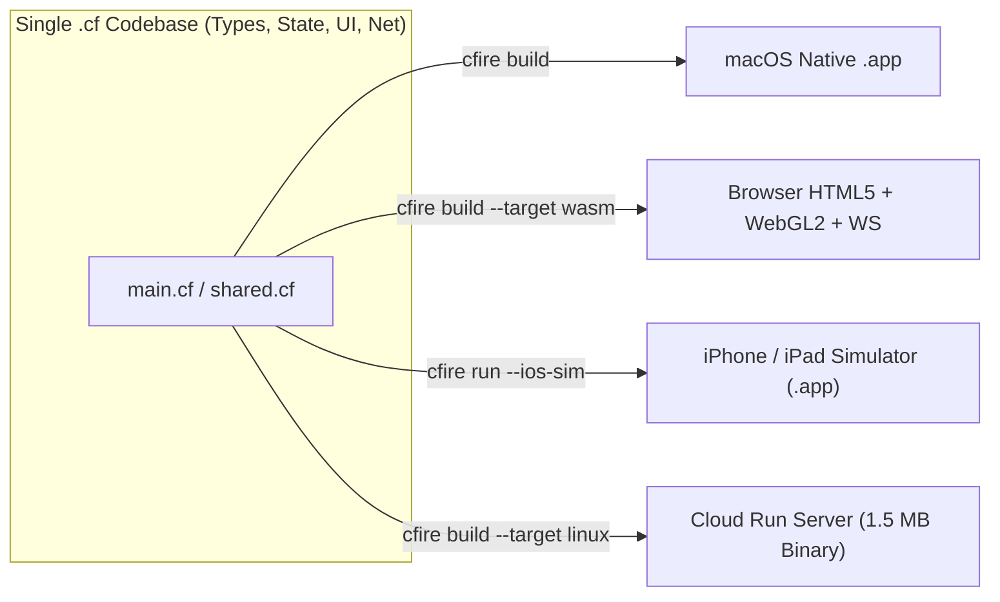
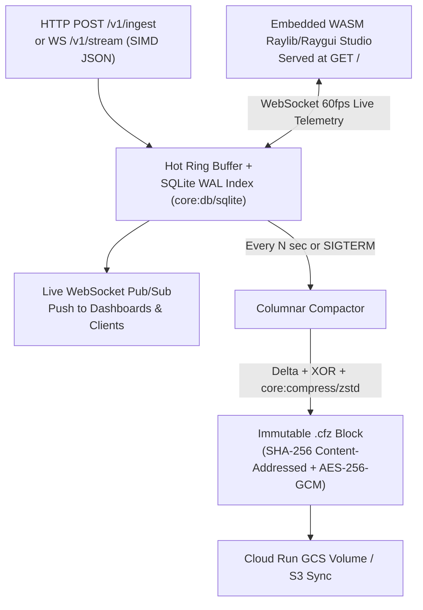
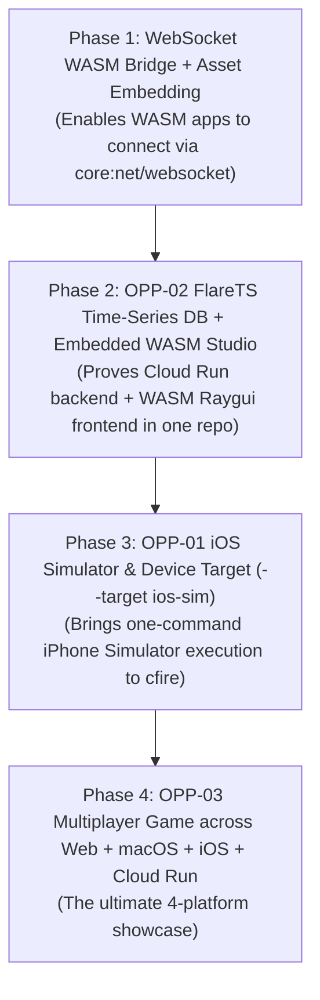

# Strategic Opportunity Tracker: Flagship Targets, Showcase Applications & Ecosystem Ideas

> [!IMPORTANT]
> **Purpose**: This document tracks high-leverage strategic opportunities for `cfire`—spanning new compilation targets (iOS), flagship systems applications (`FlareTS` Cloud Run time-series engine), multiplayer web/desktop/mobile games, and next-generation creative/AI showcases.
>
> **Core Thesis**: `cfire`'s unfair advantage is **One Codebase, Every Runtime**—combining Go/TypeScript ergonomics with deterministic ISO C++23 performance, native hardware/GPU libraries (`vendor:raylib`, `vendor:raygui`), batteries-included systems primitives (`core:compress/zstd`, `core:json`, `core:db/sqlite`, `core:net/websocket`, `core:crypto/aes`), and zero-config target packaging (`native`, `.app`, `wasm`, and upcoming `ios`).

---

## 1. Executive Summary & Opportunity Tracker Matrix

| ID | Initiative | Category | Status | Priority | Effort | Primary Value Proposition |
| :--- | :--- | :--- | :--- | :--- | :--- | :--- |
| **`OPP-01`** | **Native iOS & Simulator Target (`--target ios-sim` / `ios`)** | Compiler / Build System | **Completed (`active.md`)** | **P0 (Core Focus)** | 2–3 Days | Compile & launch a `.cf` graphical/touch app directly into the iPhone Simulator (`cfire run --ios`) or `.app` bundle with zero Xcode project ceremony. |
| **`OPP-02`** | **FlareTS: Scale-to-Zero Time-Series Engine & Edge Cache** | Flagship Systems App | Evaluating | **P0 (Core Focus)** | 3–5 Days | A 1.5 MB Cloud Run time-series DB & real-time pub/sub cache using Zstd columnar compression, SQLite WAL, and an embedded WASM/Raygui telemetry studio built from the *same* `.cf` repo. |
| **`OPP-03`** | **Cross-Platform Multiplayer Web + Desktop + iOS Game** | Flagship Game / Web | Evaluating | **P0 (Core Focus)** | 3–4 Days | 100% shared tick, physics, and packet serialization `.cf` code running simultaneously on a Linux WebSocket server, macOS `.app`, HTML5/WASM browser canvas, and iOS Simulator. |
| **`OPP-04`** | **Pocket Studio: Real-Time Audio Synth & Drum Machine** | Creative / DSP App | Evaluating | **P0 (Core Focus)** | 2–3 Days | Zero-GC real-time C++23 DSP audio synthesis + 60fps Raylib oscilloscope/sequencer running identically in the browser (`wasm`), macOS `.app`, and iPad/iPhone (`ios`). |
| **`OPP-05`** | **Local-First Spatial Canvas & CRDT Whiteboard** | Productivity / GPU App | Idea | **P1 (High Synergy)** | 3–4 Days | Infinite 120fps GPU canvas (`vendor:raylib`), offline SQLite WAL persistence, and live multiplayer cursor/stroke sync over `core:net/websocket`. |
| **`OPP-06`** | **Zero-Overhead MCP Server & Local AI Vector Engine** | AI / Agent Systems | Idea | **P2 (Exploration)** | 2–3 Days | Compile-time `json:"..."` schema reflection into a single-binary Model Context Protocol (MCP) server with SIMD cosine similarity + SQLite + Zstd caching. |
| **`OPP-07`** | **Embedded Hardware / Handheld Gaming (`--target rpi` / `rg35xx`)** | Embedded / Gaming | Idea | **P2 (Exploration)** | 2 Days | Cross-compile Raylib `.cf` games to ARM64 Linux retro handhelds (Anbernic, Miyoo, Raspberry Pi, Steam Deck) with one CLI flag. |



---

## 2. Deep Dive on Core Focus Areas (`P0`)

### `OPP-01`: Native iOS & Simulator Target (`--target ios-sim` / `--target ios`)

#### 2.1 Why This Matters (The Value Proposition)
Building an iOS app today requires gigabytes of Xcode project files (`.xcodeproj`), Swift/Objective-C boilerplate, CocoaPods/SPM, and manual provisioning just to draw a single interactive rectangle on an iPhone screen.
If a developer can write a 40-line `.cf` file and run:
```bash
cfire run --ios-sim main.cf
```
and watch `cfire` compile the code, generate the iOS `.app` bundle, boot the iPhone Simulator, install the bundle, and launch a 60fps touch-enabled graphical application in under 3 seconds, **`cfire` immediately enters an elite tier of developer experience**.

#### 2.2 Locked Architectural Decisions & Technical Approach
1. **Toolchain Discovery (`xcrun`)**:
   - Locate iOS SDK paths dynamically via `xcrun --sdk iphonesimulator --show-sdk-path` (`--target ios-sim`) and `xcrun --sdk iphoneos --show-sdk-path` (`--target ios`).
   - Invoke Apple `clang++` with `-std=c++2b` and target triples:
     - Apple Silicon Simulator: `-target arm64-apple-ios17.0-simulator -isysroot <SimSDK>`
     - Physical iOS Device: `-target arm64-apple-ios17.0 -isysroot <DeviceSDK>`
2. **Self-Contained Objective-C++ `UIKit` + `OpenGLES3` + `CoreAudio` Backend (`runtime/vendor/raylib_ios.hpp`)**:
   - Zero external SDL2 or Xcode project dependency: when compiling a `.cf` program for iOS (`__APPLE__ && TARGET_OS_IPHONE`), `cfire` compiles with `-x objective-c++ -fobjc-arc` and includes `runtime/vendor/raylib_ios.hpp`.
   - Implements the complete Raylib 2D/text/shapes/textures/input/audio API directly on top of iOS `UIKit` (`UIApplicationMain`, `UIWindow`, `UIView<UIKeyInput>`), `OpenGLES` (`EAGLContext`, `CAEAGLLayer`), `QuartzCore`, and `AudioToolbox` (`AudioQueue` / `CoreAudio`).
   - Preserves `cfire`'s standard blocking `for !rl.WindowShouldClose() { rl.BeginDrawing() ... rl.EndDrawing() }` loop by driving `UIApplicationMain` on launch and pumping `CFRunLoopRunInMode(kCFRunLoopDefaultMode, ...)` inside `EndDrawing()` / `WindowShouldClose()`.
3. **Smart Adaptive Viewport & Safe-Area Letterboxing**:
   - `rl.InitWindow(0, 0, title)` uses the iPhone/iPad's native logical screen points (`GetScreenWidth()` / `GetScreenHeight()`).
   - Fixed canvas sizes like `rl.InitWindow(720, 480, title)` automatically configure the `Info.plist` orientation preference (Landscape when `w > h`, Portrait when `h >= w`), scale and center the virtual canvas inside the iOS Safe Area (`safeAreaInsets`, avoiding the Dynamic Island and Home Indicator), and transparently remap single/multi-touch coordinates into the `w x h` virtual coordinate space.
4. **Automatic Software Keyboard Integration (`UIView<UIKeyInput>`)**:
   - Our iOS view conforms to `<UIKeyInput>` and automatically calls `[view becomeFirstResponder]` when a `vendor:raygui` `GuiTextBox` enters `editMode == true` (and `resignFirstResponder` when `editMode` exits), feeding typed characters and Backspace directly into `GetCharPressed()` and `IsKeyPressed(KEY_BACKSPACE)`.
5. **Transparent iOS Sandbox File/Database Mapping & Stdlib Linking**:
   - Relative writable paths in `core:fs` (`fs.write_text`, `fs.write_all`, `fs.open(..., Write)`) and `core:db/sqlite` (`sqlite.open("app.db")`) automatically resolve to the iOS app's writable `~/Documents/` directory, while relative reads check the read-only `.app` bundle first before falling back to `~/Documents/`.
   - Links the iOS SDK's built-in `-lsqlite3` and uses `core:json`'s header-only C++23 JSON parser/serializer on iOS without requiring macOS Homebrew libraries.
6. **Automated Flat iOS `.app` Bundle & `cfire run --ios` Lifecycle**:
   - Generates a flat iOS bundle (`<App>.app/<App>` + `<App>.app/Info.plist` with `UIDeviceFamily = [1, 2]` and `UILaunchScreen = {}`), ad-hoc signs via `codesign --force --sign -`, boots the Simulator if needed, installs via `xcrun simctl install booted`, and launches via `xcrun simctl launch --console-pty booted <bundle_id>` so `println(...)` streams live to the terminal.

---

### `OPP-02`: `FlareTS` — Scale-to-Zero Cloud Run Time-Series Database & Real-Time Cache

#### 2.3 Why This Matters (The Value Proposition)
Traditional time-series databases (InfluxDB, Prometheus, TimescaleDB) and caches (Redis) assume **always-on VMs** with persistent local disks and hundreds of megabytes of baseline RAM. On serverless platforms like **Google Cloud Run** or **Fly Machines**, instances scale to zero when idle and spin up in milliseconds when traffic arrives.

`FlareTS` proves that `cfire` can build a production-grade, cloud-native data engine where **a single binary acts as both the high-throughput database server AND serves its own WebAssembly GPU observability studio**.

#### 2.4 Concrete Architecture & Differentiators


1. **Dual-Engine Core (Time-Series + Ephemeral KV Cache)**:
   - **KV / Pub-Sub Cache Layer**: In-memory sharded hash map with microsecond TTL expiration, atomic counters, and WebSocket topic subscriptions (`WS /v1/watch/:prefix`). When a key mutates, subscribed web/game clients receive an instant push frame.
   - **Time-Series Layer**: Append-only in-memory partition for the active time window, backed by `core:db/sqlite` in `WAL` mode for crash recovery and tag/label metadata indexing.
2. **Columnar Zstd Compression + Content-Addressed Blocks (`.cfz`)**:
   - Instead of storing bloated JSON rows, `FlareTS` transposes batches of $(timestamp, series\_id, value)$ into contiguous arrays:
     - Timestamps $\rightarrow$ Delta-of-delta encoding
     - Float64 values $\rightarrow$ Gorilla XOR bit-packing
     - Packed columns $\rightarrow$ Compressed via `core:compress/zstd` (`zstd.compress`, achieving 10x–15x compression ratios)
     - Optional encryption at rest via `core:crypto/aes` (`aes.encrypt_gcm`) and integrity hashing via `core:crypto/sha256`.
3. **Cloud Run `SIGTERM` Scale-to-Zero Hook**:
   - When Cloud Run scales an instance to zero, it sends `SIGTERM` and grants a 10-second grace period. `FlareTS` catches `SIGTERM`, flushes the active in-memory ring buffer into a `.cfz` Zstd block on the mounted Cloud Storage volume in <50ms, and exits cleanly with zero data loss.
   - On cold start, the binary boots in **<5ms**, memory-maps the SQLite index, and immediately serves queries.
4. **The Killer Showcase — Embedded WASM Raygui Telemetry Studio**:
   - The `FlareTS` dashboard UI (`studio.cf`) is written in `cfire` using `vendor:raylib` and `vendor:raygui`.
   - Compiled via `cfire build --target wasm studio.cf`, the resulting `.wasm`/`.js` assets are embedded into the `FlareTS` server binary.
   - Visiting `https://flarets-xyz.a.run.app/` in a browser loads the 60fps WASM telemetry studio, which connects back to the server via `core:net/websocket` (`wss://`) to render live flamegraphs, ingestion sparklines, and interactive query builders—**100% written in `cfire`, zero JavaScript frameworks**.

---

### `OPP-03`: Cross-Platform Multiplayer Web + Desktop + iOS Game

#### 2.5 Why This Matters (The Value Proposition)
In traditional game development, building a real-time multiplayer game that runs in the browser, on desktop, and on mobile requires stitching together multiple languages or heavyweight engines (e.g., Unity/Godot exporting 30MB WASM blobs, or writing a Go/Node server and duplicating physics/networking logic in TypeScript).

With `cfire`, **100% of the game—server, desktop client, browser WASM client, and iOS client—shares a single `shared/protocol.cf` and `shared/sim.cf` package**.

#### 2.6 Concrete Game Design & Architecture Ideas
To make the game immediately fun, visually impressive, and a true stress-test of `cfire`:

1. **Game Concept Idea: *"Neon Drift: Arena"* (or *"GridWars IO"*)**:
   - A fast-paced 60fps top-down neon geometric multiplayer arena (think *Geometry Wars* / *Agar.io* / *Tron* light-cycles with particle physics and shader bloom).
   - Why geometric/neon? It requires **zero external 3D art pipeline**—everything is rendered procedurally with `raylib` primitives, additive blending, camera screen-shake, and trail particles, keeping the WASM payload under **400 KB** (loads in <200ms in any browser).
2. **Deterministic Shared Simulation (`shared/sim.cf`)**:
   - Both the `cfire` authoritative server and the `cfire` client import `shared/sim.cf`.
   - The client runs **Client-Side Prediction** using the exact same `step_world(mut state, input, dt)` function that the server runs at 60Hz, eliminating lag even over cellular/Wi-Fi connections.
3. **Zero-Boilerplate Wire Protocol (`shared/protocol.cf`)**:
   - Uses `cfire` structs with `json:"..."` (or compact binary byte-slice packing + `zstd` delta compression for large state snapshots) over `core:net/websocket` (`router.ws("/play/:room", ...)`).
   - **Cross-Platform WebSocket Client Bridge**:
     - On Native Desktop & iOS: Uses `core:net/websocket` (`websocket.connect("wss://...")`).
     - On WebAssembly (`--target wasm`): `core:net/websocket` automatically maps `websocket.connect` to the browser's native `emscripten_websocket_*` C API (`<emscripten/websocket.h>`) so the **exact same `.cf` networking code works in the browser without `#ifdef` in user code!**
4. **Instant Playability Everywhere**:
   - Share a URL $\rightarrow$ Players join instantly in desktop/mobile browsers via WASM.
   - Run `cfire run client.cf` $\rightarrow$ Native macOS `.app` joins the exact same room.
   - Run `cfire run --ios-sim client.cf` $\rightarrow$ iPhone Simulator with dual virtual thumbsticks joins the exact same room.

---

### `OPP-04`: Pocket Studio — Real-Time Audio Synthesizer & Groovebox (Web + macOS + iOS)

#### 2.7 Why This Matters (The Value Proposition)
Real-time audio synthesis and DSP (Digital Signal Processing) require computing 48,000 stereo float samples per second (`AudioStream` callback every ~5ms) with **strictly zero garbage-collection pauses**. Languages with garbage collectors (Go, JavaScript, C#, Java, Python) suffer from audible pops/glitches under GC pressure, forcing audio developers to write raw C++.

Because `cfire` lowers directly to deterministic, zero-GC ISO C++23 and already ships `vendor:raylib` (which bundles `raudio`—a cross-platform hardware audio stream engine backed by `CoreAudio` on macOS/iOS and `WebAudio` in WASM) alongside `vendor:raygui`, `cfire` can compile a **single `.cf` file into a desktop synth `.app`, a browser WebAssembly groovebox, and a multi-touch iPhone/iPad instrument**.

#### 2.8 Concrete Architecture & Feature Scope
1. **Lock-Free C++23 DSP Engine (`dsp.cf`)**:
   - Polyphonic 4-voice oscillator bank (Sine, Saw, Square, Triangle, and 2-operator FM synthesis) + resonant state-variable low-pass filter (SVF) + ADSR envelope generator + stereo delay/reverb.
   - Feeds raw 32-bit float PCM buffers into Raylib's `InitAudioDevice()` / `LoadAudioStream(48000, 32, 2)` / `UpdateAudioStream()`.
2. **16-Step Sequencer & Interactive Control Surface (`ui.cf`)**:
   - Built with `vendor:raygui` sliders/knobs (cutoff, resonance, attack, release, FM depth, BPM) and a 16x8 touch-friendly step grid.
   - Real-time 60fps oscilloscope and FFT frequency spectrum visualizer rendered directly above the step grid using `rl.DrawLineStrip` and additive neon glow.
3. **Preset Persistence & Sharing**:
   - Patches and patterns serialize to compact JSON (`core:json`) or Zstd-compressed base64 URLs (`core:compress/zstd` + `core:encoding/base64`) so users can share a synth patch or beat via a URL parameter in the WASM version or load it on iOS!

---

## 3. Additional High-Synergy Ideas Worth Exploring (`P1` / `P2`)

Based on your focus on **iOS (`OPP-01`), high-performance data engines (`OPP-02` FlareTS), multiplayer web/mobile games (`OPP-03`), and real-time audio/creative apps (`OPP-04`)**, here are three additional areas that build on the same foundation:

### `OPP-05`: Local-First Collaborative Infinite Canvas & Architecture Whiteboard
- **Why `cfire` is uniquely suited**:
  - Browser DOM apps (like Miro or web-based whiteboards) choke when rendering 10,000+ nodes, arrows, and freehand ink strokes. Tools like Figma solved this by writing a C++ engine compiled to WebAssembly + WebGL.
- **What you can build**:
  - An ultra-fast 120fps infinite zoom/pan canvas written in `cfire` (`vendor:raylib` 2D camera + spatial R-tree index).
  - Local-first persistence in `core:db/sqlite` (instant save/load of `.cfboard` files compressed with `core:compress/zstd`).
  - Live multiplayer collaboration (shared cursors and conflict-free stroke syncing) powered by the `FlareTS` / `cfire` WebSocket server!

### `OPP-06`: Single-Binary Local AI Vector Engine & MCP Server (`FlareVec`)
- **Why `cfire` is uniquely suited**:
  - Developers building AI agents are tired of spinning up Docker containers or Python `chromadb` environments just to index local codebases, notes, or game NPC memories.
- **What you can build**:
  - An extension module or companion mode to `FlareTS` that stores float32 embedding vectors in SQLite + memory-mapped arrays, uses C++23 SIMD (`core:math`) to compute 100,000 cosine similarities in <2ms, and exposes both an HTTP/WebSocket API and an **MCP (Model Context Protocol) stdio server** generated automatically from `cfire` struct tags.

### `OPP-07`: Retro Handheld & Linux Gaming Target (`--target arm64-linux` / Steam Deck)
- **Why `cfire` is uniquely suited**:
  - Once you build the multiplayer web/desktop/iOS game (`OPP-03`), adding cross-compilation for ARM64 Linux handhelds (Anbernic RG35XX, TrimUI, Raspberry Pi) and SteamOS is trivial via `buildsys.hpp` sysroot targeting.

---

## 4. Shared Compiler & Runtime Enablers (The Multiplier Effect)

Notice how the top three priorities (`OPP-01` iOS, `OPP-02` FlareTS, `OPP-03` Multiplayer Game) reinforce each other through **three small compiler/stdlib upgrades**:

| Shared Enabler | Unlocks in `OPP-01` (iOS) | Unlocks in `OPP-02` (FlareTS) | Unlocks in `OPP-03` (Web/iOS Game) |
| :--- | :--- | :--- | :--- |
| **1. `core:net/websocket` WASM Browser Bridge (`<emscripten/websocket.h>`)** | Native WS already works on iOS | Allows the WASM Raygui telemetry studio to stream live metrics from FlareTS | Allows the WASM browser game client to talk to the authoritative `.cf` game server |
| **2. Embedded Asset Packing (`build.Embed` or `--preload-file`)** | Bundles fonts/icons/audio into the iOS `.app` | Embeds the compiled WASM studio directly inside the single `flarets` server binary | Bundles sprites, shaders, and audio into both the `.wasm` payload and `.app` bundle |
| **3. `--target ios-sim` / `--target ios` in `src/buildsys.hpp`** | Core deliverable (`cfire run --ios-sim`) | Allows monitoring your Cloud Run DB from a native iPhone app | Lets the multiplayer game run natively on iPhone/iPad with touch controls |

---

## 5. Recommended Execution Roadmap



### Next Steps to Kick Off Any Track
When ready to begin implementation on any of the above tracks:
1. Promote the selected `OPP-*` item (or Phase 1 enabler) into [`active.md`](./active.md).
2. Complete the Pre-Implementation Quality Gate (scope, edge cases, verification matrix).
3. Build, test (`make review-check`), and ship!
