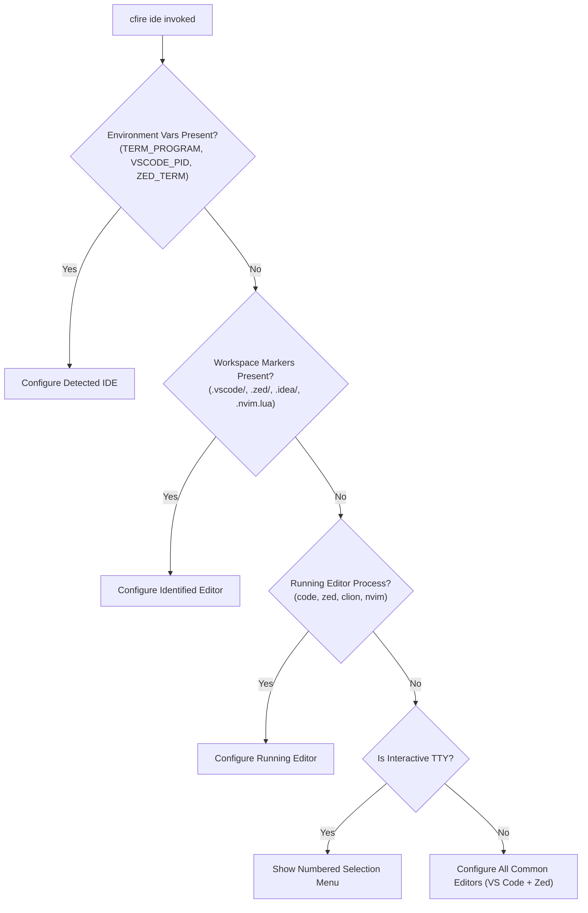

# Post-Backlog Strategic Explorations: Build System, Agent Tooling, and Multi-IDE

> [!NOTE]
> **Status**: Strategic Explorations (Post-Backlog).  
> **Target Timeline**: To be scheduled after completion of the core backlog items (`LSP-*`, `LD-*`, `BS-*`, `LIB-*`) in [`backlog.md`](./backlog.md).  
> **Safety Notice**: This file is completely decoupled from [`active.md`](./active.md) to ensure ongoing autonomous agents are not interrupted.

---

## 1. Build System: Remote GitHub Fetching, Dependency Policies & Vendoring

### 1.1 Problem Statement & Current Limitations
1. **Remote URLs are Metadata-Only**:
   - `build.cf` currently permits declarations like:
     ```cf
     var ZstdCMake = build.CMake("github.com/facebook/zstd@v1.5.7", { ... })
     ```
   - In `cfire/src/buildsys.hpp`, if the path does not exist on disk, the build system logs it as declarative metadata and skips building:
     ```cpp
     if (!std::filesystem::exists(src_dir) || !std::filesystem::is_directory(src_dir)) {
         return {}; // Remote reference without local checkout (metadata-only mode)
     }
     ```
   - There is no automated shallow clone, tarball extraction, or package caching mechanism.

2. **System-Only Fallback for `vendor:` Packages (The Example 06 Raylib Problem)**:
   - `examples/06-raylib-viz/main.cf` imports `"vendor:raylib"`.
   - In `cfire/src/buildsys.hpp`, `vendor:raylib` directly invokes `pkg-config raylib`.
   - If `raylib` is not pre-installed on the host system via `brew` or `apt`, compilation immediately fails with linker errors (`-lraylib not found`).
   - Projects cloned directly from GitHub cannot build hermetically out-of-the-box unless the user manually identifies, installs, and links missing external libraries.

---

### 1.2 Proposed Architecture: Explicit Dependency Policies

We propose introducing explicit dependency resolution modes both in `build.cf` and via the CLI.

#### A. Resolution Policies
| Policy | Behavior |
| :--- | :--- |
| **`system`** | Use host package manager / `pkg-config` exclusively. Fail if missing. |
| **`vendor`** | Look strictly in `./vendor/<pkg>` within the project root. Build via local driver. |
| **`fetch`** | Download hermetically to `~/.cfire/cache/pkg/<pkg>@<ver>` or `.cfire/deps/`. |
| **`if-missing`** *(Recommended Default)* | Check local `vendor/` first, then `pkg-config`; if missing on system, automatically fetch and build. |
| **`force-fetch`** | Bypass system libraries entirely; fetch release source archive and build hermetically. |

#### B. Declarative Configuration in `build.cf`
```cf
package build

import "core:build"

// Remote dependency with build driver and resolution policy
var Raylib = build.Fetch("github.com/raysan5/raylib@5.5", {
    Policy: "if-missing", // "system" | "vendor" | "fetch" | "if-missing"
    Driver: "CMake",
    Options: ["BUILD_EXAMPLES=OFF"],
})

var App = build.Executable("raylib-viz", {
    Entry: "main.cf",
    Deps: [Raylib],
})
```

#### C. Dedicated CLI Commands
1. **`cfire run --fetch-missing` / `cfire build --force-fetch`**:
   - Allows users to control whether the compiler touches the network or falls back to host libraries.
2. **`cfire vendor [package]`**:
   - Downloads the target dependency (or all dependencies declared in `build.cf`) and extracts them directly into `./vendor/<pkg>`.
   - Converts the project into a 100% self-contained, air-gapped, vendored repository suitable for offline builds and reproducible CI.

#### D. Fixing `examples/06-raylib-viz`
1. Add a dedicated `build.cf` to `examples/06-raylib-viz/` specifying `Policy: "if-missing"` or a local vendored driver.
2. In `cfire/src/buildsys.hpp`, when `vendor:raylib` is imported:
   - Check `./vendor/raylib` first.
   - If absent, check `pkg-config raylib`.
   - If absent, trigger automated fetch (using GitHub tarball release `archive/refs/tags/5.5.tar.gz` to avoid downloading full git history) into `.cfire/cache/sources/raylib/`, and invoke CMake in background to build `libraylib.a`.

---

## 2. LLM & Agent Friendliness: Tooling Beyond LSP and FMT

While humans benefit from interactive IDE features (LSP hovers, completions, syntax highlighting), AI agents (Claude, Gemini, Antigravity, Cursor, Devin) interact with codebases through file edits, bash commands, and error loops. To make `cfire` an industry-leading language for autonomous agent pair-programming, we should invest in the following high-leverage tooling:

### 2.1 Machine-Readable Diagnostics (`cfire check --format=json`)
- **Current State**: `cfire check` or `cfire build` emits human-styled terminal errors with ANSI colors and multi-line formatting. Agents must parse stderr with fragile regexes.
- **Proposed Solution**:
  ```bash
  cfire check --json src/main.cf
  ```
  **Output**:
  ```json
  {
    "success": false,
    "diagnostics": [
      {
        "file": "src/main.cf",
        "range": {
          "start": { "line": 24, "character": 9 },
          "end": { "line": 24, "character": 15 }
        },
        "severity": "error",
        "code": "E0341",
        "message": "Type mismatch: expected 'str', found 'i64'",
        "fixit": {
          "replacement": "to_string(count)",
          "description": "Convert i64 to str"
        }
      }
    ]
  }
  ```
- **Agent Benefit**: Fast semantic checking (<30ms, no Clang invocation required) with structured ranges and compiler-generated fix suggestions that agents can apply directly.

---

### 2.2 Token-Optimized Symbol Outline (`cfire outline --json`)
- **Current State**: When an agent needs to discover types or functions across multiple files, it must view entire files, burning thousands of context tokens.
- **Proposed Solution**:
  ```bash
  cfire outline --json src/
  ```
  **Output**:
  ```json
  {
    "files": {
      "src/server.cf": {
        "package": "server",
        "imports": ["core:net", "core:sync"],
        "types": [
          { "name": "Config", "kind": "struct", "fields": ["port: u16", "host: str"] }
        ],
        "functions": [
          { "name": "start", "params": ["cfg: Config"], "returns": "void!" }
        ]
      }
    }
  }
  ```
- **Agent Benefit**: Compresses codebase structure by 90-95%, allowing an agent to grasp whole-project architecture in a single prompt step.

---

### 2.3 Single-Prompt Context Cheat-Sheet (`cfire doc --llm`)
- **Current State**: LLMs do not have `cfire` syntax in their pre-training data; models frequently guess and hallucinate Go or Rust syntax (e.g., using `func` instead of `fn`, `struct Name` instead of `type Name struct`, or forgetting `cplusplus` blocks).
- **Proposed Solution**:
  ```bash
  cfire doc --llm
  ```
  Generates a tightly compressed (~350 tokens) grammar, type system, error handling (`!`, `try`), and stdlib reference sheet ready to be added to `.cursorrules`, `AGENTS.md`, or system instructions.

---

### 2.4 CLI-Exposed Refactoring & Safe Renaming (`cfire refactor rename`)
- **Current State**: When refactoring a type or function across 10 files, LLMs often miss occurrences or break call sites.
- **Proposed Solution**: Expose the LSP's rename and reference index directly via CLI:
  ```bash
  cfire refactor rename --file src/types.cf --line 12 --col 6 --to NewConfigName --dry-run
  cfire refactor rename --file src/types.cf --line 12 --col 6 --to NewConfigName --apply
  ```
- **Agent Benefit**: Guarantees atomic, semantic, multi-file refactoring with zero hallucinations or orphaned references.

---

### 2.5 One-Shot REPL & Scratchpad Execution (`cfire eval`)
- **Current State**: To test syntax or stdlib behavior, an agent must create a scratch `.cf` file, compile, run, and delete it.
- **Proposed Solution**:
  ```bash
  cfire eval 'println("result: {}", 1 + 2)'
  ```
  - Lower into an in-memory prelude, compile via memory buffer, and run instantly.
- **Agent Benefit**: Instant evaluation for verifying language semantics in tool loops.

---

## 3. Universal IDE Detection & Automated Configuration

### 3.1 Background & Prior Art
We previously added `cfire ide zed`, which creates `.zed/settings.json` configuring the `cfire-lsp` binary, file associations, inlay hints, and format-on-save. This needs to be expanded into an intelligent multi-IDE engine covering VS Code, Cursor, Windsurf, JetBrains (CLion / Fleet), and Neovim.

---

### 3.2 Automated Detection Strategy
Instead of requiring the user to know CLI arguments, `cfire ide` should automatically deduce the environment using a multi-tiered heuristic:



#### Detection Matrix
1. **Environment Variables**:
   - `TERM_PROGRAM=vscode` or `VSCODE_PID` $\rightarrow$ VS Code / Cursor / Windsurf
   - `TERM_PROGRAM=zed` or `ZED_TERM` $\rightarrow$ Zed
   - `VIMRUNTIME` or `NVIM` $\rightarrow$ Neovim
2. **Workspace Directory Markers**:
   - `.vscode/` $\rightarrow$ VS Code
   - `.zed/` $\rightarrow$ Zed
   - `.idea/` $\rightarrow$ JetBrains (CLion / Fleet)
   - `.nvim/` or `init.lua` $\rightarrow$ Neovim
3. **Running Process Scan**:
   - Inspect processes via `ps` or platform equivalents for active instances of `code`, `zed`, `clion`, `webstorm`, or `nvim`.
4. **Interactive CLI Prompt (TTY fallback)**:
   - If indeterminate, present a clean prompt:
     ```text
     Select your editor:
       1) VS Code / Cursor / Windsurf
       2) Zed
       3) JetBrains (CLion / Fleet)
       4) Neovim
       5) All of the above
     [1-5]: 
     ```

---

### 3.3 Editor Configuration Specifications

#### A. VS Code / Cursor / Windsurf
- **Files Created**: `.vscode/settings.json`, `.vscode/extensions.json`
- **Configuration**:
  ```json
  {
    "files.associations": {
      "*.cf": "cfire"
    },
    "[cfire]": {
      "editor.defaultFormatter": "cfire",
      "editor.formatOnSave": true
    },
    "cfire.lsp.path": "cfire",
    "cfire.lsp.arguments": ["lsp"],
    "cfire.inlayHints.enable": true
  }
  ```
- **Recommended Extension**: Suggest generic LSP client or official `cfire` companion extension in `.vscode/extensions.json`.

#### B. JetBrains (CLion / Fleet)
- **Files Created**: `.idea/lsp.xml` or Fleet `.fleet/settings.json`
- **Configuration**:
  - Registers `cfire-lsp` as the language server for file extension `.cf`.
  - Maps code style and external tool formatting to `cfire fmt`.

#### C. Neovim
- **Files Created**: `.nvim.lua` or `.nvim/cfire.lua`
- **Configuration**:
  ```lua
  -- Auto-generated by cfire ide
  vim.filetype.add({ extension = { cf = 'cfire' } })
  vim.lsp.start({
    name = 'cfire-lsp',
    cmd = { 'cfire', 'lsp' },
    root_dir = vim.fs.dirname(vim.fs.find({'build.cf', '.git'}, { upward = true })[1]),
    settings = {},
  })
  vim.api.nvim_create_autocmd('BufWritePre', {
    pattern = '*.cf',
    callback = function() vim.lsp.buf.format({ async = false }) end,
  })
  ```

#### D. Zed
- **Files Created**: `.zed/settings.json` (already implemented and verified).

---

## 4. Execution Readiness & Next Steps

When the current backlog is cleared, these three initiatives can be promoted into formal tasks:
1. `BS-EXT-01`: Remote GitHub fetching, `--fetch-missing`, and vendoring for `examples/06-raylib-viz`.
2. `TOOL-LLM-01`: Deterministic JSON diagnostics (`--json`), code outline, and LLM cheat-sheet generation.
3. `IDE-01`: Multi-IDE auto-detection and configuration engine for VS Code, JetBrains, and Neovim.
